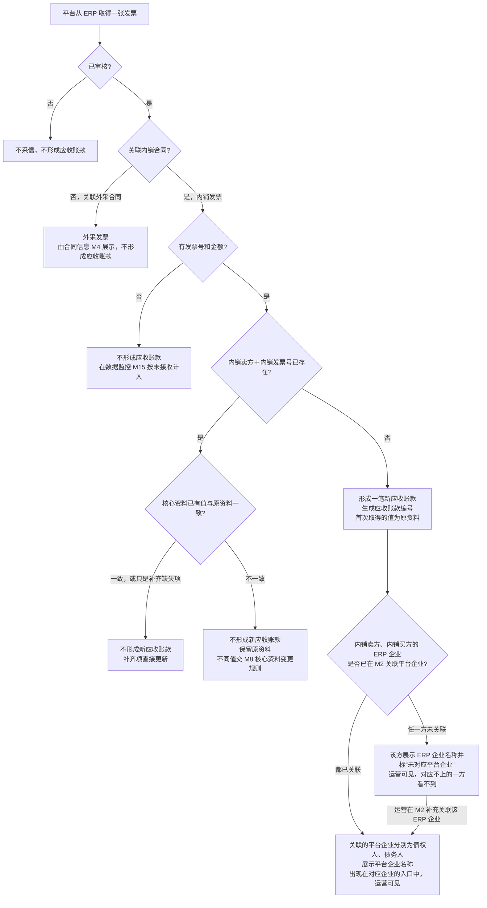
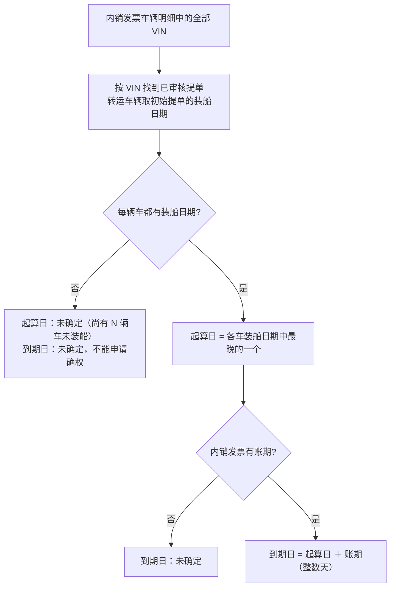
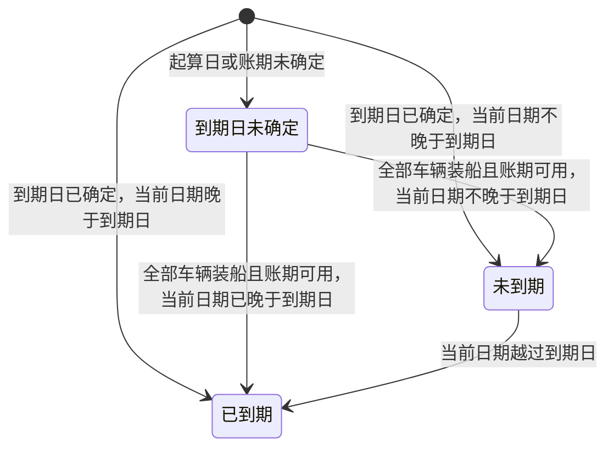
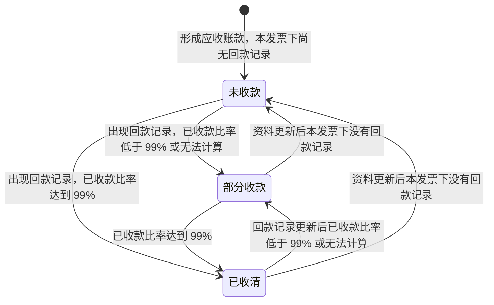
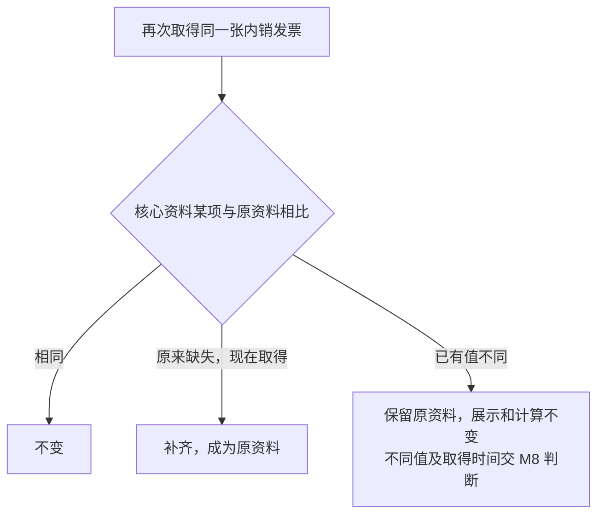
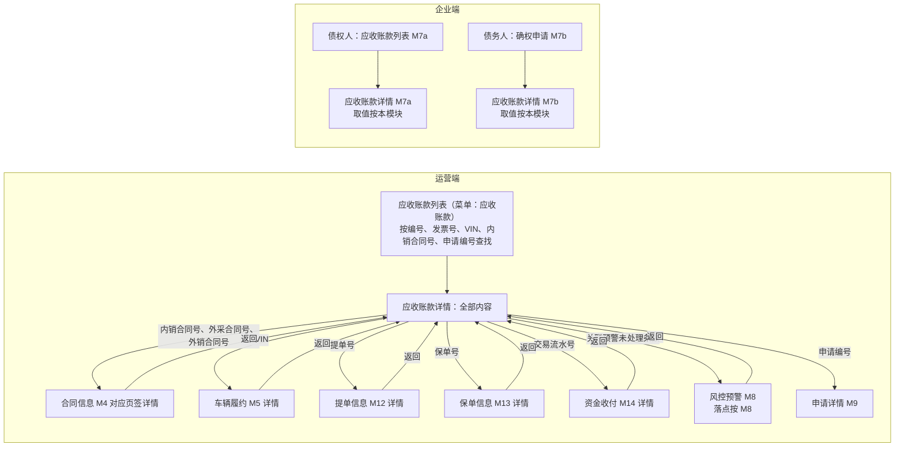

# 应收账款（资产全景） · 流程图与状态机

2026-11-25｜需求评审稿

本册把[功能册](./01-应收账款与发票-PRD.md)中的主要流程与状态画成图，规则以功能册为准。图中方框是业务环节或状态，不代表页面或组件。图号沿用原值，缺号不代表遗漏。

| 图 | 内容 | 对应功能 |
| --- | --- | --- |
| [应收账款形成与差异识别（图 M3-1）](#fig-m3-1) | 取得已审核内销发票后形成应收账款、忽略重复，或保留原资料并把不同值交 M8，以及按 ERP 企业关联结果对应平台企业 | [应收账款的形成与识别（F-M3-01）](./01-应收账款与发票-PRD.md#F-M3-01) |
| [应收账款起算日与到期日的确定（图 M3-7）](#fig-m3-7) | 按初始提单装船日期和账期计算起算日、到期日 | [账期与到期状态（F-M3-04）](./01-应收账款与发票-PRD.md#F-M3-04) |
| [到期状态（图 M3-4）](#fig-m3-4) | 到期日未确定、未到期、已到期之间的转换 | [到期状态](./01-应收账款与发票-PRD.md#due-status) |
| [回款状态（图 M3-5）](#fig-m3-5) | 未收款、部分收款、已收清之间的转换 | [回款状态](./01-应收账款与发票-PRD.md#repayment-status) |
| [核心资料保护（图 M3-3）](#fig-m3-3) | 再次取得的核心资料与原资料相同、补齐或不同时的处理 | [核心资料保护（F-M3-07）](./01-应收账款与发票-PRD.md#F-M3-07) |
| [各角色进入应收账款的路径（图 M3-6）](#fig-m3-6) | 运营从哪里进入详情、能通过单据编号去哪里；企业端进入 M7a、M7b 的应收账款详情 | [单据编号跳转](./01-应收账款与发票-PRD.md#doc-links)、[确权申请结果（F-M3-10）](./01-应收账款与发票-PRD.md#F-M3-10)、[企业端查看（F-M3-09）](./01-应收账款与发票-PRD.md#F-M3-09) |

## 图 M3-1 应收账款形成与差异识别

## 图 M3-7 应收账款起算日与到期日的确定

资料更新后重新走一遍；车辆转运后的其他提单不参与计算；提单装船日期取得后不变更，起算日确定后不再改变。

## 图 M3-4 到期状态

判断按 UTC+1 的当前日期。

- 到期日当天仍为未到期，UTC+1 的到期日 24:00 之后为已到期。
- 起算日确定后不再改变，到期状态按该到期日判断。
- 到期状态由“未到期”变为“已到期”时，处理中的确权申请由 M7a 自动关闭；本模块不直接撤销申请。

## 图 M3-5 回款状态

按本发票下回款的计入金额（分配到本发票的金额；币种不同时按收付日期当日最后时刻适用的汇率换算为应收账款原币，收付日期为今天的先暂计）和已收款比率判定，收清容差为 1%。资料更新后重新判定，汇率变化不改变回款状态。

- 外销收款、M8 关联风控预警和汇率变化都不改变回款状态。

## 图 M3-3 核心资料保护

正常业务中核心资料视为不变。本模块不设核心资料状态；不同值是否构成风险、能否办理，按风控预警（M8）。

## 图 M3-6 各角色进入应收账款的路径

- 企业端的访问与可见内容按 M7a、M7b。
- 编号对应的单据在平台中不存在时不可点击，见功能册[单据编号跳转](./01-应收账款与发票-PRD.md#doc-links)。
