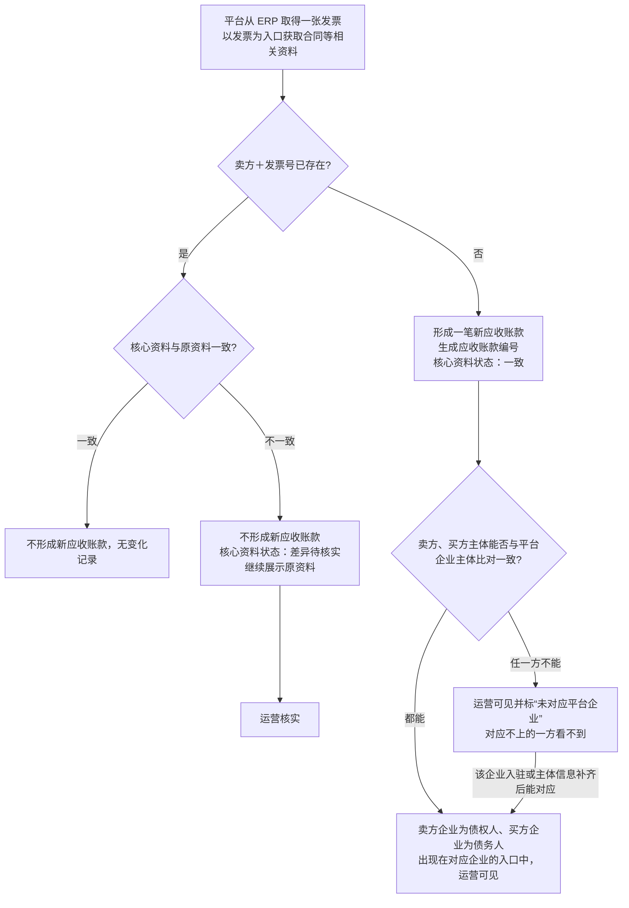
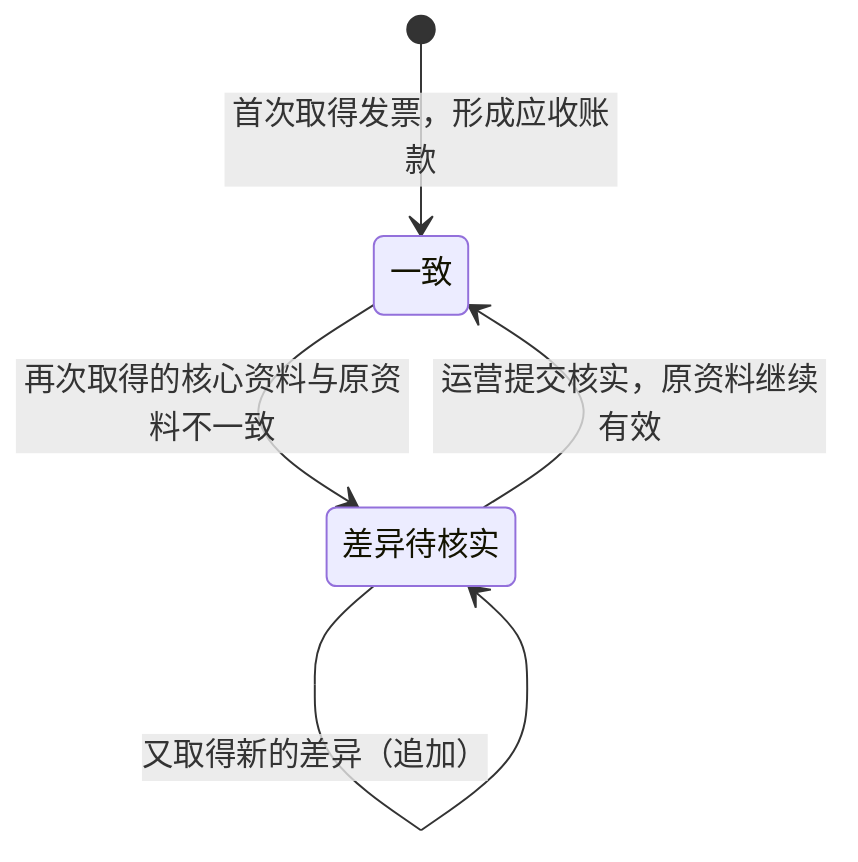
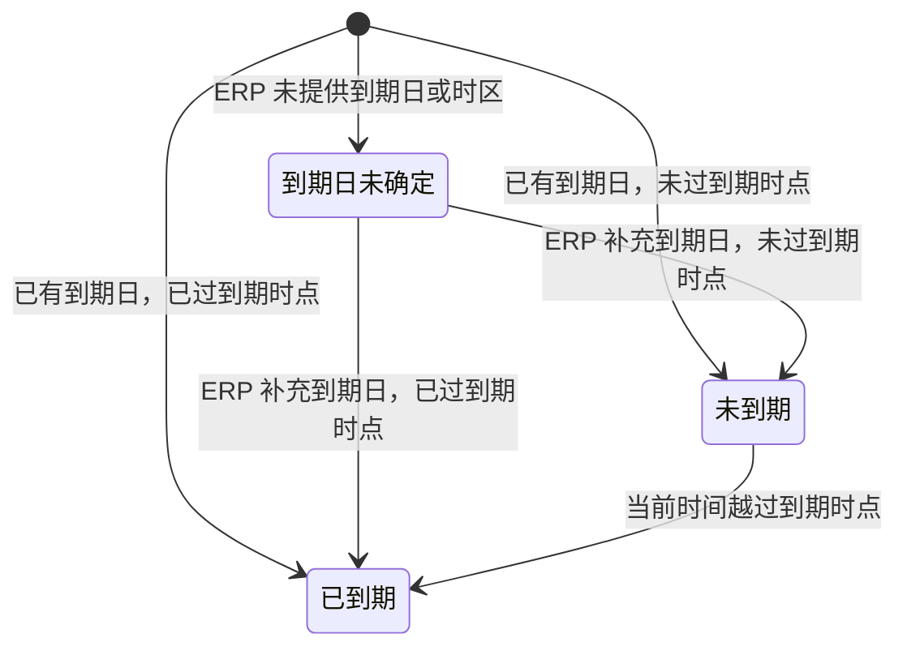
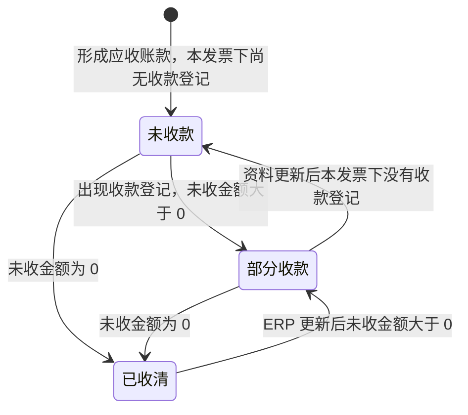
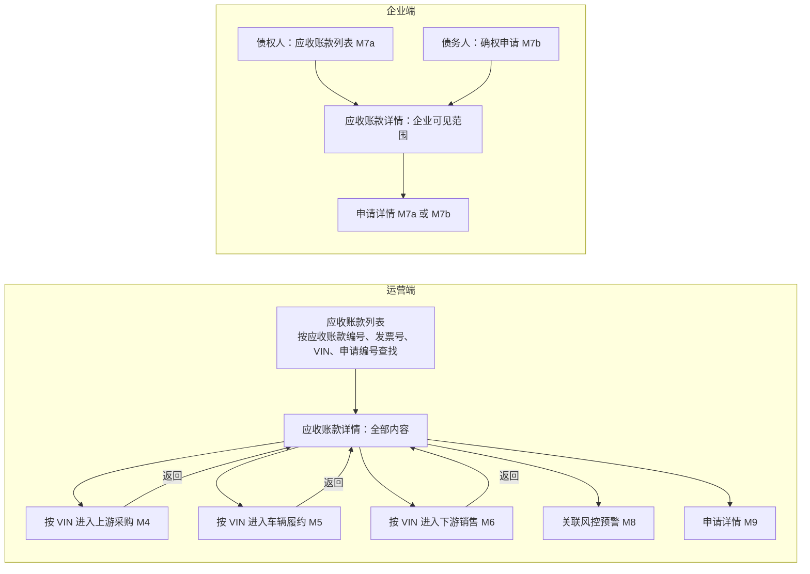

# 应收账款与发票 · 流程图与状态机

2026-11-12｜需求评审稿

本册把[功能册](./01-应收账款与发票-PRD.md)中的主要流程与状态画成图，规则以功能册为准。图中方框是业务环节或状态，不代表页面或组件。图号沿用原值，缺号不代表遗漏。

| 图 | 内容 | 对应功能 |
| --- | --- | --- |
| [应收账款形成与差异识别（图 M3-1）](#fig-m3-1) | 取得发票后形成应收账款、忽略重复或进入差异核实，以及买卖双方对应平台企业 | [应收账款的形成与识别（F-M3-01）](./01-应收账款与发票-PRD.md#F-M3-01) |
| [核心资料状态（图 M3-3）](#fig-m3-3) | 一致与差异待核实之间的转换 | [核心资料差异核实（F-M3-07）](./01-应收账款与发票-PRD.md#F-M3-07) |
| [到期状态（图 M3-4）](#fig-m3-4) | 到期日未确定、未到期、已到期之间的转换 | [账期与到期状态（F-M3-04）](./01-应收账款与发票-PRD.md#F-M3-04) |
| [回款状态（图 M3-5）](#fig-m3-5) | 未收款、部分收款、已收清之间的转换 | [款项与回款（F-M3-05）](./01-应收账款与发票-PRD.md#F-M3-05) |
| [各角色进入应收账款的路径（图 M3-6）](#fig-m3-6) | 运营、债权人、债务人从哪里进入详情，能继续去哪里 | [企业查看应收账款详情（F-M3-09）](./01-应收账款与发票-PRD.md#F-M3-09)、[确权审核进度与关联追溯入口（F-M3-10）](./01-应收账款与发票-PRD.md#F-M3-10) |

## 图 M3-1 应收账款形成与差异识别

## 图 M3-3 核心资料状态

初始状态为“一致”，没有终态。任何状态下都继续以原资料展示。

- 核实提交失败或被他人先行处理时，状态不变。

## 图 M3-4 到期状态

判断时把 ERP 时区下的到期时点换算为 UTC+1 后与当前时间比较，换算结果不展示。

- 到期日当天仍为未到期，到期日 24:00（ERP 时区）之后为已到期。
- 已有到期日的变化按核心资料差异处理，到期状态仍按原到期日判断；原来缺失的到期日补齐后按补齐的资料判断。
- 到期状态变化不自动撤销任何在途申请。

## 图 M3-5 回款状态

按 ERP 提供的未收金额和本发票下的收款登记判定，资料更新后重新判定。

- 债务人付款记录、回款预警都不改变回款状态。

## 图 M3-6 各角色进入应收账款的路径

- 企业不是该应收账款的对应一方、或没有对应角色时，打开详情按功能册[不可访问](./01-应收账款与发票-PRD.md#no-access)处理。
