# 企业登录与首次入驻 · 流程图与状态机

2026-11-13｜需求评审稿

本册把[功能与业务规则](./01-企业登录与首次入驻-PRD.md)中的主要流程与状态画成图，规则以功能册为准。图中方框是业务环节，不代表页面或组件。

| 图 | 内容 | 对应功能 |
| --- | --- | --- |
| [图 1](#fig-1) | 邮箱与密码登录、停用与锁定判断、首次登录强制改密后直接进入平台，以及按入驻进度进入平台内的当前步骤或业务 | [邮箱与密码登录（M1-F01）](./01-企业登录与首次入驻-PRD.md#M1-F01)、[首次登录强制改密（M1-F02）](./01-企业登录与首次入驻-PRD.md#M1-F02)、[连续失败与临时锁定（M1-F04）](./01-企业登录与首次入驻-PRD.md#M1-F04)、[入驻准备与进度（M1-F05）](./01-企业登录与首次入驻-PRD.md#M1-F05) |
| [图 2](#fig-2) | 用登录邮箱验证码自助找回密码，含人机校验和停用、锁定的判断，成功后直接进入平台 | [自助找回密码（M1-F03）](./01-企业登录与首次入驻-PRD.md#M1-F03) |
| [图 3](#fig-3) | 填写钱包地址（同页提示不可更换）后直接连接钱包，连接成功且地址一致即发起签名确认并绑定 | [绑定钱包并验证控制权（M1-F06）](./01-企业登录与首次入驻-PRD.md#M1-F06) |
| [图 4](#fig-4) | 首次提交个人信息、企业信息与组织资料，以及之后的维护 | [完善并提交个人与企业信息（M1-F07）](./01-企业登录与首次入驻-PRD.md#M1-F07)、[账户信息查看与维护（M1-F09）](./01-企业登录与首次入驻-PRD.md#M1-F09) |
| [图 5](#fig-5) | 验证当前密码后修改密码 | [修改密码（M1-F10）](./01-企业登录与首次入驻-PRD.md#M1-F10) |
| [图 6](#fig-6) | 登录有效期、无操作登出、退出、设置新密码与运营操作导致的登录结束 | [登录有效期、无操作登出与退出（M1-F11）](./01-企业登录与首次入驻-PRD.md#M1-F11) |
| [企业用户账号状态机](#state-1) | 账号启停、密码状态、临时锁定三个维度各自的变化 | [账号与入驻状态](./01-企业登录与首次入驻-PRD.md#account-states)、[运营操作对账号的影响](./01-企业登录与首次入驻-PRD.md#operator-actions) |
| [入驻进度状态机](#state-2) | 从待绑定钱包到已完成入驻 | [入驻准备与进度（M1-F05）](./01-企业登录与首次入驻-PRD.md#M1-F05) |
| [登录状态机](#state-3) | 一次登录从建立到结束 | [登录有效期、无操作登出与退出（M1-F11）](./01-企业登录与首次入驻-PRD.md#M1-F11) |

## 登录与入驻去向（图 1）

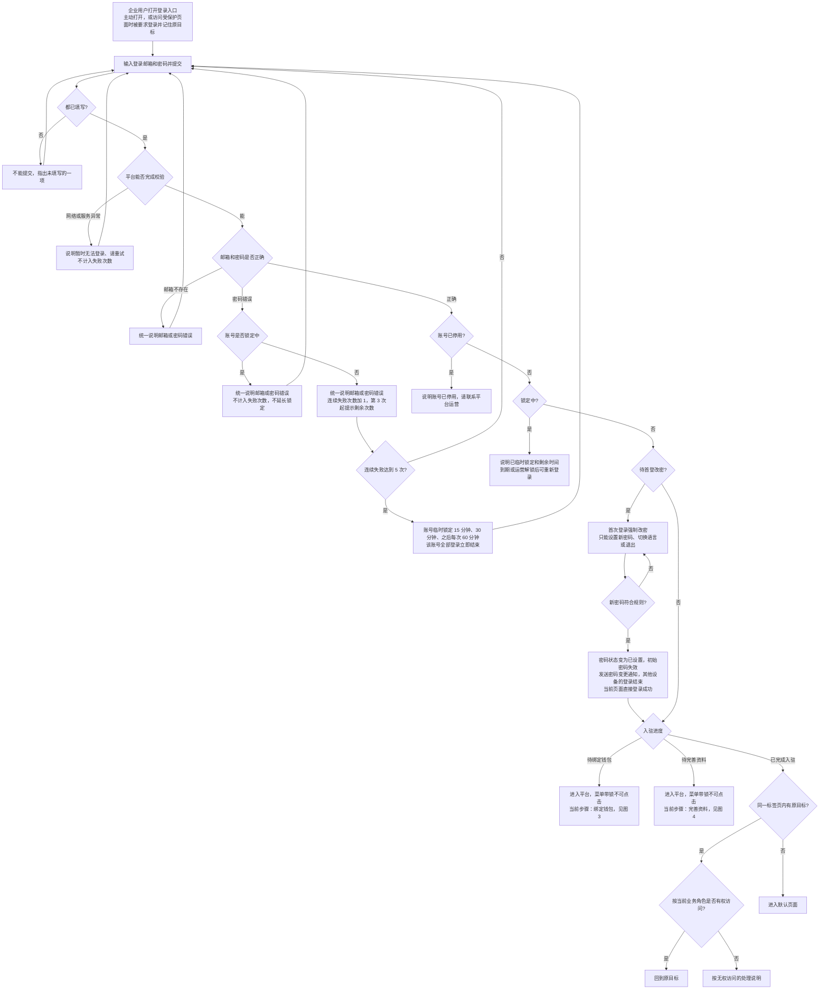

- 入驻未完成时不保留原目标，登录后进入平台内的当前入驻步骤；入驻期间菜单全部可见但锁定。
- 运营重置密码后的账号完成改密即登录，如果早已完成入驻，直接进入业务。

## 自助找回密码（图 2）

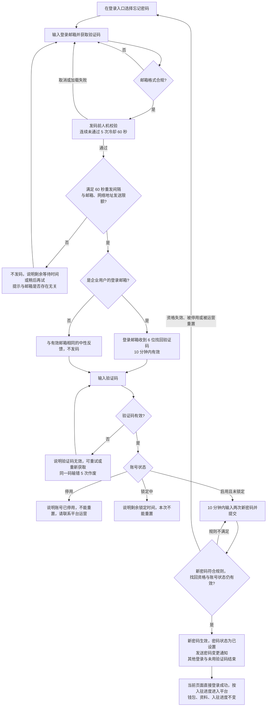

## 绑定钱包并验证控制权（图 3）

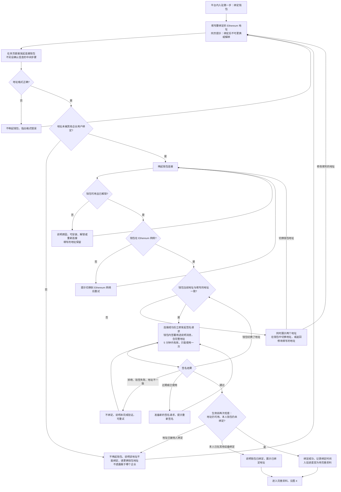

- 签名失败不计入密码连续失败次数；同一网络地址 1 小时内签名验证失败超过 20 次后降速。
- 签名确认前可以修改地址或放弃；绑定期间登录结束时本次绑定不生效，重新登录后从填写钱包地址开始。

## 资料提交与维护（图 4）

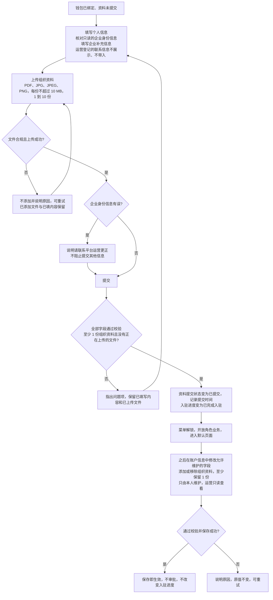

## 修改密码（图 5）

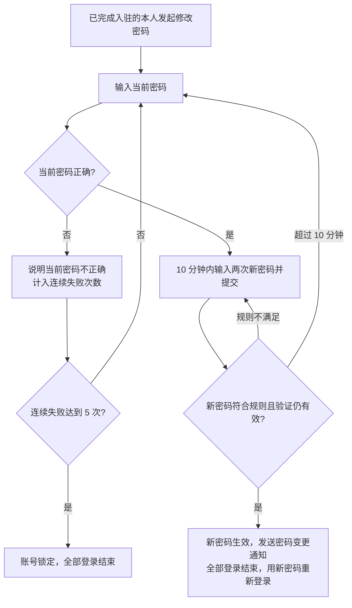

## 登录结束（图 6）

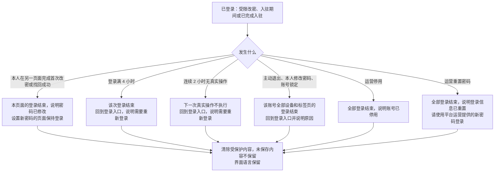

## 企业用户账号状态机

账号启停、密码状态、临时锁定是三个独立维度，各自变化，互不替代。

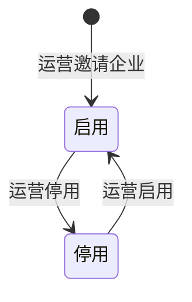

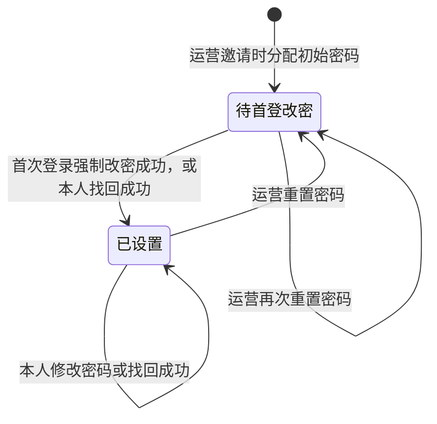

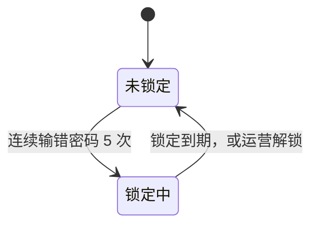

- 三个维度在登录时的组合结果见[各维度组合下的登录结果](./01-企业登录与首次入驻-PRD.md#login-combination)。
- 停用、重置密码、进入锁定时，该账号全部登录立即结束；启用后恢复为停用前的密码状态。
- 重置密码不解除锁定；锁定期间的到期计时不因停用暂停。
- 任何状态变化都不新建用户、不解除或更换钱包、不改变入驻进度。

## 入驻进度状态机

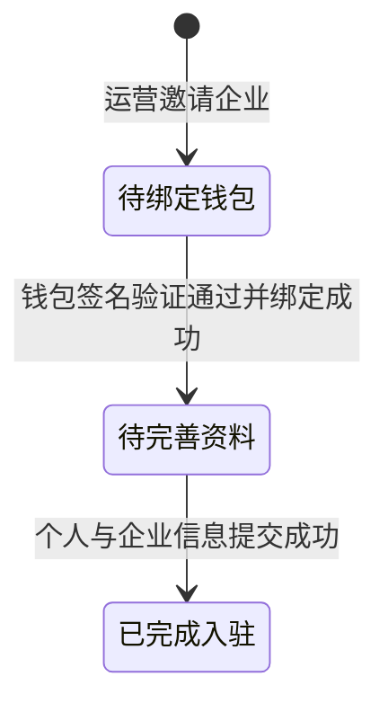

- 入驻进度只能前进，不会回退；已完成入驻是终态。
- 密码状态为待首登改密时不能进入任何入驻步骤，但入驻进度保持不变。
- 已完成入驻后，资料维护、找回密码、运营重置密码、停用与启用都不改变入驻进度。

## 登录状态机

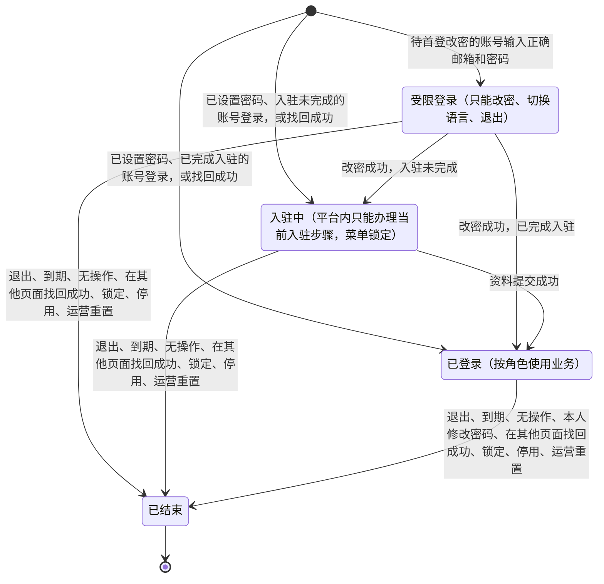

- 一次登录有效期为 4 小时，连续 2 小时没有真实操作后失效，两者先到先结束。
- 受限登录完成改密后直接转为入驻中或已登录，登录有效期自改密成功起重新计算；同一账号在其他设备和标签页上的登录结束。
- 找回成功的页面直接建立新的登录，同一账号已有的其他登录结束。
- 已结束是终态，迟到的操作结果不能使它恢复。
