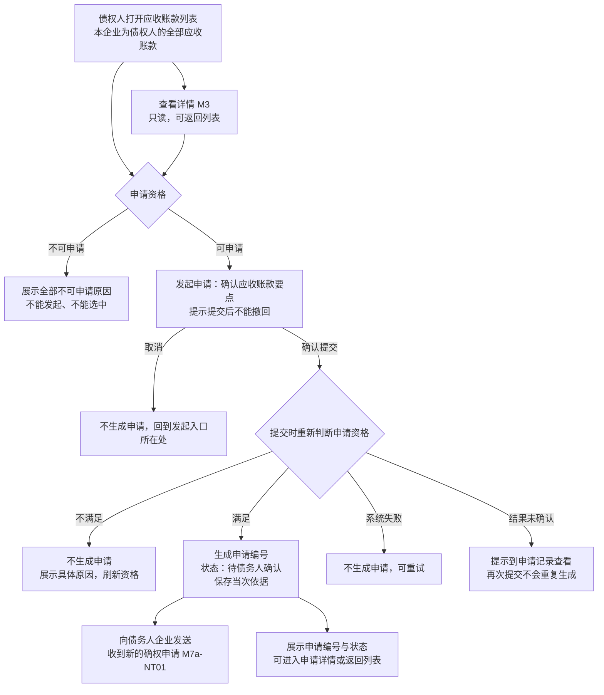
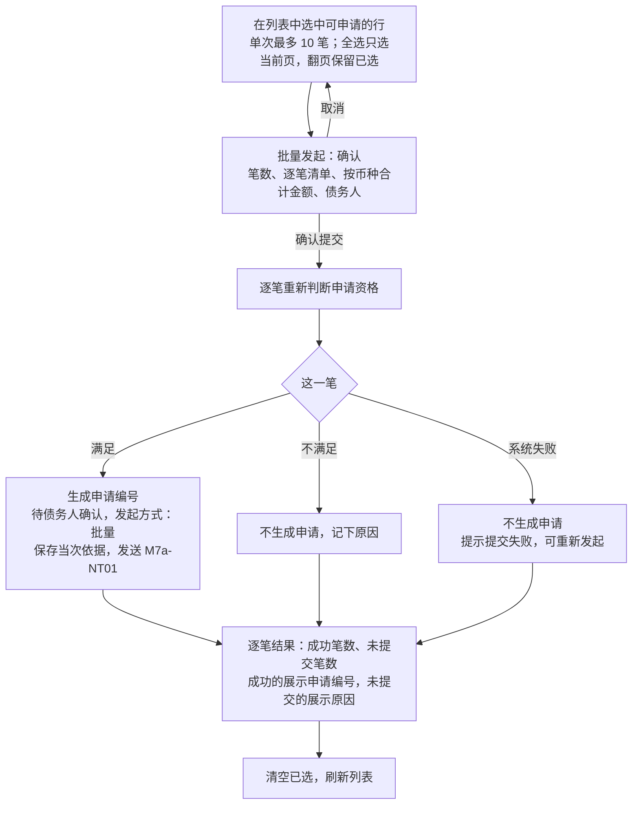
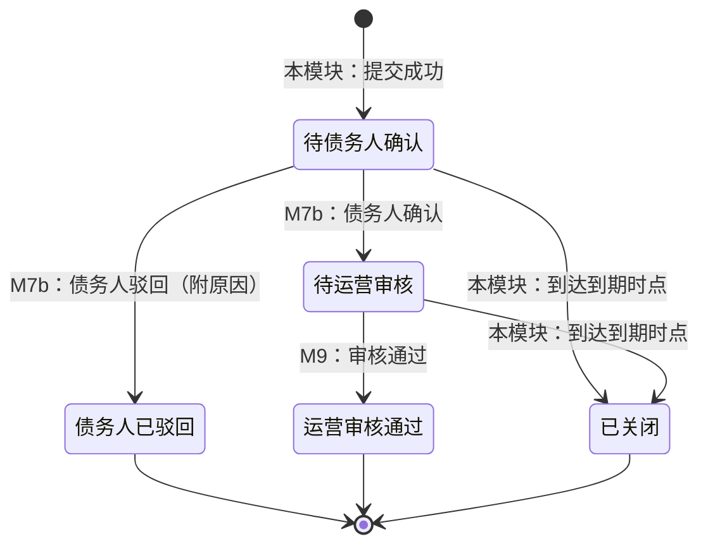
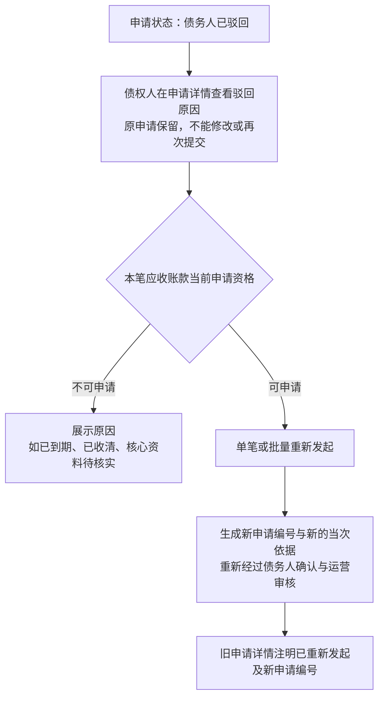

# 应收查看与确权申请 · 流程图与状态机

2026-11-12｜需求评审稿

本册把[功能册](./01-应收查看与确权申请-PRD.md)中的主要流程与状态画成图，规则以功能册为准。图中方框是业务环节或状态，不代表页面或组件。

| 图 | 内容 | 对应功能 |
| --- | --- | --- |
| [单笔发起确权申请（图 M7a-1）](#fig-m7a-1) | 从应收账款列表查看、判断资格到单笔提交及结果 | [债权人应收账款列表（F-M7a-01）](./01-应收查看与确权申请-PRD.md#F-M7a-01)、[单笔发起确权申请（F-M7a-03）](./01-应收查看与确权申请-PRD.md#F-M7a-03) |
| [批量发起确权申请（图 M7a-2）](#fig-m7a-2) | 选择、确认、逐笔判断与逐笔结果 | [批量发起确权申请（F-M7a-04）](./01-应收查看与确权申请-PRD.md#F-M7a-04) |
| [申请状态（图 M7a-3）](#fig-m7a-3) | 一笔申请从提交到结束的状态、带来变化的模块，以及到期自动关闭 | [申请状态](./01-应收查看与确权申请-PRD.md#apply-status)、[申请记录与进度（F-M7a-05）](./01-应收查看与确权申请-PRD.md#F-M7a-05)、[到期自动关闭（F-M7a-08）](./01-应收查看与确权申请-PRD.md#F-M7a-08) |
| [债务人驳回后重新发起（图 M7a-4）](#fig-m7a-4) | 查看驳回原因、重新判断资格、生成新申请 | [债务人驳回后的处理（F-M7a-07）](./01-应收查看与确权申请-PRD.md#F-M7a-07) |

## 图 M7a-1 单笔发起确权申请

## 图 M7a-2 批量发起确权申请

- 单次最多选择 10 笔。
- 每一笔独立判断、独立生成；一笔失败不影响其他笔，已成功的不回退。

## 图 M7a-3 申请状态

初始状态为“待债务人确认”。“债务人已驳回”“运营审核通过”“已关闭”为终态。运营审核只有通过，没有驳回或不通过。

- 到期时点之后提交的确认、驳回、审核通过都不生效，按“已关闭”处理。
- 核心资料变化、回款变化、角色变化、账号停用都不改变申请状态，也不要求重新确认或重新审核。
- “运营审核通过”之后的出库进度由 M9 另行提供，不是申请状态。

## 图 M7a-4 债务人驳回后重新发起

