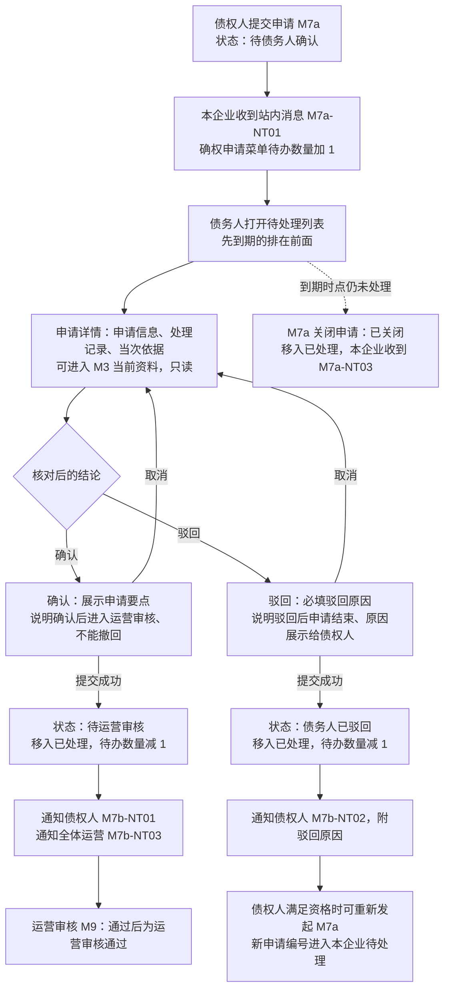
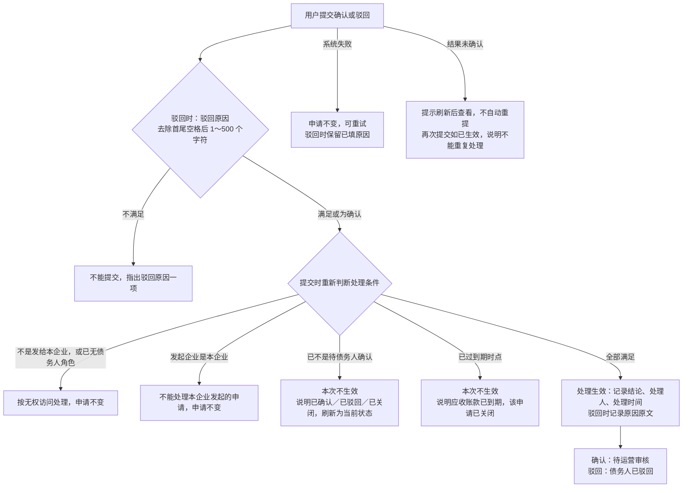
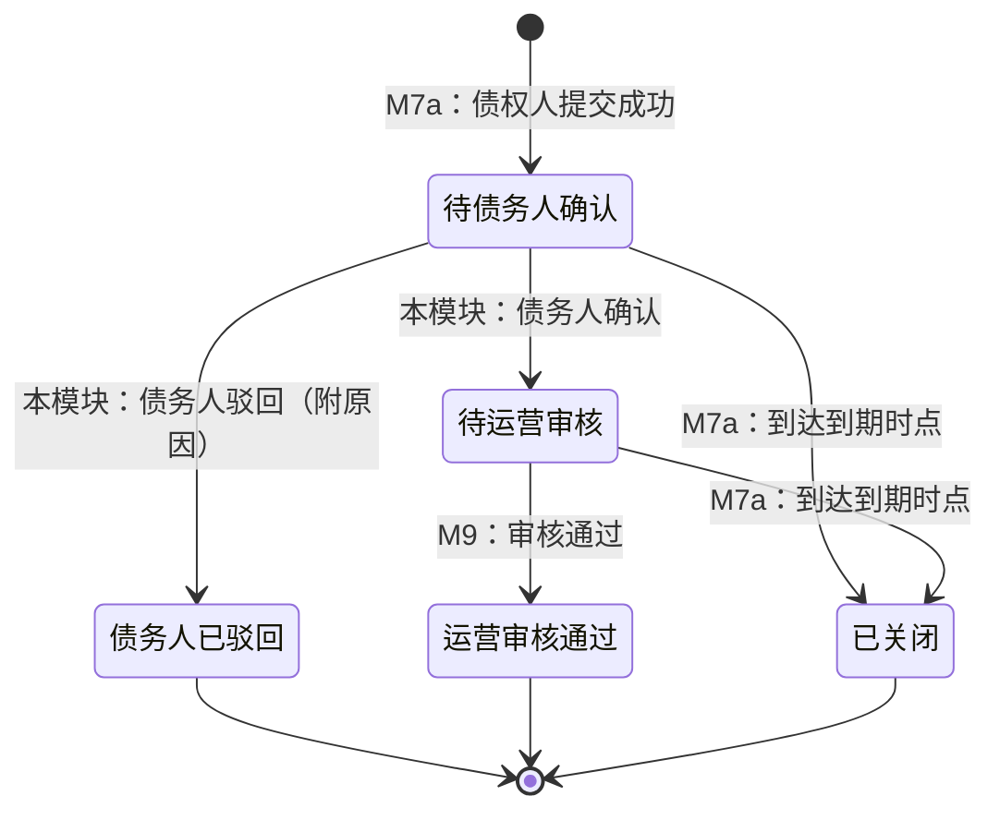

# 确权待办与确认处理 · 流程图与状态机

2026-11-12｜需求评审稿

本册把[功能册](./01-确权待办与确认处理-PRD.md)中的主要流程与状态画成图，规则以功能册为准。图中方框是业务环节或状态，不代表页面或组件。

| 图 | 内容 | 对应功能 |
| --- | --- | --- |
| [查看与处理确权申请（图 M7b-1）](#fig-m7b-1) | 从收到申请、待办数量、列表与详情核对，到确认或驳回后的去向 | [确权申请列表与待办数量（F-M7b-01）](./01-确权待办与确认处理-PRD.md#F-M7b-01)、[申请详情与当次依据（F-M7b-02）](./01-确权待办与确认处理-PRD.md#F-M7b-02) |
| [确认或驳回的提交（图 M7b-2）](#fig-m7b-2) | 提交时重新判断处理条件、到期边界、重复提交与失败 | [可以确认或驳回的条件](./01-确权待办与确认处理-PRD.md#process-conditions)、[确认申请（F-M7b-03）](./01-确权待办与确认处理-PRD.md#F-M7b-03)、[驳回申请（F-M7b-04）](./01-确权待办与确认处理-PRD.md#F-M7b-04) |
| [债务人视角的申请状态（图 M7b-3）](#fig-m7b-3) | 一笔申请的状态、哪些变化由本模块带来，以及在待处理与已处理中的位置 | [确权申请列表与待办数量（F-M7b-01）](./01-确权待办与确认处理-PRD.md#F-M7b-01)、[处理之后能看到什么](./01-确权待办与确认处理-PRD.md#after-result) |

## 图 M7b-1 查看与处理确权申请

- 确认、驳回也可以从待处理列表中的行发起，规则相同。
- 提交时的条件判断与异常见[确认或驳回的提交（图 M7b-2）](#fig-m7b-2)。

## 图 M7b-2 确认或驳回的提交

- 同一申请重复点击、或两个窗口分别提交时，只有先提交成功的一次生效。
- 到期以到期时点为界：到期时点之前提交成功的有效；之后提交的不生效，即使 M7a 尚未完成关闭。

## 图 M7b-3 债务人视角的申请状态

申请状态由 M7a 定义，本图只标出各变化由哪个模块带来，以及申请在本模块列表中的分组。初始状态为“待债务人确认”（待处理）；其余状态都在已处理中。“债务人已驳回”“运营审核通过”“已关闭”为终态。

- 本模块只带来“待运营审核”“债务人已驳回”两种变化，且只能从“待债务人确认”开始。
- 核心资料变化、回款变化、角色变化、账号停用都不改变申请状态，也不要求重新确认。
- 债权人重新发起会生成新的申请，从“待债务人确认”重新开始；被驳回的旧申请保持“债务人已驳回”。
