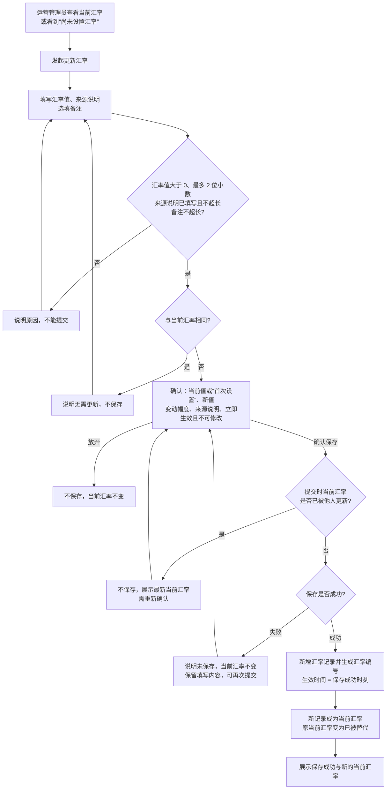
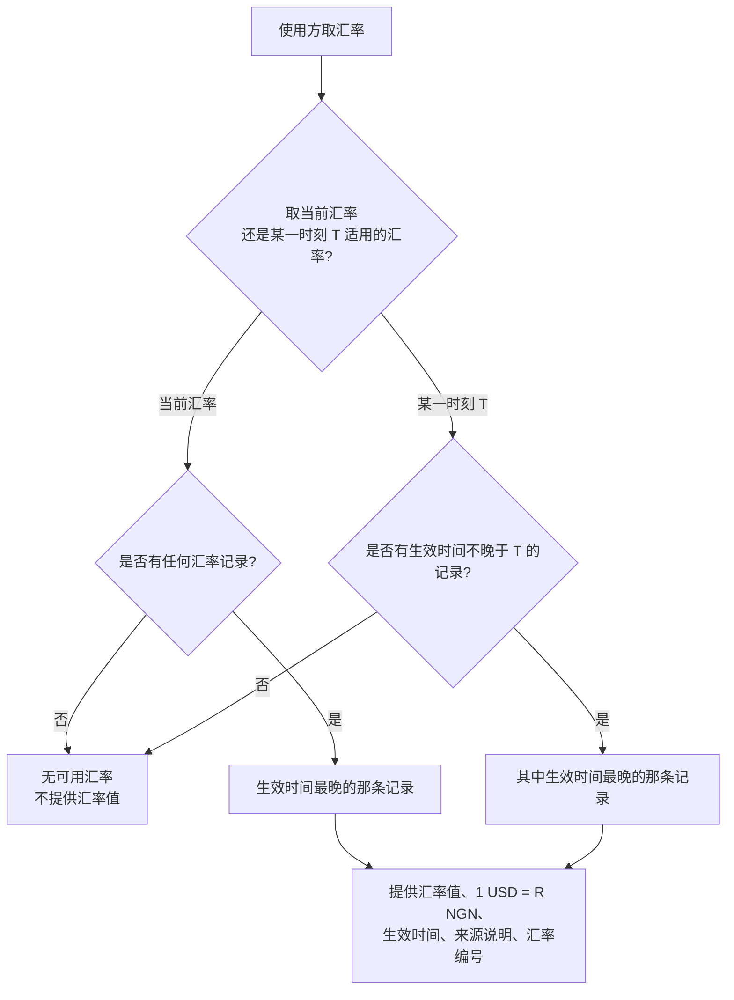
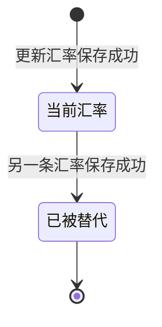

# 汇率管理 · 流程图与状态机

2026-11-12｜需求评审稿

本册把[功能与业务规则](./01-汇率管理-PRD.md)中的主要流程与状态画成图，规则以功能册为准。图中方框是业务环节，不代表页面或组件。

| 图 | 内容 | 对应功能 |
| --- | --- | --- |
| [图 1](#fig-1) | 更新汇率：填写、确认、保存与异常 | [更新汇率（FX-03）](./01-汇率管理-PRD.md#FX-03) |
| [图 2](#fig-2) | 某一时刻适用的汇率如何判定 | [对外提供的汇率口径（FX-05）](./01-汇率管理-PRD.md#FX-05) |
| [状态机 1](#state-1) | 一条汇率记录的状态 | [更新汇率（FX-03）](./01-汇率管理-PRD.md#FX-03)、[汇率历史（FX-04）](./01-汇率管理-PRD.md#FX-04) |

## 更新汇率（图 1）

## 某一时刻适用的汇率（图 2）

## 一条汇率记录的状态（状态机 1）

- 初始状态：保存成功即为当前汇率；未保存成功的填写不形成记录。
- 同一时间只有一条记录处于当前汇率。
- 已被替代是终态：不能修改、删除，也不能恢复为当前汇率；要用回旧值只能再保存一条新记录。
- 状态变化不改变记录的汇率值、生效时间、来源说明、备注、维护人和汇率编号；变为已被替代时只确定其失效时间。
