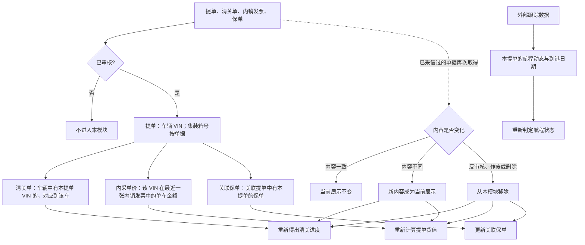
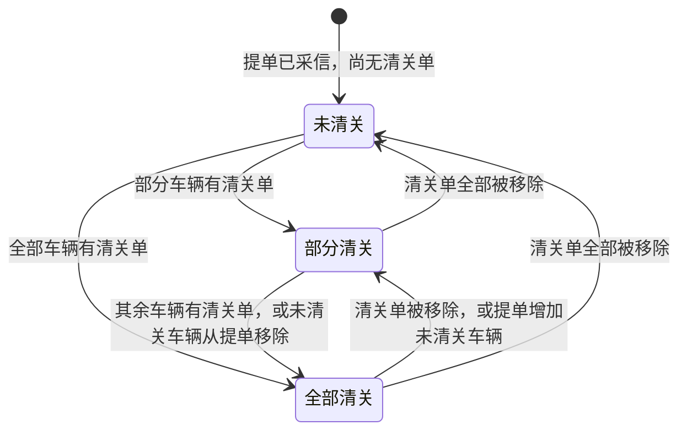
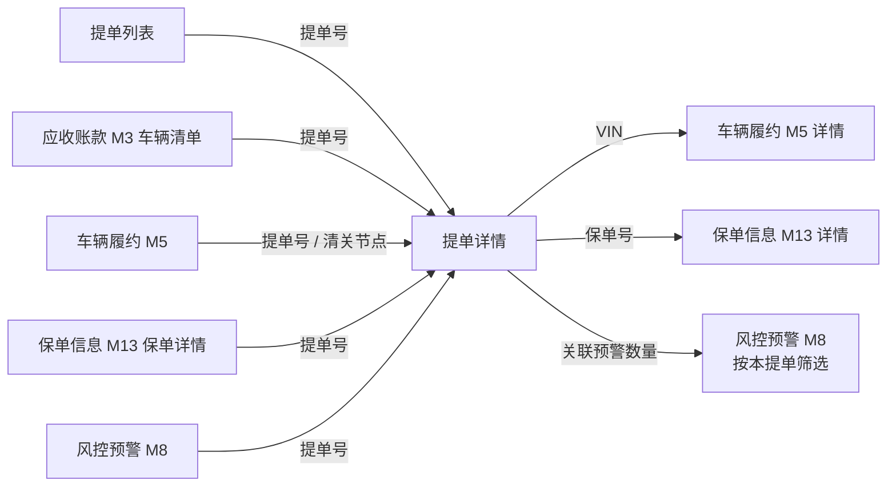
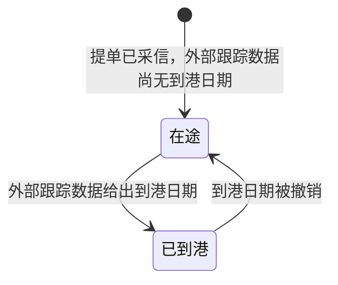

# 提单信息 · 流程图与状态机

2026-11-19｜需求评审稿（待多模块联调）

本册把[功能册](./01-提单信息-PRD.md)中的主要流程与状态画成图，规则以功能册为准。图中方框是业务环节或状态，不代表页面或组件。

| 图 | 内容 | 对应功能 |
| --- | --- | --- |
| [提单与清关资料的采信与关联（图 M12-1）](#fig-m12-1) | 只采信已审核单据，按 VIN 把清关单、内采单价、保单关联到提单车辆，结合外部跟踪数据，以及更新与移除后的重新得出 | [提单与清关资料的采信与关联（F-M12-01）](./01-提单信息-PRD.md#F-M12-01)、[提单货值（F-M12-04）](./01-提单信息-PRD.md#F-M12-04) |
| [清关进度（图 M12-2）](#fig-m12-2) | 一张提单的清关状态随清关单和提单车辆的变化 | [清关进度与清关单（F-M12-06）](./01-提单信息-PRD.md#F-M12-06) |
| [各入口与跳转（图 M12-3）](#fig-m12-3) | 从哪些模块进入提单详情，提单页的 VIN、保单号和关联预警跳到哪里，回到哪里 | [单据编号跳转](./01-提单信息-PRD.md#doc-links)、[关联预警（F-M12-10）](./01-提单信息-PRD.md#F-M12-10)、[可见范围与跨模块入口（F-M12-11）](./01-提单信息-PRD.md#F-M12-11) |
| [航程状态（图 M12-4）](#fig-m12-4) | 一张提单的航程状态随外部跟踪数据的变化 | [航程与到港（F-M12-05）](./01-提单信息-PRD.md#F-M12-05) |

## 图 M12-1 提单与清关资料的采信与关联

- 清关单只按 VIN 对应车辆，不比对集装箱号或船名航次；集装箱号只按提单、清关单单据展示，不对应到车辆。
- 清关单中的 VIN 不在任何已采信提单上时，本模块不展示该清关单；车辆履约（M5）仍按 VIN 使用它。
- 提单不关联内销合同；内采单价只按 VIN 取自内销发票。

## 图 M12-2 清关进度

k 为已清关车辆数，N 为提单车辆总数。车辆只要有一张已采信清关单列有其 VIN 就计为已清关。

- 清关状态只描述已有记录，不影响确权、审核或出库。
- 清关状态与航程状态相互独立。

## 图 M12-3 各入口与跳转

- 从目标详情可返回本提单详情；从本提单详情可返回进入前的位置；从列表进入的返回列表并保留查找与筛选条件。
- 从车辆履约清关节点进入时，定位到车辆清单中的该 VIN。
- 目标单据已不再被采信时提示“该内容不存在或已更新”。

## 图 M12-4 航程状态

航程状态只取外部跟踪数据，平台不按装船日期、航程动态或清关日期推算。

- 外部跟踪数据加载失败时只提示失败并可重试，不显示为“在途”。
