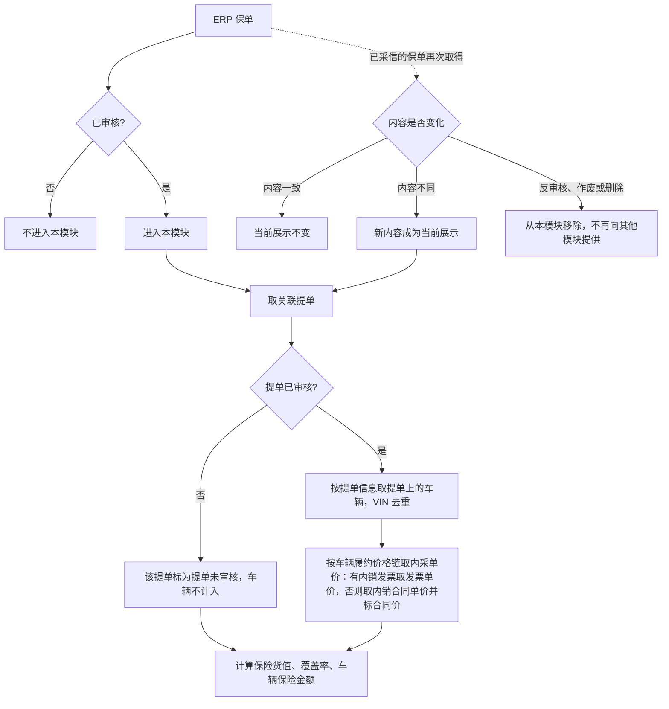
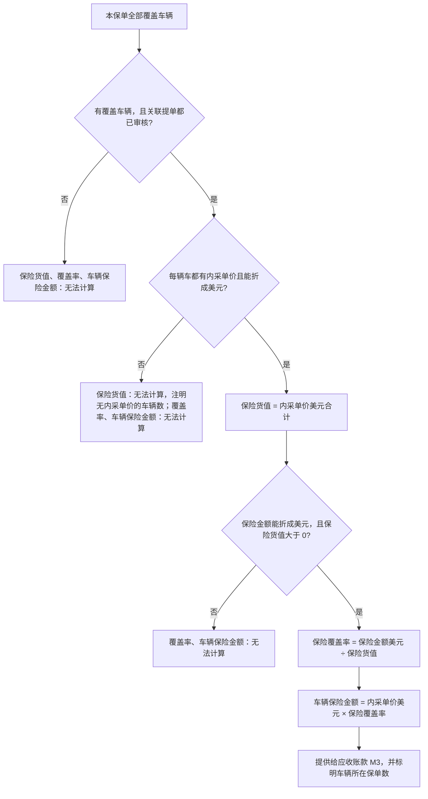
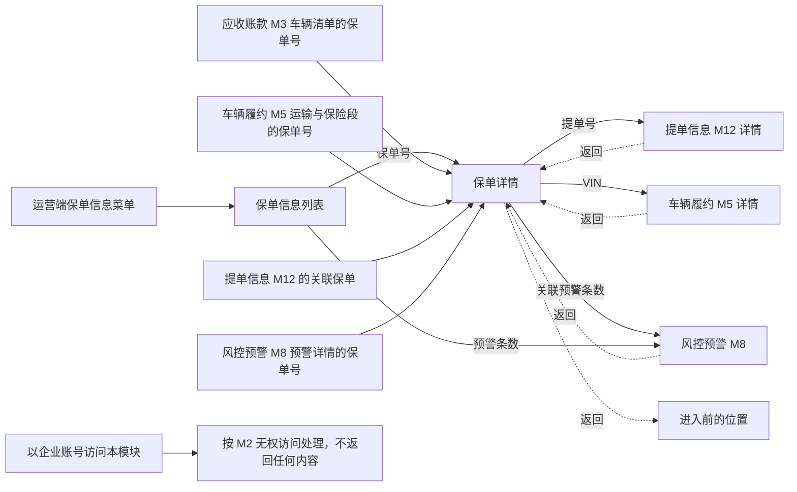

# 保单信息 · 流程图与状态机

2026-11-24｜需求评审稿（待多模块联调）

本册把[功能册](./01-保单信息-PRD.md)中的主要流程画成图，规则以功能册为准。图中方框是业务环节或判断，不代表页面或组件。本模块只读展示保单资料，没有需要用户推动的业务状态，所以本册没有状态机；保单是否被采信只取决于 ERP 审核结果，见图 M13-1。

| 图 | 内容 | 对应功能 |
| --- | --- | --- |
| [保单的采信与车辆对应（图 M13-1）](#fig-m13-1) | 只采信已审核保单，经关联提单得到覆盖车辆，以及更新与移除后的重新计算 | [保单的采信与车辆对应（F-M13-01）](./01-保单信息-PRD.md#F-M13-01) |
| [保险货值、覆盖率与车辆保险金额（图 M13-2）](#fig-m13-2) | 从车辆内采单价到保险货值、保险覆盖率、车辆保险金额，以及不能计算的分支 | [保障核对（F-M13-04）](./01-保单信息-PRD.md#F-M13-04)、[车辆清单与车辆保险金额（F-M13-05）](./01-保单信息-PRD.md#F-M13-05) |
| [各入口与跳转（图 M13-3）](#fig-m13-3) | 从哪些模块进入保单详情，保单页的编号和关联预警跳到哪里，回到哪里，以及企业账号访问的处理 | [单据编号跳转](./01-保单信息-PRD.md#doc-links)、[关联预警（F-M13-07）](./01-保单信息-PRD.md#F-M13-07)、[可见范围与跨模块入口（F-M13-08）](./01-保单信息-PRD.md#F-M13-08) |

## 图 M13-1 保单的采信与车辆对应

- 保单不关联内销合同，也不直接带 VIN；车辆一律经关联提单得到。
- 提单车辆或内采单价变化后，同样回到“计算”环节重新得出结果。

## 图 M13-2 保险货值、覆盖率与车辆保险金额

- 内采单价为合同价的车辆照常计入保险货值，保险货值注明“含 N 辆合同价”。
- 覆盖率只作计算结果展示，不判断是否足额，也不作提示；风险判断在风控预警（M8）。
- 同一辆车在多张保单中时，每张保单照常计算，本模块不作提示；应收账款（M3）如何使用见 M3 [资产健康度（F-M3-11）](../../两端共用/M3-应收账款与发票/01-应收账款与发票-PRD.md#F-M3-11)。

## 图 M13-3 各入口与跳转

- 从列表进入后返回列表时，保留原查找与筛选条件。
- 跳转目标的落点及目标已不存在时的结果，以目标模块为准；关联预警的落点按风控预警（M8）[进入与返回](../M8-风控预警与三方数据源/01-风控预警与三方数据源-PRD.md#entries)。
- 企业账号访问按 M2 [运营端菜单与无权访问（F-OP-11）](../M2-运营登录与企业管理/01-运营登录与企业管理-PRD.md#F-OP-11)处理。
