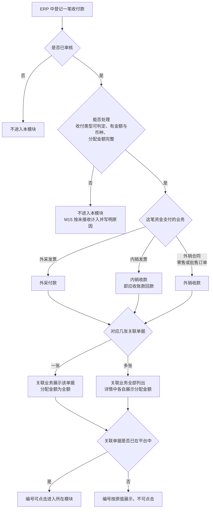
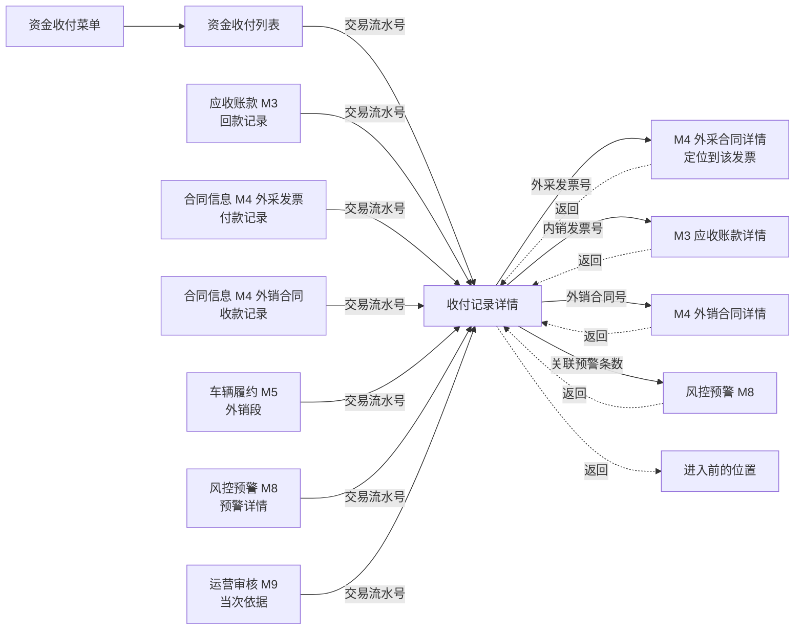
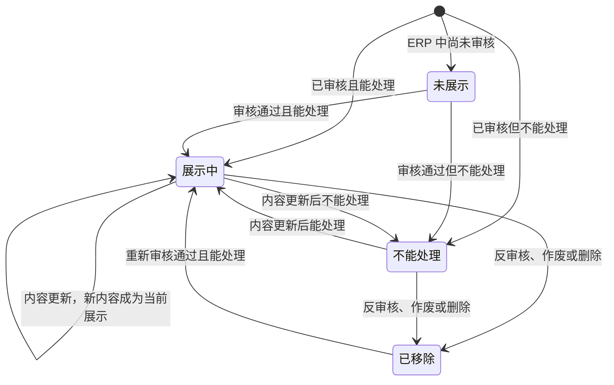

# 资金收付 · 流程图与状态机

2026-11-24｜需求评审稿

本册把[功能册](./01-资金收付-PRD.md)中的主要流程与状态画成图，规则以功能册为准。图中方框是业务环节，不代表页面或组件。

| 图 | 内容 | 对应功能 |
| --- | --- | --- |
| [收付记录的采信与分类（图 M14-1）](#fig-m14-1) | 收付登记如何进入本模块并分为三类收付记录，哪些不能处理 | [收付记录的采信与分类（F-M14-01）](./01-资金收付-PRD.md#F-M14-01)、[关联业务（F-M14-04）](./01-资金收付-PRD.md#F-M14-04) |
| [各入口与跳转（图 M14-2）](#fig-m14-2) | 从各模块进入收付记录详情，以及从详情进入关联业务和风控预警 | [关联业务（F-M14-04）](./01-资金收付-PRD.md#F-M14-04)、[关联预警（F-M14-05）](./01-资金收付-PRD.md#F-M14-05)、[可见范围与跨模块入口（F-M14-06）](./01-资金收付-PRD.md#F-M14-06) |
| [收付记录在本模块的展示状态（图 M14-3）](#fig-m14-3) | 一条收付登记在本模块中的展示状态 | [收付记录的采信与分类（F-M14-01）](./01-资金收付-PRD.md#F-M14-01) |

## 图 M14-1 收付记录的采信与分类

## 图 M14-2 各入口与跳转

## 图 M14-3 收付记录在本模块的展示状态

- 未展示、不能处理、已移除时，从其他模块带入的交易流水号进入后展示“未找到该收付记录”。
- 不能处理的收付登记在 M15 按未接收计入，原因见[不能处理的收付登记](./01-资金收付-PRD.md#not-received)。
