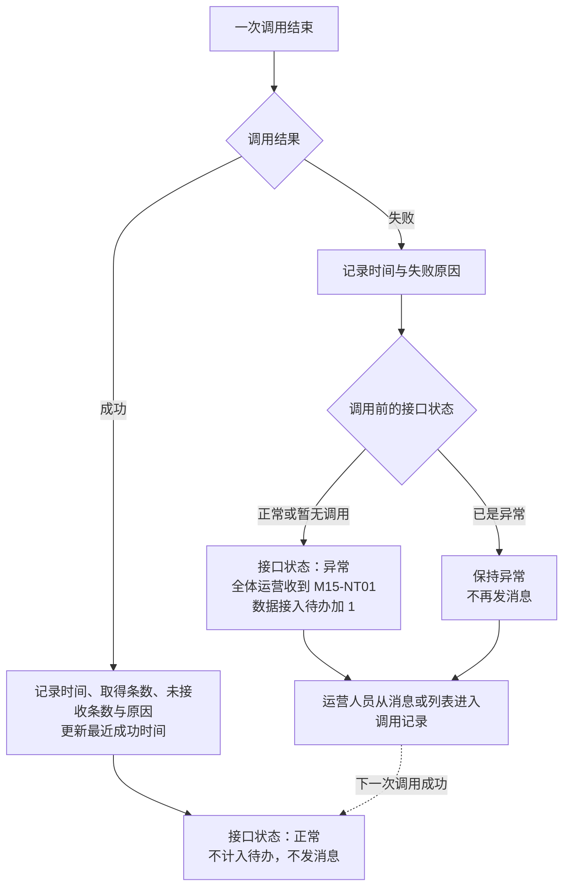
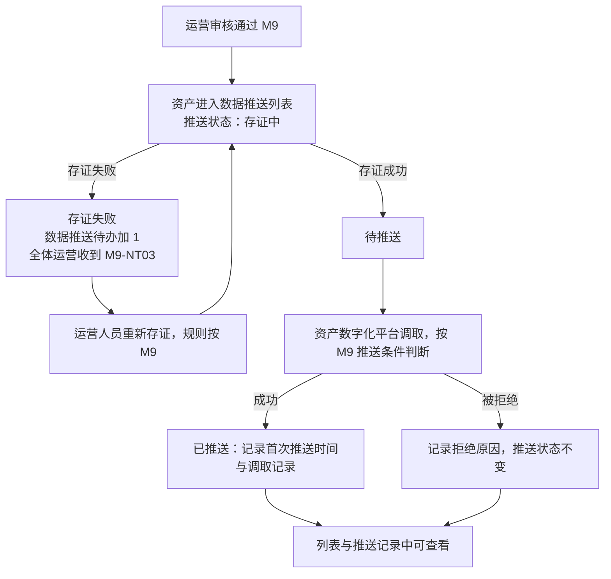
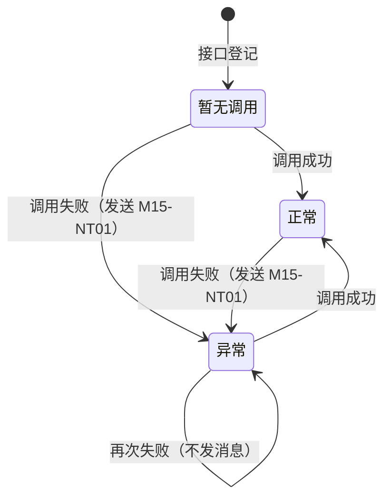
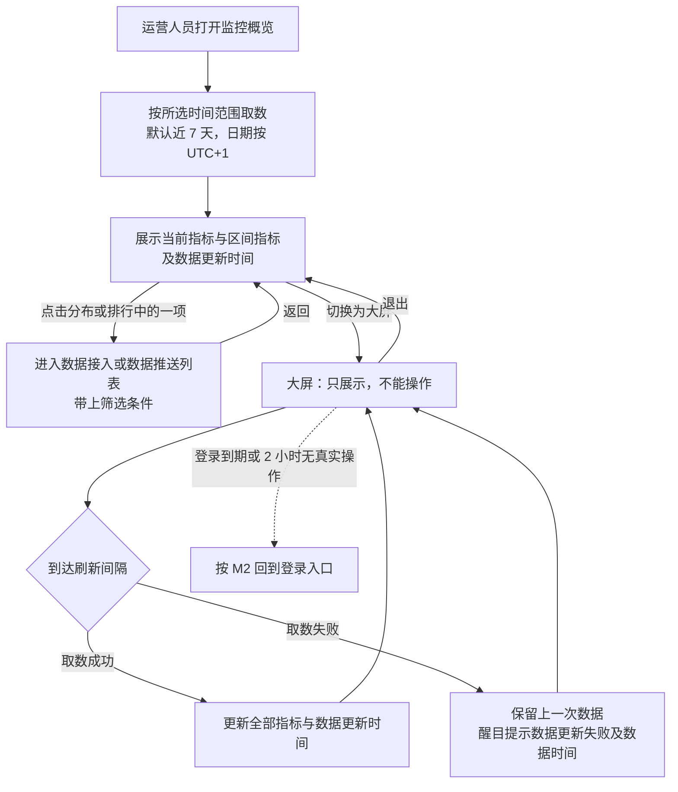

# 数据监控 · 流程图与状态机

2026-11-24｜需求评审稿

本册把[功能册](./01-数据监控-PRD.md)中的主要流程与状态画成图，规则以功能册为准。图中方框是业务环节或状态，不代表页面或组件。

| 图 | 内容 | 对应功能 |
| --- | --- | --- |
| [数据接入的状态与告警（图 M15-1）](#fig-m15-1) | 每次调用后接口状态怎样变化、何时告警、何时计入待办 | [接口列表与状态（F-M15-01）](./01-数据监控-PRD.md#F-M15-01)、[告警与待办数量（F-M15-05）](./01-数据监控-PRD.md#F-M15-05) |
| [数据推送的查看与重新存证（图 M15-2）](#fig-m15-2) | 运营人员查看资产推送情况、对存证失败的资产重新存证 | [资产推送列表（F-M15-03）](./01-数据监控-PRD.md#F-M15-03)、[资产推送记录（F-M15-04）](./01-数据监控-PRD.md#F-M15-04) |
| [接口状态（图 M15-3）](#fig-m15-3) | 一个接口的状态转换 | [接口状态](./01-数据监控-PRD.md#interface-status) |
| [监控概览与大屏（图 M15-4）](#fig-m15-4) | 概览取数、时间范围、进入列表，以及大屏的自动刷新与失败提示 | [监控概览与大屏（F-M15-06）](./01-数据监控-PRD.md#F-M15-06) |

## 图 M15-1 数据接入的状态与告警

- 调用成功但有未接收单据时，接口状态仍为正常，未接收情况只在调用记录中查看。
- 是否“长时间无数据”本期不自动判断，运营人员按最近成功时间判断。

## 图 M15-2 数据推送的查看与重新存证

- 推送规则全部以 M9 为准；本模块只展示结果，并提供重新存证入口。

## 图 M15-3 接口状态

初始状态为“暂无调用”（研发登记接口时形成）；没有终态。

- 状态只由最近一次调用的结果决定；调用结果尚未返回时状态不变。

## 图 M15-4 监控概览与大屏

- 自动刷新不算真实操作；大屏刷新间隔与登录时长待确认，见[大屏刷新间隔（Q-M15-02）](./01-数据监控-PRD.md#Q-M15-02)、[大屏登录时长（Q-M15-03）](./01-数据监控-PRD.md#Q-M15-03)。
