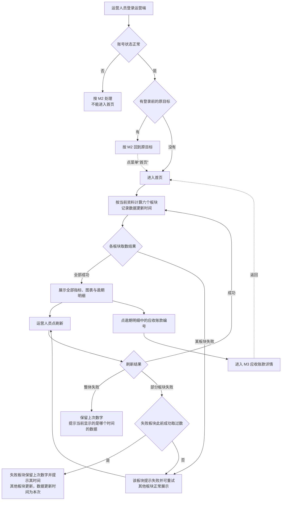
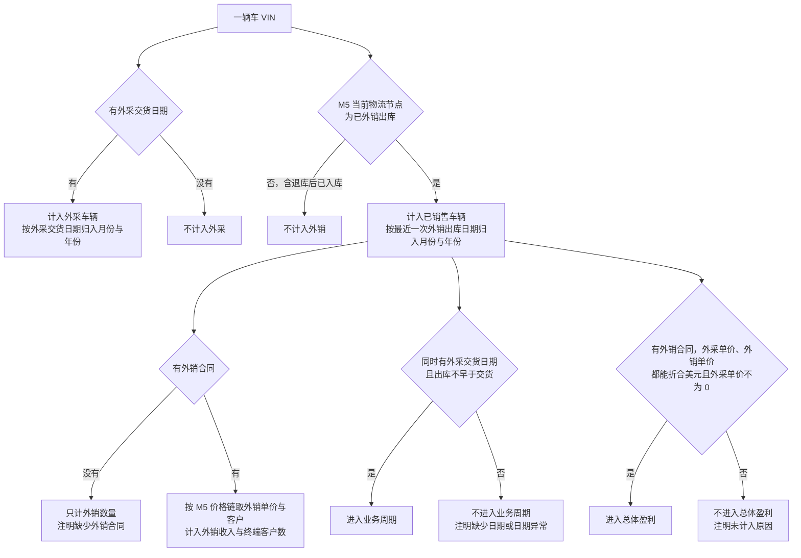
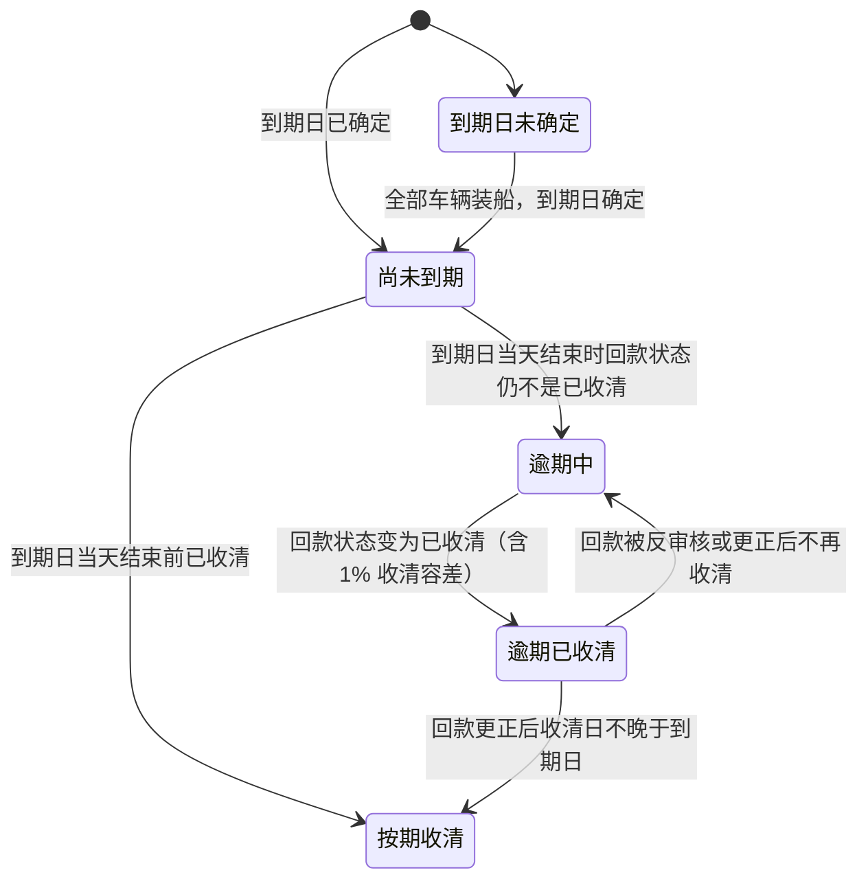

# 运营端首页 · 流程图与状态机

2026-11-25｜需求评审稿

本册把[功能册](./01-运营端首页-PRD.md)中的主要流程与状态画成图，规则以功能册为准。图中方框是业务环节或状态，不代表页面或组件。

| 图 | 内容 | 对应功能 |
| --- | --- | --- |
| [打开与刷新首页（图 M17-1）](#fig-m17-1) | 运营人员进入首页、取数、板块加载失败与刷新失败时看到什么 | [首页入口（F-M17-01）](./01-运营端首页-PRD.md#F-M17-01)、[数据更新时间、刷新与加载失败](./01-运营端首页-PRD.md#refresh) |
| [车辆计入外采与外销（图 M17-2）](#fig-m17-2) | 一辆车是否计入外采、外销统计，以及能否进入业务周期、总体盈利 | [车辆的外采与外销计入（F-M17-02）](./01-运营端首页-PRD.md#F-M17-02)、[业务周期（F-M17-05）](./01-运营端首页-PRD.md#F-M17-05)、[总体盈利（F-M17-06）](./01-运营端首页-PRD.md#F-M17-06) |
| [一笔应收账款的逾期状态（图 M17-3）](#fig-m17-3) | 一笔应收账款从未逾期到逾期中、逾期已收清的转换 | [账款逾期（F-M17-08）](./01-运营端首页-PRD.md#F-M17-08) |

## 图 M17-1 打开与刷新首页

## 图 M17-2 车辆计入外采与外销

## 图 M17-3 一笔应收账款的逾期状态

- 逾期中、逾期已收清都计入历史逾期次数和逾期明细；到期日未确定、尚未到期、按期收清都不计入。
- 状态按当前资料随时重新判定，首页不保存历史快照。
