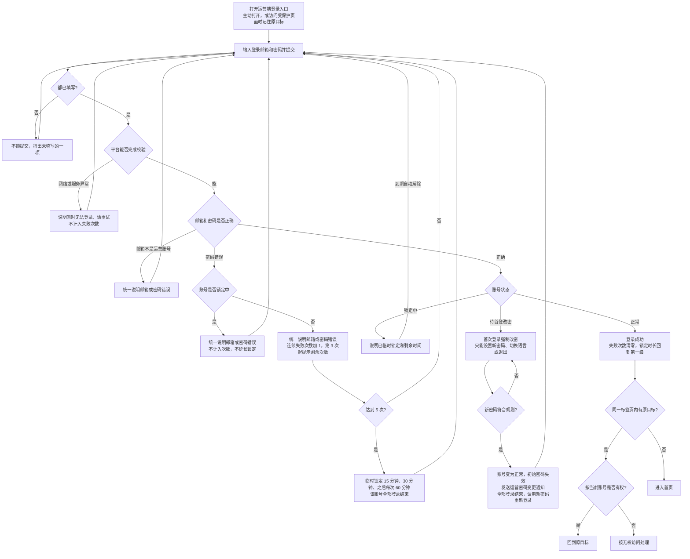
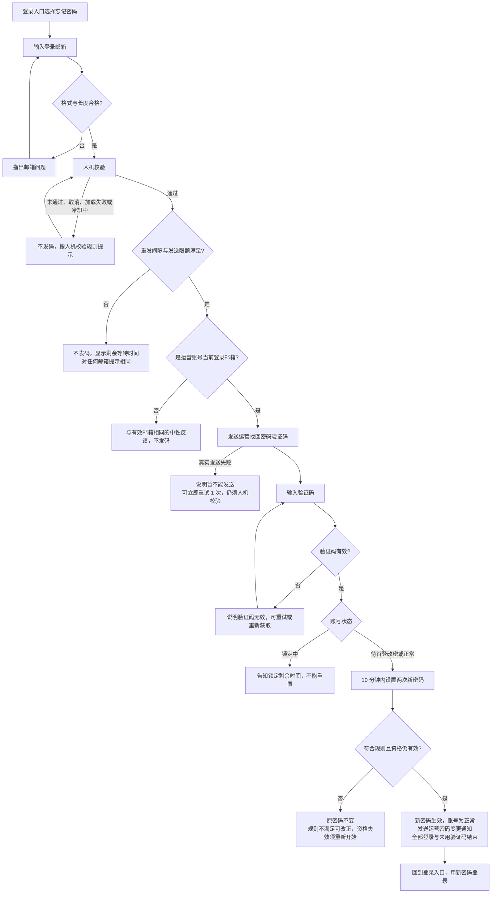
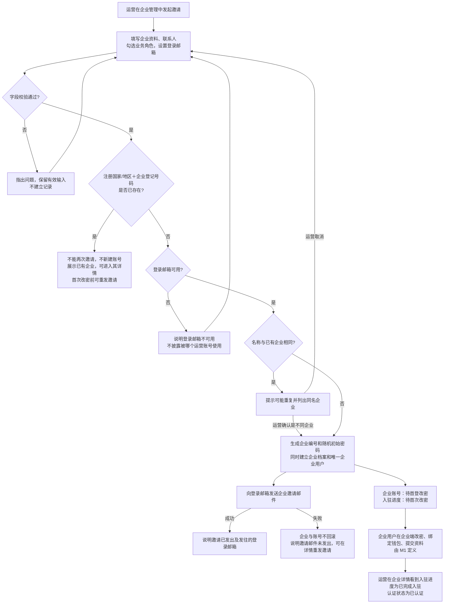
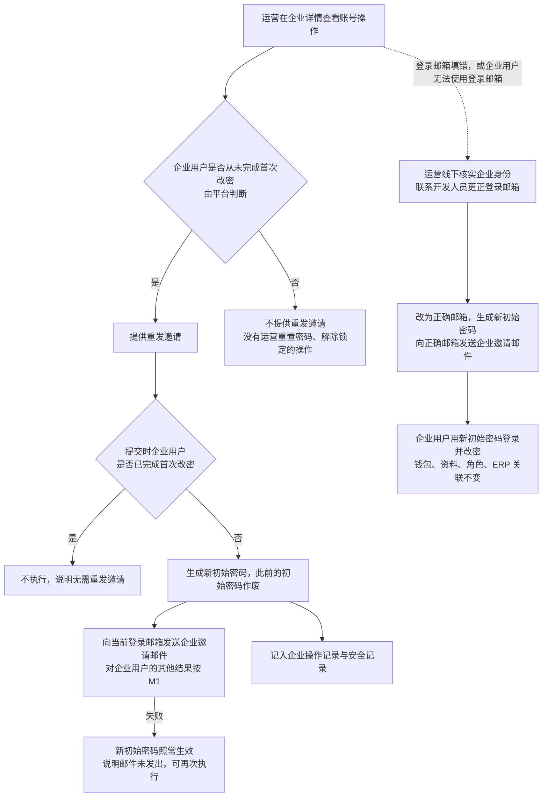
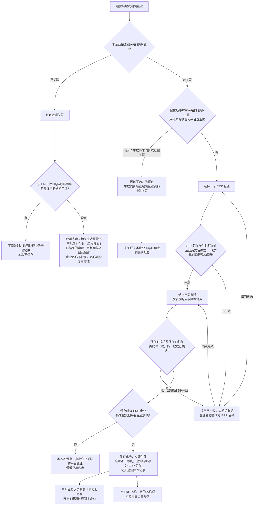
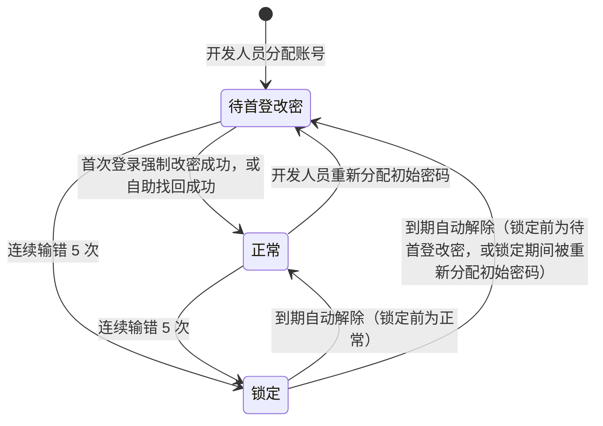
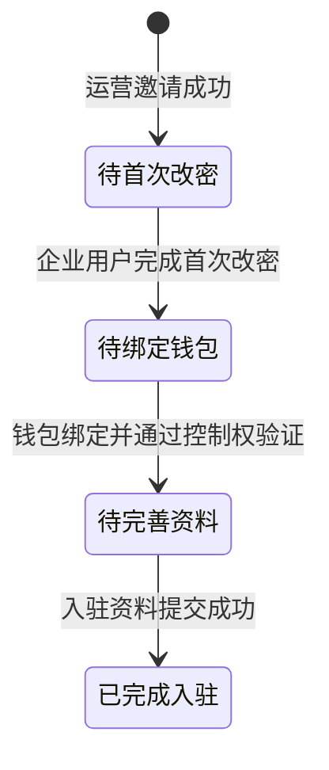

# 运营登录、企业邀请与企业管理 · 流程图与状态机

2026-11-25｜需求评审稿｜对应功能册：[01](./01-运营登录与企业管理-PRD.md)

本册把[功能与业务规则](./01-运营登录与企业管理-PRD.md)中的主要流程与状态画成图，规则以功能册为准。图中方框是业务环节，不代表页面或组件。企业用户在企业端的流程由[企业登录与首次入驻（M1）](../../企业端/M1-企业登录与首次入驻/02-企业登录与首次入驻-流程图与状态机.md)画出，本册不重复。图号沿用原值，缺号不代表遗漏。

| 图 | 内容 | 对应功能 |
| --- | --- | --- |
| [图 1](#fig-1) | 运营邮箱与密码登录、锁定判断、首次登录强制改密、登录后进入或返回原目标 | [邮箱与密码登录（F-OP-02）](./01-运营登录与企业管理-PRD.md#F-OP-02)、[首次登录强制改密（F-OP-04）](./01-运营登录与企业管理-PRD.md#F-OP-04)、[登录后进入与返回原目标（F-OP-05）](./01-运营登录与企业管理-PRD.md#F-OP-05)、[连续失败与临时锁定（F-OP-06）](./01-运营登录与企业管理-PRD.md#F-OP-06) |
| [图 2](#fig-2) | 运营用邮箱验证码找回密码，含发码前人机校验 | [自助找回密码（F-OP-03）](./01-运营登录与企业管理-PRD.md#F-OP-03) |
| [图 3](#fig-3) | 邀请企业：身份查重、同名提醒、建立企业与唯一企业用户、发送邀请邮件 | [邀请企业并开通唯一企业用户（F-EN-02）](./01-运营登录与企业管理-PRD.md#F-EN-02) |
| [图 4](#fig-4) | 运营对原企业账号的重发邀请（仅从未完成首次改密时），以及开发人员更正登录邮箱 | [重发邀请（F-EN-07）](./01-运营登录与企业管理-PRD.md#F-EN-07)、[开发人员更正登录邮箱](./01-运营登录与企业管理-PRD.md#login-email-fix) |
| [图 6](#fig-6) | 新增或编辑企业时关联唯一的 ERP 企业、名称一致校验、取消关联，以及对应收账款的影响 | [关联 ERP 企业（F-EN-10）](./01-运营登录与企业管理-PRD.md#F-EN-10) |
| [运营账号状态机](#state-1) | 运营账号在待首登改密、正常、锁定之间的变化 | [运营账号状态](./01-运营登录与企业管理-PRD.md#op-account-status) |
| [入驻进度状态机](#state-3) | 企业从待首次改密到已完成入驻，及由此得出的认证状态（运营端不展示） | [入驻进度与认证状态](./01-运营登录与企业管理-PRD.md#enterprise-account-status) |

## 运营登录与首次改密（图 1）

## 运营自助找回密码（图 2）

## 邀请企业（图 3）

## 运营维护原企业账号（图 4）

## 关联与取消关联 ERP 企业（图 6）

## 运营账号状态机

- 锁定和全部登录结束时，该账号在所有设备上的登录立即结束。本期不设运营账号停用。

## 入驻进度状态机

- 入驻进度只前进、不后退；重发邀请不改变入驻进度。各步骤的具体规则由 M1 定义。
- 认证状态由入驻进度得出：已完成入驻为已认证，其余三个阶段为未认证；已认证后不会回到未认证。运营端不展示认证状态，入驻进度只在企业列表展示。
