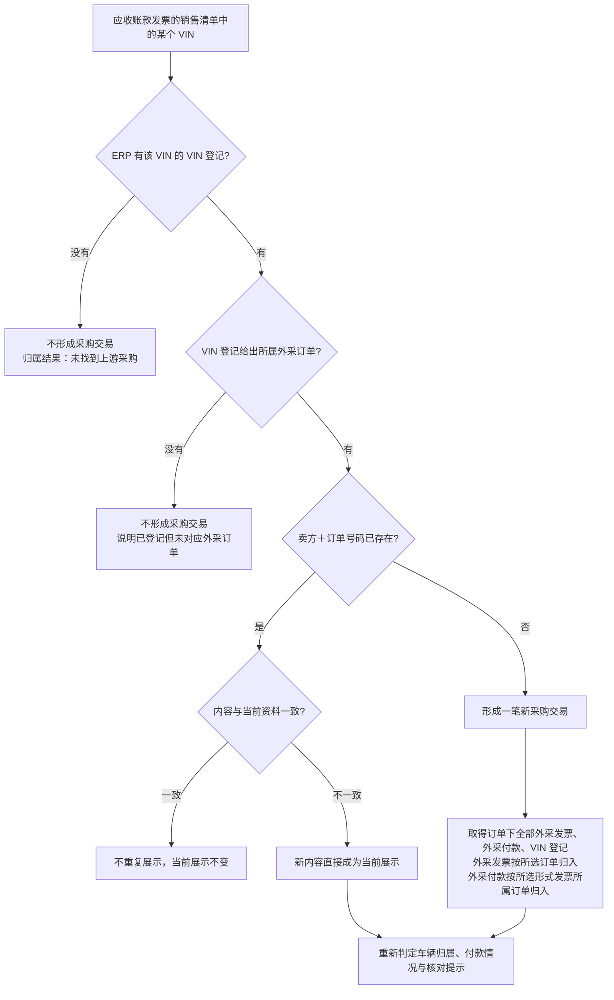
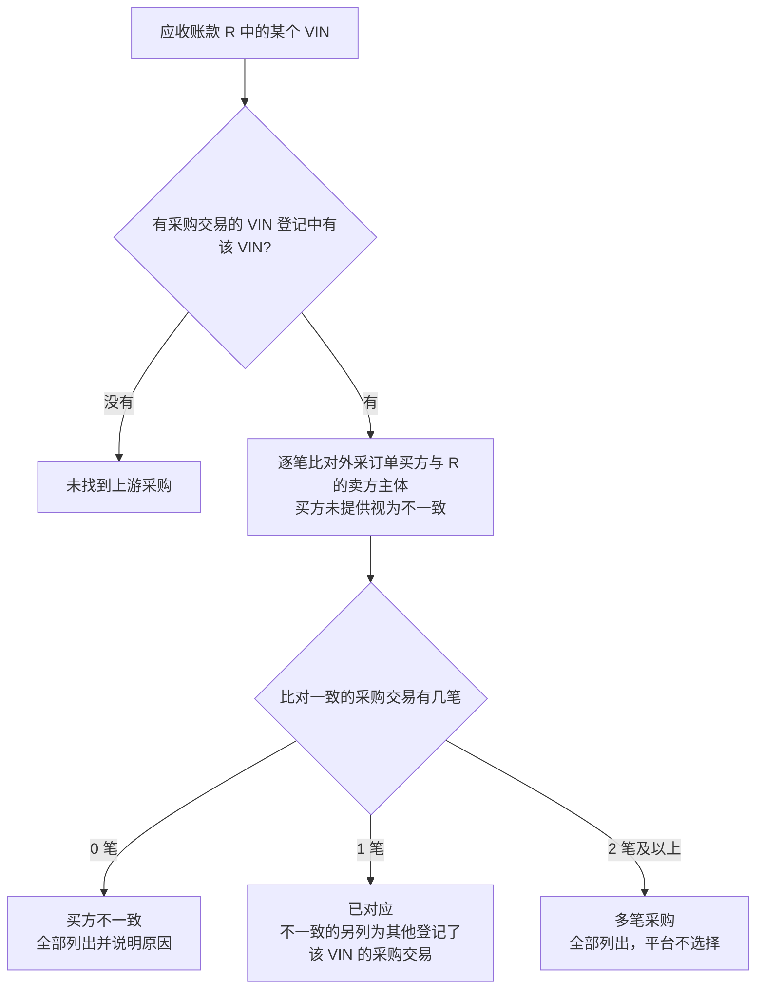
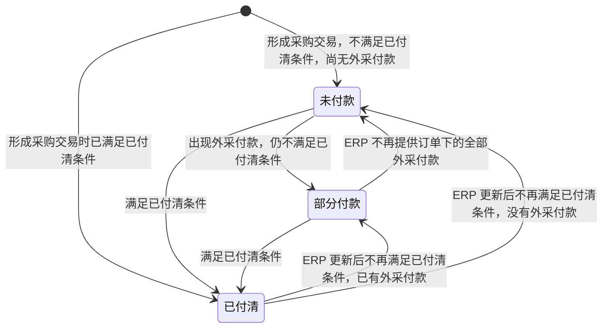
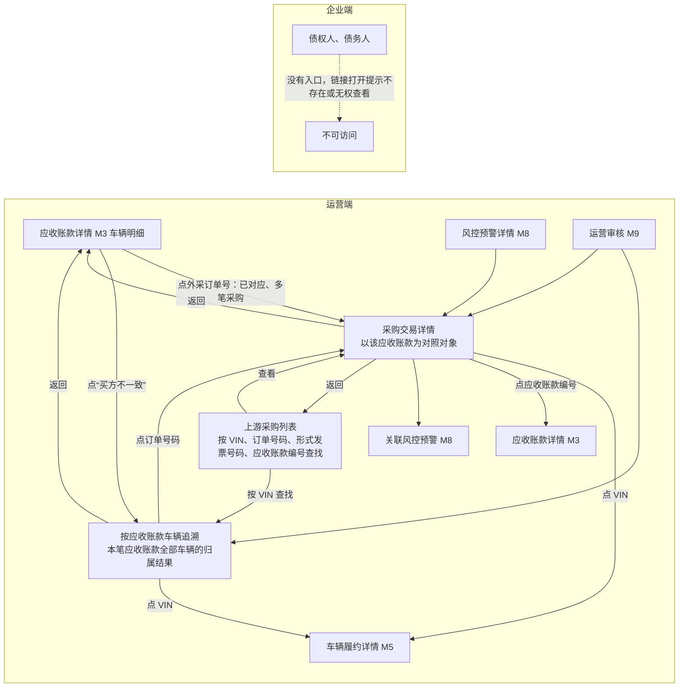

# 上游采购追溯 · 流程图与状态机

2026-11-13｜需求评审稿

本册把[功能册](./01-上游采购追溯-PRD.md)中的主要流程与状态画成图，规则以功能册为准。图中方框是业务环节或状态，不代表页面或组件。

| 图 | 内容 | 对应功能 |
| --- | --- | --- |
| [上游采购资料的取得与组织（图 M4-1）](#fig-m4-1) | 以应收账款发票为入口，按 VIN 取得 VIN 登记、外采订单、外采发票、外采付款并组成采购交易，以及重复与更新 | [上游采购资料的组织（F-M4-01）](./01-上游采购追溯-PRD.md#F-M4-01) |
| [车辆归属判定（图 M4-2）](#fig-m4-2) | 对应收账款的某辆车，按 VIN 登记与订单买方比对得出归属结果 | [车辆归属判定（F-M4-02）](./01-上游采购追溯-PRD.md#F-M4-02) |
| [采购交易付款情况（图 M4-3）](#fig-m4-3) | 每笔采购交易在未付款、部分付款、已付清之间的转换 | [外采付款（F-M4-06）](./01-上游采购追溯-PRD.md#F-M4-06) |
| [各入口与返回路径（图 M4-4）](#fig-m4-4) | 运营从应收账款的外采订单号或“买方不一致”、上游采购列表、M8、M9 进入本模块，点击 VIN、应收账款编号去哪里、回到哪里 | [按应收账款车辆追溯（F-M4-04）](./01-上游采购追溯-PRD.md#F-M4-04)、[可见范围与跨模块入口（F-M4-09）](./01-上游采购追溯-PRD.md#F-M4-09) |

## 图 M4-1 上游采购资料的取得与组织

- 外采发票、外采付款、VIN 登记再次取得时同样按“内容一致则不重复、不一致则以新内容替换当前展示”处理。
- ERP 不再提供某份资料时，从当前展示中移除。

## 图 M4-2 车辆归属判定

对应收账款 R 销售清单中的每个 VIN 分别判定；同一 VIN 在不同应收账款中分别判定。

- 归属结果是事实标注，运营不能在本模块认定或更改；资料更新后重新判定。
- 是否构成风控预警由 M8 判定。

## 图 M4-3 采购交易付款情况

按整笔采购交易判定，依据 ERP 提供的各张外采发票未付金额、外采订单未开票金额和订单下是否已有外采付款；ERP 资料更新后重新判定，没有终态。图中“已付清条件”指：订单下至少有一张外采发票，全部外采发票的未付金额为 0，且未开票金额为 0。

- 付款情况不按单张外采发票判定，外采发票下不挂付款。
- 付款情况只描述上游采购款，不改变应收账款的回款状态。

## 图 M4-4 各入口与返回路径

- 从 M5、M3 应收账款编号、M8、M9 返回时，逐级回到点击前的位置。
