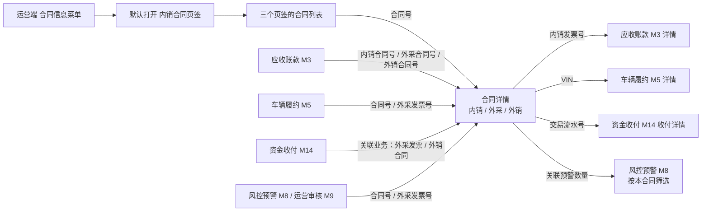
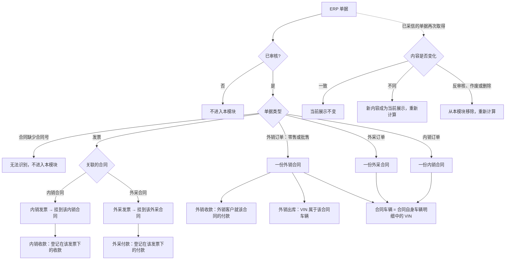
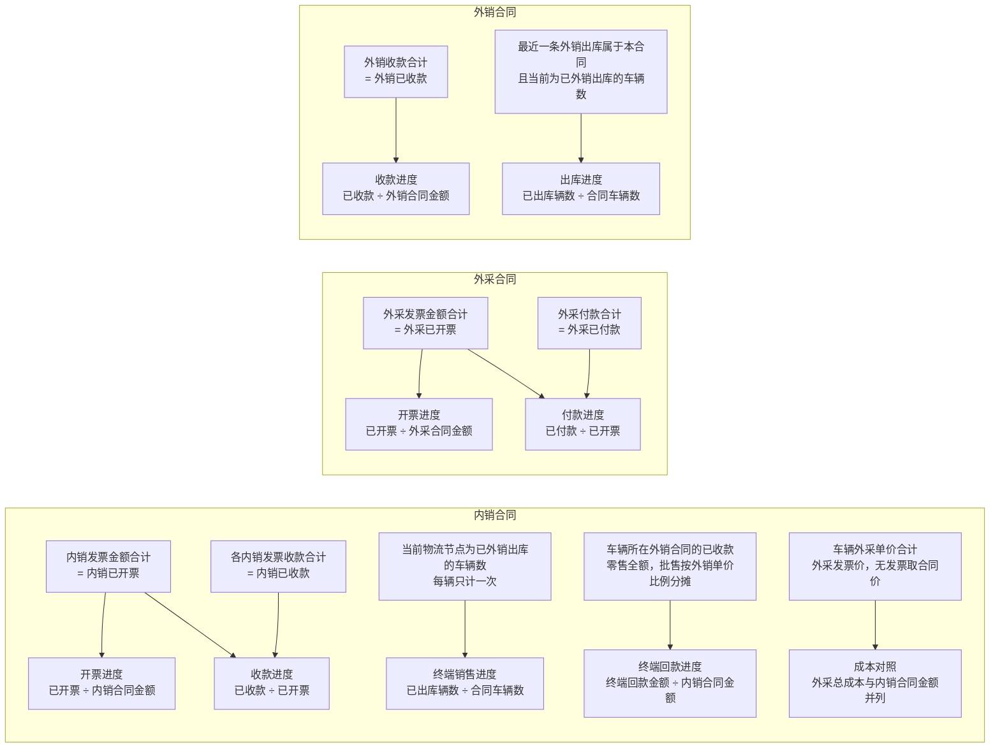

# 合同信息 · 流程图与状态机

2026-11-25｜需求评审稿（待多模块联调）

本册把[功能册](./01-合同信息-PRD.md)中的主要流程画成图，规则以功能册为准。图中方框是业务环节或业务对象，不代表页面或组件。本模块的合同没有需要定义的业务状态（执行进度是计算值，不是状态），所以本册只有流程图，没有状态机。图号沿用原值，已删除的图不再占号，缺号不代表遗漏。

| 图 | 内容 | 对应功能 |
| --- | --- | --- |
| [各入口与返回路径（图 M4-4）](#fig-m4-4) | 从哪些模块进入合同信息，合同详情中的单据编号和关联预警跳到哪里，回到哪里 | [菜单与页签（F-M4-10）](./01-合同信息-PRD.md#F-M4-10)、[关联预警（F-M4-08）](./01-合同信息-PRD.md#F-M4-08)、[可见范围与跨模块入口（F-M4-09）](./01-合同信息-PRD.md#F-M4-09) |
| [合同资料的采信与归集（图 M4-5）](#fig-m4-5) | 只采信已审核单据，形成三类合同，并挂上发票、收付和车辆 | [合同资料的采信与归集（F-M4-01）](./01-合同信息-PRD.md#F-M4-01) |
| [合同执行进度的取数关系（图 M4-6）](#fig-m4-6) | 三类合同的执行进度分别由哪些资料汇总得出 | [内销合同详情（F-M4-12）](./01-合同信息-PRD.md#F-M4-12)、[外采合同详情（F-M4-05）](./01-合同信息-PRD.md#F-M4-05)、[外采发票与付款（F-M4-06）](./01-合同信息-PRD.md#F-M4-06)、[外销合同详情（F-M4-14）](./01-合同信息-PRD.md#F-M4-14) |

## 图 M4-4 各入口与返回路径

- 从合同详情返回列表时回到进入前的页签，保留原查找与筛选条件；从其他模块进入时返回进入前的位置。
- 外采发票号进入所属外采合同详情，并定位到外采发票清单中的该发票。
- 目标单据已被移除时提示“该内容不存在或已更新”。

## 图 M4-5 合同资料的采信与归集

- 一辆车可同时属于一份外采合同、一份内销合同和一份或多份外销合同，各自独立展示。
- 批售合同的车辆按每行车辆的 VIN 逐车列出。
- 发票、付款或收款关联的合同尚未采信时暂不展示，合同采信后自动归入。

## 图 M4-6 合同执行进度的取数关系

每项进度都由已完成、总量、未完成、比率四个值组成，表达方式见[执行进度的统一表达](./01-合同信息-PRD.md#progress-model)。图中写出每项进度的“已完成 ÷ 总量”。

- 内销发票金额、待收款金额与应收账款（M3）中对应应收账款的金额一致；车辆的三项单价与车辆履约（M5）价格链一致，车辆的外销收款情况按 M5 判定，只在车辆清单中展示，不参与终端回款进度计算。
- 外销收款以外销合同为单位合计，不拆到车辆。
- 未完成小于 0 时为 0；比率超过 100% 按实际值展示；合计中任一笔无法折算时为“无法计算”。
- 美元值按汇率管理（M11）查看时的当前汇率折算。
- 终端回款中批售合同的收款按比例分摊，规则见[终端回款金额的计入](./01-合同信息-PRD.md#terminal-receipt)；分摊依据为外销单价占比。
- 图中各进度只是计算值，本模块不据此判断风险；风控判断由风控预警（M8）负责。
