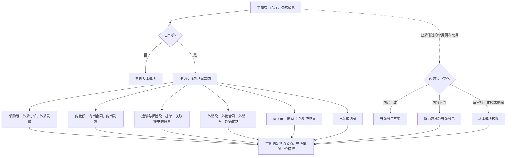
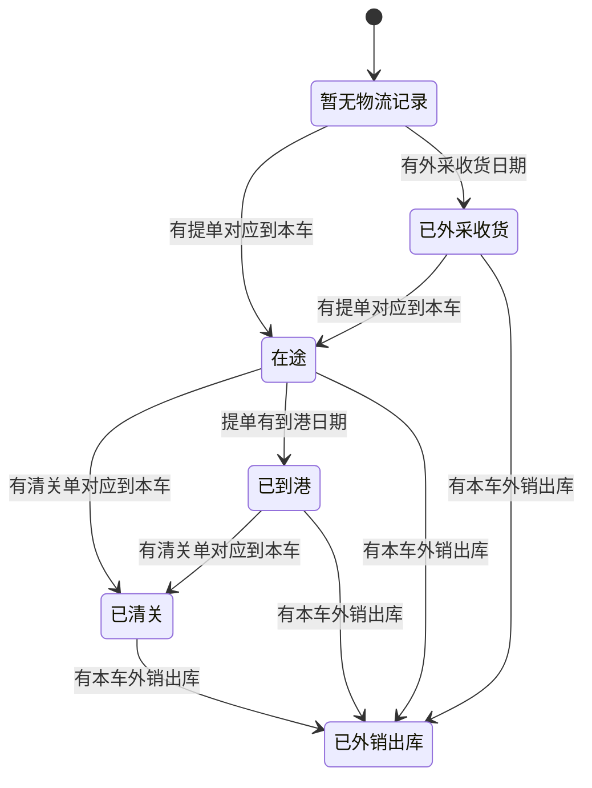
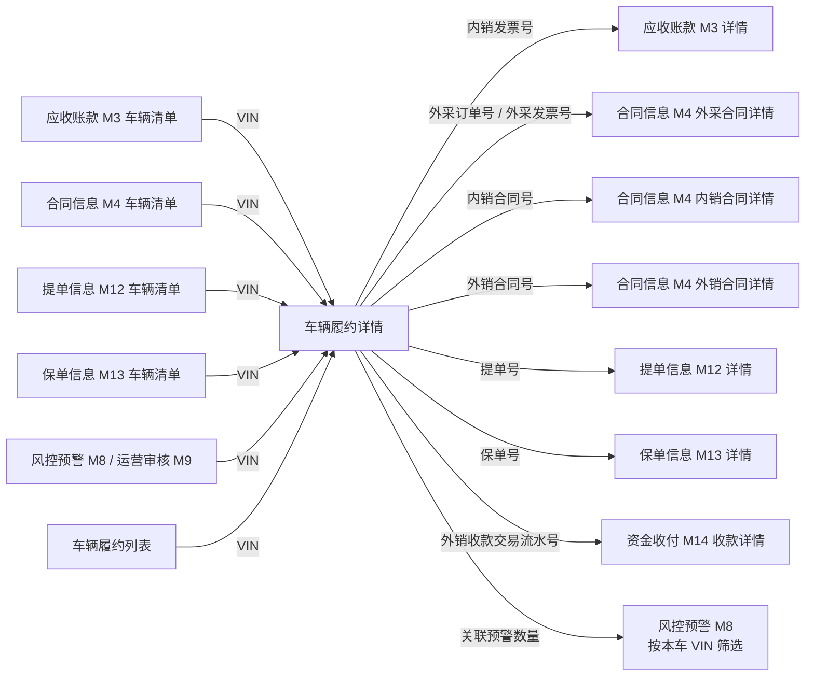
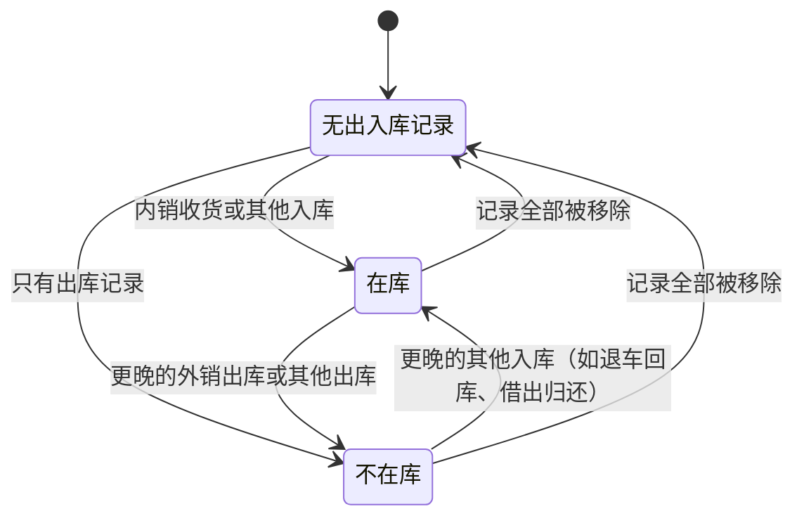

# 车辆履约 · 流程图与状态机

2026-11-19｜需求评审稿（待多模块联调）

本册把[功能册](./01-车辆履约-PRD.md)中的主要流程与状态画成图，规则以功能册为准。图中方框是业务环节或状态，不代表页面或组件。图号沿用原值，缺号不代表遗漏。

| 图 | 内容 | 对应功能 |
| --- | --- | --- |
| [车辆资料的采信与关联（图 M5-1）](#fig-m5-1) | 只采信已审核单据，按 VIN 关联到车辆，以及更新与移除后的重新判定 | [车辆资料的采信与关联（F-M5-01）](./01-车辆履约-PRD.md#F-M5-01) |
| [物流节点进度（图 M5-3）](#fig-m5-3) | 一辆车的当前物流节点按已有记录的最远节点变化 | [物流节点进度（F-M5-02）](./01-车辆履约-PRD.md#F-M5-02) |
| [各入口与跳转（图 M5-4）](#fig-m5-4) | 从哪些模块进入车辆履约，车辆页的单据编号和关联预警跳到哪里，回到哪里 | [单据编号跳转](./01-车辆履约-PRD.md#doc-links)、[关联预警（F-M5-13）](./01-车辆履约-PRD.md#F-M5-13)、[可见范围与跨模块入口（F-M5-14）](./01-车辆履约-PRD.md#F-M5-14) |
| [在库情况（图 M5-5）](#fig-m5-5) | 在库情况随出入库记录的变化 | [出入库与在库情况（F-M5-11）](./01-车辆履约-PRD.md#F-M5-11) |

## 图 M5-1 车辆资料的采信与关联

- 外采发票是就外采订单开具的发票，内销发票是就内销合同开具的发票。

## 图 M5-3 物流节点进度

当前物流节点取已有记录的最远节点，资料移除或更正后可以后退（图中只画前进方向）。

- 其他出库（如借出）不进入外销出库节点。
- 前序节点没有记录时如实展示“暂无记录”，不补全。

## 图 M5-4 各入口与跳转

- 从单据详情可返回本车详情；从车辆详情可返回进入前的位置。
- 目标单据已不再被采信时提示“该内容不存在或已更新”。

## 图 M5-5 在库情况

比较的是最近一次入库与最近一次出库的先后。

- 在库情况与当前物流节点相互独立，组合见[当前物流节点与在库情况的组合](./01-车辆履约-PRD.md#stock-combo)。
