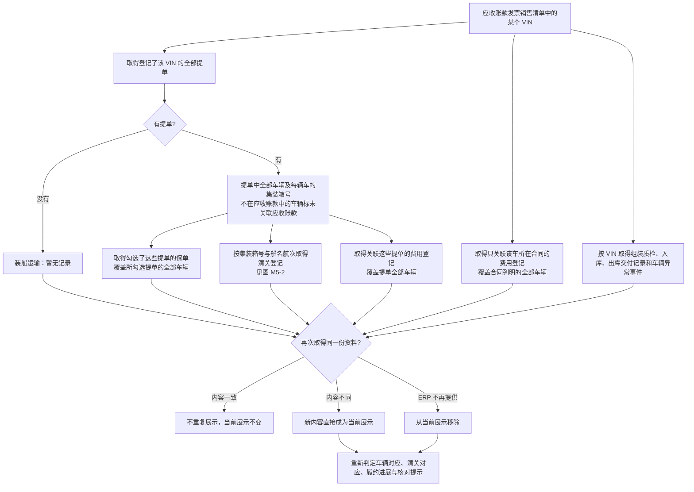
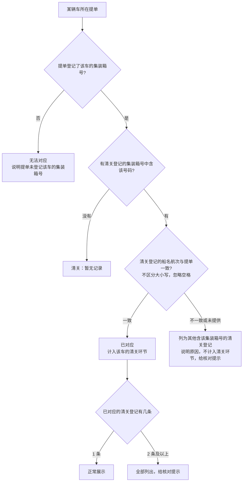
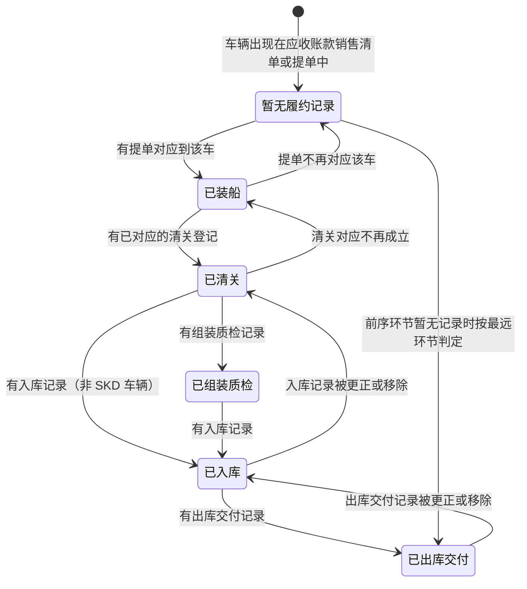
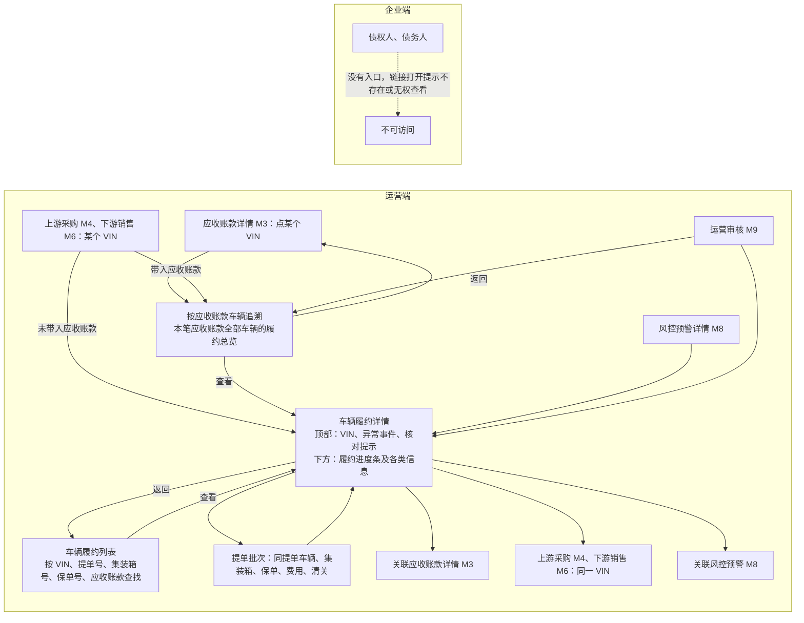

# 车辆物流与履约追溯 · 流程图与状态机

2026-11-13｜需求评审稿

本册把[功能册](./01-车辆物流与履约追溯-PRD.md)中的主要流程与状态画成图，规则以功能册为准。图中方框是业务环节或状态，不代表页面或组件。

| 图 | 内容 | 对应功能 |
| --- | --- | --- |
| [履约资料的取得与关联（图 M5-1）](#fig-m5-1) | 以应收账款发票车辆为入口，取得提单、保单、清关、费用和车辆履约记录并对应到车辆，以及重复与更新 | [履约资料的取得与关联（F-M5-01）](./01-车辆物流与履约追溯-PRD.md#F-M5-01) |
| [清关登记与车辆的对应（图 M5-2）](#fig-m5-2) | 按提单中该车的集装箱号与船名航次判定清关登记能否计入该车 | [清关登记与车辆的对应](./01-车辆物流与履约追溯-PRD.md#customs-match)、[清关（F-M5-08）](./01-车辆物流与履约追溯-PRD.md#F-M5-08) |
| [履约进展（图 M5-3）](#fig-m5-3) | 一辆车的履约进展按已有记录的最远环节变化，详情中以履约进度条展示 | [履约进展（F-M5-02）](./01-车辆物流与履约追溯-PRD.md#F-M5-02) |
| [各入口与返回路径（图 M5-4）](#fig-m5-4) | 运营从应收账款、上游采购、下游销售、列表、M8、M9 进入本模块，能继续去哪里、回到哪里 | [按应收账款车辆追溯（F-M5-04）](./01-车辆物流与履约追溯-PRD.md#F-M5-04)、[可见范围与跨模块入口（F-M5-14）](./01-车辆物流与履约追溯-PRD.md#F-M5-14) |

## 图 M5-1 履约资料的取得与关联

- 费用登记既关联提单又关联合同时按提单对应车辆；两者都未提供时不在本模块展示。
- 履约资料更新不改变应收账款的销售清单、装船日期、金额、回款和任何状态。

## 图 M5-2 清关登记与车辆的对应

对某辆车在某张提单中登记的集装箱号判定；一辆车在多张提单中时分别判定。

## 图 M5-3 履约进展

每辆车按五个环节中已有记录的最远环节判定；组装质检只对 SKD 车辆适用，可以没有。资料更正或移除后按最新资料重新判定，可以后退；没有终态。

- 前序环节没有记录、后续环节已有记录时，直接按最远环节判定，前序环节展示“暂无记录”；图中只画出一条跳跃示例，其余跳跃同理。
- 车辆异常事件、保单、费用不改变履约进展；履约进展与异常事件、核对提示的组合见功能册[组合表](./01-车辆物流与履约追溯-PRD.md#progress-combo)。
- 详情中以[履约进度条](./01-车辆物流与履约追溯-PRD.md#progress-bar)展示五个环节：已有记录的环节标为已完成并带日期，履约进展所在环节为当前环节，没有记录的环节展示“暂无记录”。

## 图 M5-4 各入口与返回路径

- 从 M4、M6、M8、M9 进入时，返回到进入前的位置。
- 列表和追溯总览只展示关键字段，经“查看”进入车辆履约详情。
