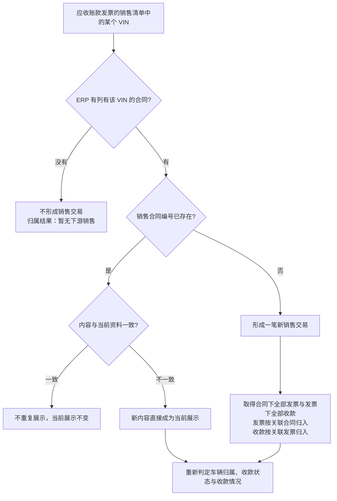
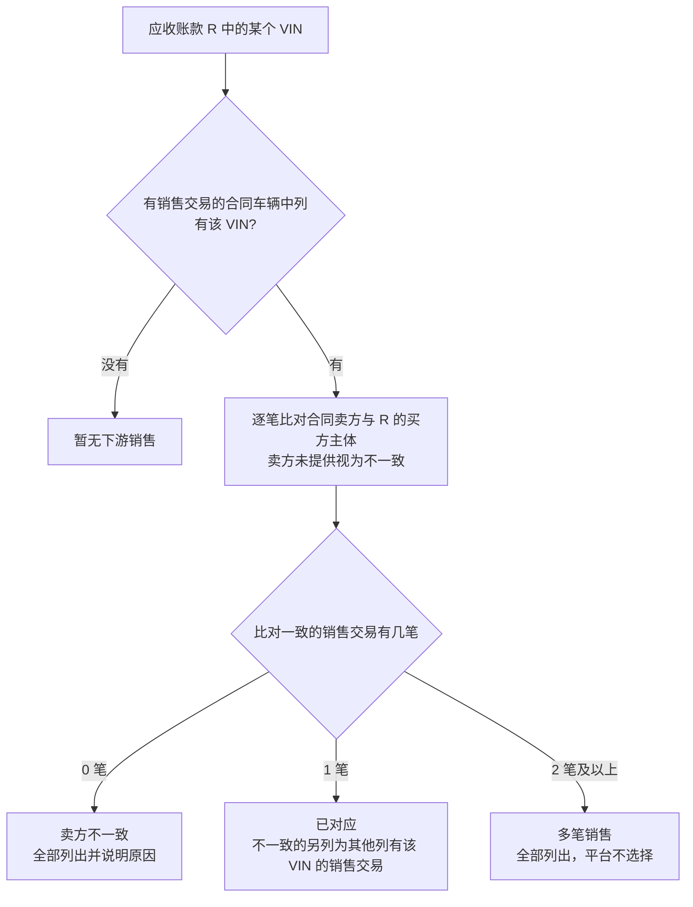
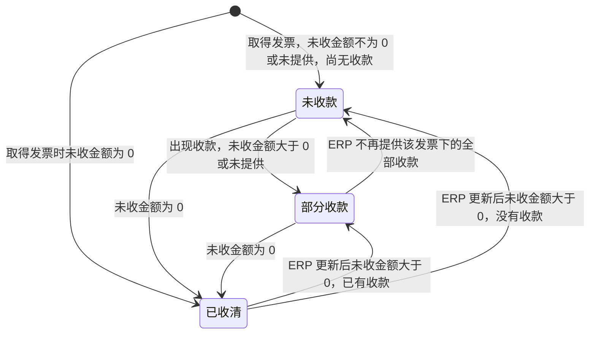
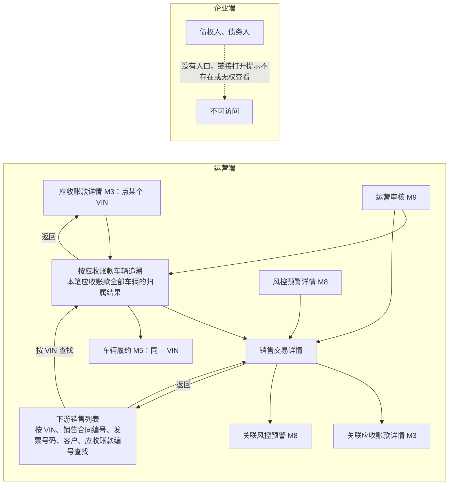

# 下游销售与收款追溯 · 流程图与状态机

2026-11-13｜需求评审稿

本册把[功能册](./01-下游销售与收款追溯-PRD.md)中的主要流程与状态画成图，规则以功能册为准。图中方框是业务环节或状态，不代表页面或组件。

| 图 | 内容 | 对应功能 |
| --- | --- | --- |
| [下游销售资料的取得与组织（图 M6-1）](#fig-m6-1) | 以应收账款发票为入口，按 VIN 取得合同、发票、收款并组成销售交易，以及重复与更新 | [下游销售资料的组织（F-M6-01）](./01-下游销售与收款追溯-PRD.md#F-M6-01) |
| [车辆归属判定（图 M6-2）](#fig-m6-2) | 对应收账款的某辆车，按合同车辆与合同卖方比对得出归属结果 | [车辆归属判定（F-M6-02）](./01-下游销售与收款追溯-PRD.md#F-M6-02) |
| [发票收款状态（图 M6-3）](#fig-m6-3) | 每张下游发票在未收款、部分收款、已收清之间的转换 | [收款信息（F-M6-06）](./01-下游销售与收款追溯-PRD.md#F-M6-06) |
| [各入口与返回路径（图 M6-4）](#fig-m6-4) | 运营从应收账款、下游销售列表、M8、M9 进入本模块，能继续去哪里、回到哪里 | [按应收账款车辆追溯（F-M6-04）](./01-下游销售与收款追溯-PRD.md#F-M6-04)、[可见范围与跨模块入口（F-M6-08）](./01-下游销售与收款追溯-PRD.md#F-M6-08) |

## 图 M6-1 下游销售资料的取得与组织

- 发票、收款再次取得时同样按“内容一致则不重复、不一致则以新内容替换当前展示”处理。
- ERP 不再提供某份资料时，从当前展示中移除。
- 任何下游资料的取得和更新都不改变应收账款的销售清单、金额、回款和状态。

## 图 M6-2 车辆归属判定

对应收账款 R 销售清单中的每个 VIN 分别判定；同一 VIN 在不同应收账款中分别判定。

- 归属结果是事实标注，运营不能在本模块认定或更改；资料更新后重新判定。
- 是否构成风控预警由 M8 判定。

## 图 M6-3 发票收款状态

每张下游发票按 ERP 提供的未收金额和该发票下的收款判定，ERP 资料更新后重新判定；没有终态。

- 销售交易的收款情况由合同下全部发票的收款状态和未开票金额得出，规则见功能册[收款状态与收款情况](./01-下游销售与收款追溯-PRD.md#collect-status)。
- 收款状态只描述卖方向客户的收款，不改变应收账款的回款状态。

## 图 M6-4 各入口与返回路径

- 从 M8、M9 进入时，返回到进入前的位置。
