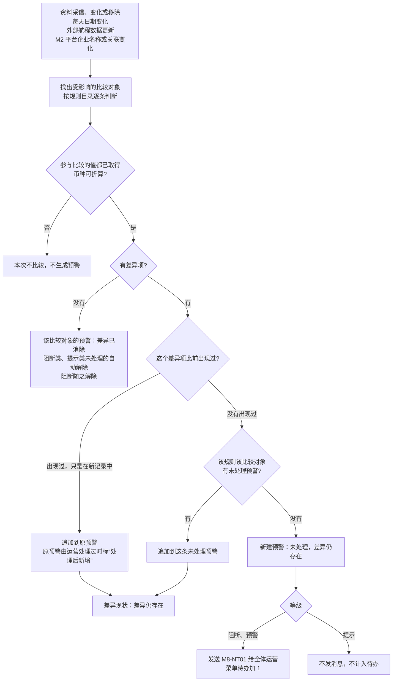
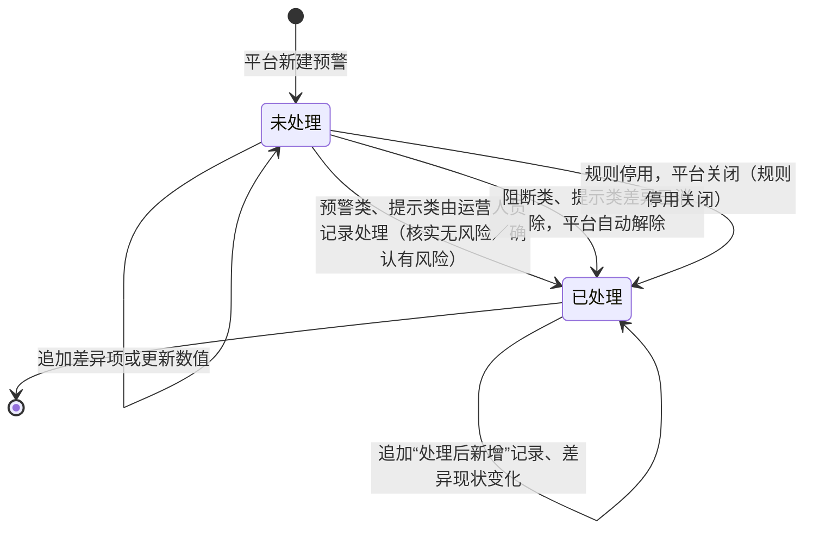
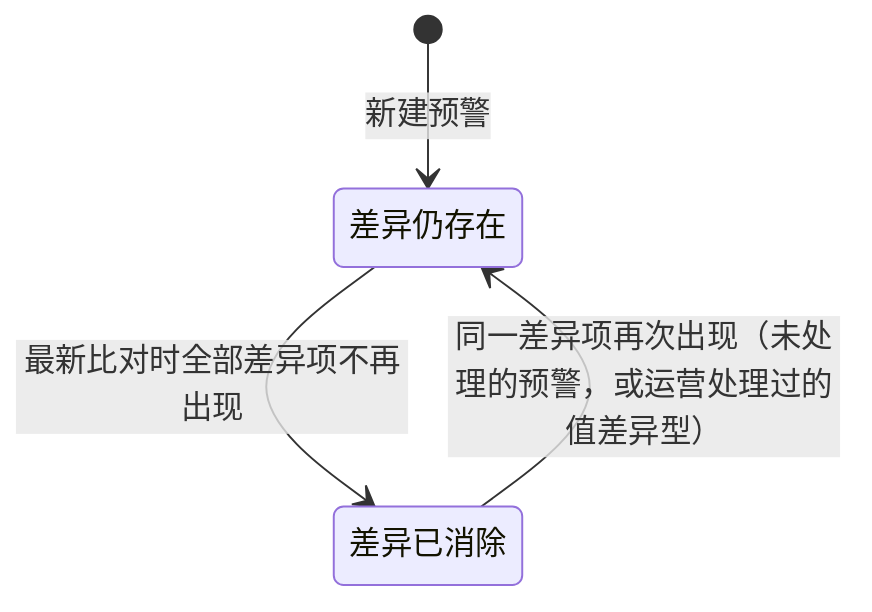
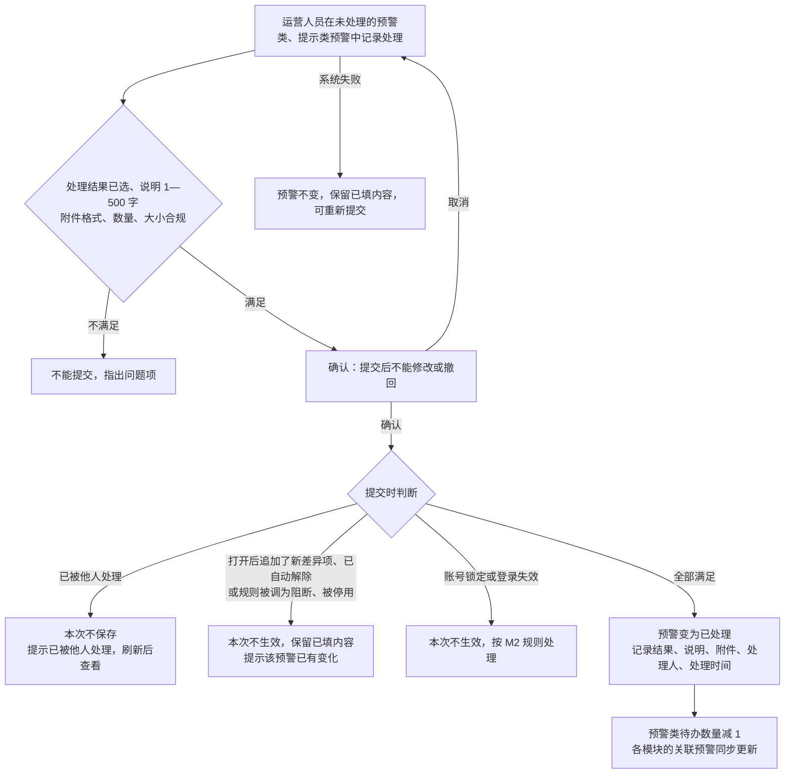
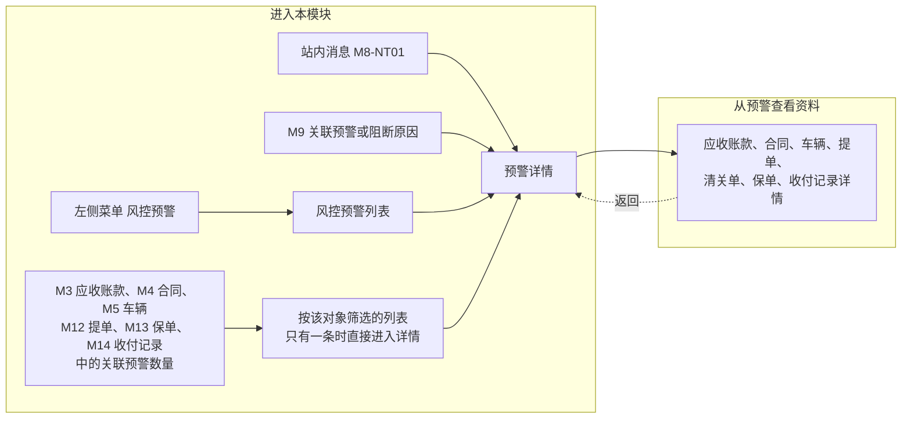
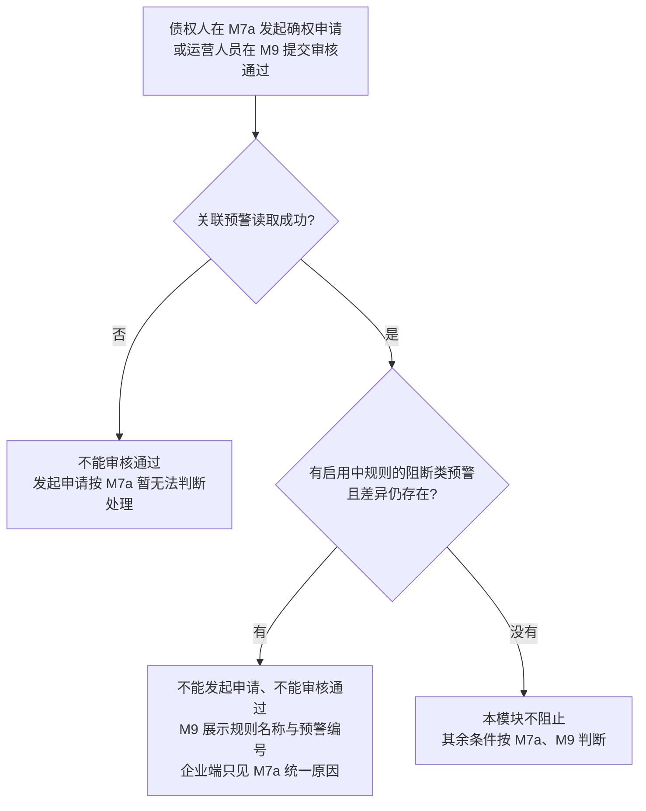
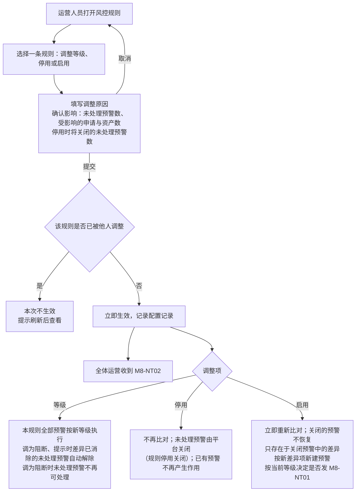

# 风控预警 · 流程图与状态机

2026-11-24｜需求评审稿

本册把[功能册](./01-风控预警-PRD.md)中的主要流程与状态画成图，规则以功能册为准。图中方框是业务环节或状态，不代表页面或组件。

| 图 | 内容 | 对应功能 |
| --- | --- | --- |
| [比对与预警生成（图 M8-1）](#fig-m8-1) | 资料或日期变化后，按规则得出差异项，以及新建、追加、去重和差异现状更新 | [比对与预警生成（F-M8-01）](./01-风控预警-PRD.md#F-M8-01)、[风控规则目录](./01-风控预警-PRD.md#rule-catalog) |
| [预警状态（图 M8-2）](#fig-m8-2) | 预警状态与差异现状各自怎样变化，阻断类、提示类如何自动解除，规则停用时如何关闭 | [风控等级与阻断（F-M8-10）](./01-风控预警-PRD.md#F-M8-10)、[核实处理与预警记录（F-M8-07）](./01-风控预警-PRD.md#F-M8-07)、[状态组合](./01-风控预警-PRD.md#status-combo) |
| [记录处理的提交（图 M8-3）](#fig-m8-3) | 预警类、提示类提交处理时的校验、并发、新差异与失败 | [记录处理](./01-风控预警-PRD.md#process) |
| [各入口与返回路径（图 M8-4）](#fig-m8-4) | 从菜单、消息、资产数据各模块、M9 进入本模块，以及从预警进入各模块资料后的返回 | [预警详情（F-M8-06）](./01-风控预警-PRD.md#F-M8-06)、[关联预警对外提供与跨模块入口（F-M8-08）](./01-风控预警-PRD.md#F-M8-08) |
| [阻断对确权申请与运营审核的作用（图 M8-5）](#fig-m8-5) | M7a 发起确权申请、M9 提交审核通过时，如何按关联预警的等级与差异现状判断是否阻断 | [阻断的作用](./01-风控预警-PRD.md#blocking)、[与运营审核的关系](./01-风控预警-PRD.md#m9-relation) |
| [风控规则配置（图 M8-6）](#fig-m8-6) | 调整等级、停用与启用的提交与生效，停用时关闭未处理预警 | [风控规则配置（F-M8-19）](./01-风控预警-PRD.md#F-M8-19) |

## 图 M8-1 比对与预警生成

- 值差异型规则按“比较对象 + 不一致的值”区分差异项；条件型规则在条件持续成立期间是同一个差异项，条件消除后再次成立才算新差异项。
- 单纯更新汇率不触发重新比对。

## 图 M8-2 预警状态

预警状态：

差异现状（与预警状态相互独立）：

- 已处理是终态，处理结果不可修改或撤回。
- 阻断类：差异仍存在时阻止关联应收账款发起确权申请和审核通过，与预警状态无关；差异已消除时阻断解除。
- 运营处理过的条件型预警在条件消除后再次成立时，以及由平台结束（已自动解除、规则停用关闭）的预警遇到同一差异再次出现时，按新事实新建预警，原预警保持不变。
- 阻断类预警没有人工处理；是否阻断以差异现状为准，未处理的阻断类预警计入待办，差异消除后由平台自动结束。

## 图 M8-3 记录处理的提交

## 图 M8-4 各入口与返回路径

- 从列表进入详情后返回列表，保留原查找与筛选条件；从消息、各模块、M9 进入时返回进入前的位置。
- 带入的预警或筛选对象已不存在时，展示“该内容不存在或已更新”，可返回来源位置。
- 三方数据源从左侧菜单“三方数据源”进入，只有能力说明，不与上述路径相连。

## 图 M8-5 阻断对确权申请与运营审核的作用

- 阻断类预警没有人工处理；阻断只随差异已消除、规则降级或停用而解除。
- 等级按规则的当前等级判断；规则已停用的预警不参与判断。
- 预警类、提示类预警不阻止确权申请与运营审核；已提交的申请照常推进，阻断不阻止债务人确认。

## 图 M8-6 风控规则配置

