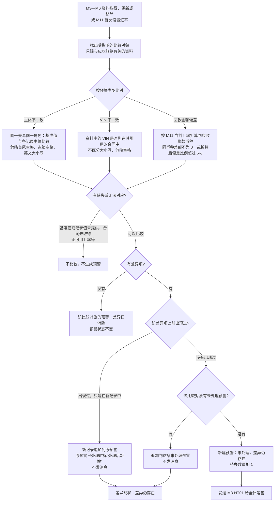
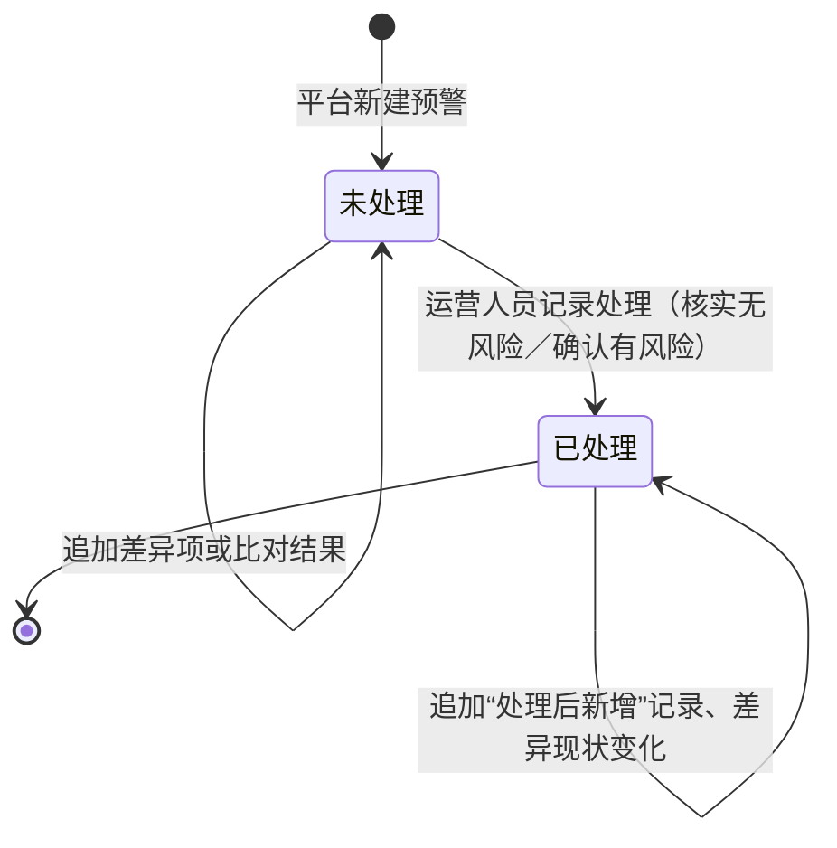
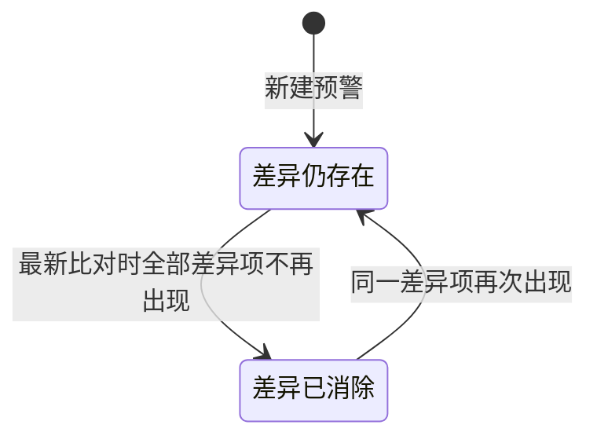
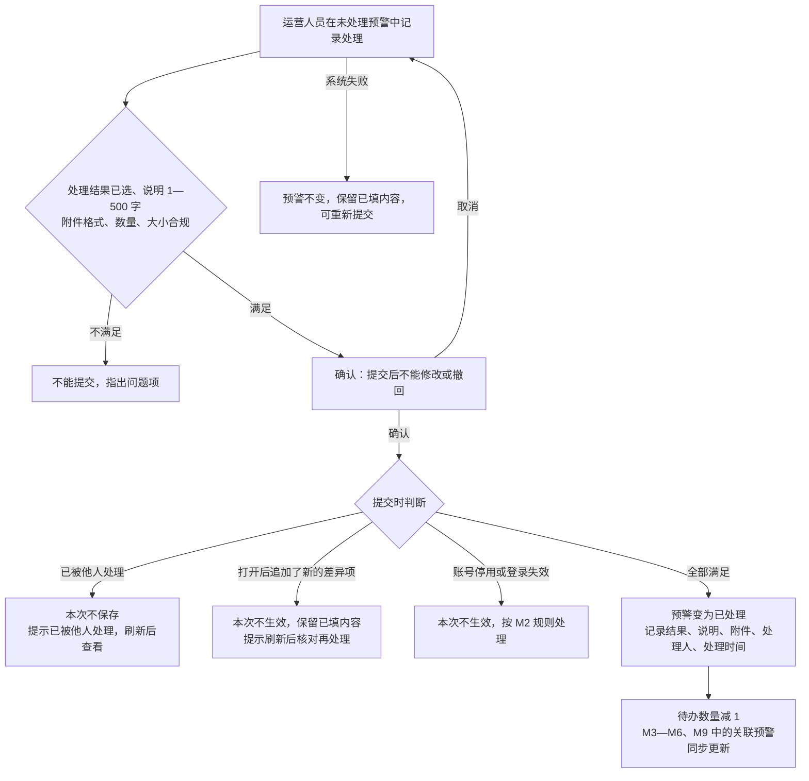
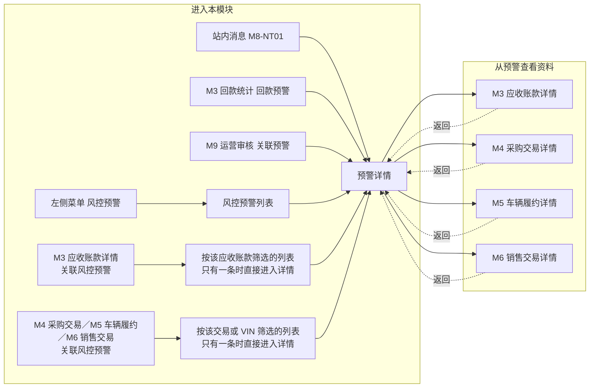

# 风控预警与三方数据源 · 流程图与状态机

2026-11-12｜需求评审稿

本册把[功能册](./01-风控预警与三方数据源-PRD.md)中的主要流程与状态画成图，规则以功能册为准。图中方框是业务环节或状态，不代表页面或组件。

| 图 | 内容 | 对应功能 |
| --- | --- | --- |
| [比对与预警生成（图 M8-1）](#fig-m8-1) | 资料取得或更新后，三类比对怎样得出差异项，以及新建、追加、去重和差异现状更新 | [比对与预警生成（F-M8-01）](./01-风控预警与三方数据源-PRD.md#F-M8-01)、[主体不一致比对（F-M8-02）](./01-风控预警与三方数据源-PRD.md#F-M8-02)、[VIN 不一致比对（F-M8-03）](./01-风控预警与三方数据源-PRD.md#F-M8-03)、[回款金额偏差比对（F-M8-04）](./01-风控预警与三方数据源-PRD.md#F-M8-04) |
| [预警状态（图 M8-2）](#fig-m8-2) | 预警状态与差异现状两个维度各自怎样变化 | [核实处理与预警记录（F-M8-07）](./01-风控预警与三方数据源-PRD.md#F-M8-07)、[状态组合](./01-风控预警与三方数据源-PRD.md#status-combo) |
| [记录处理的提交（图 M8-3）](#fig-m8-3) | 提交处理时的校验、并发、新差异与失败 | [记录处理](./01-风控预警与三方数据源-PRD.md#process) |
| [各入口与返回路径（图 M8-4）](#fig-m8-4) | 从菜单、消息、M3—M6、M9 进入本模块，以及从预警进入各模块资料后的返回 | [预警详情（F-M8-06）](./01-风控预警与三方数据源-PRD.md#F-M8-06)、[关联预警对外提供与跨模块入口（F-M8-08）](./01-风控预警与三方数据源-PRD.md#F-M8-08) |

## 图 M8-1 比对与预警生成

- 回款金额偏差没有“出现过”的去重：已处理之后资料再次变化且仍超过阈值时，按新事实新建预警。
- 单纯更新汇率不触发重新比对。
- 预警不改变任何资料与业务状态，不阻止确权、审核或出库。

## 图 M8-2 预警状态

预警状态：

差异现状（与预警状态相互独立）：

- 已处理是终态，处理结果不可修改或撤回。
- 差异已消除不会自动结束预警；未处理的预警仍需运营人员记录处理。
- 两个维度的组合结果见功能册[状态组合](./01-风控预警与三方数据源-PRD.md#status-combo)。

## 图 M8-3 记录处理的提交

## 图 M8-4 各入口与返回路径

- 从列表进入详情后返回列表，保留原查找与筛选条件；从消息、M3—M6、M9 进入时返回进入前的位置。
- 带入的预警或筛选对象已不存在时，展示“该内容不存在或已更新”，可返回来源位置。
- 三方数据源从左侧菜单“三方数据源”进入，只有能力说明，不与上述路径相连。
