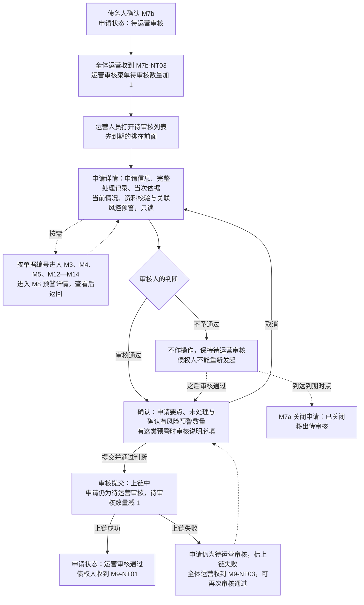
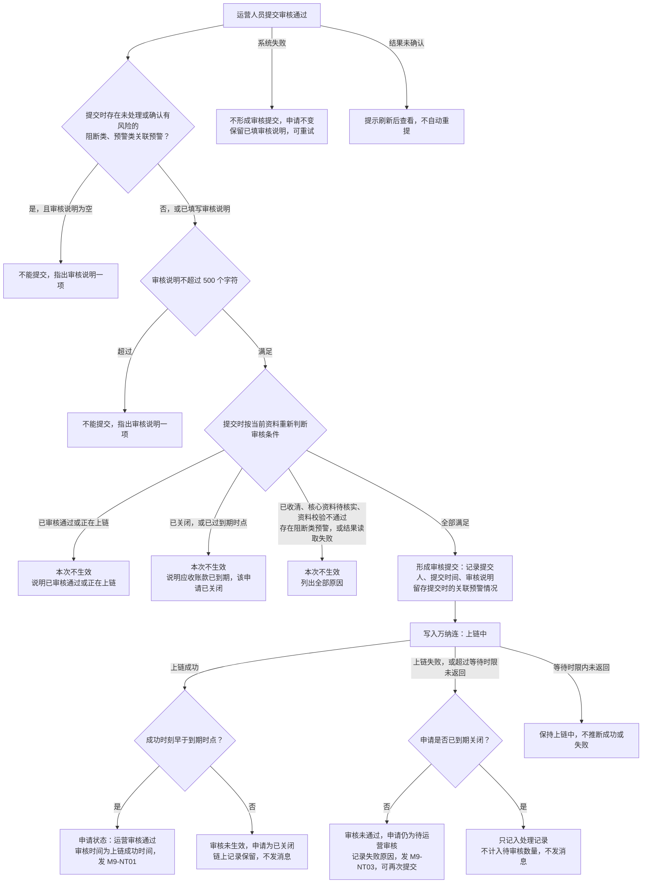
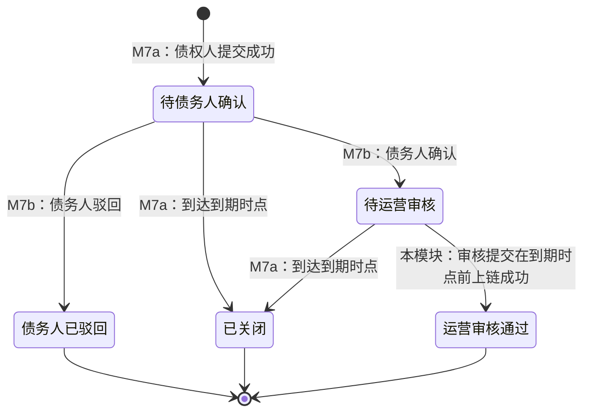
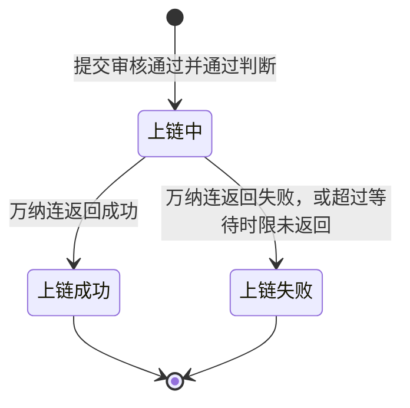

# 运营审核 · 流程图与状态机

2026-11-25｜需求评审稿

本册把[功能册](./01-运营审核-PRD.md)中的主要流程与状态画成图，规则以功能册为准。图中方框是业务环节或状态，不代表页面或组件。图号沿用原值，缺号不代表遗漏。

| 图 | 内容 | 对应功能 |
| --- | --- | --- |
| [运营审核（图 M9-1）](#fig-m9-1) | 从申请进入待审核，到核对依据、审核通过或不予通过的去向 | [运营审核列表与待办数量（F-M9-01）](./01-运营审核-PRD.md#F-M9-01)、[申请详情与审核依据（F-M9-02）](./01-运营审核-PRD.md#F-M9-02)、[不予通过的申请](./01-运营审核-PRD.md#not-approved) |
| [审核通过的提交与上链（图 M9-2）](#fig-m9-2) | 提交时重新判断条件、审核说明、上链成功与失败、并发与失败 | [审核通过（F-M9-03）](./01-运营审核-PRD.md#F-M9-03) |
| [申请状态（图 M9-5）](#fig-m9-5) | 申请状态中由本模块带来的变化 | [审核通过（F-M9-03）](./01-运营审核-PRD.md#F-M9-03) |
| [审核提交的上链结果（图 M9-6）](#fig-m9-6) | 一次审核提交上链结果的全部转换 | [审核提交的上链结果](./01-运营审核-PRD.md#submit-status) |

## 图 M9-1 运营审核

- 审核通过也可以从待审核列表中的行发起，规则相同。
- 提交时的条件判断与异常见[审核通过的提交与上链（图 M9-2）](#fig-m9-2)。

## 图 M9-2 审核通过的提交与上链

- 同一申请重复点击、或两名运营人员同时提交时，只有先通过判断的一次形成审核提交。
- 到期时点之后提交的不生效，即使 M7a 尚未完成关闭；上链成功的时刻是否早于到期时点按 M7a 到期时点前后的处理判断，见[提交与上链](./01-运营审核-PRD.md#review-result)。

## 图 M9-5 申请状态

申请状态由 M7a 定义，本图只标出本模块带来的变化。上链结果不是申请状态，见[审核提交的上链结果（图 M9-6）](#fig-m9-6)。

- 本模块只带来“运营审核通过”一种申请状态变化，只能从“待运营审核”开始，且只在上链成功时发生；没有驳回或不通过。
- 上链中、上链失败时申请状态保持“待运营审核”。
- “运营审核通过”到期时不变。

## 图 M9-6 审核提交的上链结果

每一次审核提交各有一个上链结果。初始为“上链中”（提交通过判断时形成）；“上链成功”“上链失败”为终态。

- 上链失败后运营人员再次提交，形成新的审核提交，从“上链中”重新开始；之前那次的结果保持“上链失败”。
- 一笔申请同一时间最多一个“上链中”的审核提交，最多一次审核通过生效。
- 等待时限内结果未返回时保持“上链中”；超时后才返回的结果只记录，不改变上链结果。
- “上链成功”不一定使审核通过：成功时刻早于到期时点的，申请变为“运营审核通过”；等于或晚于到期时点的，审核未生效，申请为“已关闭”。
- 申请已关闭时的上链失败只记录，不发消息。
