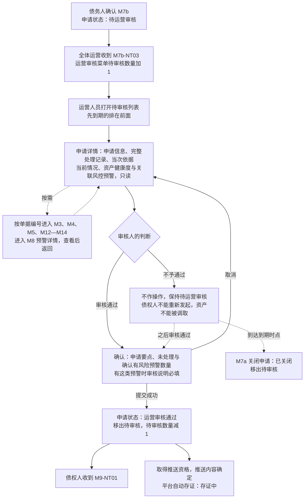
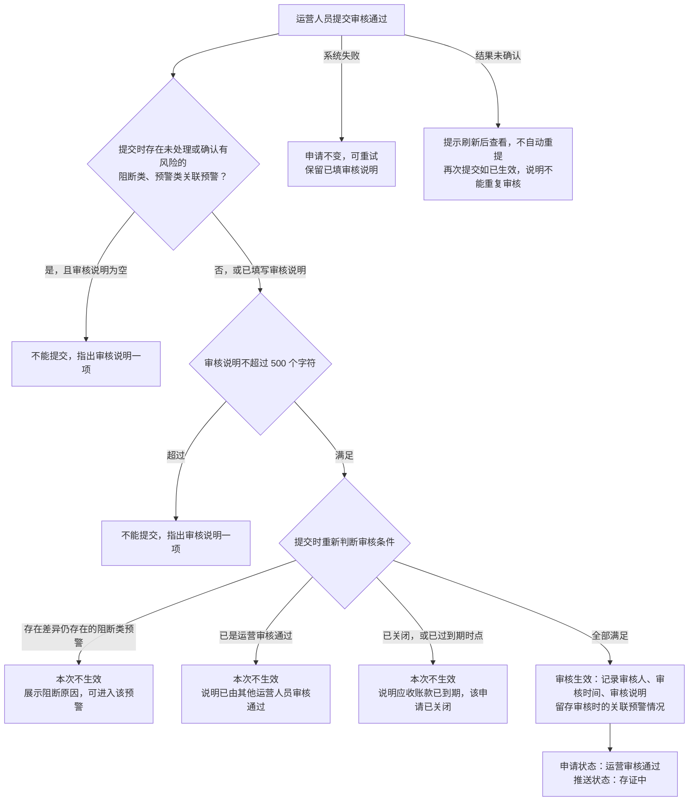
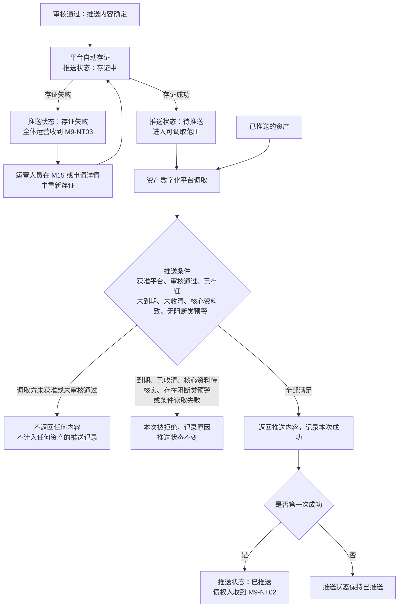
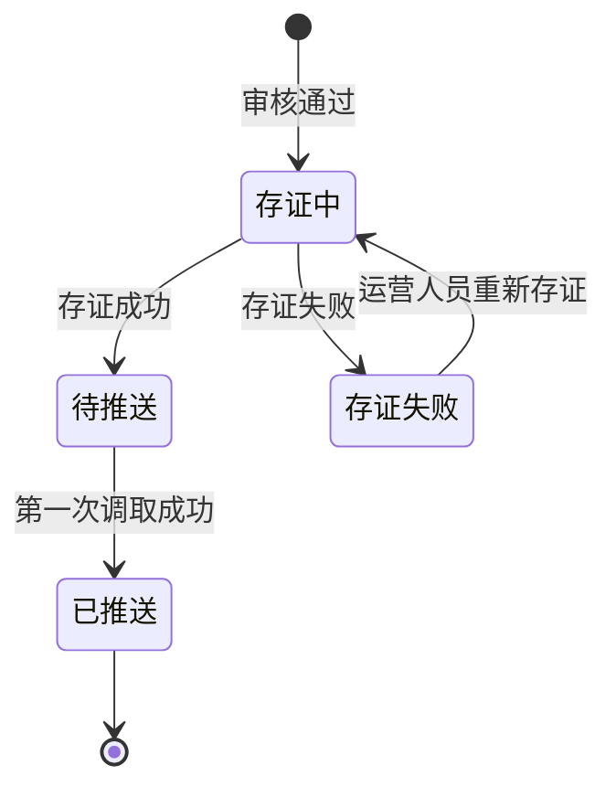
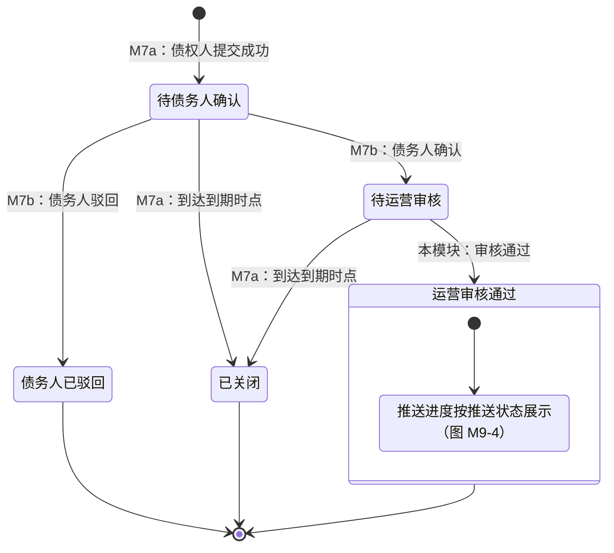

# 运营审核与资产推送 · 流程图与状态机

2026-11-24｜需求评审稿

本册把[功能册](./01-运营审核与资产推送-PRD.md)中的主要流程与状态画成图，规则以功能册为准。图中方框是业务环节或状态，不代表页面或组件。

| 图 | 内容 | 对应功能 |
| --- | --- | --- |
| [运营审核（图 M9-1）](#fig-m9-1) | 从申请进入待审核，到核对依据、审核通过或不予通过的去向 | [运营审核列表与待办数量（F-M9-01）](./01-运营审核与资产推送-PRD.md#F-M9-01)、[申请详情与审核依据（F-M9-02）](./01-运营审核与资产推送-PRD.md#F-M9-02)、[不予通过的申请](./01-运营审核与资产推送-PRD.md#not-approved) |
| [审核通过的提交（图 M9-2）](#fig-m9-2) | 提交时重新判断条件、审核说明、到期边界、并发与失败 | [审核通过（F-M9-03）](./01-运营审核与资产推送-PRD.md#F-M9-03) |
| [存证与被调取（图 M9-3）](#fig-m9-3) | 审核通过后自动存证、存证失败后重新存证、每次调取的判断 | [推送条件（F-M9-05）](./01-运营审核与资产推送-PRD.md#F-M9-05)、[存证与推送内容（F-M9-06）](./01-运营审核与资产推送-PRD.md#F-M9-06)、[被调取与推送状态（F-M9-07）](./01-运营审核与资产推送-PRD.md#F-M9-07) |
| [推送状态（图 M9-4）](#fig-m9-4) | 一笔资产推送状态的全部转换 | [推送状态](./01-运营审核与资产推送-PRD.md#push-status) |
| [申请状态与推送进度（图 M9-5）](#fig-m9-5) | 申请状态中由本模块带来的变化，以及审核通过后接上的推送进度 | [审核通过（F-M9-03）](./01-运营审核与资产推送-PRD.md#F-M9-03)、[推送进度对外提供（F-M9-08）](./01-运营审核与资产推送-PRD.md#F-M9-08) |

## 图 M9-1 运营审核

- 审核通过也可以从待审核列表中的行发起，规则相同。
- 提交时的条件判断与异常见[审核通过的提交（图 M9-2）](#fig-m9-2)。

## 图 M9-2 审核通过的提交

- 同一申请重复点击、或两名运营人员同时提交时，只有先提交成功的一次生效。
- 到期以到期时点为界：到期时点之前提交成功的有效；之后提交的不生效，即使 M7a 尚未完成关闭。

## 图 M9-3 存证与被调取

- 推送内容在审核通过时确定，每次成功调取都返回同一份内容。
- 存证结果未返回时保持“存证中”；资产数字化平台的调取方式待验证，见[资产数字化平台的调取能力（Q-M9-03）](./01-运营审核与资产推送-PRD.md#Q-M9-03)。

## 图 M9-4 推送状态

推送状态属于一笔取得推送资格的资产。初始状态为“存证中”（审核通过时形成）；“已推送”为终态。

- 资料变化、风控预警、被拒绝的调取、企业角色或账号变化都不改变推送状态。
- 债权人看到的“未推送”包含存证中、存证失败、待推送，对应关系见[推送进度对外提供（F-M9-08）](./01-运营审核与资产推送-PRD.md#F-M9-08)。

## 图 M9-5 申请状态与推送进度

申请状态由 M7a 定义，本图只标出本模块带来的变化，以及审核通过后接上的推送进度。推送进度不是申请状态，不改变申请状态。

- 本模块只带来“运营审核通过”一种申请状态变化，且只能从“待运营审核”开始；没有驳回或不通过。
- “运营审核通过”到期时不变；之后的调取能否成功按推送条件判断。
