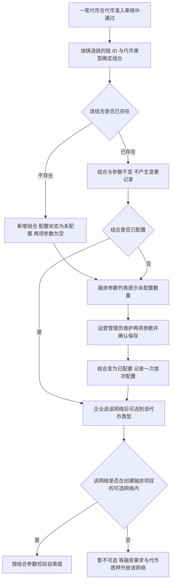
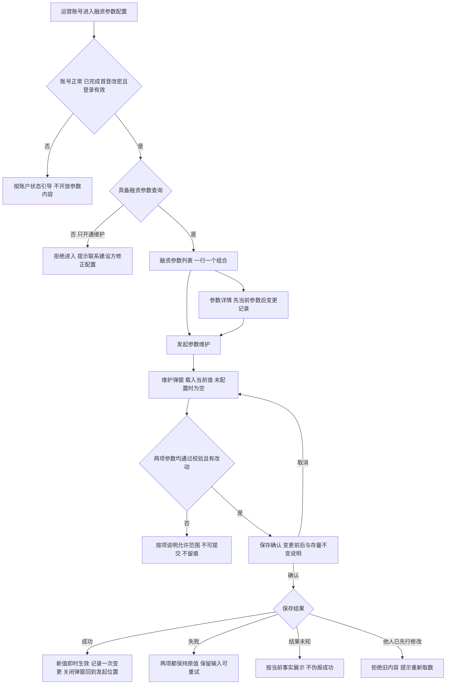
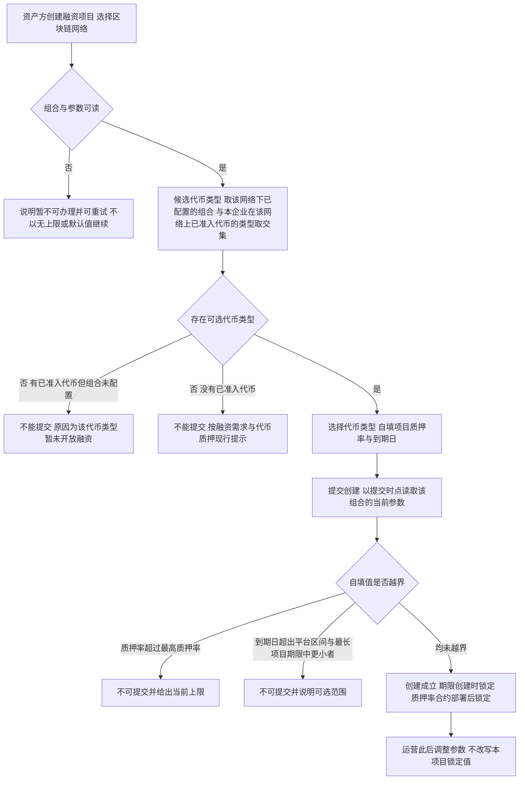
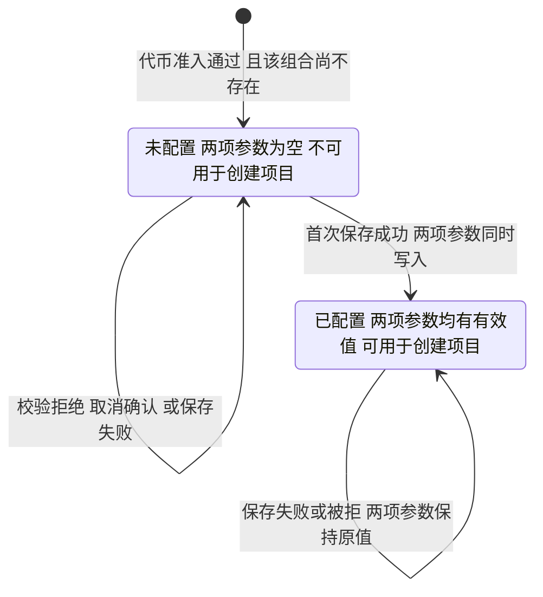
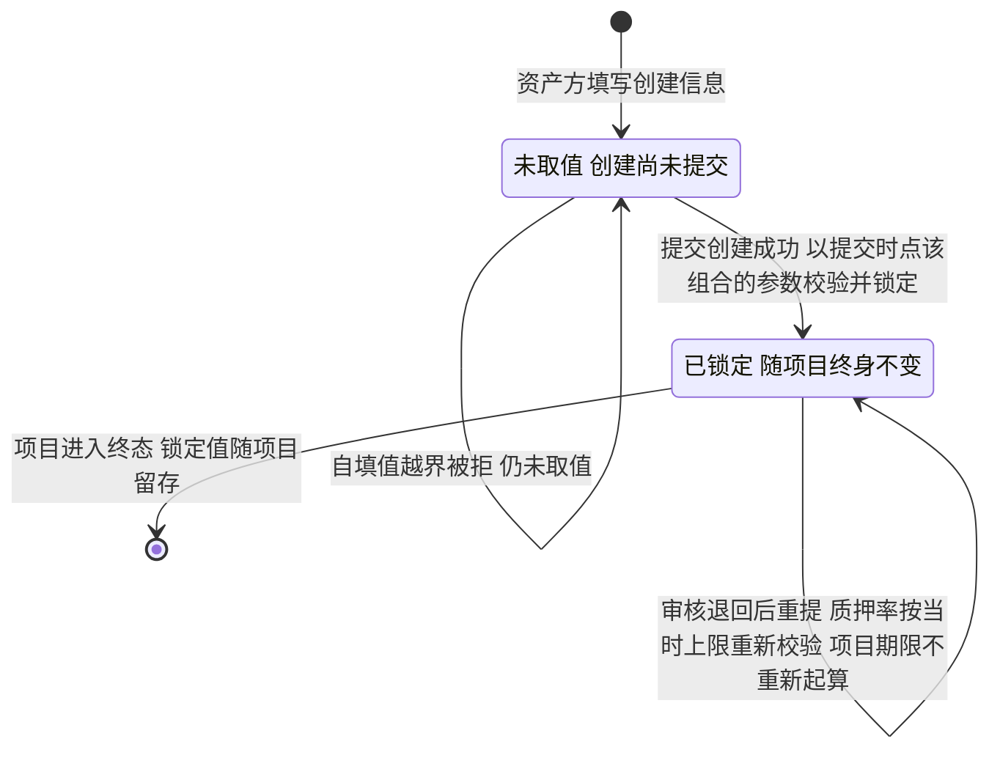

# 运营端融资参数配置 · 流程图与状态机

2026-10-21｜需求评审稿

本册把[功能与业务规则](./01-运营端融资参数配置-PRD.md)中的主要流程与状态画成图，规则以功能册为准。图中方框是业务环节，不代表页面或组件；图中不画逐笔质押的任何环节。

| 图 | 内容 | 对应功能 |
| --- | --- | --- |
| 组合的产生与配置（FL-O-FC-03） | 代币准入通过 → 产生或沿用组合 → 运营配置 → 企业可选 | [组合随代币准入产生（F-O-FC-06）](./01-运营端融资参数配置-PRD.md#f-o-fc-06) |
| 参数读取与维护（FL-O-FC-01） | 运营读取列表与详情，在弹窗中维护并确认保存 | [融资参数列表与检索（F-O-FC-01）](./01-运营端融资参数配置-PRD.md#f-o-fc-01)、[参数详情与变更记录（F-O-FC-02）](./01-运营端融资参数配置-PRD.md#f-o-fc-02)、[参数维护与保存（F-O-FC-03）](./01-运营端融资参数配置-PRD.md#f-o-fc-03) |
| 创建融资项目的参数供给与锁定（FL-O-FC-02） | 资产方选网络与代币类型时取哪个组合、未配置时的结果、提交时锁定 | [创建融资项目的参数供给与未配置处理（F-O-FC-05）](./01-运营端融资参数配置-PRD.md#f-o-fc-05)、[参数生效与存量隔离（F-O-FC-04）](./01-运营端融资参数配置-PRD.md#f-o-fc-04) |
| 组合融资参数状态机（ST-O-FC-01） | 一个组合的配置状态与转换 | [组合随代币准入产生（F-O-FC-06）](./01-运营端融资参数配置-PRD.md#f-o-fc-06)、[参数维护与保存（F-O-FC-03）](./01-运营端融资参数配置-PRD.md#f-o-fc-03) |
| 项目参数取值的锁定（ST-O-FC-02） | 一个融资项目采用的参数取值何时锁定 | [参数生效与存量隔离（F-O-FC-04）](./01-运营端融资参数配置-PRD.md#f-o-fc-04)、[创建融资项目的参数供给与未配置处理（F-O-FC-05）](./01-运营端融资参数配置-PRD.md#f-o-fc-05) |

## 组合的产生与配置（FL-O-FC-03）

待审核、已退回的代币不产生组合。组合一经产生一直保留，代币失效或持有变化都不移除组合。

## 参数读取与维护（FL-O-FC-01）

两项参数要么全部采用新值，要么全部保持原值。未提交的编辑、校验拒绝、取消确认与保存失败都不产生变更记录。

## 创建融资项目的参数供给与锁定（FL-O-FC-02）

面客侧的选择、自填与提示规则以[融资需求与代币质押](../../面客端/05-借贷广场-融资需求与代币质押/01-融资需求与代币质押-PRD.md#f-ls-01)为准，本图只表达参数从哪个组合来、在哪个时点被取用。

校验与锁定用同一份提交时点的参数值。同一代币类型在不同网络上按各自组合取值。

## 组合融资参数状态机（ST-O-FC-01）

对象是一个组合（区块链网络 + 代币类型）的融资参数配置，不是项目、代币或质押笔。状态取自[配置状态（FC-04）](./01-运营端融资参数配置-PRD.md#fc-04)。本模块没有草稿、待生效、停用或删除状态。

转换只由组合的产生与运营的保存成功触发；后续代币准入通过、代币失效、持有变化、项目创建、项目审核或时间流逝都不改变状态。组合没有终态，一经产生一直保留。

## 项目参数取值的锁定（ST-O-FC-02）

对象是一个融资项目所采用的参数取值；项目自身的状态以[项目状态机](../../面客端/05-借贷广场-融资需求与代币质押/02-融资需求与代币质押-流程图与状态机.md#st-ls-01)为准，本图不重复。

参数调整不触发额度重算、质押情况判断或到期日变化；上限调至低于存量锁定值不构成冲突，也不产生存量整改。
