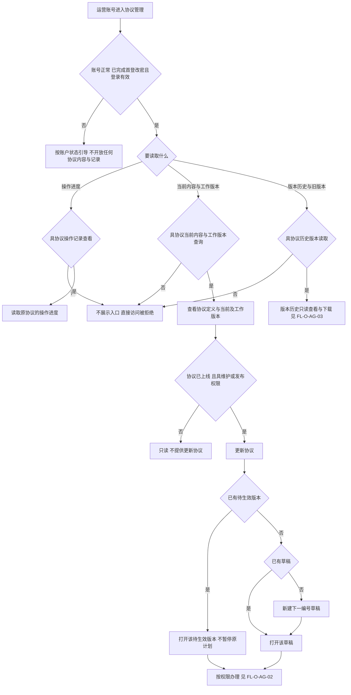
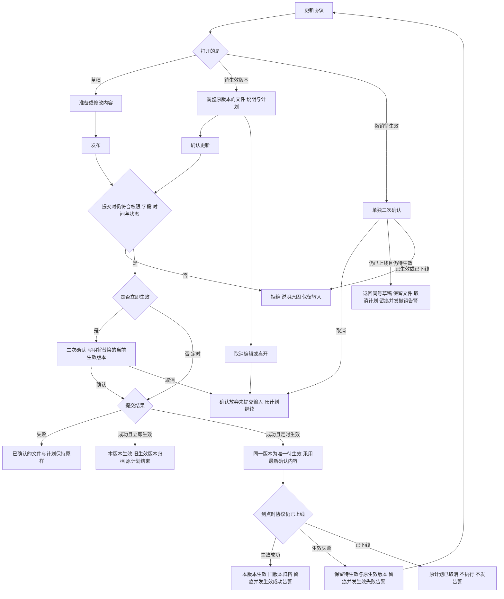
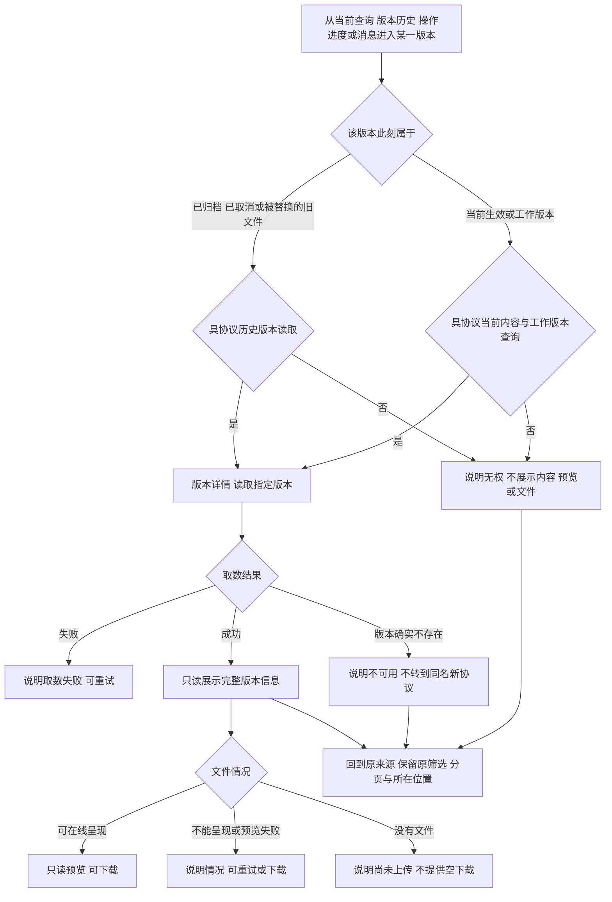
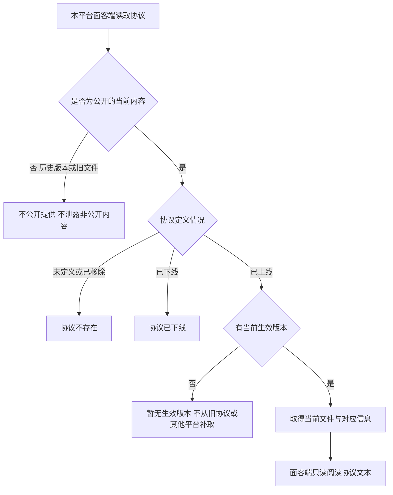
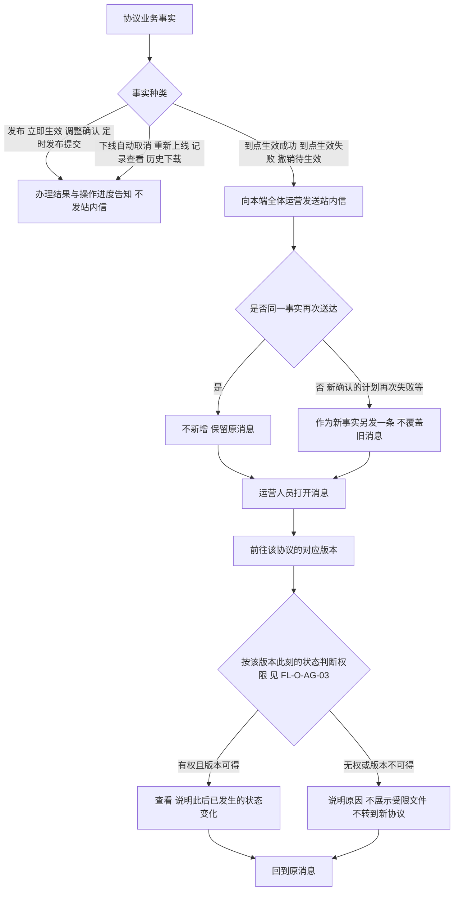
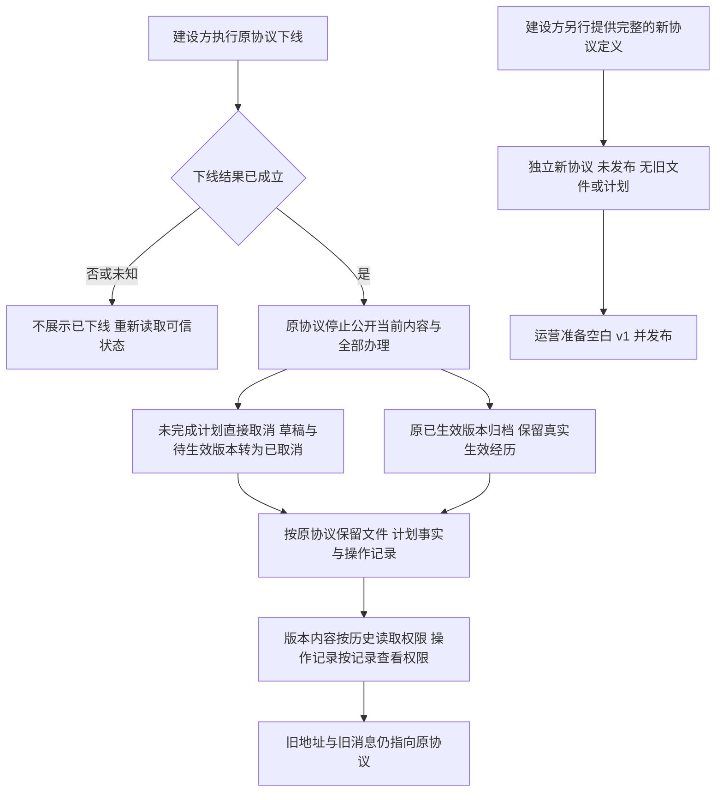
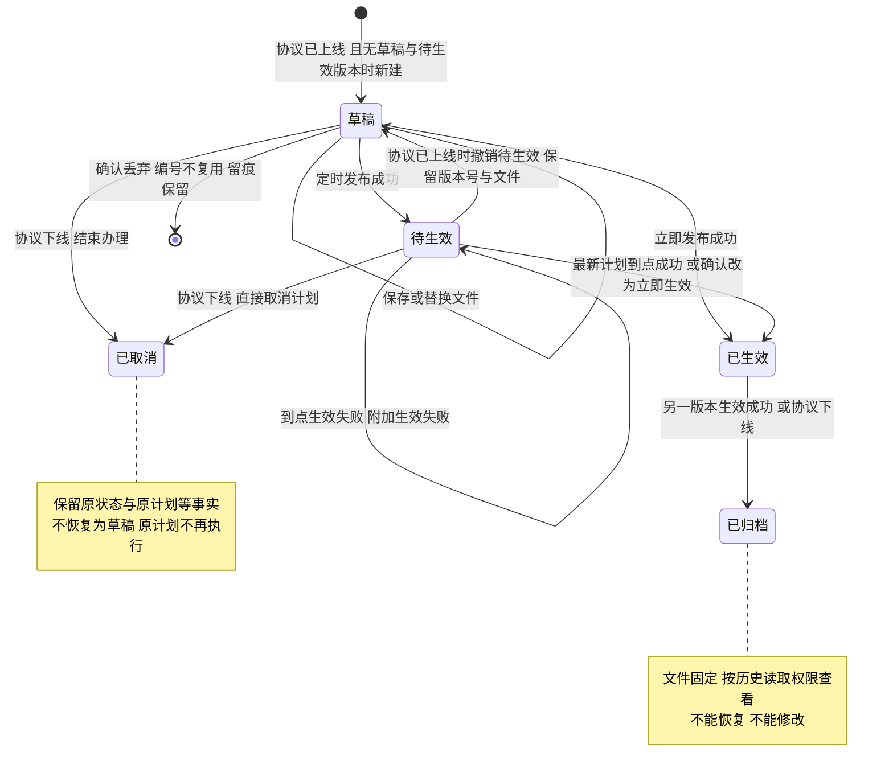
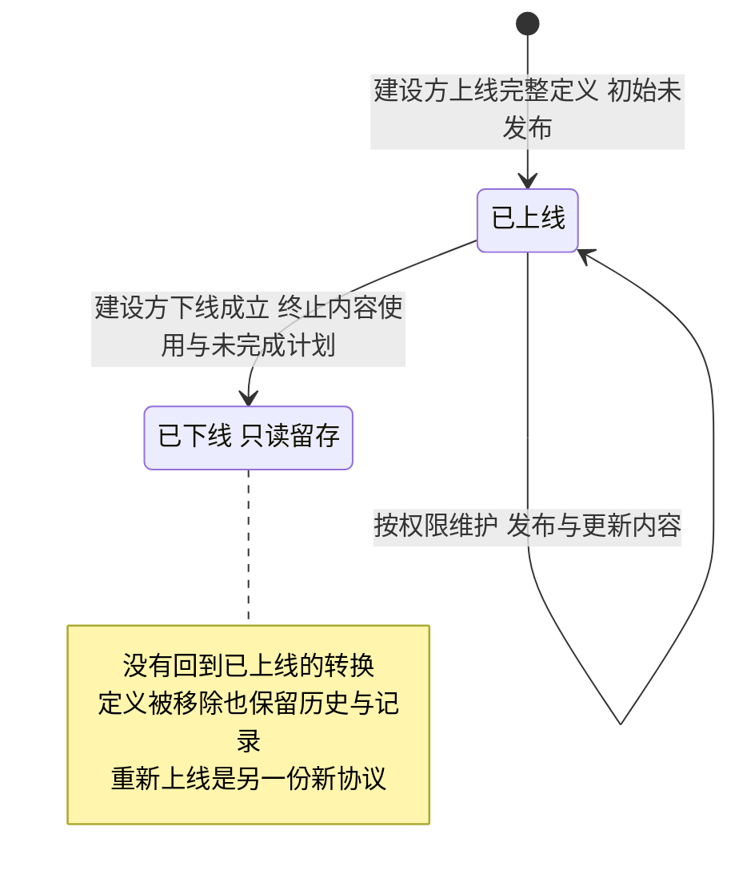

# 运营端协议管理 · 流程图与状态机

2026-10-19｜需求评审稿

本册把[功能册](./01-运营端协议管理-PRD.md)中的主要流程与状态画成图，规则以功能册为准。图中方框是业务环节与状态，不代表页面或组件；承载形式由设计决定（见[统一条款](./01-运营端协议管理-PRD.md#design-boundary)）。各平台独立运行，不共享版本与消息。

| 图 | 内容 | 对应功能 |
| --- | --- | --- |
| [按对象读取与统一更新入口（FL-O-AG-01）](#fl-o-ag-01) | 准入、三类读取分别判定，“更新协议”按当前情况打开草稿、待生效版本或新建草稿 | [协议定义、列表与检索](./01-运营端协议管理-PRD.md#f-o-ag-01)、[更新协议与内容维护](./01-运营端协议管理-PRD.md#f-o-ag-04)、[操作进度与留痕](./01-运营端协议管理-PRD.md#f-o-ag-09) |
| [草稿发布与原待生效版本调整（FL-O-AG-02）](#fl-o-ag-02) | 发布、确认更新、撤销待生效、三处二次确认与到点结果 | [发布、待生效调整与生效](./01-运营端协议管理-PRD.md#f-o-ag-06) |
| [当前查询、版本历史与原来源返回（FL-O-AG-03）](#fl-o-ag-03) | 按目标版本此刻的状态判断读取权限，只读查看后回到来源 | [版本历史与版本详情](./01-运营端协议管理-PRD.md#f-o-ag-07) |
| [公开当前版本读取（FL-O-AG-04）](#fl-o-ag-04) | 面客端读取协议的四种结果 | [当前生效版本的公开读取](./01-运营端协议管理-PRD.md#f-o-ag-11) |
| [事件告知、阅读与目标权限（FL-O-AG-05）](#fl-o-ag-05) | 哪些事实发站内信、重复如何处理、打开后去哪 | [消息通知](./01-运营端协议管理-PRD.md#notifications) |
| [下线、旧对象留存与全新上线（FL-O-AG-06）](#fl-o-ag-06) | 下线的结果与重新上线的独立新协议 | [协议下线、留存与重新上线](./01-运营端协议管理-PRD.md#offline) |
| [单个版本状态机（ST-O-AG-01）](#st-o-ag-01) | 草稿、待生效、已生效、已归档、已取消之间的转换 | [更新协议与内容维护](./01-运营端协议管理-PRD.md#f-o-ag-04)、[发布、待生效调整与生效](./01-运营端协议管理-PRD.md#f-o-ag-06) |
| [协议对象的上线与下线（ST-O-AG-02）](#st-o-ag-02) | 协议上线状态，与单个版本状态分开 | [协议下线、留存与重新上线](./01-运营端协议管理-PRD.md#offline) |

## FL-O-AG-01 按对象读取与统一更新入口

本期唯一角色运营管理员持有全部五项协议权限；图中的权限判断对应交付配置中的各权限项（见[权限与账号准入](./01-运营端协议管理-PRD.md#permissions)）。

协议定义与操作进度同属基本信息，须同时可得，先定义后进度。重新上线的新协议没有旧内容可复制，首次更新从空白 v1 开始。

## FL-O-AG-02 草稿发布与原待生效版本调整

修改内容需维护权限，发布、确认更新与撤销需发布权限（均须配套当前内容查询）。只有立即生效、撤销待生效、丢弃草稿三处二次确认；定时发布与调整后仍为定时直接提交。

取消确认、提交失败或未提交的修改都不改变已确认的文件与计划。办理期间到点生效先成功时，旧内容不能覆盖已生效内容；下线已成立时，旧的办理提交不能继续。调整成功后只按新计划运行，版本历史不新增另一个待生效版本。三类告警见[消息通知](./03-运营端协议管理-消息通知.md)。

## FL-O-AG-03 当前查询、版本历史与原来源返回

版本历史只承载辨认版本所需的信息与查看、下载两个动作，完整信息在版本详情；持有全部写权限也不能在版本历史中恢复、发布或删除。从消息或操作进度进入时回到该来源；旧地址始终指向原协议的原版本。

## FL-O-AG-04 公开当前版本读取

本平台本期不收取协议同意，公开读取只用于阅读协议文本。当前生效版本切换后，面客端最迟 5 分钟内显示新版本。重新上线的新协议尚未发布时为暂无生效版本，不继承旧内容。

## FL-O-AG-05 事件告知、阅读与目标权限

下线自动取消不是撤销待生效，不发撤销告警；取消也不报告成生效失败。旧消息不迁到重新上线的新协议。消息的阅读、未读与跳转规则归[运营端消息通知](../07-运营端消息通知/01-运营端消息通知-PRD.md)。

## FL-O-AG-06 下线、旧对象留存与全新上线

下线与重新上线由建设方执行，运营端没有对应的办理动作。

两条流程之间没有“恢复原计划”的箭头：原协议下线后不再回到已上线，新协议单独开始。到点生效先成功时，先记录真实生效，再按下线归档；下线先成立时，原计划不再执行。定义被移除后，版本历史与操作记录仍可按原协议定位。

## ST-O-AG-01 单个版本状态机

图中是同一协议内的同一个版本；待生效调整的留痕不是另一个版本。

每份已上线协议最多一个草稿、一个待生效、一个已生效版本；有待生效版本时不新建草稿。各状态允许的动作与读取权限见[版本状态](./01-运营端协议管理-PRD.md#states)。

## ST-O-AG-02 协议对象的上线与下线

与单个版本状态分开；协议列表中的草稿、待生效等协议状态由协议上线状态与版本情况组合得出（见[协议上线状态与协议状态](./01-运营端协议管理-PRD.md#states)）。

重新上线的新协议单独从初始状态进入已上线、未发布，不从旧协议连线，也不携带旧版本、计划或记录。
