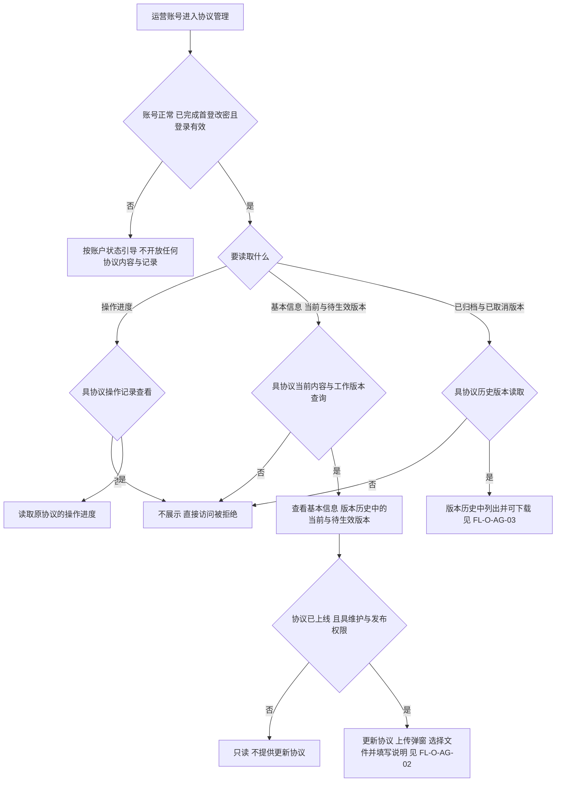
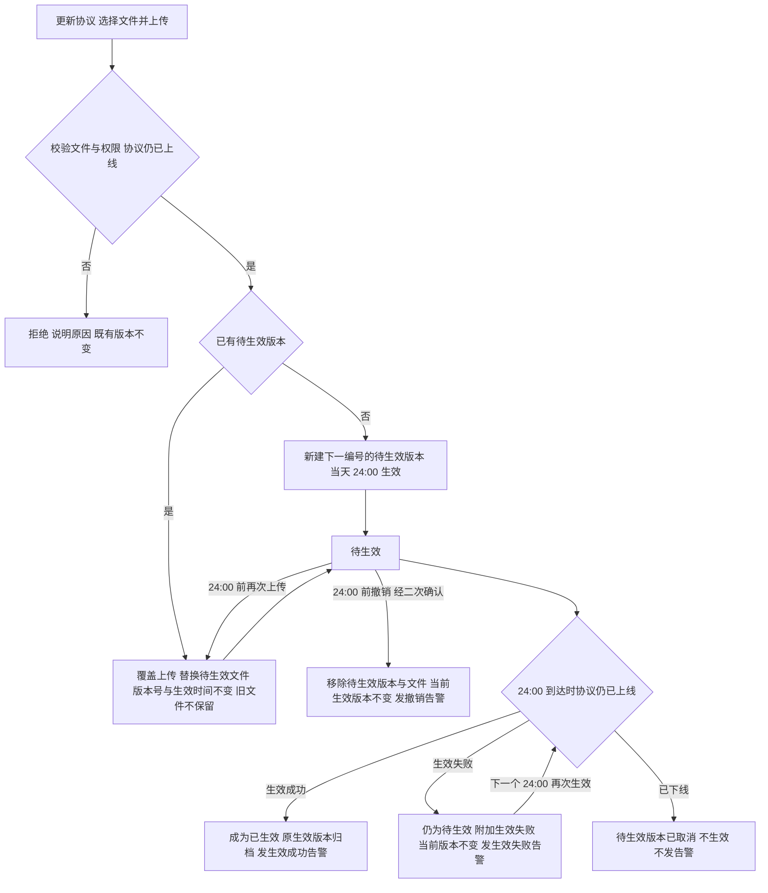
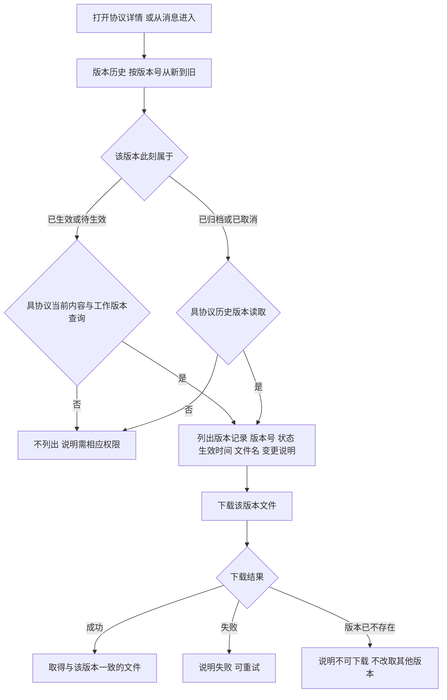
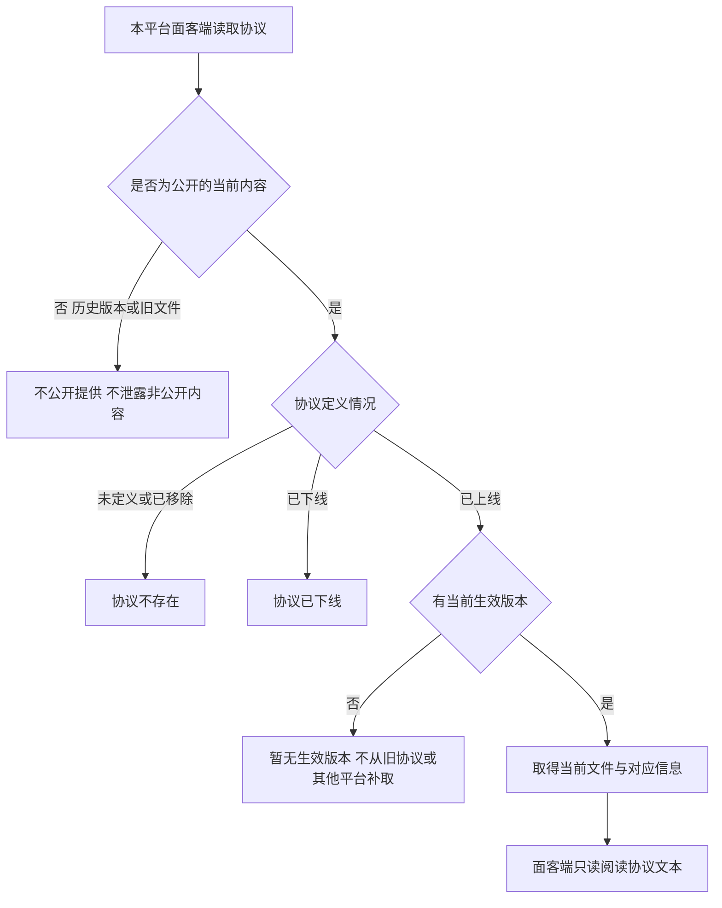
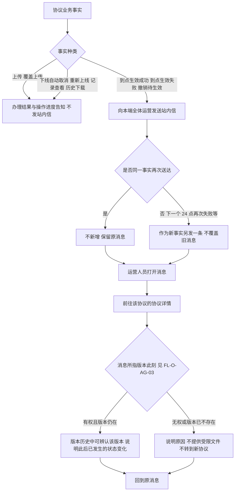
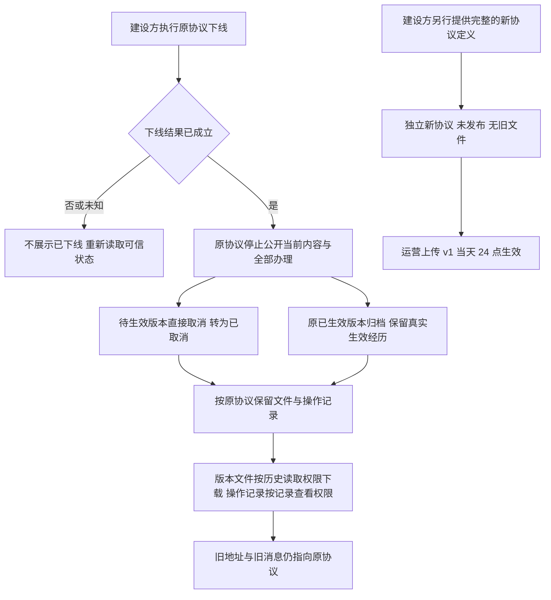
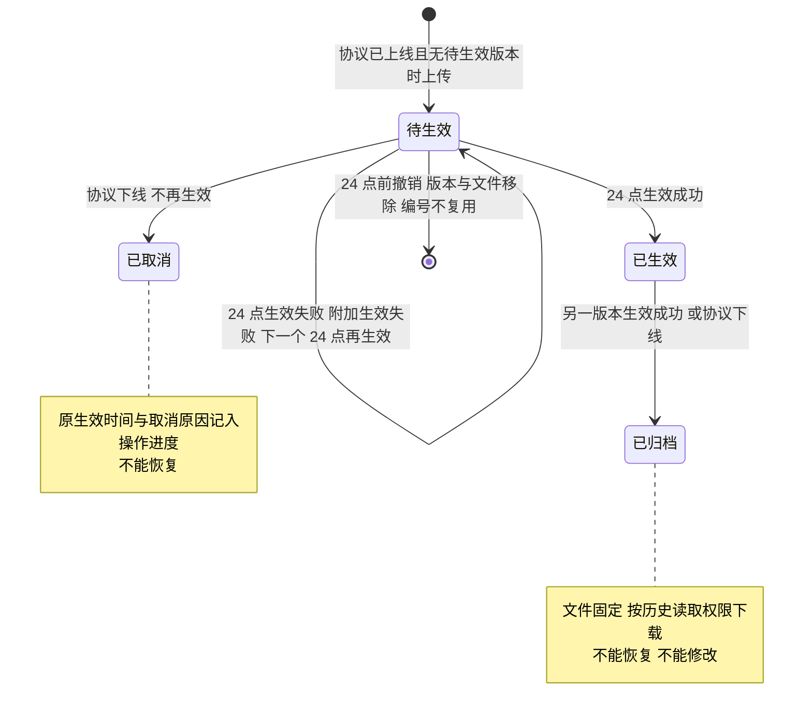
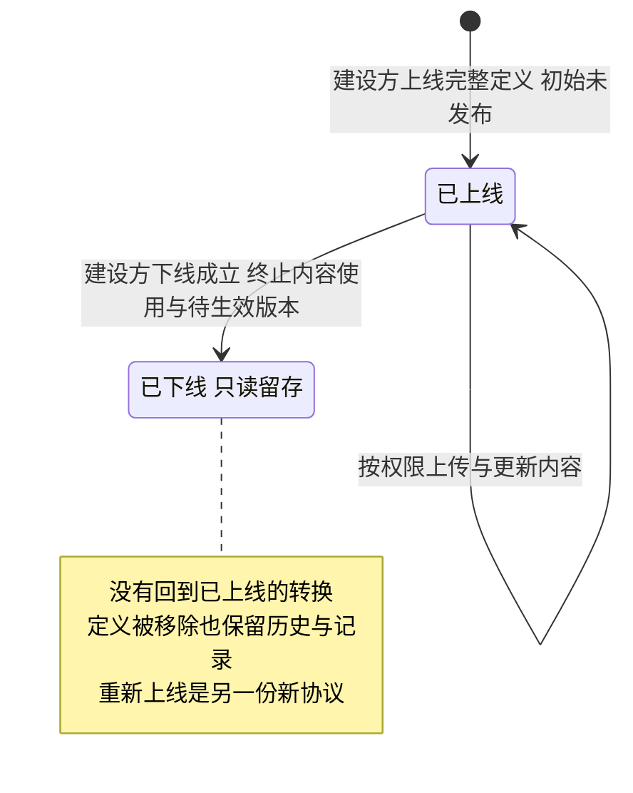

# 运营端协议管理 · 流程图与状态机

2026-10-21｜需求评审稿

本册把[功能册](./01-运营端协议管理-PRD.md)中的主要流程与状态画成图，规则以功能册为准。图中方框是业务环节与状态，不代表页面或组件；承载形式由设计决定（见[统一条款](./01-运营端协议管理-PRD.md#design-boundary)）。各平台独立运行，不共享版本与消息。

| 图 | 内容 | 对应功能 |
| --- | --- | --- |
| [按对象读取与上传协议（FL-O-AG-01）](#fl-o-ag-01) | 准入、三类读取分别判定，“更新协议”只采集文件与说明 | [协议定义、列表与检索](./01-运营端协议管理-PRD.md#f-o-ag-01)、[上传协议](./01-运营端协议管理-PRD.md#f-o-ag-04)、[操作进度与留痕](./01-运营端协议管理-PRD.md#f-o-ag-09) |
| [上传、覆盖与到点生效（FL-O-AG-02）](#fl-o-ag-02) | 上传成为待生效、24:00 前覆盖或撤销、24:00 生效成功或失败 | [上传协议](./01-运营端协议管理-PRD.md#f-o-ag-04)、[到点生效](./01-运营端协议管理-PRD.md#f-o-ag-06) |
| [版本历史与下载（FL-O-AG-03）](#fl-o-ag-03) | 按版本此刻的状态判断是否列出，只提供下载 | [版本历史](./01-运营端协议管理-PRD.md#f-o-ag-07) |
| [公开当前版本读取（FL-O-AG-04）](#fl-o-ag-04) | 面客端读取协议的四种结果 | [当前生效版本的公开读取](./01-运营端协议管理-PRD.md#f-o-ag-11) |
| [事件告知、阅读与目标权限（FL-O-AG-05）](#fl-o-ag-05) | 哪些事实发站内信、重复如何处理、打开后去哪 | [消息通知](./01-运营端协议管理-PRD.md#notifications) |
| [下线、旧对象留存与全新上线（FL-O-AG-06）](#fl-o-ag-06) | 下线的结果与重新上线的独立新协议 | [协议下线、留存与重新上线](./01-运营端协议管理-PRD.md#offline) |
| [单个版本状态机（ST-O-AG-01）](#st-o-ag-01) | 待生效、已生效、已归档、已取消之间的转换 | [上传协议](./01-运营端协议管理-PRD.md#f-o-ag-04)、[到点生效](./01-运营端协议管理-PRD.md#f-o-ag-06) |
| [协议对象的上线与下线（ST-O-AG-02）](#st-o-ag-02) | 协议上线状态，与单个版本状态分开 | [协议下线、留存与重新上线](./01-运营端协议管理-PRD.md#offline) |

## FL-O-AG-01 按对象读取与上传协议

本期唯一角色运营管理员持有全部五项协议权限；图中的权限判断对应交付配置中的各权限项（见[权限与账号准入](./01-运营端协议管理-PRD.md#permissions)）。

协议详情依次是基本信息、版本历史、操作进度，三部分同时可得。基本信息只有协议名称、协议类型、适用业务环节、协议用途说明。更新协议只采集文件与变更说明并给出格式与大小要求，没有生效时间、立即生效或草稿可选；撤销待生效是协议详情上的独立动作。

## FL-O-AG-02 上传、覆盖与到点生效

生效日界为每天 UTC 24:00。只有撤销待生效需要二次确认，上传直接提交。

以 24:00 那一刻的待生效文件为准生效；24:00 之后提交的上传归入下一个生效日界。撤销告警是否保留待用户确认（Q-O-AG-14，推荐删除）。三类告警见[消息通知](./03-运营端协议管理-消息通知.md)。

## FL-O-AG-03 版本历史与下载

版本历史只列版本记录并提供下载，没有查看详情、在线预览或任何写动作；持有全部写权限也不能在此恢复、上传、撤销或删除。被覆盖的文件与被撤销的版本不出现。上传人、归档与取消等经过在操作进度中查看。

## FL-O-AG-04 公开当前版本读取

本平台本期不收取协议同意，公开读取只用于阅读协议文本。当前生效版本切换后，面客端最迟 5 分钟内显示新版本。重新上线的新协议尚未发布时为暂无生效版本，不继承旧内容。

## FL-O-AG-05 事件告知、阅读与目标权限

下线自动取消不是撤销待生效，不发撤销告警；取消也不报告成生效失败。旧消息不迁到重新上线的新协议。消息的阅读、未读与跳转规则归[运营端消息通知](../07-运营端消息通知/01-运营端消息通知-PRD.md)。

## FL-O-AG-06 下线、旧对象留存与全新上线

下线与重新上线由建设方执行，运营端没有对应的办理动作。

两条流程之间没有“恢复旧协议”的箭头：原协议下线后不再回到已上线，新协议单独开始。到点生效先成功时，先记录真实生效，再按下线归档；下线先成立时，待生效版本不再生效。定义被移除后，版本历史与操作记录仍可按原协议定位。

## ST-O-AG-01 单个版本状态机

图中是同一协议内的同一个版本；覆盖上传只替换文件，不产生新版本。

每份已上线协议最多一个待生效、一个已生效版本。各状态允许的动作与读取权限见[版本状态](./01-运营端协议管理-PRD.md#states)。

## ST-O-AG-02 协议对象的上线与下线

与单个版本状态分开；协议列表中的待生效、未发布等协议状态由协议上线状态与版本情况组合得出（见[协议上线状态与协议状态](./01-运营端协议管理-PRD.md#states)）。

重新上线的新协议单独从初始状态进入已上线、未发布，不从旧协议连线，也不携带旧版本或记录。
