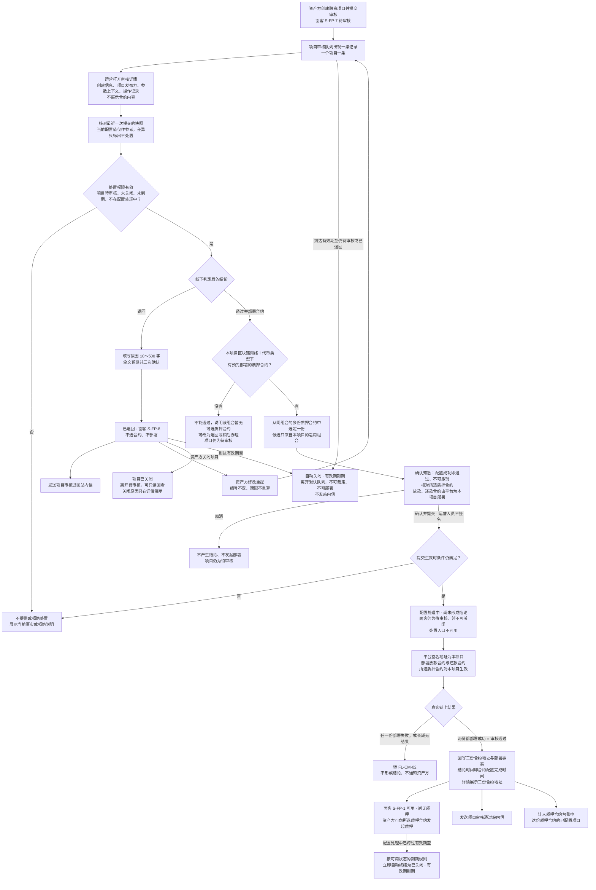
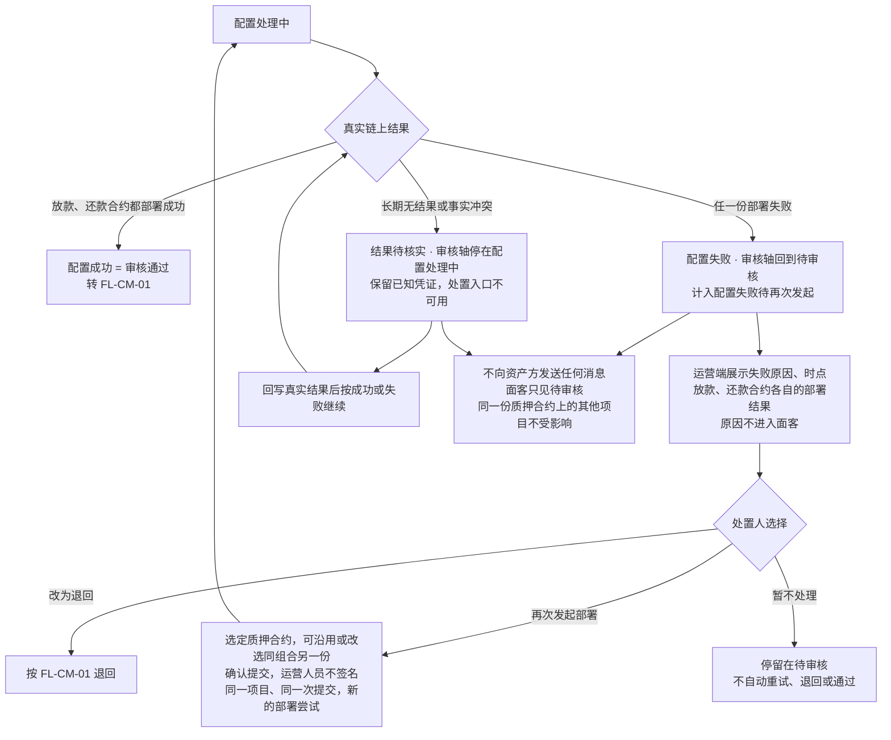
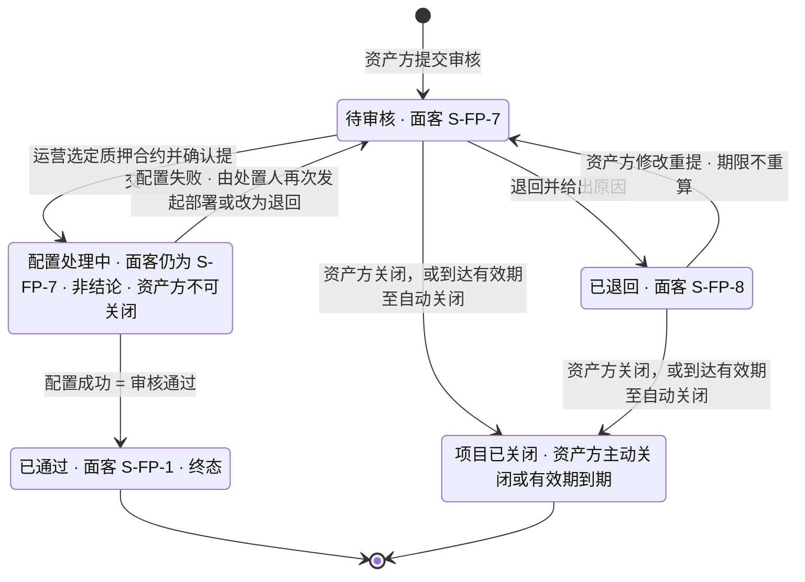
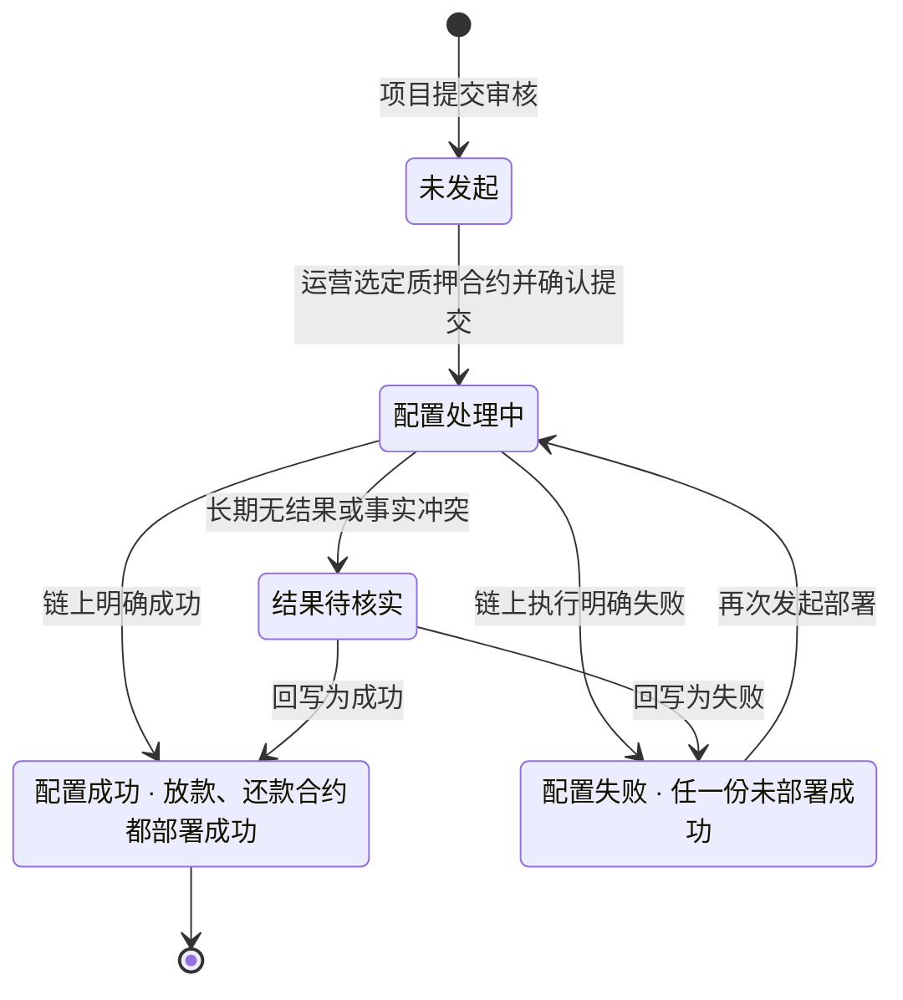

# 运营端项目合约管理 · 流程图与状态机

2026-10-28｜需求评审稿

本册把[功能与业务规则](./01-运营端项目合约管理-PRD.md)中的主要流程与状态画成图，规则以功能册为准。图中方框是业务环节，不代表页面或组件。资产方看到的项目状态以[融资项目状态（ST-LS-01）](../../面客端/05-借贷广场-融资需求与代币质押/02-融资需求与代币质押-流程图与状态机.md#st-ls-01)为准，本册只标出对应关系。

| 图 | 内容 | 对应功能 |
| --- | --- | --- |
| [项目审核与合约配置（FL-CM-01）](#fl-cm-01) | 从资产方提交到通过并配置成功或退回 | [项目审核队列](./01-运营端项目合约管理-PRD.md#m1)、[审核详情与创建信息核对](./01-运营端项目合约管理-PRD.md#m2)、[通过并部署合约](./01-运营端项目合约管理-PRD.md#m3)、[退回](./01-运营端项目合约管理-PRD.md#m4) |
| [配置失败、结果待核实与再次发起部署（FL-CM-02）](#fl-cm-02) | 部署没有成功时的三种去向 | [配置失败、结果待核实与再次发起部署](./01-运营端项目合约管理-PRD.md#m5) |
| [详情、操作记录与质押合约台账的查看（FL-CM-03）](#fl-cm-03) | 从队列或台账进入详情并返回 | [审核详情与创建信息核对](./01-运营端项目合约管理-PRD.md#m2)、[质押合约台账](./01-运营端项目合约管理-PRD.md#m6) |
| [项目审核轴（ST-CM-01）](#st-cm-01) | 待审核、配置处理中、已通过、已退回之间的转换 | [两条状态轴](./01-运营端项目合约管理-PRD.md#states) |
| [合约配置执行状态（ST-CM-02）](#st-cm-02) | 合约部署的链上执行事实 | [两条状态轴](./01-运营端项目合约管理-PRD.md#states) |

## FL-CM-01 项目审核与合约配置

## FL-CM-02 配置失败、结果待核实与再次发起部署

## FL-CM-03 详情、操作记录与质押合约台账的查看

```mermaid
flowchart TD
  A["运营管理员 · 融资项目审核查询"] --> B{"入口：项目合约管理"}
  B -- "项目审核队列" --> C["默认待审核且未关闭<br/>提交时间升序<br/>审核轴只显示状态值，不显示关闭原因与合约地址"]
  B -- "质押合约台账" --> D["一条记录一份质押合约<br/>区块链网络＋代币类型<br/>质押合约地址与已配置项目数"]
  D --> D1["查看配置在这份质押合约上的项目<br/>只含配置成功的项目"]
  C --> E["项目审核详情"]
  D1 --> E
  E --> F["创建信息、项目发布方、参数上下文<br/>项目关闭信息（已关闭时）"]
  E --> G{"本次提交的合约配置走到哪一步"}
  G -- "未发起部署" --> G1["不展示合约内容"]
  G -- "配置处理中、配置失败、结果待核实" --> G2["展示部署进度与结果<br/>所选质押合约地址与已部署出的合约地址标明尚未配置<br/>不展示所配置的合约"]
  G -- "配置成功" --> G3["展示质押合约、放款合约、还款合约地址<br/>与合约配置完成时间"]
  E --> J["操作记录 · 唯一的进度与历史来源<br/>倒序；历次提交、结论、原因、部署尝试均在此"]
  E -- "返回" --> K["回到来源并保留筛选、排序、分页与位置"]
```

审核历史不单独成表，就是操作记录按事件读取的同一条记录。

## ST-CM-01 项目审核轴

结果待核实时审核轴停在配置处理中，不另成状态，回写真实结果后按配置成功或配置失败转换。项目已关闭是叠加标记：关闭后审核轴保留关闭前的取值，列表只显示该取值，“项目已关闭”与关闭原因在详情展示，不再可裁定。配置处理中资产方不能关闭，也不因到期立即关闭，部署结果回写后按结果处理：成功则审核通过，若已过有效期至，项目转为可用后立即自动终结；失败则回到待审核，若已过有效期至，随即自动关闭（[配置处理中资产方不能关闭项目（D-CM-21）](./01-运营端项目合约管理-PRD.md#d-cm-21)、[待审核或已退回时到期自动关闭](./01-运营端项目合约管理-PRD.md#expiry)）。

## ST-CM-02 合约配置执行状态

配置成功后不再发起部署；所配置的合约只读，无录入、修改、更换、重新部署或解除配置入口。本状态只属于一个项目，同一份质押合约上其他项目的配置状态互不影响。
