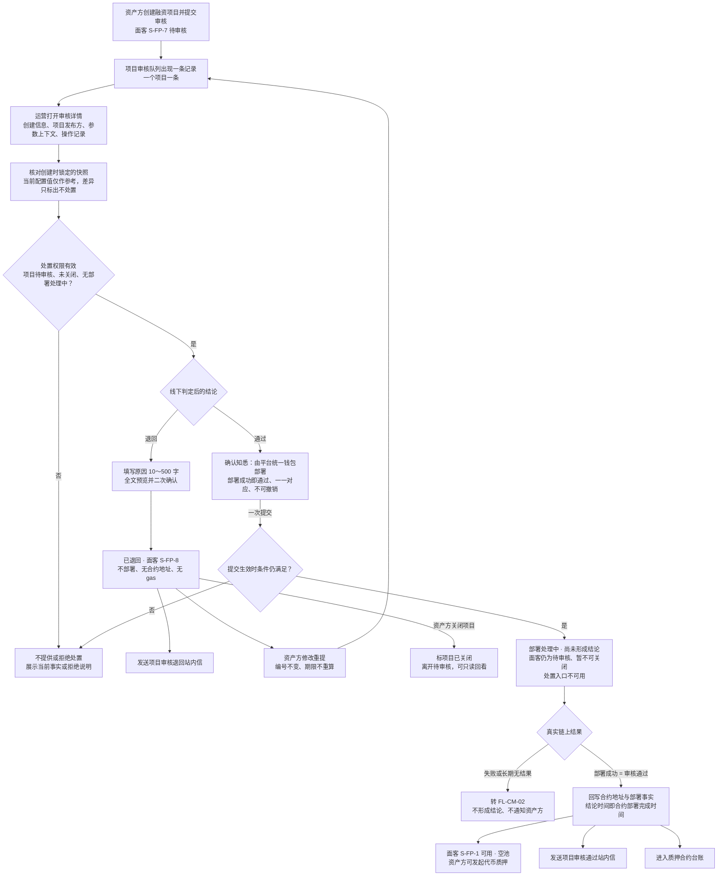
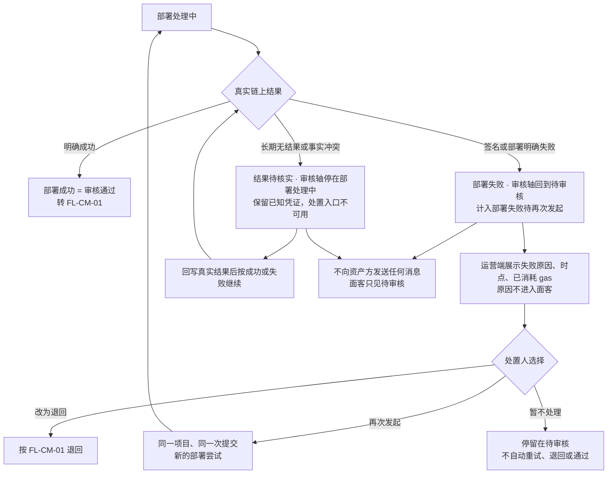
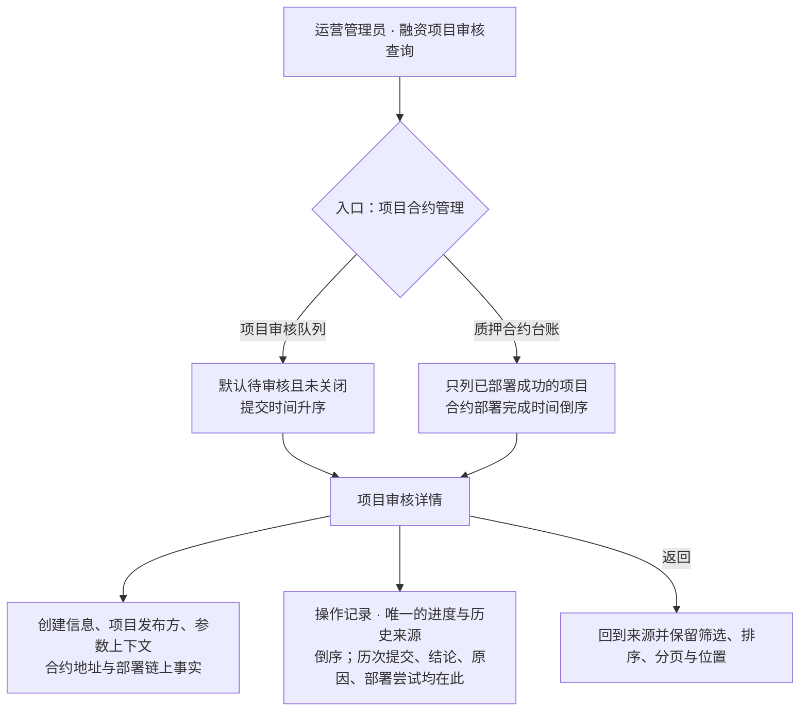
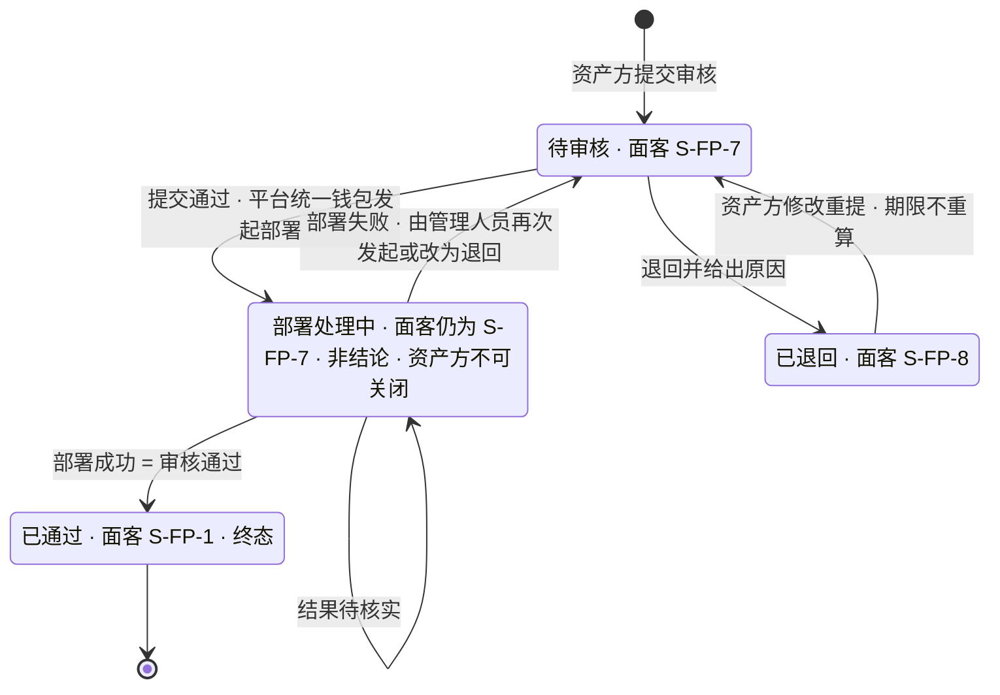
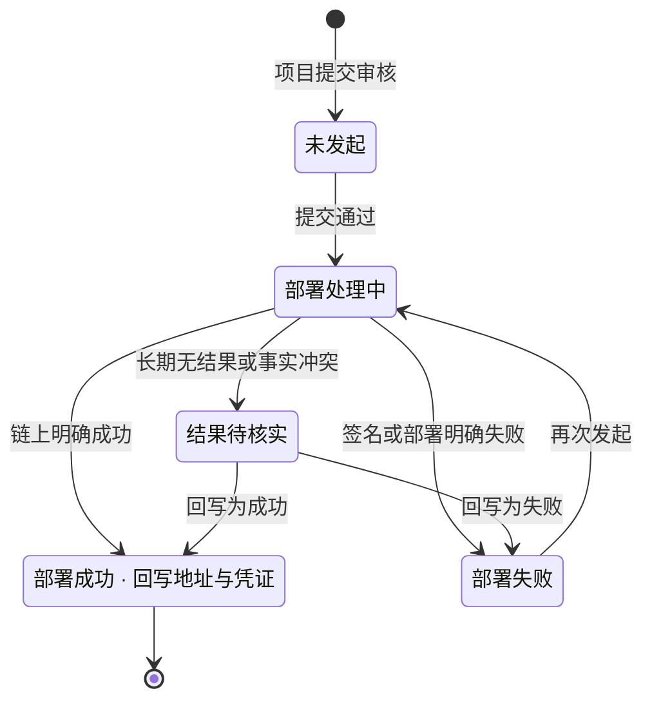

# 运营端项目合约管理 · 流程图与状态机

2026-10-15｜需求评审稿

本册把[功能与业务规则](./01-运营端项目合约管理-PRD.md)中的主要流程与状态画成图，规则以功能册为准。图中方框是业务环节，不代表页面或组件。资产方看到的项目状态以[融资项目状态（ST-LS-01）](../../面客端/05-借贷广场-融资需求与代币质押/02-融资需求与代币质押-流程图与状态机.md#st-ls-01)为准，本册只标出对应关系。

| 图 | 内容 | 对应功能 |
| --- | --- | --- |
| [项目审核与合约部署（FL-CM-01）](#fl-cm-01) | 从资产方提交到通过并部署成功或退回 | [项目审核队列](./01-运营端项目合约管理-PRD.md#m1)、[审核详情与创建信息核对](./01-运营端项目合约管理-PRD.md#m2)、[通过并部署合约](./01-运营端项目合约管理-PRD.md#m3)、[退回](./01-运营端项目合约管理-PRD.md#m4) |
| [部署失败、结果待核实与再次发起（FL-CM-02）](#fl-cm-02) | 部署没有成功时的三种去向 | [部署失败、结果待核实与再次发起](./01-运营端项目合约管理-PRD.md#m5) |
| [详情、操作记录与合约台账的查看（FL-CM-03）](#fl-cm-03) | 从队列或台账进入详情并返回 | [审核详情与创建信息核对](./01-运营端项目合约管理-PRD.md#m2)、[质押合约台账](./01-运营端项目合约管理-PRD.md#m6) |
| [项目审核轴（ST-CM-01）](#st-cm-01) | 待审核、部署处理中、已通过、已退回之间的转换 | [两条状态轴](./01-运营端项目合约管理-PRD.md#states) |
| [合约部署执行状态（ST-CM-02）](#st-cm-02) | 部署的链上执行事实 | [两条状态轴](./01-运营端项目合约管理-PRD.md#states) |

## FL-CM-01 项目审核与合约部署

## FL-CM-02 部署失败、结果待核实与再次发起

## FL-CM-03 详情、操作记录与合约台账的查看

审核历史不单独成表，就是操作记录按事件读取的同一条记录。

## ST-CM-01 项目审核轴

资产方在待审核或已退回期间关闭项目时，审核轴保留原值并标"项目已关闭"，不再可裁定；部署处理中资产方不能关闭，部署结果回写后按结果处理（[部署处理中资产方不能关闭项目（D-CM-21）](./01-运营端项目合约管理-PRD.md#d-cm-21)）。

## ST-CM-02 合约部署执行状态

部署成功后不再发起部署；地址只读，无录入、修改、解绑或重新部署入口。
