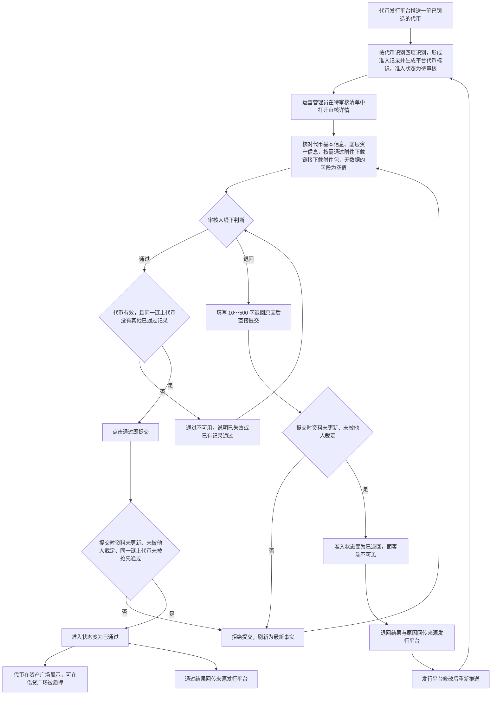
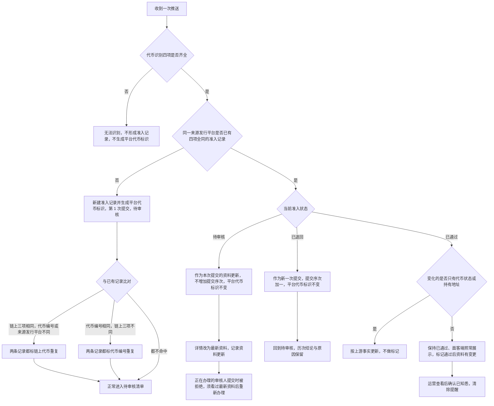
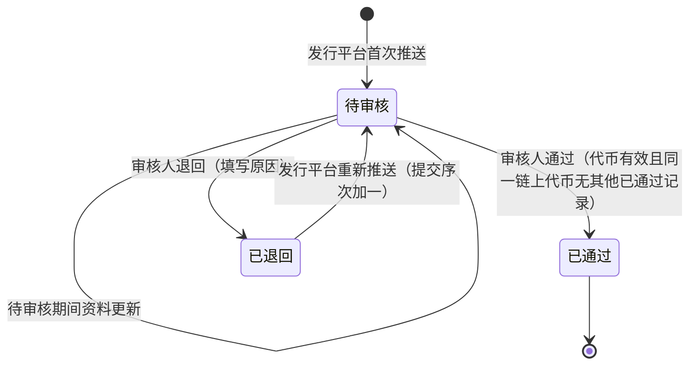

# 代币准入审核 · 流程图与状态机

2026-10-21｜需求评审稿

本册把[功能与业务规则](./01-代币准入审核-PRD.md)中的主要流程与状态画成图，规则以功能册为准。图中方框是业务环节，不代表页面或组件。

| 图 | 内容 | 对应功能 |
| --- | --- | --- |
| 准入审核主流程（FL-TA-01） | 发行平台推送 → 运营核对 → 通过后进入面客端，或退回后重新推送 | [接收准入申请（F-TA-01）](./01-代币准入审核-PRD.md#f-ta-01)、[通过（F-TA-07）](./01-代币准入审核-PRD.md#f-ta-07)、[退回（F-TA-08）](./01-代币准入审核-PRD.md#f-ta-08)、[准入结果的去向（F-TA-09）](./01-代币准入审核-PRD.md#f-ta-09) |
| 推送更新与重新提交（FL-TA-02） | 按代币识别四项识别一笔代币并提醒疑似重复，以及同一笔代币在不同准入状态下再次推送时的处理 | [接收准入申请（F-TA-01）](./01-代币准入审核-PRD.md#f-ta-01)、[通过后的资料变更（F-TA-10）](./01-代币准入审核-PRD.md#f-ta-10) |
| 准入状态（ST-TA-01） | 一条准入记录的准入状态与转换 | [准入状态与叠加标记](./01-代币准入审核-PRD.md#states) |

## 准入审核主流程（FL-TA-01）

## 推送更新与重新提交（FL-TA-02）

## 准入状态（ST-TA-01）

- 初始状态：待审核。
- 终态：已通过，本期不可撤销、不可改判、不下架。
- 已退回不是终态：发行平台可以不限次数重新推送；不重新推送则一直停留在已退回。
- 代币状态、重复提醒、通过后资料有变更是叠加标记，不是准入状态，不在本图中转换；组合见[准入状态与叠加标记](./01-代币准入审核-PRD.md#states)。
