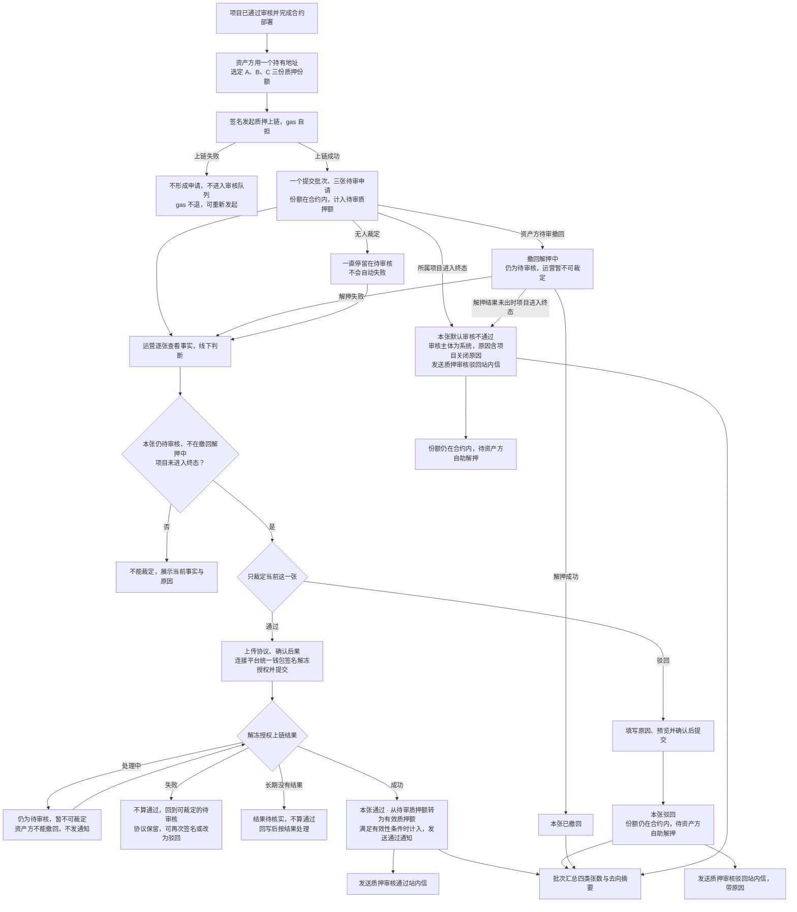
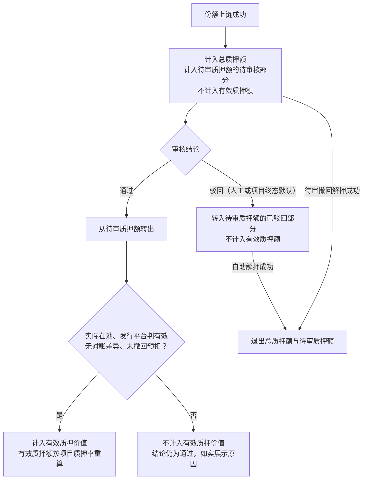
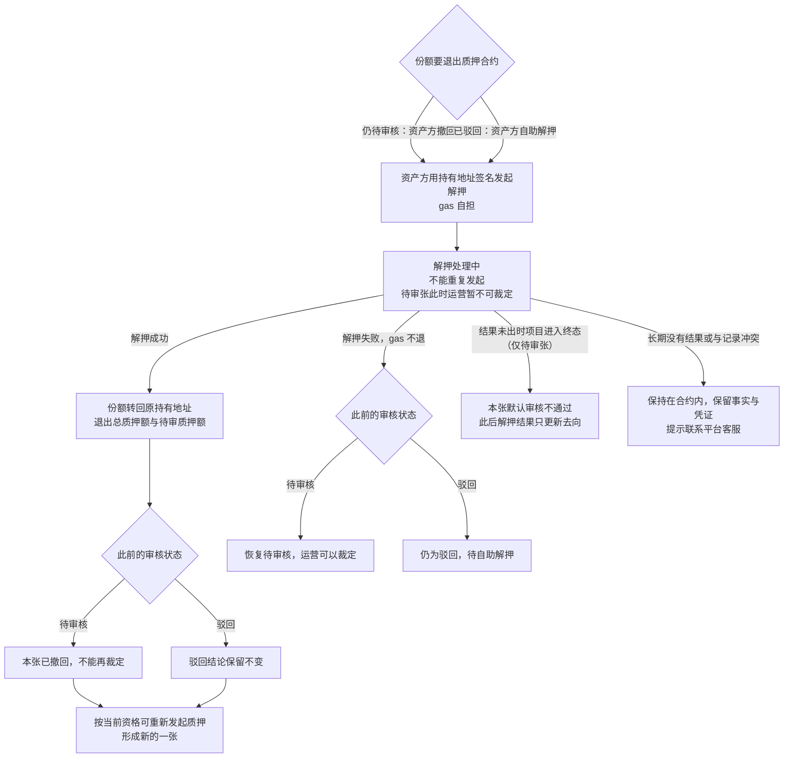
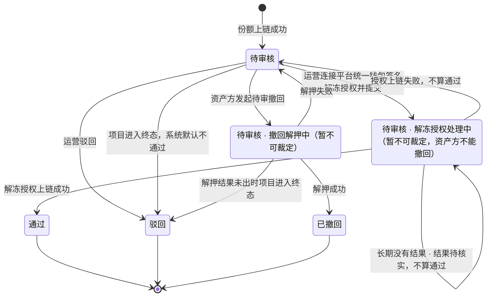
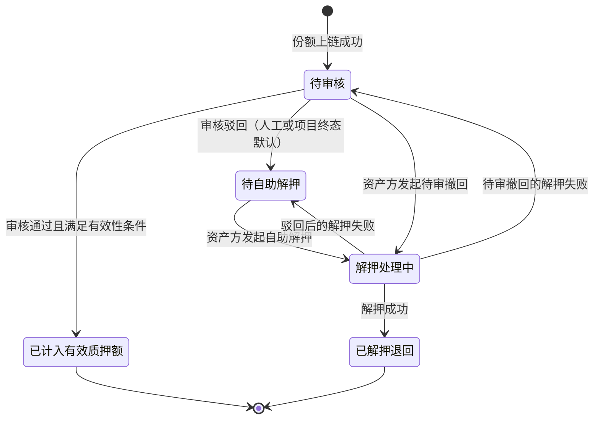

# 代币质押审核 · 流程图与状态机

2026-10-16｜需求评审稿｜规则以[功能与业务规则](./01-代币质押审核-PRD.md)为准，本册只画业务环节与状态。

图中的“一张”指一份质押份额的一次质押申请。图只表达业务流程与业务对象的状态，不表示页面或组件，也不画链上执行细节；承载形式由设计决定（见[统一条款](./01-代币质押审核-PRD.md#design-boundary)）。

| 图号 | 内容 | 对应功能 |
| --- | --- | --- |
| [FL-PR-01](#fl-pr-01) | 质押上链、逐张审核与两端结果 | [审核队列](./01-代币质押审核-PRD.md#m1)、[通过与协议](./01-代币质押审核-PRD.md#m3)、[驳回](./01-代币质押审核-PRD.md#m4)、[留痕与通知](./01-代币质押审核-PRD.md#m7) |
| [FL-PR-02](#fl-pr-02) | 审核结论对三项额度的影响 | [三项额度与审核的关系](./01-代币质押审核-PRD.md#quota) |
| [FL-PR-03](#fl-pr-03) | 待审撤回、驳回后的自助解押与项目终态 | [待审撤回与项目终态](./01-代币质押审核-PRD.md#m5)、[链上事实的只读追踪](./01-代币质押审核-PRD.md#m6) |
| [ST-PR-01](#st-pr-01) | 单笔审核状态（RV-20） | [单笔审核状态](./01-代币质押审核-PRD.md#states)、[状态与去向的组合](./01-代币质押审核-PRD.md#combination) |
| [ST-PR-02](#st-pr-02) | 本笔当前去向 | [本笔当前去向](./01-代币质押审核-PRD.md#whereabouts) |

## FL-PR-01 质押上链、逐张审核与两端结果

## FL-PR-02 审核结论对三项额度的影响

## FL-PR-03 待审撤回、驳回后的自助解押与项目终态

## ST-PR-01 单笔审核状态（RV-20）

“撤回解押中”与“解冻授权处理中”仍属待审核，只是暂不可裁定，不是新的审核状态。解冻授权处理中（含结果待核实）资产方不能撤回，项目也不会进入终态（处理中的链上操作属于未处理完成的业务）。驳回含人工驳回与项目终态默认不通过两种来源。时间流逝不改变审核状态。

## ST-PR-02 本笔当前去向

取值同面客[本笔当前去向（PA-15）](../../面客端/05-借贷广场-融资需求与代币质押/01-融资需求与代币质押-PRD.md#pa-15)。

审核通过但代币失效或有对账差异的，不进入“已计入有效质押额”，如实展示不计入的原因。已解押退回后再次质押形成新的一张，不覆盖旧记录。
