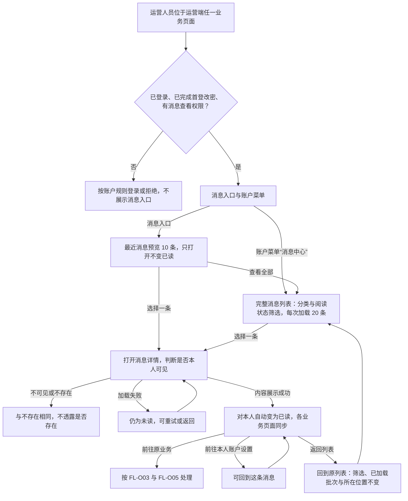
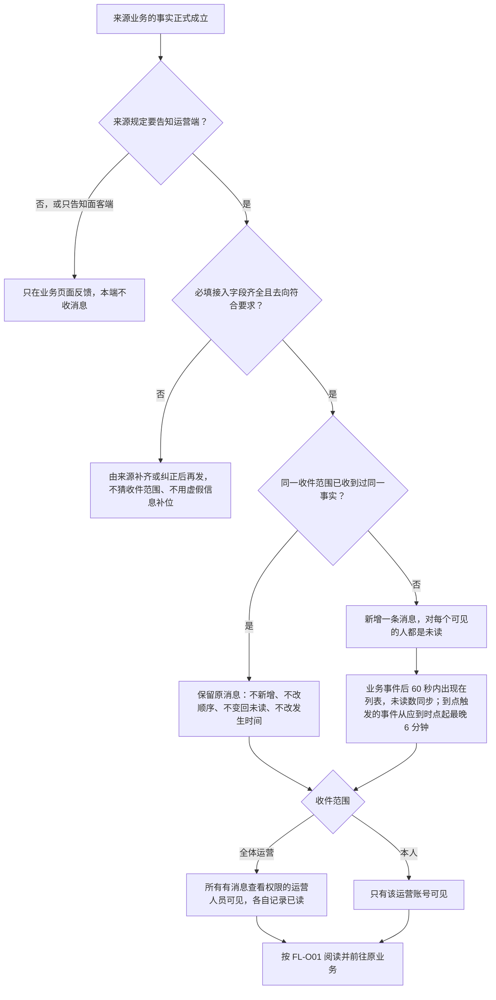
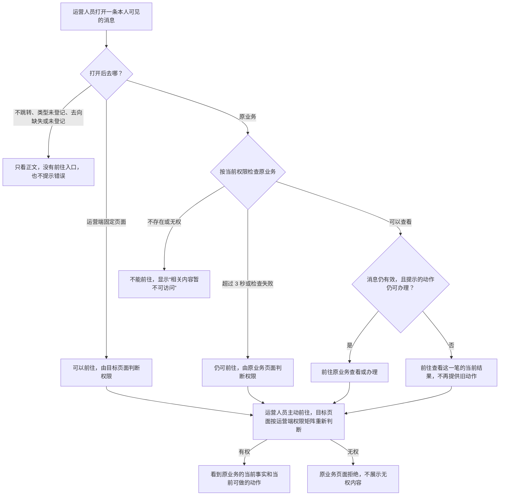
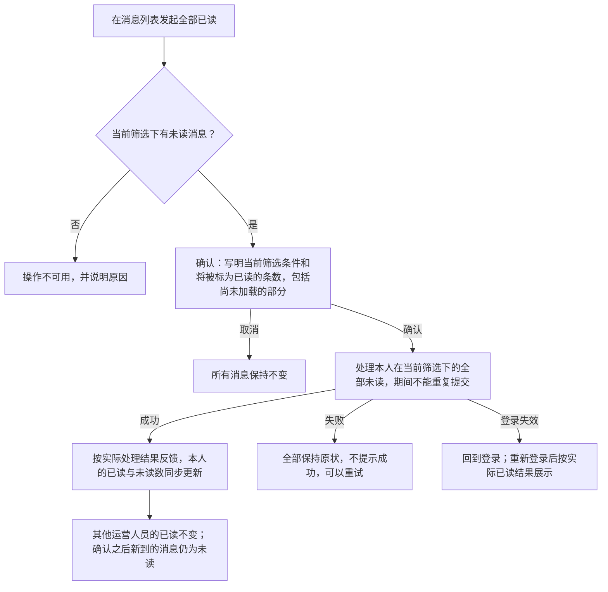
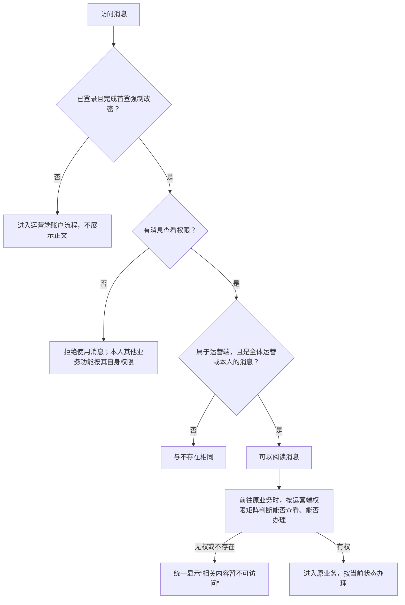
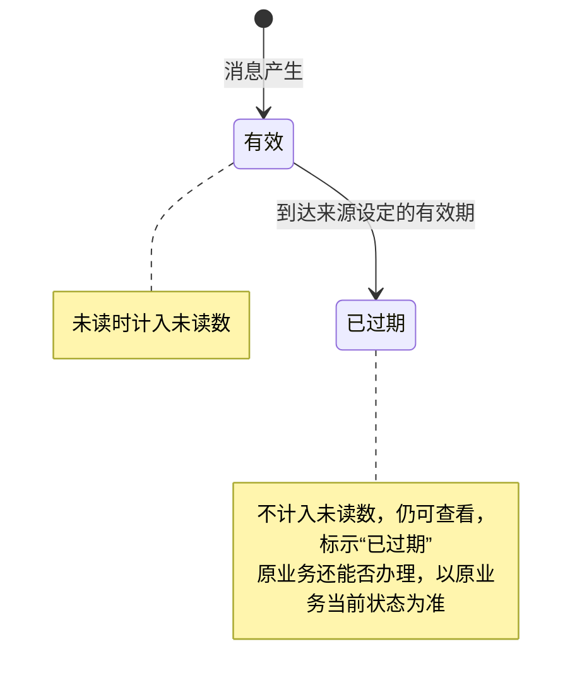
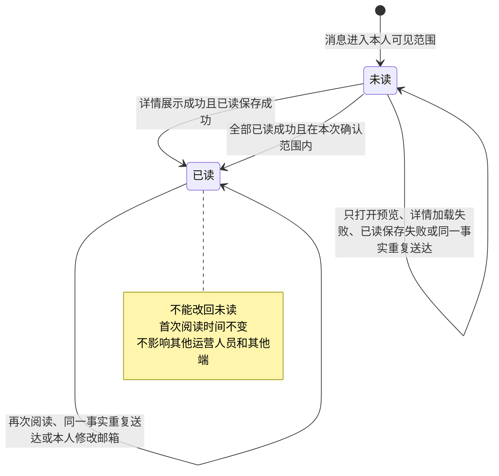

# 运营端消息通知 · 流程图与状态机

2026-10-23｜需求评审稿

本册把[功能与业务规则](./01-运营端消息通知-PRD.md)中的主要流程和状态画成图，规则以功能册为准。图中的方框是业务环节，不代表页面或组件，页面怎么承载由设计决定（见[统一条款](./01-运营端消息通知-PRD.md#design-boundary)）。图中“原业务”指消息所说的那一笔业务，包括必要的原提交或原版本。

| 图 | 内容 | 对应功能 |
| --- | --- | --- |
| [入口、列表、详情、已读与返回（FL-O01）](#fl-o01) | 从入口进入消息并返回原列表 | [消息入口](./01-运营端消息通知-PRD.md#f-o01)、[消息列表](./01-运营端消息通知-PRD.md#f-o06)、[消息详情与已读](./01-运营端消息通知-PRD.md#f-o10) |
| [一条消息从来源发出到运营人员阅读（FL-O02）](#fl-o02) | 接入、缺失处理、重复与承接 | [来源接入字段要求](./01-运营端消息通知-PRD.md#f-o18)、[谁能看到哪些消息](./01-运营端消息通知-PRD.md#f-o16) |
| [前往原业务（FL-O03）](#fl-o03) | 按去向、权限和业务现状前往 | [前往原业务](./01-运营端消息通知-PRD.md#f-o14) |
| [全部已读（FL-O04）](#fl-o04) | 确认范围与数量后改变本人阅读状态 | [消息详情、已读与全部已读](./01-运营端消息通知-PRD.md#f-o10) |
| [消息准入与原业务权限分别判断（FL-O05）](#fl-o05) | 消息与原业务分别判权 | [谁能看到哪些消息](./01-运营端消息通知-PRD.md#f-o16)、[前往原业务](./01-运营端消息通知-PRD.md#f-o14)、[登录状态与安全](./01-运营端消息通知-PRD.md#session) |
| [消息有效期（ST-O01）](#st-o01) | 消息从有效到过期 | [消息有效期字段](./01-运营端消息通知-PRD.md#effective-until)、[前往原业务](./01-运营端消息通知-PRD.md#f-o14) |
| [本人阅读状态（ST-O02）](#st-o02) | 本人的未读与已读转换 | [消息详情与已读](./01-运营端消息通知-PRD.md#f-o10) |

## 入口、列表、详情、已读与返回（FL-O01）

预览不提供全部已读；列表不提供逐条标为已读。刷新详情后仍是同一条消息。切换账号后不显示前一个账号的内容。各业务页面共用本人的已读状态，不代表与其他人或其他端共享。

## 一条消息从来源发出到运营人员阅读（FL-O02）

发什么、何时发、发给哪种收件范围，由来源模块在其消息通知册中规定。本图表示消息的业务承接过程，不表示技术接入流程。字段取值与必填条件见[接入字段](./01-运营端消息通知-PRD.md#intake-fields)：发生时间取业务事实时刻，到点事件取应到时点；去向为原业务或固定页面时须有定位，去向为原业务时还须有查看与办理条件。适配状态默认待适配，完成共享登记、收件范围、文案及真实送达验证后才为已适配。

类型有值但未登记、分类无法识别及已收到消息的内容或去向异常，按[内容与去向异常](./01-运营端消息通知-PRD.md#intake-fallback)承接：保留可读与计数规则，未登记或缺失的去向不提供入口。接入时缺少必填信息与展示时发生异常分别处理；本模块不发邮件或其他站外消息。

## 前往原业务（FL-O03）

始终定位到消息所说的那一笔，不换成最新一笔。消息正文说的是当时的事实，原业务页面展示的是当前的事实。超时不放宽任何权限。

## 全部已读（FL-O04）

全部已读只改变本人的阅读状态，与业务是否办完无关。

## 消息准入与原业务权限分别判断（FL-O05）

消息查看权限只决定能否使用本模块，不带来任何原业务的权限；没有消息查看权限，也不影响本人从业务页面访问自己有权限的内容。管理员的称谓不带来查看他人本人消息的权限。

## 消息有效期（ST-O01）

一条消息是否仍在有效期内，与是否已读、原业务能否办理是三件互相独立的事。

没有设定有效期的消息一直有效。重复送达不会让过期的消息恢复有效。原业务被删除、本人无权、原动作已办完，都不会让消息变为过期。

## 本人阅读状态（ST-O02）

对象是一个运营账号对一条消息的阅读状态。“全体运营”消息每个人各有一个阅读状态。

新的事实是一条新消息，有自己的阅读状态，不会把旧消息改回未读。已读不代表审核、发布或其他业务已经完成。没有消息查看权限期间不能阅读；权限恢复后沿用原来的阅读状态。
