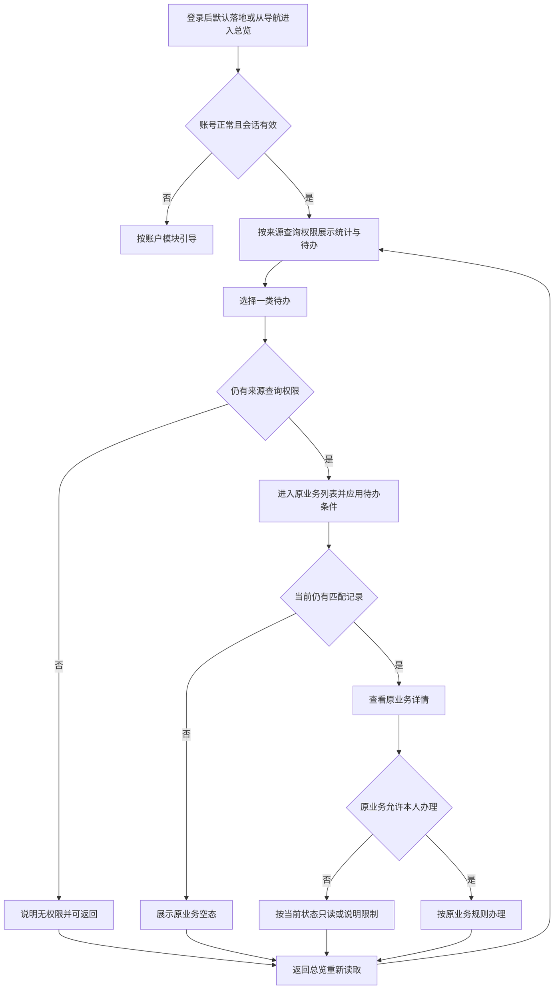
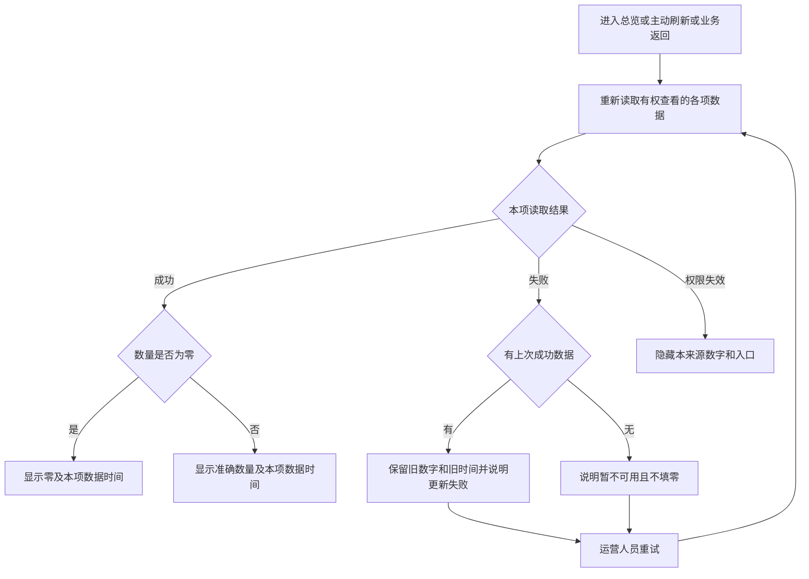

# 运营端总览 · 流程图与状态机

2026-10-26｜需求评审稿

本册说明总览查看与业务回流，规则以[功能与业务规则](01-运营端总览-PRD.md)为准。总览不创建业务对象或独立待办状态机，审核与配置状态仍由来源模块维护。

| 图 | 内容 | 对应功能 |
| --- | --- | --- |
| 查看与办理回流（FL-OV-01） | 进入总览、打开分类待办并返回 | [进入总览与权限范围（F-OV-01）](01-运营端总览-PRD.md#f-ov-01)、[四类待办与去向（F-OV-03）](01-运营端总览-PRD.md#f-ov-03) |
| 数据读取与重试（FL-OV-02） | 成功、零值、部分失败与重试 | [三项核心统计（F-OV-02）](01-运营端总览-PRD.md#f-ov-02)、[各来源状态构成与提醒（F-OV-05）](01-运营端总览-PRD.md#f-ov-05)、[近期审结（F-OV-06）](01-运营端总览-PRD.md#f-ov-06)、[数据展示、刷新与异常（F-OV-04）](01-运营端总览-PRD.md#f-ov-04) |

## 1. 查看与办理回流（FL-OV-01）

查看不认领待办；办理是否成功、是否进入配置处理中等，都按原业务事实处理，返回总览重新计数。

## 2. 数据读取与重试（FL-OV-02）

每项独立反馈，其他成功项不受单项读取失败影响；失败项不能用于宣告全部待办清空。核心统计、状态构成、提醒、近期审结与待办都按本图读取；某一构成项失败时，该来源合计同样暂不可用。
