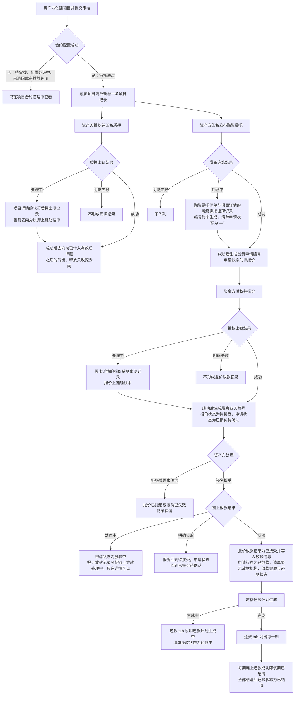
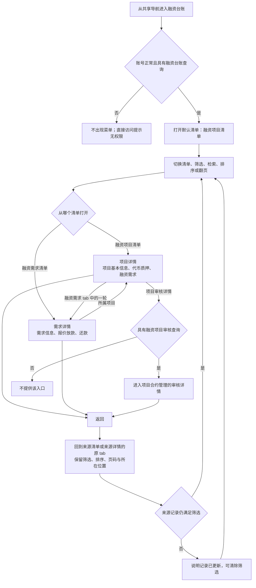
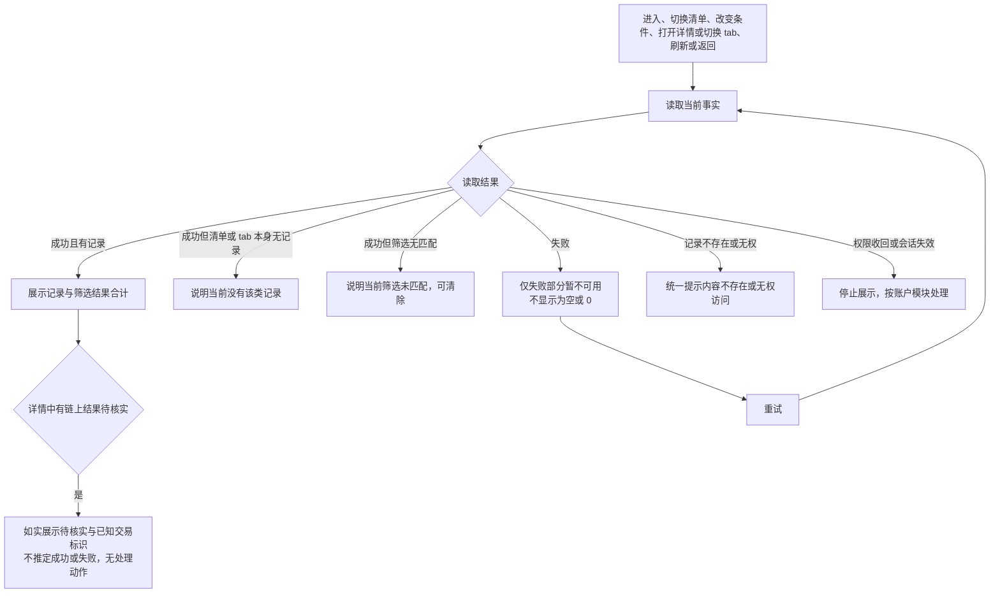

# 融资台账 · 流程图与状态机

2026-10-26｜需求评审稿

本册把功能册中的主要流程画成图，规则以[功能与业务规则](01-融资台账-PRD.md)为准。图中方框是业务环节，不代表页面或组件。融资台账只读，不拥有任何业务对象的状态；清单与详情展示的状态由来源模块的状态机定义，见本册末节对照表。

| 图 | 内容 | 对应功能 |
| --- | --- | --- |
| 业务记录出现在清单与详情中（FL-LG-01） | 一笔融资从项目通过审核到还款结清，各业务对象在什么时候出现在哪个清单或 tab | [两个清单与共同展示规则（F-LG-02）](01-融资台账-PRD.md#f-lg-02)、[融资项目清单与项目基本信息（F-LG-03）](01-融资台账-PRD.md#f-lg-03)、[项目详情中的代币质押（F-LG-04）](01-融资台账-PRD.md#f-lg-04)、[融资需求清单与需求信息（F-LG-05）](01-融资台账-PRD.md#f-lg-05)、[需求详情中的报价放款（F-LG-06）](01-融资台账-PRD.md#f-lg-06)、[需求详情中的还款（F-LG-08）](01-融资台账-PRD.md#f-lg-08) |
| 查看、穿透与返回（FL-LG-02） | 两个清单进入详情、项目与需求之间的穿透及返回 | [进入融资台账与权限（F-LG-01）](01-融资台账-PRD.md#f-lg-01)、[详情穿透与返回（F-LG-09）](01-融资台账-PRD.md#f-lg-09)、[浏览、筛选与视图保持（F-LG-10）](01-融资台账-PRD.md#f-lg-10) |
| 读取与异常（FL-LG-03） | 读取成功、空、筛选无结果、失败与无权 | [读取状态与异常（F-LG-11）](01-融资台账-PRD.md#f-lg-11) |

## 1. 业务记录出现在清单与详情中（FL-LG-01）

- 记录一旦出现就一直保留：已终结的需求、已拒绝或已失效的报价、已转回的质押、已结清的期次都可查询。
- 改额不新增需求记录；再次发布生成新一轮记录。同一份额再次质押生成新的质押记录。
- 链上处理中与链上结果待核实只在详情中展示，清单中只显示业务状态。

## 2. 查看、穿透与返回（FL-LG-02）

质押记录、报价放款记录与还款期次在所属 tab 内展开阅读。台账内的查看与穿透不产生任何业务变化，不进入面客端页面。

## 3. 读取与异常（FL-LG-03）

清单、筛选结果合计与详情的各 tab 分别反馈，其中一部分失败不影响其他已成功部分。

## 4. 状态的来源与展示位置

台账不新增状态机。下表列出展示的状态、来源定义及展示位置。

| 对象 | 状态 | 展示位置 | 来源状态机或定义 |
| --- | --- | --- | --- |
| 融资项目 | 项目状态、质押情况 | 融资项目清单与项目详情 | [融资项目状态机（ST-LS-01）](../../面客端/05-借贷广场-融资需求与代币质押/02-融资需求与代币质押-流程图与状态机.md#st-ls-01)、[质押情况变化](../../面客端/05-借贷广场-融资需求与代币质押/01-融资需求与代币质押-PRD.md#coverage) |
| 融资项目 | 已到期标记 | 项目详情 | [融资项目状态机（ST-LS-01）](../../面客端/05-借贷广场-融资需求与代币质押/02-融资需求与代币质押-流程图与状态机.md#st-ls-01) |
| 质押记录 | 当前去向、链上执行状态、链上结果待核实 | 项目详情的代币质押 | [代币质押与链上执行状态机（ST-LS-02）](../../面客端/05-借贷广场-融资需求与代币质押/02-融资需求与代币质押-流程图与状态机.md#st-ls-02)、[质押代币清单与代币详情（D-LS-67）](../../面客端/05-借贷广场-融资需求与代币质押/01-融资需求与代币质押-PRD.md#d-ls-67) |
| 融资需求 | 申请状态 | 融资需求清单与需求详情 | [对外状态协作（ST-CR-03）](../../面客端/06-借贷广场-授信报价与接受拒绝/02-授信报价与接受拒绝-流程图与状态机.md#st-cr-03) |
| 融资需求 | 发布、改额冻结与撤下的链上处理中 | 需求详情 | [一轮需求的冻结状态机（ST-LS-03）](../../面客端/05-借贷广场-融资需求与代币质押/02-融资需求与代币质押-流程图与状态机.md#st-ls-03) |
| 融资需求 | 还款状态（还款中、逾期、已结清） | 融资需求清单 | 本册[融资需求清单与需求信息（F-LG-05）](01-融资台账-PRD.md#f-lg-05)，由[融资业务状态机（L8-S02）](../../面客端/08-借贷广场-链上还款/02-链上还款-流程图与状态机.md#l8-s02)与业务逾期标记得出 |
| 报价放款 | 报价状态、链上放款处理中、本笔链上授权状态 | 需求详情的报价放款 | [融资业务本模块状态（ST-CR-02）](../../面客端/06-借贷广场-授信报价与接受拒绝/02-授信报价与接受拒绝-流程图与状态机.md#st-cr-02)、[本笔授权状态（ST-CR-04）](../../面客端/06-借贷广场-授信报价与接受拒绝/02-授信报价与接受拒绝-流程图与状态机.md#st-cr-04) |
| 融资业务 | 业务状态、业务逾期标记 | 需求详情的还款 | [融资业务状态机（L8-S02）](../../面客端/08-借贷广场-链上还款/02-链上还款-流程图与状态机.md#l8-s02) |
| 还款期次 | 期次状态、逾期标记与天数 | 需求详情的还款 | [还款期次状态机（L8-S01）](../../面客端/08-借贷广场-链上还款/02-链上还款-流程图与状态机.md#l8-s01) |
