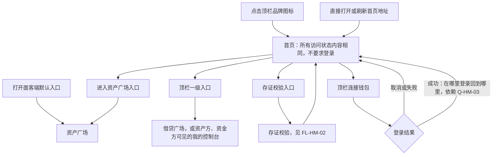
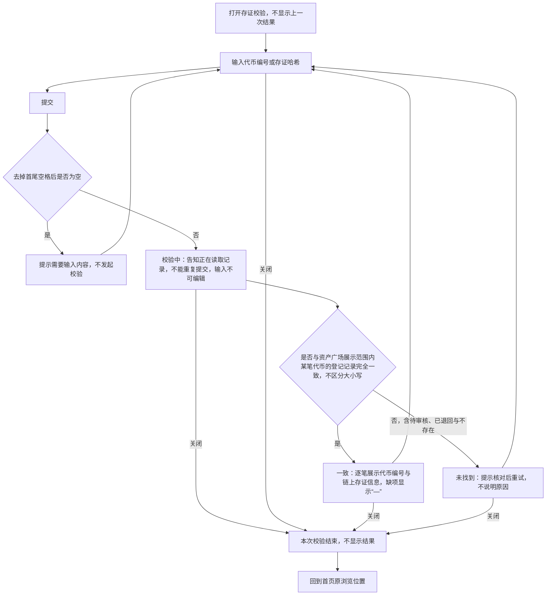
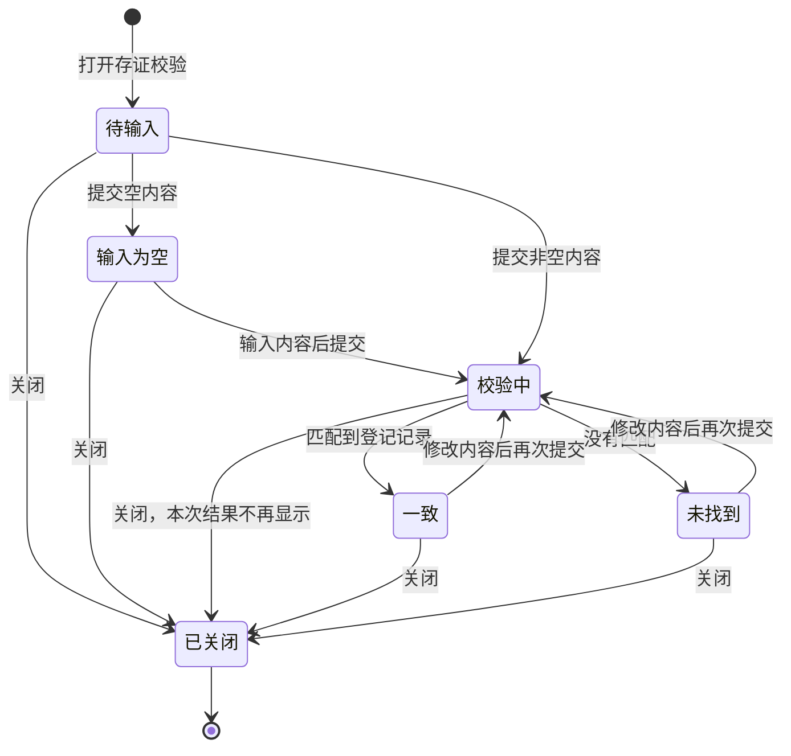

# 首页 · 流程图与状态机

2026-10-27｜草案

本册把[功能与业务规则](./01-首页-PRD.md)中的主要流程与状态画成图，规则以功能册为准。图中方框是业务环节或状态，不代表页面或组件。

| 图 | 内容 | 对应功能 |
| --- | --- | --- |
| [进入与离开首页（FL-HM-01）](#FL-HM-01) | 从哪里进入首页，在首页可以去哪里，以及登录后的落点 | [进入首页与离开（F-HM-01）](./01-首页-PRD.md#F-HM-01)、[使用须知与进入资产广场（F-HM-08）](./01-首页-PRD.md#F-HM-08)、[存证校验（F-HM-10）](./01-首页-PRD.md#F-HM-10) |
| [存证校验（FL-HM-02）](#FL-HM-02) | 输入、校验与三种结果 | [存证校验（F-HM-10）](./01-首页-PRD.md#F-HM-10) |
| [存证校验状态（ST-HM-01）](#ST-HM-01) | 一次存证校验从打开到关闭的状态 | [存证校验（F-HM-10）](./01-首页-PRD.md#F-HM-10) |

## 进入与离开首页（FL-HM-01）

## 存证校验（FL-HM-02）

## 存证校验状态（ST-HM-01）

一次存证校验从打开到关闭。关闭是终态；再次打开是一次新的校验，从“待输入”开始。

