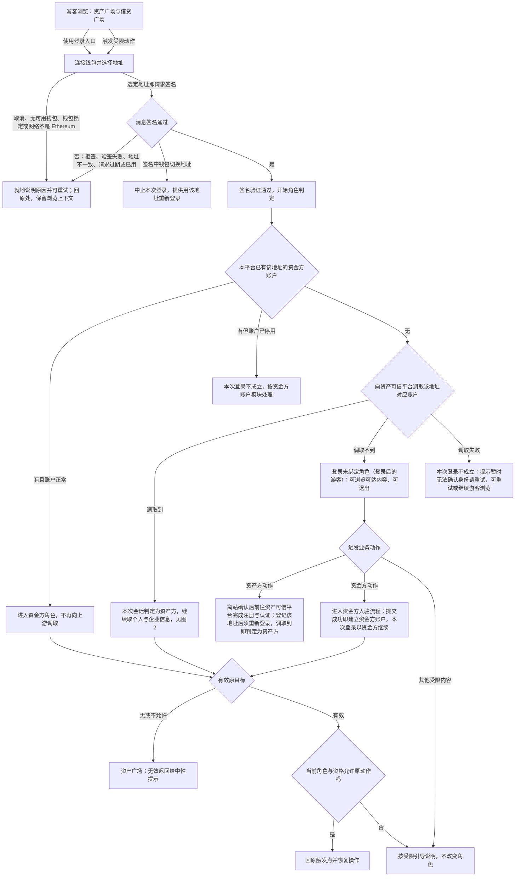
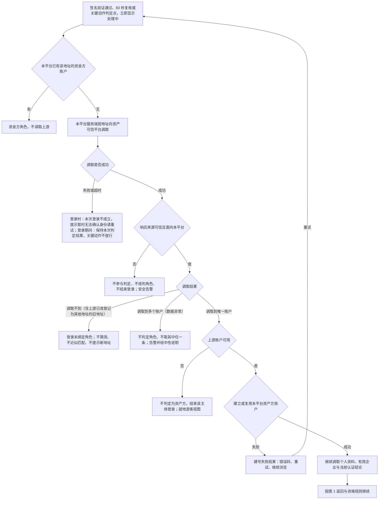
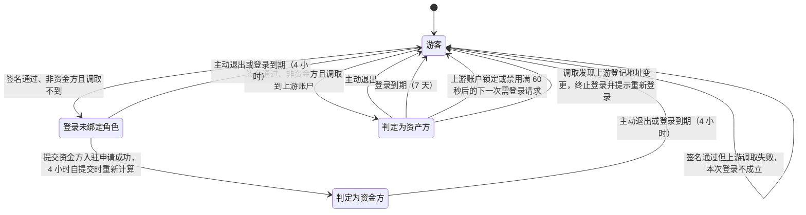
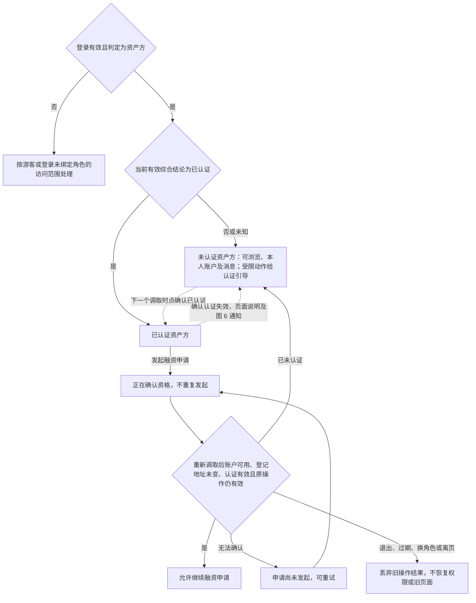
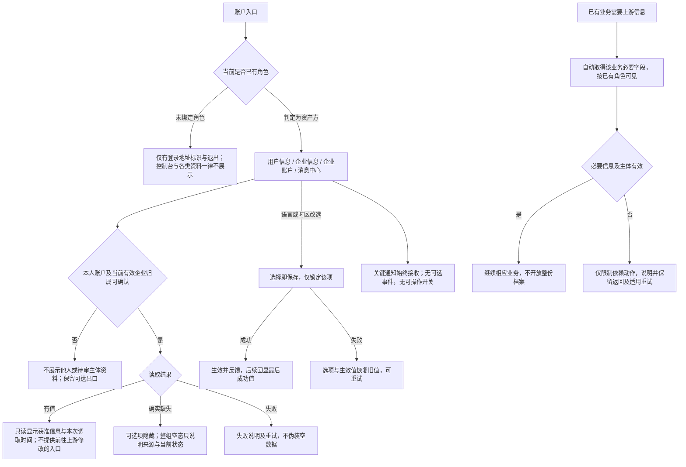
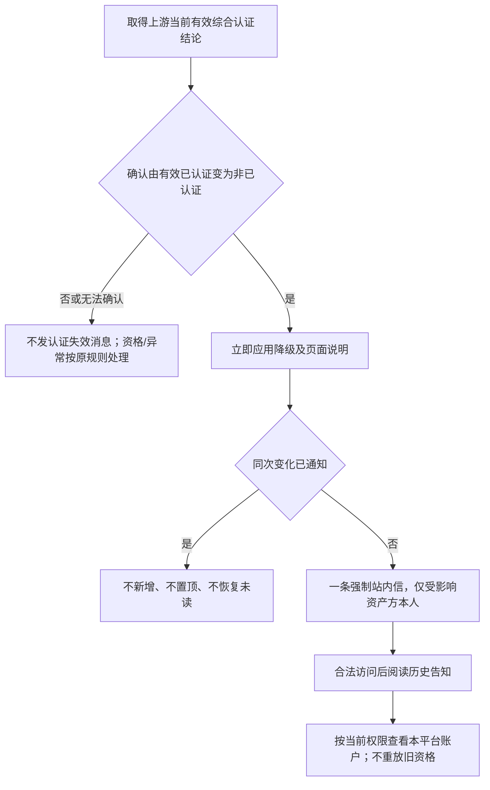
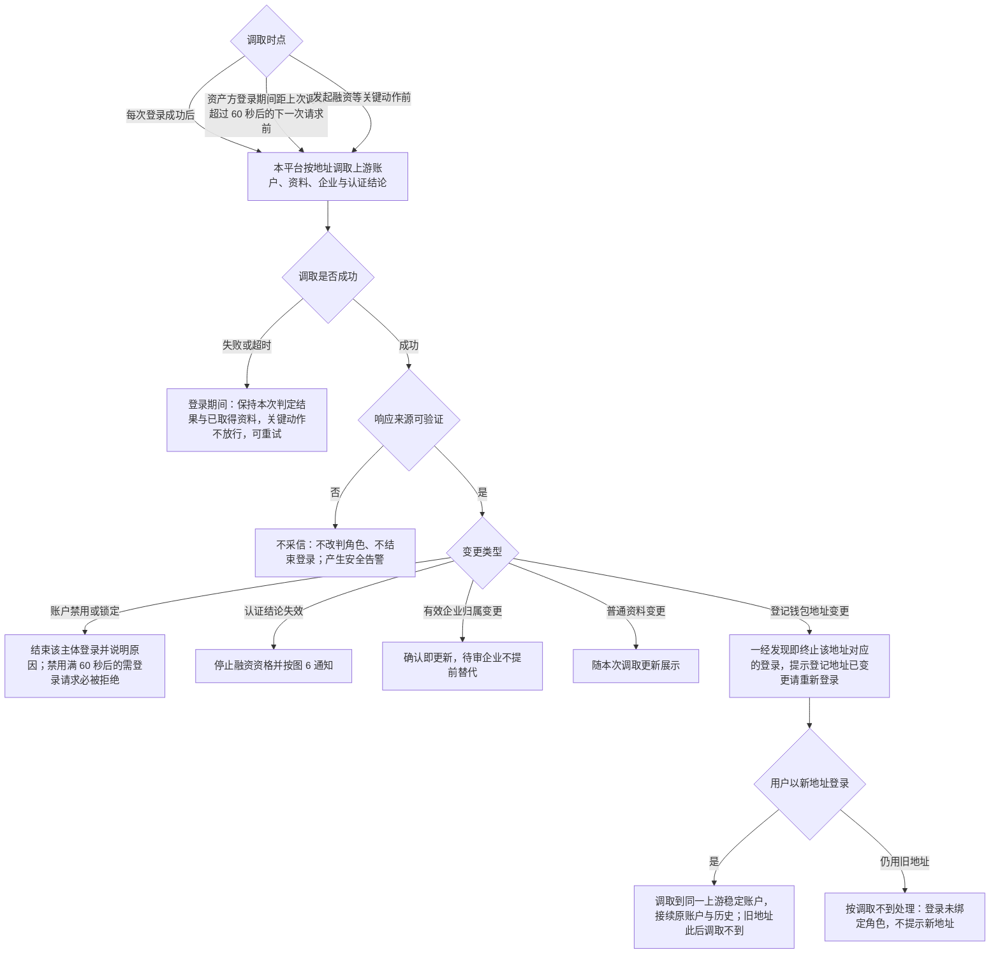

# 登录主干与资产方 SSO 接入 · 流程图与状态机

图仅表达业务流程和状态，**不表达页面布局、组件形态与视觉层级**；承载形式由 Hallmark 设计决定。图中“上游”统一指资产可信平台（用户注册认证与个人、企业信息的来源）。具体分支、字段与验收统一见[主 PRD](./01-登录主干与资产方SSO接入-PRD.md)。资金方节点仅表示 资金方账户模块的接续边界。

## 图 1 · 从游客浏览到钱包登录、角色判定与恢复原操作

对应[统一钱包登录入口](./01-登录主干与资产方SSO接入-PRD.md#F-L02)、[登录签名规则](./01-登录主干与资产方SSO接入-PRD.md#signature-rules)、[取消、不可用与更换钱包](./01-登录主干与资产方SSO接入-PRD.md#F-L03)、[登录后的角色匹配](./01-登录主干与资产方SSO接入-PRD.md#F-L34)与[返回](./01-登录主干与资产方SSO接入-PRD.md#F-L04)。

取消登录不执行原业务；未绑定角色不阻断浏览，也不要求用户选择角色；跨平台返回未满足对端确认时按资产广场兜底。判定顺序固定为先查本平台资金方、再向资产可信平台调取，**本期不接收上游主动推送**；**本平台不保存地址与资产方角色的绑定关系，每次登录都重新判定**，一个地址只对应一个角色；资金方账户保存唯一且不可修改的登录地址作为账户属性。

## 图 2 · 上游信息调取、角色判定与账户建立

对应[同一套判定](./01-登录主干与资产方SSO接入-PRD.md#F-L25)、[调取与来源校验](./01-登录主干与资产方SSO接入-PRD.md#F-L20)与[调取结果](./01-登录主干与资产方SSO接入-PRD.md#F-L35)。每次登录与登录期间的调取时点共用此判定；从上游注册或认证后返回本身不触发改判。

本期本平台不签任何协议，流程中没有协议同意环节；上游注册时签署的同步授权属上游侧行为。登录时调取失败则本次登录不成立；登录期间调取失败不结束已建立的钱包登录。

## 图 3 · 角色与登录状态

对应[登录、角色与认证分别判断](./01-登录主干与资产方SSO接入-PRD.md#state-contract)与[退出与失效](./01-登录主干与资产方SSO接入-PRD.md#F-L27)。角色与认证是两条独立的轴，本图只表达角色与登录。

退出均就地降为游客且解释原因，不自动弹登录；主动退出不退出上游，退出入口全平台唯一。**上游普通退出不结束本平台登录**；上游账户禁用或锁定满 60 秒后，任何需要登录的操作或页面刷新即被拒绝并结束登录，页面停留无请求时不主动提示。登录未绑定角色的用户在上游完成注册后，须退出并重新登录才判定为资产方；登录有效期均为自登录成功起的绝对时长。一个地址只对应一个角色且**禁止并存**；本次判定出的角色不可由用户改选，改用其他地址按全新用户重新判定。图中状态是本次会话的判定结果，不是账户上保存的绑定。原“钱包待重新确认”状态已停用。

## 图 4 · 认证资格与发起融资

对应[认证更新与发起融资](./01-登录主干与资产方SSO接入-PRD.md#F-L29)。角色判定先完成；申请审核进度不代替当前有效综合认证。

## 图 5 · 本人资料与偏好

对应[本人账户与企业信息](./01-登录主干与资产方SSO接入-PRD.md#F-L32)。

退出、换账户或离页后，旧资料/操作结果不得恢复旧角色或页面；未成功保存无草稿，已成功值不因离页撤回。资料多少不决定认证资格。偏好含语言与时区两项，取值与生效规则见[主 PRD 的偏好设置](./01-登录主干与资产方SSO接入-PRD.md#language-save)；时区只影响时间展示，不改变业务时间与先后。图中第三项按资产方侧展示名“企业账户”，资金方侧显示“机构账户”，字段与模块口径统一为企业账户，见[账户菜单](./01-登录主干与资产方SSO接入-PRD.md#account-menu)。企业账户的维护动作与字段不在本图，见[企业账户 PRD](../03-企业账户/01-企业账户-PRD.md)；在企业账户登记数币地址所发起的一次性签名不是登录，见[主 PRD 的例外说明](./01-登录主干与资产方SSO接入-PRD.md#ownership-signature)。

## 图 6 · 认证资格失效站内信

对应[认证资格失效通知](./03-登录主干与资产方SSO接入-消息通知.md#event)。

降级不等待通知成功；持续未认证不催促，恢复后再次真实失效是新事件。资金方和运营人员不接收本模块事件。

## 图 7 · 上游信息调取与登记地址变更处理

对应[上游变更的同步与通知](./01-登录主干与资产方SSO接入-PRD.md#F-L36)。

**本期由本平台主动调取，不接收上游主动推送**：变更（含登记地址变更）都在下一个调取时点（登录成功后、资产方登录期间的 60 秒复核、关键动作前）被发现并应用，不承诺秒级同步，页面停留无请求时不主动发现；登录期间调取失败不改判本次会话的角色、不放行关键动作，重复失败按接入缺口上报。**本期不考虑上游撤回资料可见权限**，该分支不实现。登记地址变更不设待重新确认状态、不冻结资金类动作。
