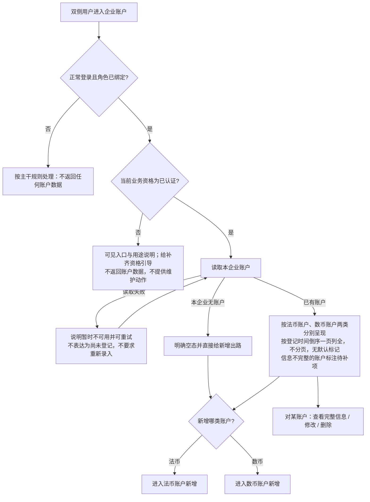
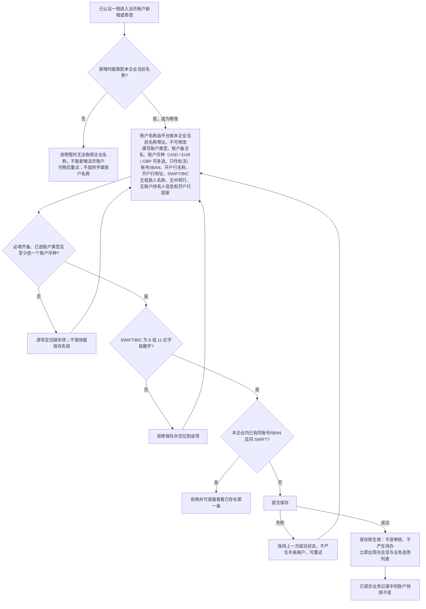
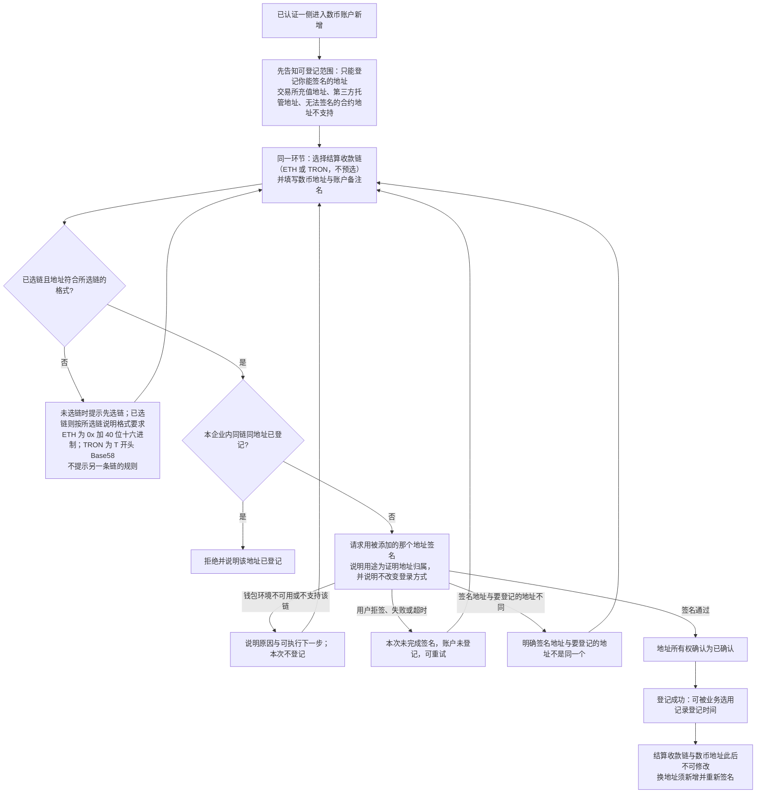
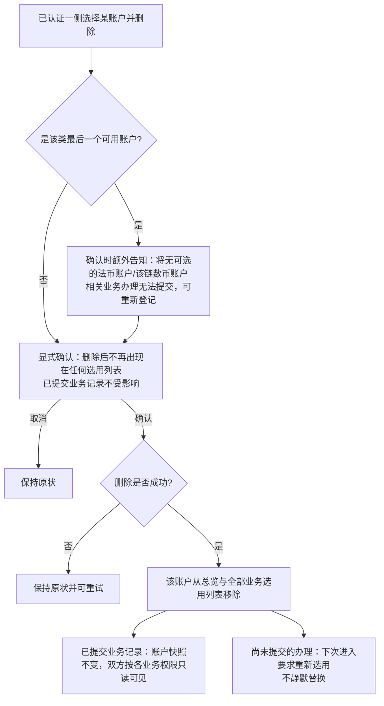
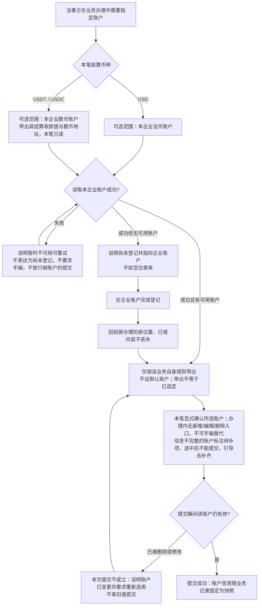
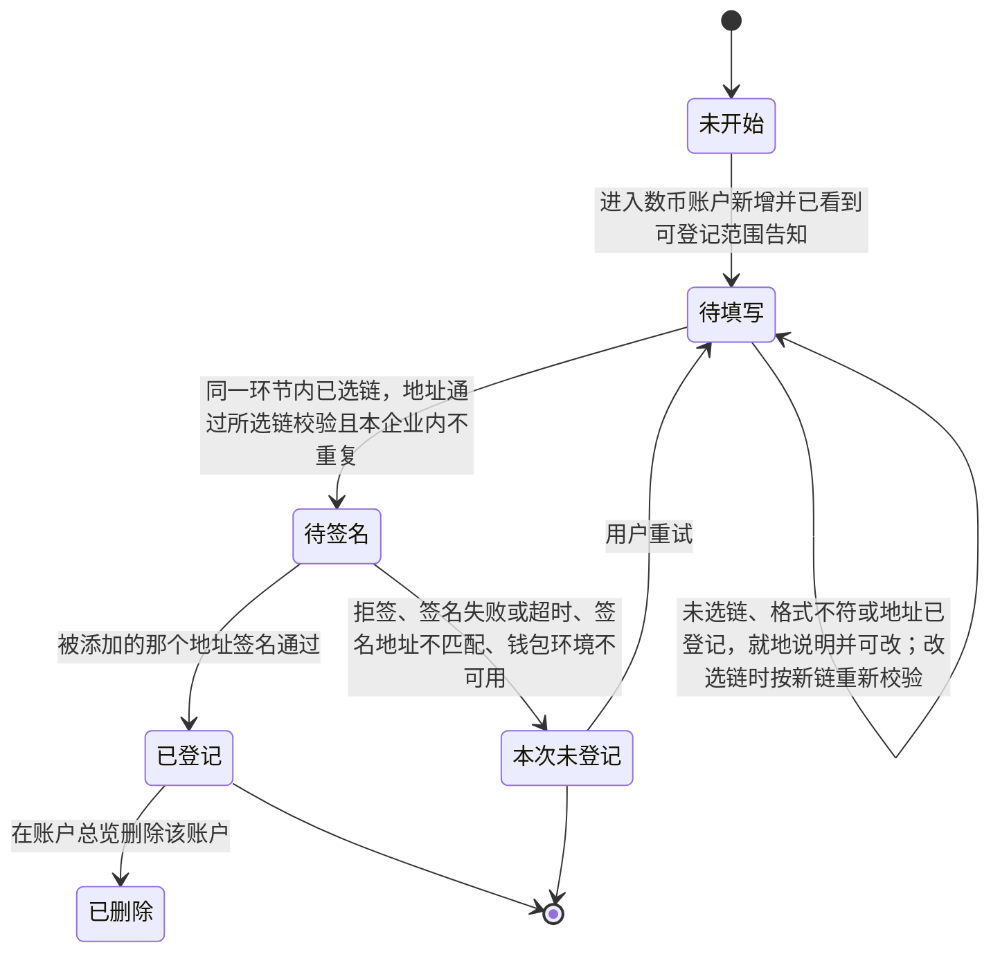
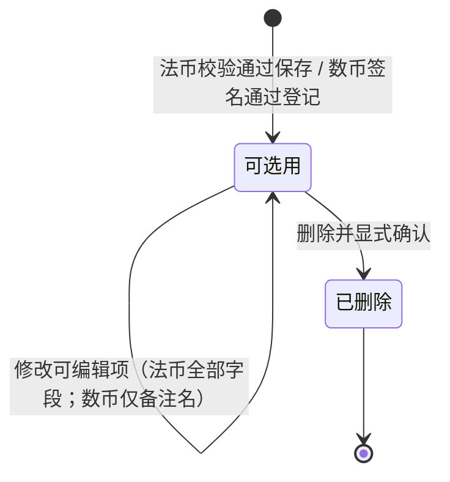

# 企业账户 · 流程图与状态机

2026-10-15｜需求评审稿

本册把[功能与业务规则](./01-企业账户-PRD.md)中的主要流程与状态画成图，规则以功能册为准。图中方框是业务环节，不代表页面或组件；实线表示业务推进或状态变化。资产方与资金方走同一套流程，图中不分两条线。

| 图 | 内容 | 对应功能 |
| --- | --- | --- |
| [图 1](#fig-1) | 进入企业账户、按资格分流、查看总览与新增入口 | [账户总览（F-EA-01）](./01-企业账户-PRD.md#f-ea-01) |
| [图 2](#fig-2) | 法币账户的填写、校验与保存（新增与修改共用） | [新增法币账户（F-EA-02）](./01-企业账户-PRD.md#f-ea-02)、[修改账户（F-EA-04）](./01-企业账户-PRD.md#f-ea-04) |
| [图 3](#fig-3) | 数币账户的选链填址与地址所有权签名 | [新增数币账户（F-EA-03）](./01-企业账户-PRD.md#f-ea-03) |
| [图 4](#fig-4) | 删除账户，以及对已提交与未提交办理的影响 | [删除账户（F-EA-05）](./01-企业账户-PRD.md#f-ea-05) |
| [图 5](#fig-5) | 业务办理中选用账户、无账户时回流 | [业务办理中选用账户（F-EA-07）](./01-企业账户-PRD.md#f-ea-07) |
| [数币账户登记状态机](#state-1) | 一次数币账户登记从开始到登记成功或未登记 | [新增数币账户（F-EA-03）](./01-企业账户-PRD.md#f-ea-03) |
| [企业账户生命周期状态机](#state-2) | 一个已登记账户从可选用到已删除 | [修改账户（F-EA-04）](./01-企业账户-PRD.md#f-ea-04)、[删除账户（F-EA-05）](./01-企业账户-PRD.md#f-ea-05) |

## 账户总览与新增入口（图 1）

对应[账户总览（F-EA-01）](./01-企业账户-PRD.md#f-ea-01)。

运营人员与 SPV 不出现在本图任何分支：任何入口与直接请求都被拒绝，见[谁能使用（P-EA-01）](./01-企业账户-PRD.md#p-ea-01)。

## 法币账户新增与修改（图 2）

对应[新增法币账户（F-EA-02）](./01-企业账户-PRD.md#f-ea-02)与[修改账户（F-EA-04）](./01-企业账户-PRD.md#f-ea-04)。

修改与新增走同一套校验；除账户名称外的字段都可修改。企业名称变更后，已登记法币账户的账户名称随之更新，已提交业务记录的快照不变。账户币种只作标注：平台不核验银行是否支持、业务选用也不据此过滤或拦截。取消或离开不保留未提交内容，本模块不设草稿。

## 数币账户新增与地址所有权签名（图 3）

对应[新增数币账户（F-EA-03）](./01-企业账户-PRD.md#f-ea-03)。

签名不建立登录会话、不切换登录钱包、不参与登录地址匹配、不改变角色绑定，也不改绑登录凭据；被添加地址可与登录地址不同、可在另一条链上。与登录的关系见[地址所有权签名不是登录](./01-企业账户-PRD.md#ownership-signature)。任何失败分支都不改变当前登录、不产生半条账户，也没有“稍后验证”“跳过验证”或运营代确认的出路。

## 删除账户与已提交记录的关系（图 4）

对应[删除账户（F-EA-05）](./01-企业账户-PRD.md#f-ea-05)与[已提交业务的账户快照](./01-企业账户-PRD.md#snapshot)。

删除不可撤销，无回收站；需要恢复时重新登记，数币账户须重新完成地址所有权签名。

## 业务办理中选用与回流（图 5）

对应[业务办理中选用账户（F-EA-07）](./01-企业账户-PRD.md#f-ea-07)。本图只画本模块与办理侧的衔接，办理动作本身的完整规则在相应业务模块。

## 数币账户登记状态机

对象：一次数币账户的登记过程。初始状态为未开始，终态为已登记或本次未登记。

只有已登记才产生可被选用的账户；待填写、待签名都不是账户，不落入总览、不占用去重判断、不可被业务选用。结算收款链与数币地址在进入已登记后不可修改；换地址须作为新账户重新从待填写开始。

## 企业账户生命周期状态机

对象：一个已登记的企业账户（法币账户与数币账户共用）。

本期不设默认账户，生命周期只有可选用与已删除两种状态。已删除是终态：不出现在总览与任何选用列表，不可撤销、不可恢复；但已提交业务记录中的账户快照不随之变化，仍按各业务权限只读可见。本期不设“停用”这一中间状态——停止使用某账户的唯一方式是删除它。
