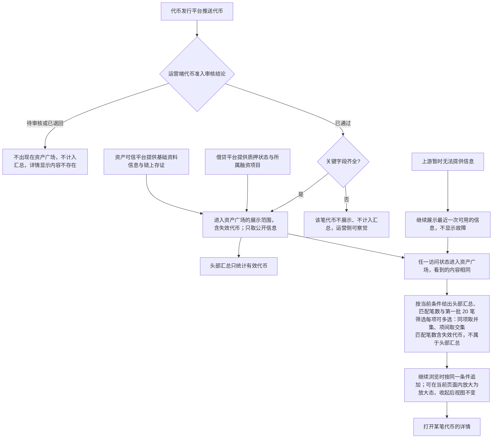
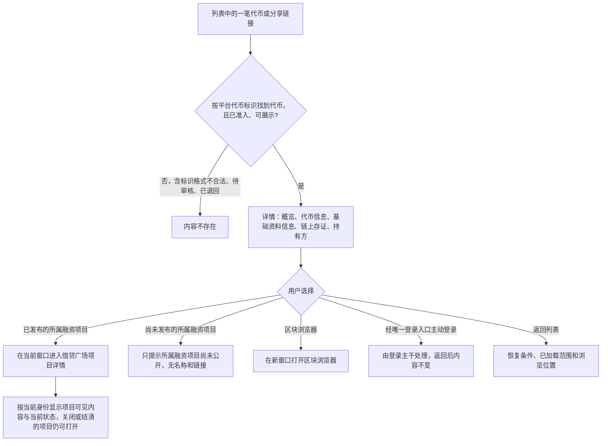
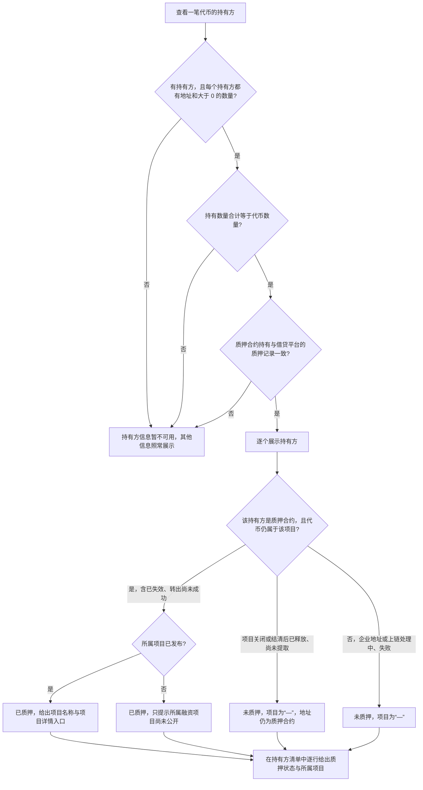
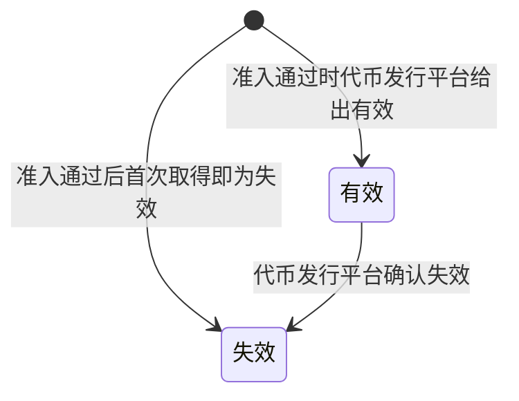
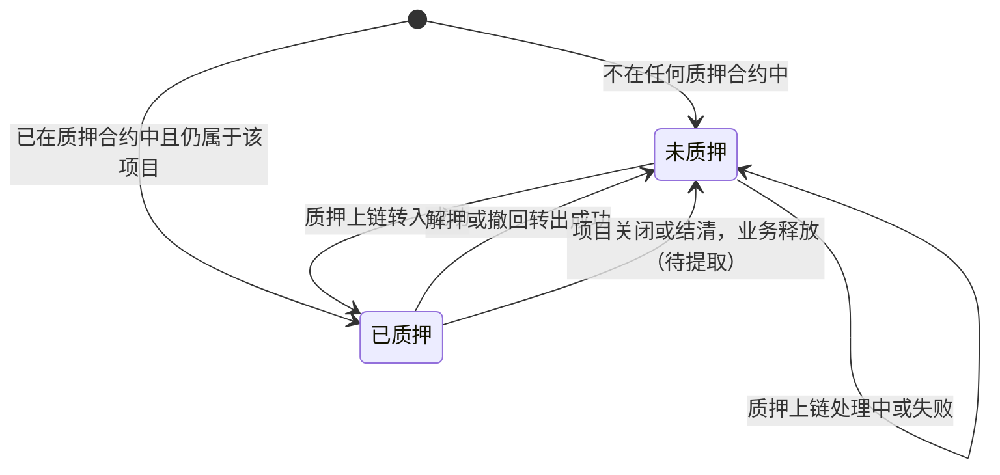
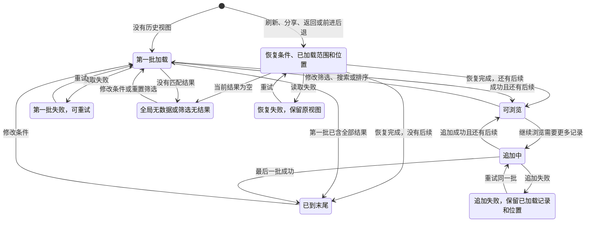

# 资产广场与已上架代币只读域 · 流程图与状态机

2026-10-28｜需求评审稿

本册把[功能与业务规则](./01-资产广场-PRD.md)中的主要流程与状态画成图，规则以功能册为准。图中方框是业务环节或状态，不代表页面或组件；图中的“链”指铸造链（本期以太坊）。

| 图 | 内容 | 对应功能 |
| --- | --- | --- |
| [信息来源与公开浏览（FL-AM-01）](#FL-AM-01) | 代币经准入后进入资产广场，各类信息以谁为准，以及浏览者如何进入 | [哪些代币出现在资产广场（F-AM-15）](./01-资产广场-PRD.md#F-AM-15)、[信息来源与时效（F-AM-13）](./01-资产广场-PRD.md#F-AM-13)、[角色、权限与公开范围（F-AM-10）](./01-资产广场-PRD.md#F-AM-10) |
| [查看详情与跳转（FL-AM-02）](#FL-AM-02) | 从列表或分享链接打开详情，再去项目详情、区块浏览器、登录或返回列表 | [进入资产广场（F-AM-01）](./01-资产广场-PRD.md#F-AM-01)、[详情地址、分享与返回（F-AM-06）](./01-资产广场-PRD.md#F-AM-06)、[链上凭证与自行查验（F-AM-08）](./01-资产广场-PRD.md#F-AM-08) |
| [持有方与质押（FL-AM-03）](#FL-AM-03) | 判断持有方信息能否展示，以及每个持有方的质押状态与所属项目 | [持有方（F-AM-14）](./01-资产广场-PRD.md#F-AM-14)、[质押状态与所属融资项目（F-AM-09）](./01-资产广场-PRD.md#F-AM-09) |
| [代币状态（ST-AM-01）](#ST-AM-01) | 代币有效与失效 | [详情内容（F-AM-07）](./01-资产广场-PRD.md#F-AM-07)、[信息来源与时效（F-AM-13）](./01-资产广场-PRD.md#F-AM-13) |
| [质押状态（ST-AM-02）](#ST-AM-02) | 一个持有方所持数量的未质押与已质押 | [质押状态与所属融资项目（F-AM-09）](./01-资产广场-PRD.md#F-AM-09) |
| [列表视图状态（ST-AM-03）](#ST-AM-03) | 首批加载、追加、空结果、失败与恢复 | [筛选、排序与搜索（F-AM-04）](./01-资产广场-PRD.md#F-AM-04)、[连续加载（F-AM-05）](./01-资产广场-PRD.md#F-AM-05)、[空结果与读取失败（F-AM-11）](./01-资产广场-PRD.md#F-AM-11) |

## 信息来源与公开浏览（FL-AM-01）

准入通过是终态，本期没有下架；通过后代币失效、持有方变化或资料变更都照常按事实展示。代币变为失效当日可见，并从当日起退出头部汇总；较早的事实不覆盖较新的事实。信息如何取得、何时刷新由研发决定。

## 查看详情与跳转（FL-AM-02）

## 持有方与质押（FL-AM-03）

质押状态只在持有方清单中逐个持有方展示；代币本身不设质押状态，列表与概览都不展示。一笔代币的持有方可以分属不同融资项目。

## 代币状态（ST-AM-01）

图中起点是代币开始在资产广场展示（准入通过）。准入审核只能通过有效代币，但通过后到首次展示之间可能已变为失效，此时直接以失效展示。本地日期越过账期到期日不触发转换。失效后仍在列表和详情中展示，但不再计入头部汇总；本期没有销毁或恢复。

## 质押状态（ST-AM-02）

对象是一个持有方所持的数量。

已质押不等于已通过审核。业务释放后，即使代币仍在质押合约中等待提取，也显示未质押。

## 列表视图状态（ST-AM-03）

