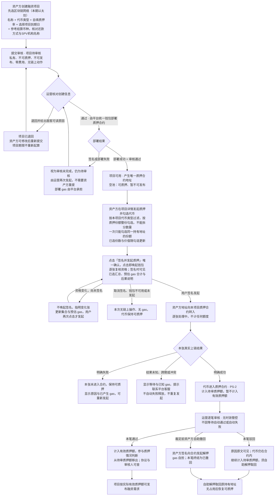
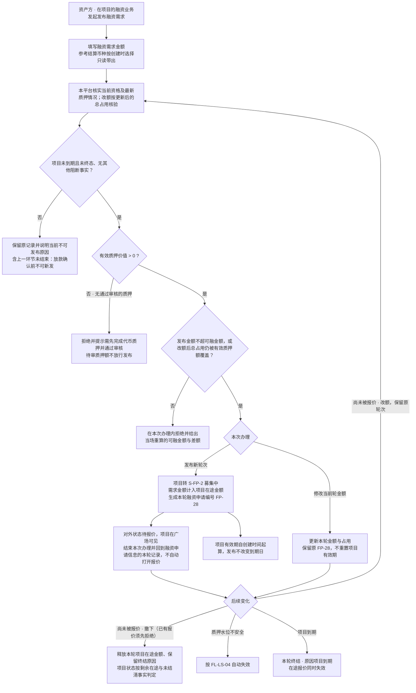
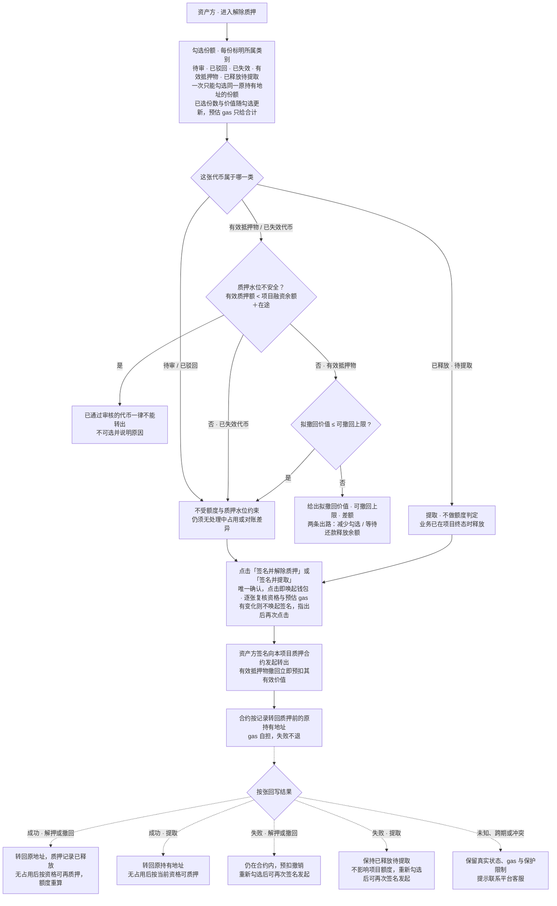
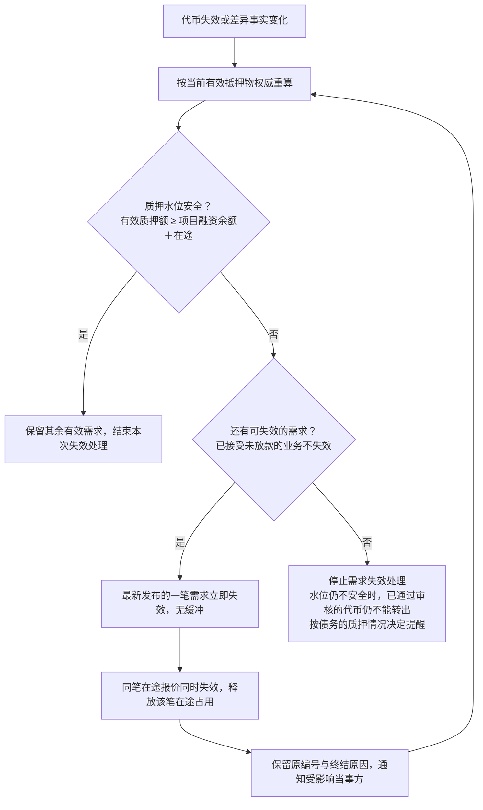
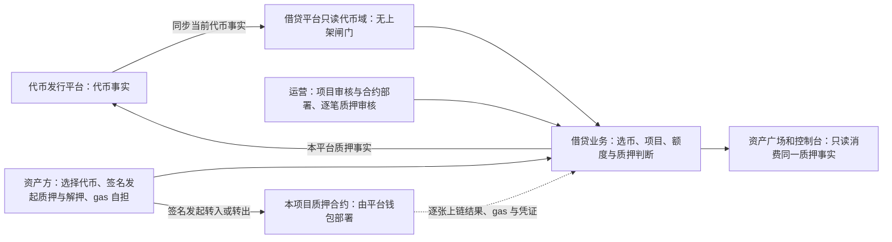
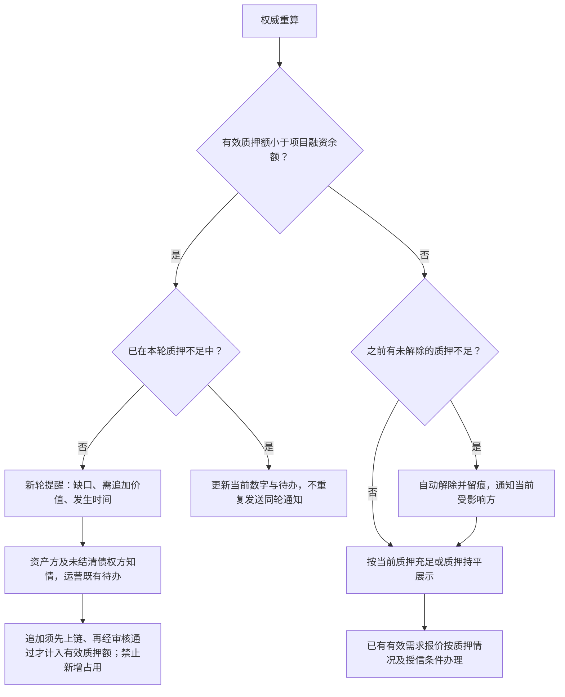
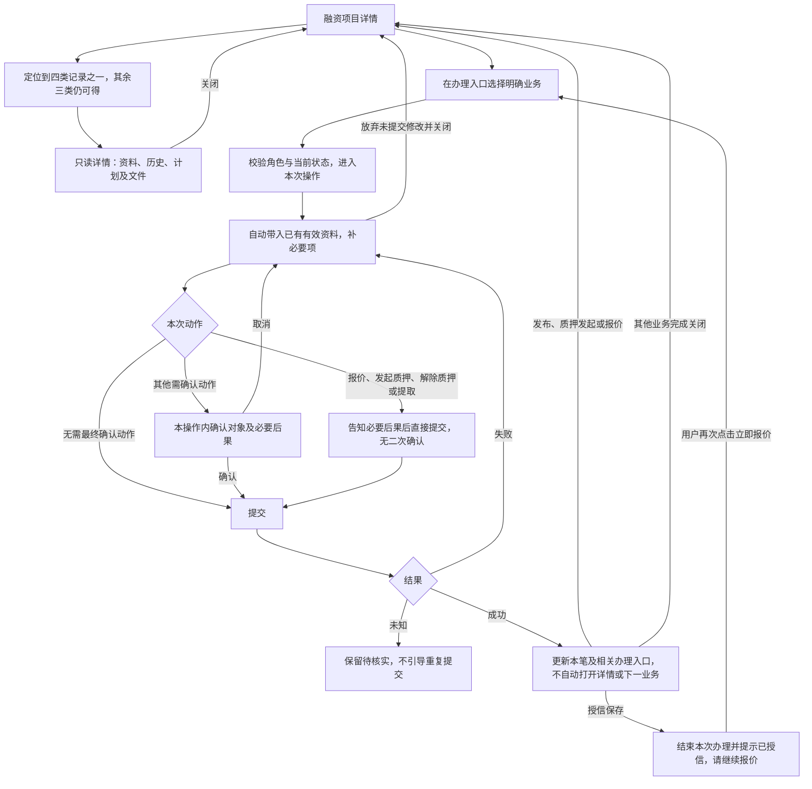
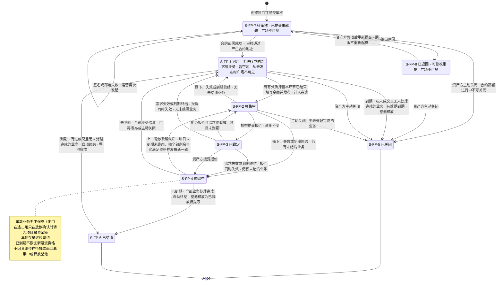
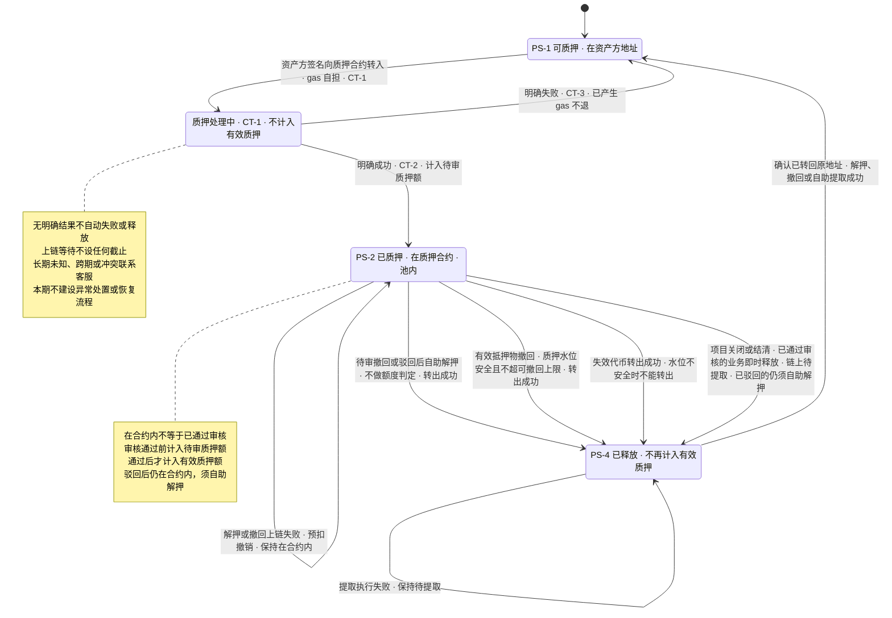
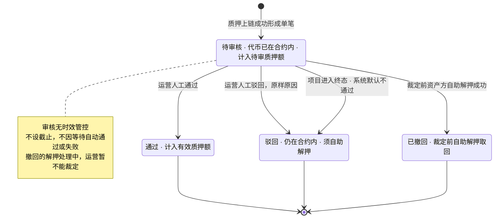

# 融资需求与代币质押 · 流程图与状态机

2026-10-15｜需求评审稿

本册把[功能与业务规则](./01-融资需求与代币质押-PRD.md)中的主要流程与状态画成图，规则以功能册为准。图中方框是业务环节，不代表页面或组件；实线表示办理或状态变化，虚线表示结果回写。处理中和待核实不代表失败。

| 图 | 内容 | 对应功能 |
| --- | --- | --- |
| [创建项目、项目审核与逐张质押（FL-LS-01）](#fl-ls-01) | 从创建、审核与合约部署，到签名质押上链和逐张审核 | [创建融资项目并提交审核](./01-融资需求与代币质押-PRD.md#pledge)、[项目审核与合约部署（F-LS-22）](./01-融资需求与代币质押-PRD.md#f-ls-22)、[发起代币质押（F-LS-05）](./01-融资需求与代币质押-PRD.md#f-ls-05)、[逐张审核结果（F-LS-21）](./01-融资需求与代币质押-PRD.md#f-ls-21) |
| [发布、改额与撤下需求（FL-LS-02）](#fl-ls-02) | 一轮融资需求的发布、修改金额与撤下 | [发布与管理融资需求（F-LS-02）](./01-融资需求与代币质押-PRD.md#f-ls-02) |
| [解除质押与提取（FL-LS-03）](#fl-ls-03) | 按类别与质押水位判断能否转出，一步签名，逐张结果 | [解除质押与提取（F-LS-06）](./01-融资需求与代币质押-PRD.md#f-ls-06) |
| [需求因质押水位不足失效（FL-LS-04）](#fl-ls-04) | 重算后按发布时间倒序使需求失效 | [需求因质押水位不足失效（F-LS-19）](./01-融资需求与代币质押-PRD.md#f-ls-19) |
| [角色与平台职责（FL-LS-05）](#fl-ls-05) | 代币发行平台、本平台、运营、资产方与质押合约之间的事实流向 | [角色与可见范围](./01-融资需求与代币质押-PRD.md#roles) |
| [质押不足触发与解除（FL-LS-06）](#fl-ls-06) | 质押不足提醒的触发、持续与自动解除 | [质押不足提醒（F-LS-16）](./01-融资需求与代币质押-PRD.md#f-ls-16) |
| [查看记录与独立办理（FL-LS-07）](#fl-ls-07) | 从记录只读查看、从办理入口办理及结束后的去向 | [查看与办理分开（F-LS-20）](./01-融资需求与代币质押-PRD.md#f-ls-20) |
| [融资项目状态机（ST-LS-01）](#st-ls-01) | 一个融资项目从待审核到已关闭或已结清 | [项目状态与后续业务](./01-融资需求与代币质押-PRD.md#project-state) |
| [代币质押与链上执行状态机（ST-LS-02）](#st-ls-02) | 一张代币在本平台的质押状态与链上执行结果 | [签名并发起质押（F-LS-08）](./01-融资需求与代币质押-PRD.md#f-ls-08)、[解除质押与提取（F-LS-06）](./01-融资需求与代币质押-PRD.md#f-ls-06) |
| [单笔审核状态机（ST-LS-03）](#st-ls-03) | 一笔质押申请的审核结论 | [逐张审核结果（F-LS-21）](./01-融资需求与代币质押-PRD.md#f-ls-21) |

## 创建项目、项目审核与逐张质押（FL-LS-01）

对应[创建融资项目并提交审核](./01-融资需求与代币质押-PRD.md#pledge)、[项目审核与合约部署（F-LS-22）](./01-融资需求与代币质押-PRD.md#f-ls-22)、[发起代币质押（F-LS-05）](./01-融资需求与代币质押-PRD.md#f-ls-05)、[逐张审核结果（F-LS-21）](./01-融资需求与代币质押-PRD.md#f-ls-21)。

三件事分别判断：项目审核决定项目能不能用，上链结果决定代币在不在合约里，逐张审核决定这张代币算不算有效质押额。全流程没有时限。

## 发布、改额与撤下需求（FL-LS-02）

对应[发布与管理融资需求（F-LS-02）](./01-融资需求与代币质押-PRD.md#f-ls-02)。

## 解除质押与提取（FL-LS-03）

对应[解除质押与提取（F-LS-06）](./01-融资需求与代币质押-PRD.md#f-ls-06)。

质押水位不安全（有效质押额低于项目融资余额＋项目在途金额）时，已通过审核的代币（有效抵押物与已失效代币）一律不能转出；判据与需求失效（FL-LS-04）相同。待审、已驳回与已释放待提取的代币不受影响。

## 需求因质押水位不足失效（FL-LS-04）

对应[需求因质押水位不足失效（F-LS-19）](./01-融资需求与代币质押-PRD.md#f-ls-19)。

## 角色与平台职责（FL-LS-05）

对应[角色与可见范围](./01-融资需求与代币质押-PRD.md#roles)。

## 质押不足触发与解除（FL-LS-06）

对应[质押不足提醒（F-LS-16）](./01-融资需求与代币质押-PRD.md#f-ls-16)。

## 查看记录与独立办理（FL-LS-07）

对应[查看与办理分开（F-LS-20）](./01-融资需求与代币质押-PRD.md#f-ls-20)。

## 融资项目状态机（ST-LS-01）

对应[项目状态与后续业务](./01-融资需求与代币质押-PRD.md#project-state)。

可用状态包含尚未质押的空池项目，空池不因未质押自动转移或关闭。项目只有在没有未处理完成的业务（待确认的报价、待放款或待放款确认、未结清业务、处理中的链上操作）时才能关闭或结清，这时才整池释放。未到期时全部结清回到可用；到期且没有未处理完成的业务时自动终结，有过成交的为已结清，从未成交的为已关闭（有效期到期）。待审核期间合约正在部署时暂不可关闭。到期是并行标记，存量业务继续履约。

## 代币质押与链上执行状态机（ST-LS-02）

对应[签名并发起质押（F-LS-08）](./01-融资需求与代币质押-PRD.md#f-ls-08)、[解除质押与提取（F-LS-06）](./01-融资需求与代币质押-PRD.md#f-ls-06)。

“已释放”是历史质押记录的状态；只有真实转回原地址且没有其他占用，代币才可再次质押。质押合法取值为可质押、已质押、已释放，链上执行为未发起、处理中、成功、失败，面客显示业务文案。

## 单笔审核状态机（ST-LS-03）

对应[逐张审核结果（F-LS-21）](./01-融资需求与代币质押-PRD.md#f-ls-21)。

驳回（含项目终态默认不通过）与撤回都需资产方自助解押才真正取回代币，链上结果见代币质押与链上执行状态机。重新发起生成新的一笔，旧笔保留。
