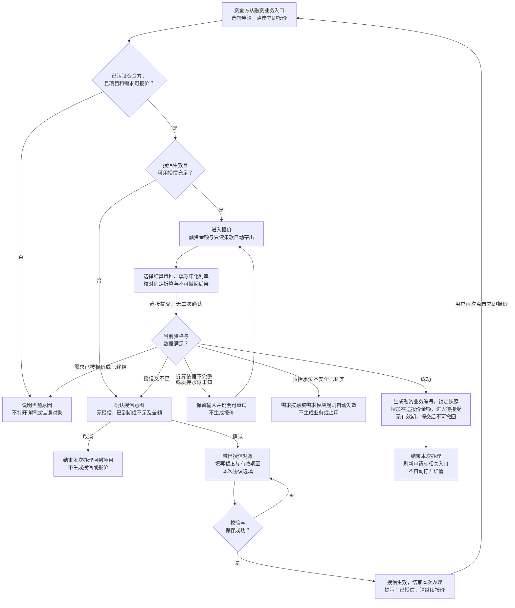
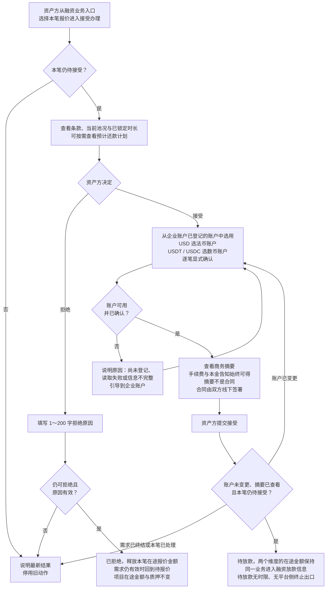
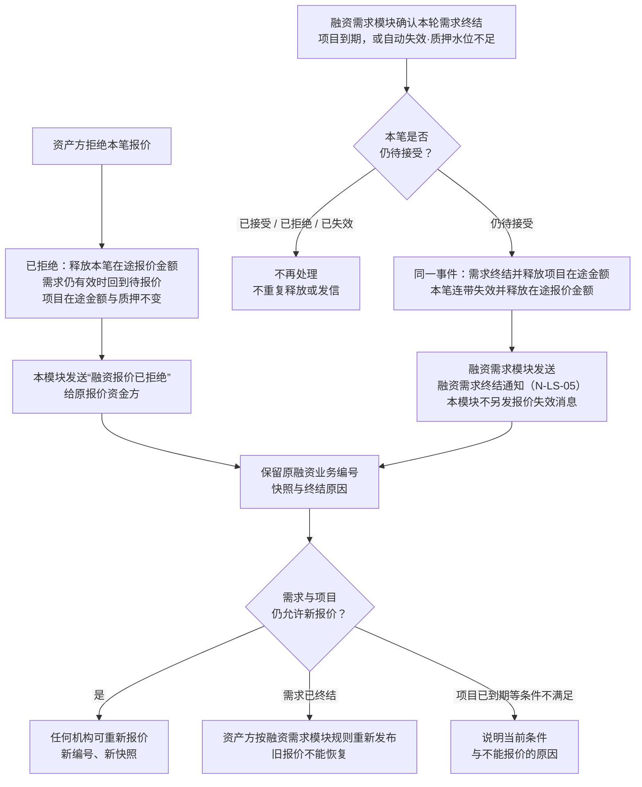
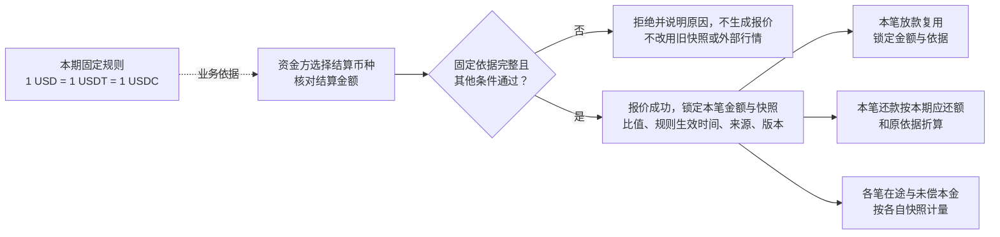
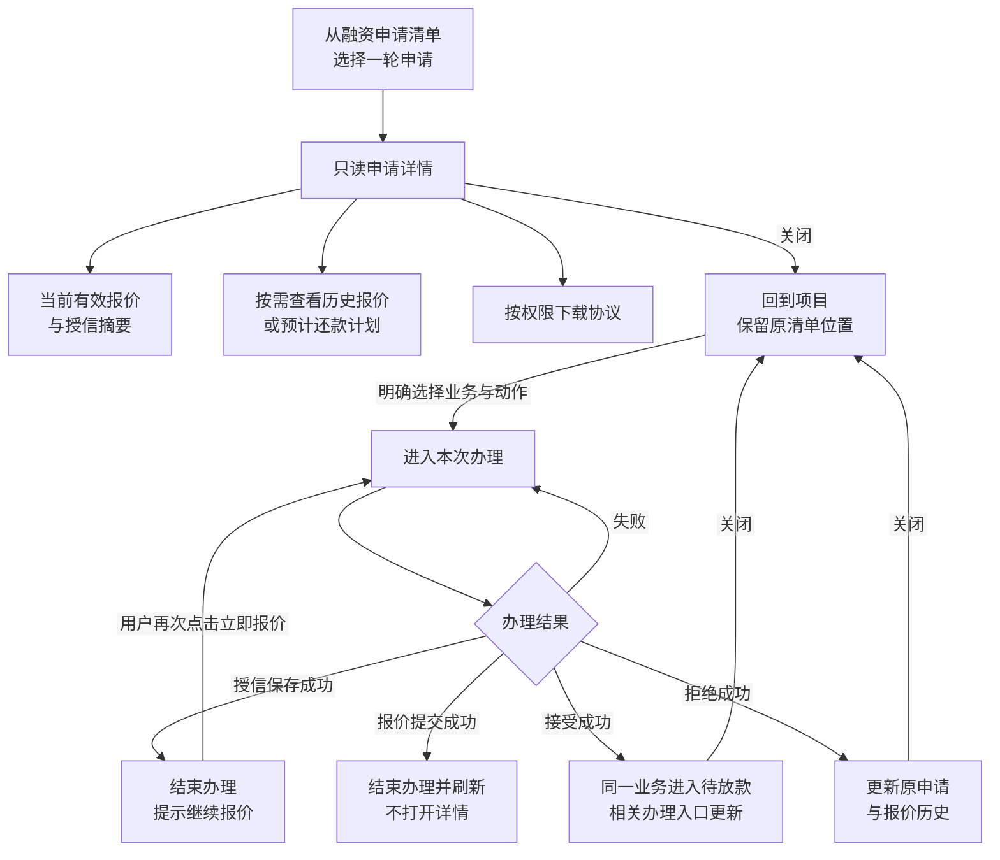
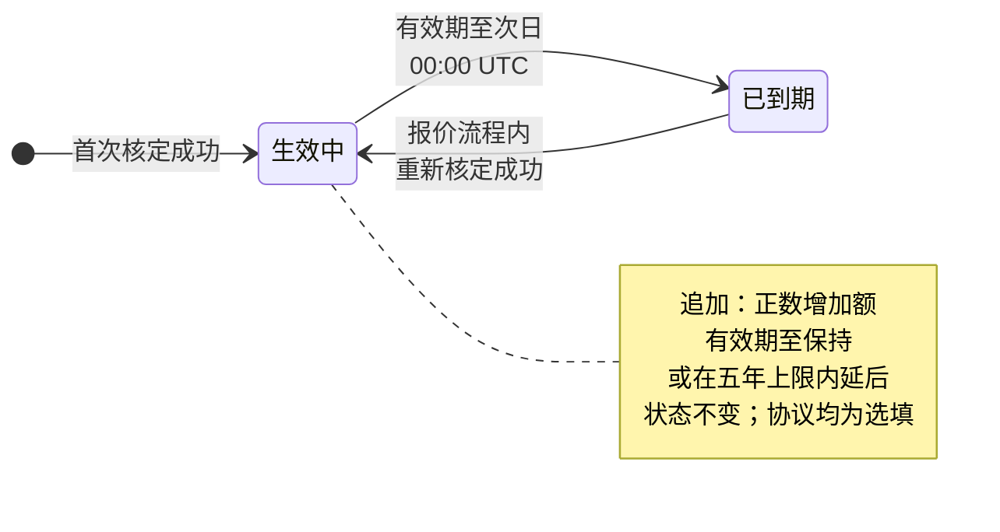
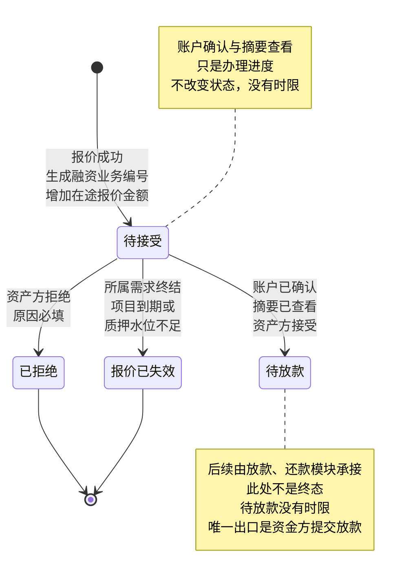
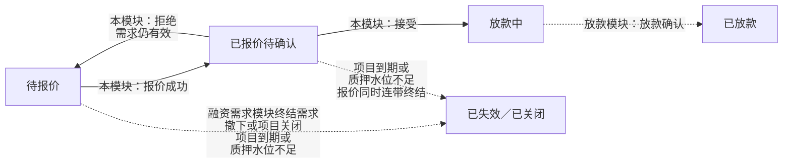

# 授信报价与接受拒绝 · 流程图与状态机

2026-10-19｜需求评审稿

本册把[功能与业务规则](./01-授信报价与接受拒绝-PRD.md)中的主要流程与状态画成图，规则以功能册为准。图中方框是业务环节，不代表页面或组件；实线表示办理或状态变化，虚线表示依据或相邻模块的结果。“终结”只针对本笔对象，不代表项目、授信或债务全部结束。

| 图 | 内容 | 对应功能 |
| --- | --- | --- |
| [授信与报价（FL-CR-01）](#fl-cr-01) | 从点击立即报价、授信判断与核定，到报价提交与锁定 | [立即报价后的四种授信结果（F-LS-37）](./01-授信报价与接受拒绝-PRD.md#credit-entry)、[核定与追加授信（F-LS-38）](./01-授信报价与接受拒绝-PRD.md#credit-save)、[报价条款与提交（F-LS-24）](./01-授信报价与接受拒绝-PRD.md#quote-form)、[提交时复核质押水位（F-LS-36）](./01-授信报价与接受拒绝-PRD.md#quote-coverage)、[生成融资业务并锁定需求（F-LS-25）](./01-授信报价与接受拒绝-PRD.md#quote-lock) |
| [接受与拒绝（FL-CR-02）](#fl-cr-02) | 资产方选用收款账户、核对商务摘要后接受，或填写原因拒绝 | [选用并确认本笔收款账户（F-LS-28）](./01-授信报价与接受拒绝-PRD.md#respond-account)、[核对商务摘要并接受（F-LS-29）](./01-授信报价与接受拒绝-PRD.md#respond-contract)、[拒绝及并发结果（F-LS-30）](./01-授信报价与接受拒绝-PRD.md#respond-reject) |
| [需求终结与连带失效（FL-CR-03）](#fl-cr-03) | 拒绝与需求终结两条退出路径，及各自的释放与消息归属 | [报价的持续有效与退出路径（F-LS-34）](./01-授信报价与接受拒绝-PRD.md#f-ls-34)、[需求终结与报价连带失效（F-LS-35）](./01-授信报价与接受拒绝-PRD.md#demand-invalid) |
| [固定折算与逐笔沿用（FL-CR-04）](#fl-cr-04) | 固定折算规则如何锁进本笔快照并被放款、还款沿用 | [固定折算与折算快照（F-LS-26）](./01-授信报价与接受拒绝-PRD.md#quote-rate) |
| [查看记录与办理交接（FL-CR-05）](#fl-cr-05) | 从记录只读查看、从办理入口办理及结束后的去向 | [查看与办理](./01-授信报价与接受拒绝-PRD.md#view-and-act)、[当前报价、历史与跨入口定位（F-LS-32）](./01-授信报价与接受拒绝-PRD.md#records) |
| [授信生命周期（ST-CR-01）](#st-cr-01) | 一条授信关系的生效与到期 | [核定与追加授信（F-LS-38）](./01-授信报价与接受拒绝-PRD.md#credit-save)、[授信有效期（F-LS-39）](./01-授信报价与接受拒绝-PRD.md#credit-term) |
| [融资业务本模块状态（ST-CR-02）](#st-cr-02) | 一笔报价从待接受到已拒绝、已失效或待放款 | [生成融资业务并锁定需求（F-LS-25）](./01-授信报价与接受拒绝-PRD.md#quote-lock)、[机构与项目两个维度（F-LS-27）](./01-授信报价与接受拒绝-PRD.md#allocation) |
| [对外状态协作（ST-CR-03）](#st-cr-03) | 本模块事实如何推动需求对外状态 | [当前报价、历史与跨入口定位（F-LS-32）](./01-授信报价与接受拒绝-PRD.md#records) |

## 授信与报价（FL-CR-01）

质押水位未知与已证实不安全走不同出口；授信保存独立生效，之后报价取消或失败都不回滚授信。

## 接受与拒绝（FL-CR-02）

账户确认与摘要查看只是待接受内的办理进度，停留多久都不改变结论；拒绝不需要先完成这些步骤。

## 需求终结与连带失效（FL-CR-03）

报价没有有效期，不存在自动到期分支。项目关闭不出现在本图：有待确认报价的项目不能关闭。失效记录需求的实际终结时刻与具体原因；同一笔只有一个正式结果。

## 固定折算与逐笔沿用（FL-CR-04）

固定比值不代表数币精度已定，数币精度仍待确认。

## 查看记录与办理交接（FL-CR-05）

详情只读；查看历史、计划与文件不改变当前办理对象。

## 授信生命周期（ST-CR-01）

追加不重置五年上限的起点；授信到期只阻止新报价，不影响已有业务。

## 融资业务本模块状态（ST-CR-02）

待接受、已拒绝、待放款、报价已失效对应融资业务状态 S-FD-1、S-FD-2、S-FD-3、S-FD-11；已拒绝与报价已失效不能恢复。待放款之后的待放款确认（S-FD-4）与还款中（S-FD-6）由[放款与放款确认](../07-借贷广场-放款与放款确认/01-放款与放款确认-PRD.md)定义。本状态机没有按时间自动发生的转移。

## 对外状态协作（ST-CR-03）

需求对外状态的唯一来源是[融资需求与代币质押](../05-借贷广场-融资需求与代币质押/01-融资需求与代币质押-PRD.md#project-state)；本模块只提供报价、接受、拒绝与连带失效的事实，不据此图另建派生规则。
