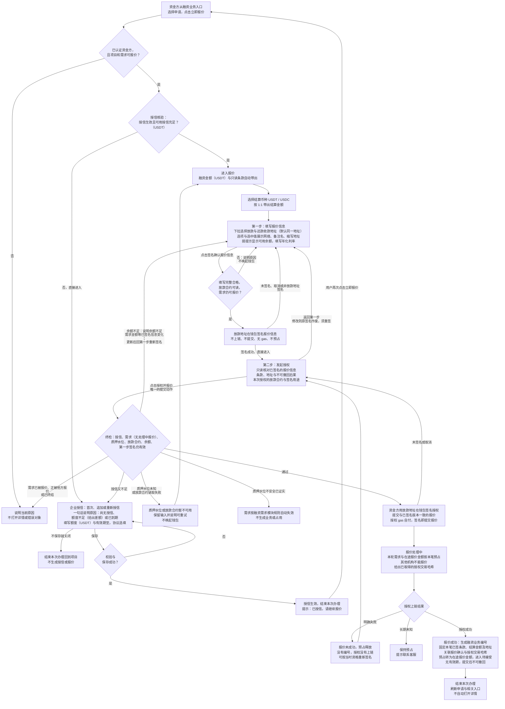
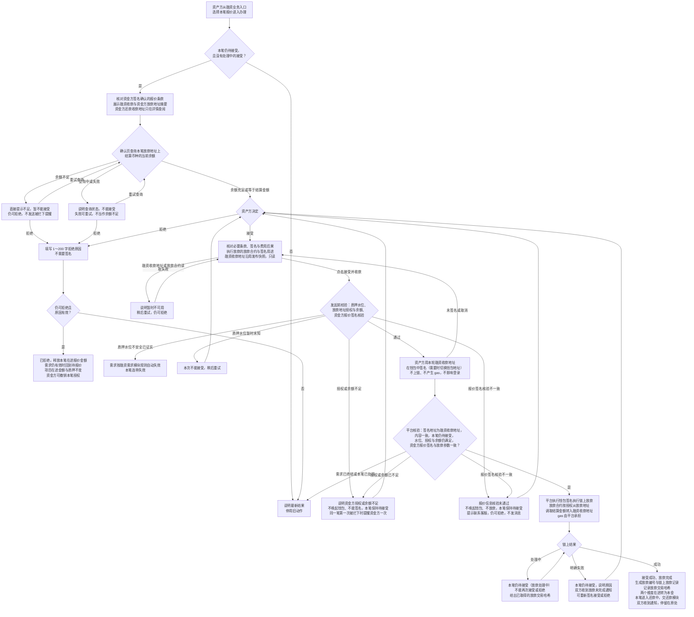
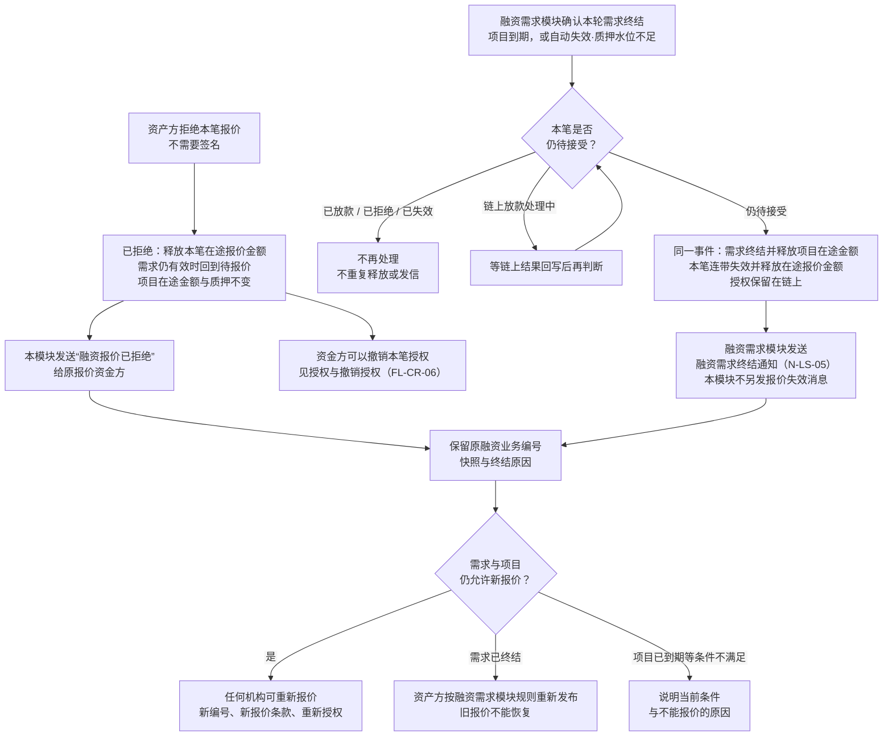
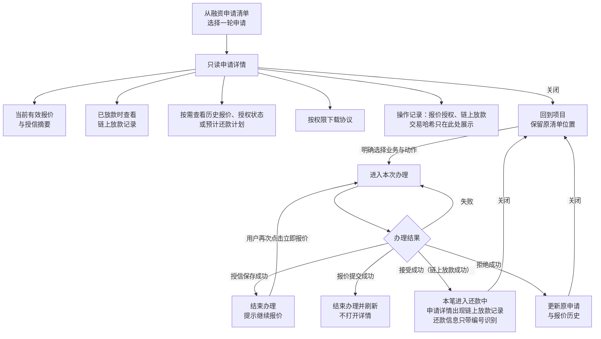
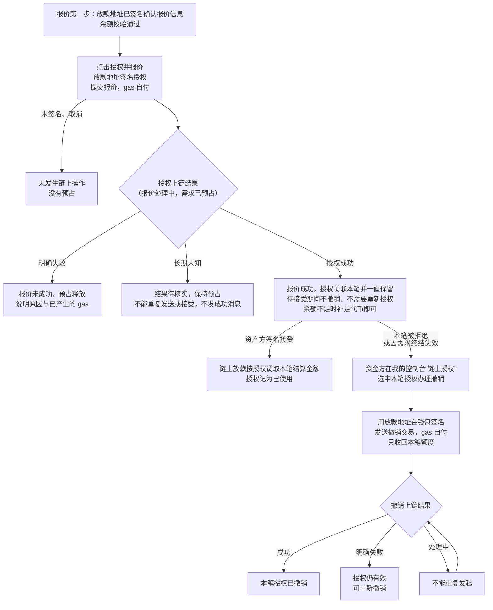
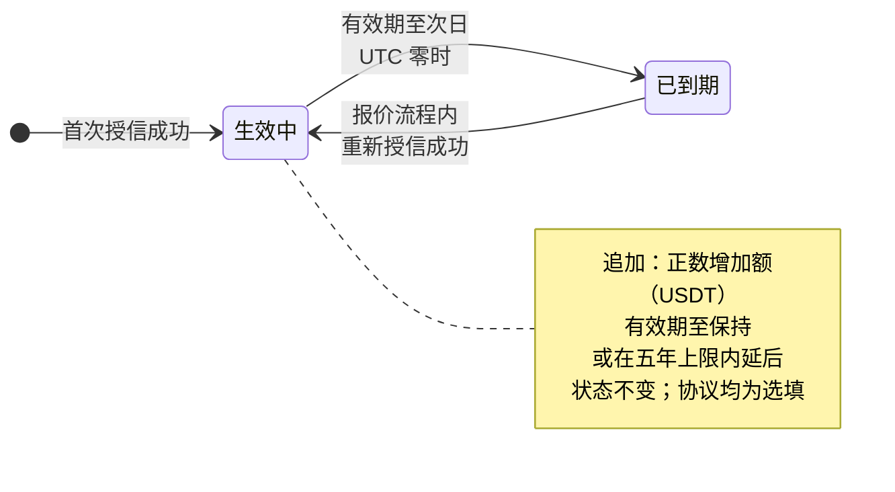
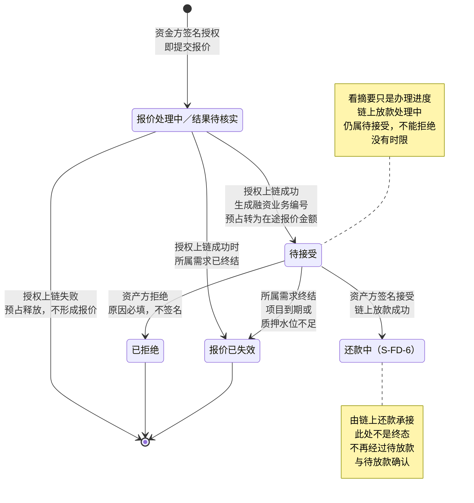
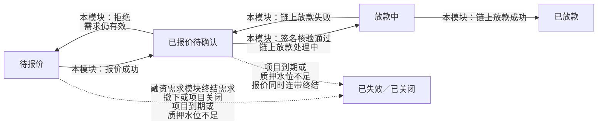
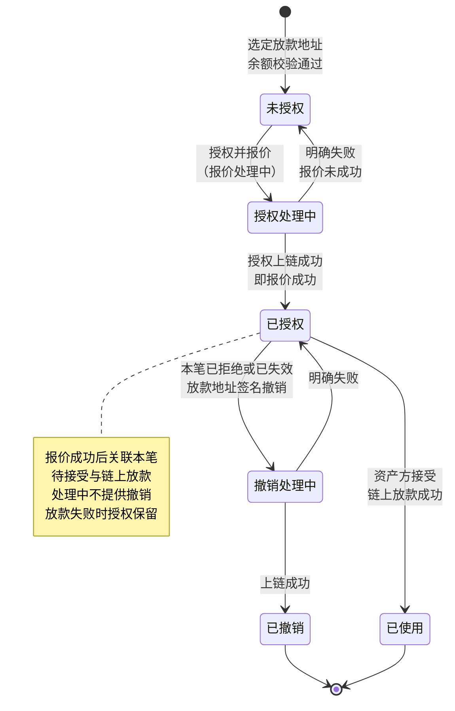

# 授信报价与接受拒绝 · 流程图与状态机

2026-10-28｜需求评审稿

本册把[功能与业务规则](./01-授信报价与接受拒绝-PRD.md)中的主要流程与状态画成图，规则以功能册为准。图中方框是业务环节，不代表页面或组件；实线表示办理或状态变化，虚线表示依据或相邻模块的结果。“终结”只针对本笔对象，不代表项目、授信或债务全部结束。图号沿用原值，缺号不代表遗漏。

| 图 | 内容 | 对应功能 |
| --- | --- | --- |
| [授信与报价（FL-CR-01）](#fl-cr-01) | 从点击立即报价、授信核验与企业授信，到放款地址、余额校验与授权并报价 | [报价前的授信核验（F-LS-37）](./01-授信报价与接受拒绝-PRD.md#credit-entry)、[企业授信：首次、追加与重新授信（F-LS-38）](./01-授信报价与接受拒绝-PRD.md#credit-save)、[报价条款与提交（F-LS-24）](./01-授信报价与接受拒绝-PRD.md#quote-form)、[结算金额与 1:1 折算（F-LS-26）](./01-授信报价与接受拒绝-PRD.md#quote-rate)、[放款地址、余额校验与授权放款合约（F-LS-40）](./01-授信报价与接受拒绝-PRD.md#quote-authorize)、[提交时复核质押水位（F-LS-36）](./01-授信报价与接受拒绝-PRD.md#quote-coverage)、[生成融资业务并锁定需求（F-LS-25）](./01-授信报价与接受拒绝-PRD.md#quote-lock) |
| [接受与拒绝（FL-CR-02）](#fl-cr-02) | 资产方核对摘要与融资收款地址后签名接受、平台执行链上放款并进入还款，或填写原因直接拒绝 | [核对本笔融资收款地址（F-LS-28）](./01-授信报价与接受拒绝-PRD.md#respond-account)、[核对商务摘要、接受并收款（链上放款）（F-LS-29）](./01-授信报价与接受拒绝-PRD.md#respond-contract)、[拒绝及并发结果（F-LS-30）](./01-授信报价与接受拒绝-PRD.md#respond-reject) |
| [需求终结与连带失效（FL-CR-03）](#fl-cr-03) | 拒绝与需求终结两条退出路径，及各自的释放、授权与消息归属 | [报价的持续有效与退出路径（F-LS-34）](./01-授信报价与接受拒绝-PRD.md#f-ls-34)、[需求终结与报价连带失效（F-LS-35）](./01-授信报价与接受拒绝-PRD.md#demand-invalid) |
| [查看记录与办理交接（FL-CR-05）](#fl-cr-05) | 从记录只读查看、从办理入口办理及结束后的去向 | [查看与办理](./01-授信报价与接受拒绝-PRD.md#view-and-act)、[当前报价、历史与跨入口定位（F-LS-32）](./01-授信报价与接受拒绝-PRD.md#records) |
| [授权与撤销授权（FL-CR-06）](#fl-cr-06) | 授权并报价的上链结果、链上放款时的使用，以及报价被拒绝或失效后的撤销授权 | [放款地址、余额校验与授权放款合约（F-LS-40）](./01-授信报价与接受拒绝-PRD.md#quote-authorize)、[撤销授权（F-LS-41）](./01-授信报价与接受拒绝-PRD.md#revoke) |
| [授信生命周期（ST-CR-01）](#st-cr-01) | 一条授信关系的生效与到期 | [企业授信：首次、追加与重新授信（F-LS-38）](./01-授信报价与接受拒绝-PRD.md#credit-save)、[授信有效期（F-LS-39）](./01-授信报价与接受拒绝-PRD.md#credit-term) |
| [融资业务本模块状态（ST-CR-02）](#st-cr-02) | 一笔报价从报价处理中、待接受，到已拒绝、已失效，或链上放款成功进入还款中 | [生成融资业务并锁定需求（F-LS-25）](./01-授信报价与接受拒绝-PRD.md#quote-lock)、[机构与项目两个维度（F-LS-27）](./01-授信报价与接受拒绝-PRD.md#allocation) |
| [对外状态协作（ST-CR-03）](#st-cr-03) | 本模块事实如何推动需求对外状态 | [当前报价、历史与跨入口定位（F-LS-32）](./01-授信报价与接受拒绝-PRD.md#records) |
| [本笔授权状态（ST-CR-04）](#st-cr-04) | 放款地址对本项目放款合约的本笔授权，从未授权到已授权，再到已使用或已撤销 | [放款地址、余额校验与授权放款合约（F-LS-40）](./01-授信报价与接受拒绝-PRD.md#quote-authorize)、[撤销授权（F-LS-41）](./01-授信报价与接受拒绝-PRD.md#revoke) |

## 授信与报价（FL-CR-01）

质押水位未知与已证实不安全走不同出口；授信保存独立生效，之后报价取消或失败都不回滚授信。报价分“填写并签名确认报价信息—发起授权”两步：第一步用放款地址签名确认报价信息，不上链、不提交，签名成功即进入第二步，没有“下一步”；已签名的报价信息由平台保存、不上链（用户 2026-10-26 裁定），授权上链成功即报价成功，签名在资产方接受、执行放款时核验（用户 2026-10-27 要求）；第二步点击时只检查签名仍对应当前填写，变化则回第一步重签；余额不足仍可签名进入第二步，点击“授权并报价”时才拦下；第二步展示本次授权的放款合约与签名用途，交易哈希的展示见[所交互的合约、签名用途与交易哈希](./01-授信报价与接受拒绝-PRD.md#chain-display)；完整条款确认与签名的规则以[本次报价条款的签名确认与一致性](./01-授信报价与接受拒绝-PRD.md#quote-integrity)为准，真实能力尚待核实；第二步的签名授权就是提交报价，授权之后没有单独的提交。报价处理中所属需求终结的，等上链结果回写后再判断：成功的报价生成编号并随需求终结记为已失效，资金方可以撤销授权；失败的不形成报价，也没有授权。

## 接受与拒绝（FL-CR-02）

接受操作页保留必要条款与地址摘要；完整条款、锁定时间、质押明细与预计计划在详情按需查阅，查阅不是接受步骤，返回同一笔办理保留进度（见[操作页与详情页的信息归属](./01-授信报价与接受拒绝-PRD.md#operation-information)）。核对条款只是待接受内的办理进度，停留多久都不改变结论；接受只有一个动作，资产方在钱包内的签名就是接受，之后的链上放款由平台执行，资产方不再确认或提交。接受即链上放款，之后没有独立的放款登记与放款确认。发起时被授权或余额拦下的，同一笔只在第一次提醒资金方。

## 需求终结与连带失效（FL-CR-03）

报价没有有效期，不存在自动到期分支。项目关闭不出现在本图：有待确认报价的项目不能关闭。失效记录需求的实际终结时刻与具体原因；同一笔只有一个正式结果。已失效报价的授权，资金方可以撤销，见[授权与撤销授权（FL-CR-06）](#fl-cr-06)。

## 查看记录与办理交接（FL-CR-05）

详情只读；查看历史、计划与文件不改变当前办理对象。授权交易哈希与放款交易哈希在详情中只在操作记录展示，当前报价、报价历史与链上放款记录不重复；哈希缩写展示、点击复制，可在新窗口跳转区块链浏览器，返回后原位置保留，见[所交互的合约、签名用途与交易哈希](./01-授信报价与接受拒绝-PRD.md#chain-display)。项目详情只有质押代币、融资申请、还款三类记录，不单设融资放款信息清单；撤销授权在我的控制台的“链上授权”清单中办理（[链上授权（F-MC-14）](../09-我的控制台/01-我的控制台-PRD.md#f-mc-14)），不从这里进入。

## 授权与撤销授权（FL-CR-06）

每笔报价都签名授权一次，不因已有授权而跳过；放款合约每个项目一份，授权只针对本项目的放款合约；同一放款地址对本项目放款合约另有未撤销的授权（如此前已拒绝或已失效的报价）时，任何一笔的授权或撤销都不减少待接受报价所需的额度。授权与撤销授权都用放款地址签名，放款地址可以不是登录地址；签名只为授权合约，与登录无关，签名前后登录状态不变。授权与撤销授权都不发送站内信。

## 授信生命周期（ST-CR-01）

追加不重置五年上限的起点；授信到期只阻止新报价，不影响已有业务。

## 融资业务本模块状态（ST-CR-02）

报价处理中没有融资业务编号，不是融资业务状态，只是本轮需求的预占；待接受、已拒绝、报价已失效对应融资业务状态 S-FD-1、S-FD-2、S-FD-11；已拒绝与报价已失效不能恢复。链上放款成功后本笔直接进入还款中（S-FD-6），之后的状态由[链上还款](../08-借贷广场-链上还款/01-链上还款-PRD.md)定义；待放款（S-FD-3）与待放款确认（S-FD-4）不再使用。本状态机没有按时间自动发生的转移。

## 对外状态协作（ST-CR-03）

需求对外状态由[融资需求与代币质押的融资申请详情](../05-借贷广场-融资需求与代币质押/01-融资需求与代币质押-PRD.md#application-detail)沿本模块事实派生：放款中指签名核验通过后链上放款处理中，已放款指链上放款成功，失败回到已报价待确认；本图不另建派生规则。

## 本笔授权状态（ST-CR-04）

每笔报价都经过一次签名授权，不跳过；授权处理中即报价处理中。资金方在平台外自行撤销的，按链上事实显示。撤销入口在我的控制台“链上授权”，我的报价详情只定位对应授权记录。
