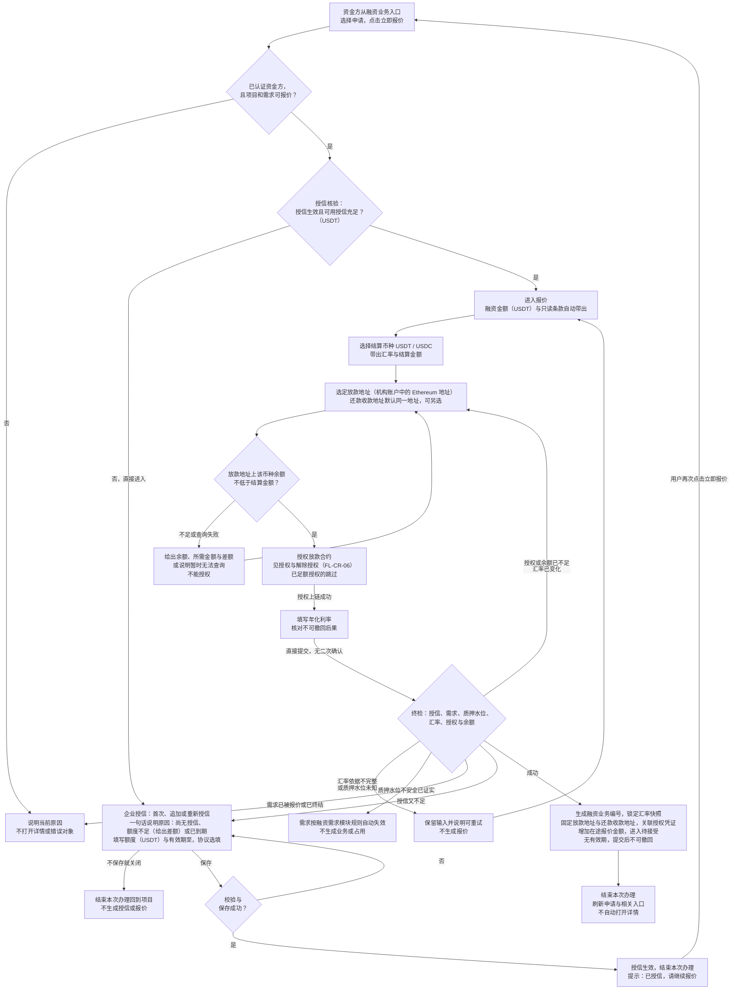
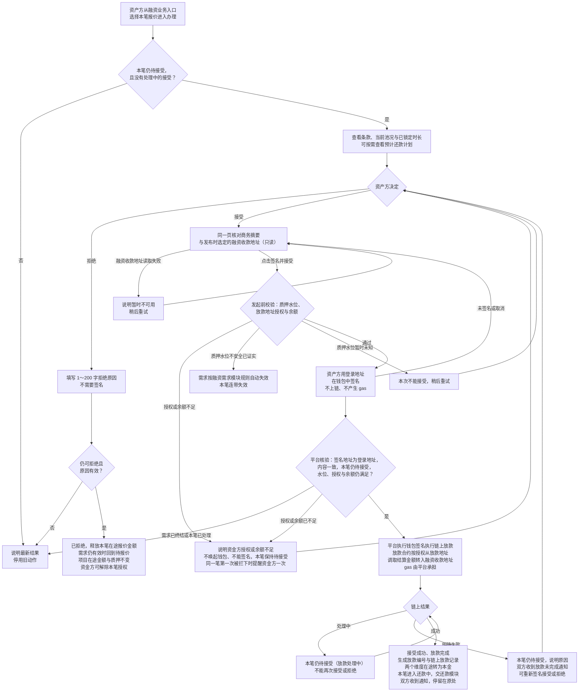
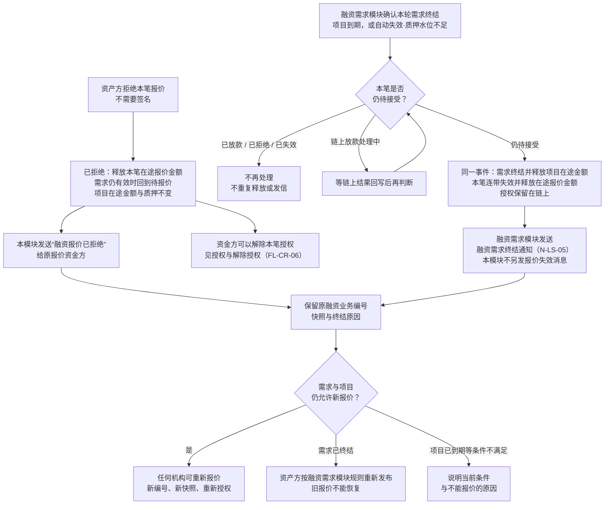
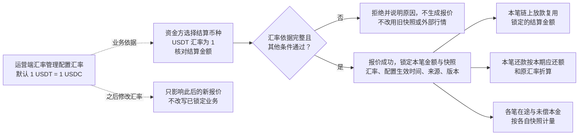
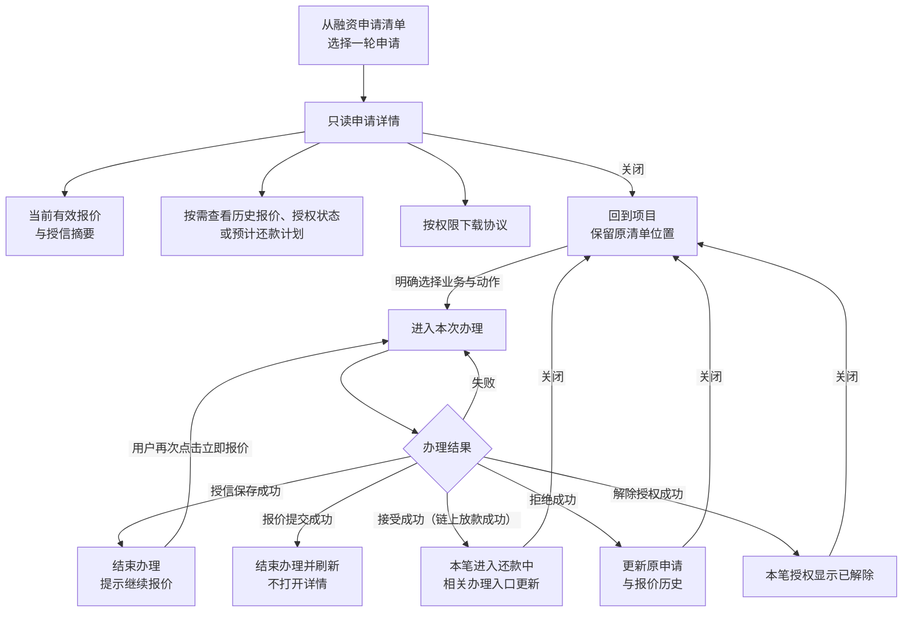
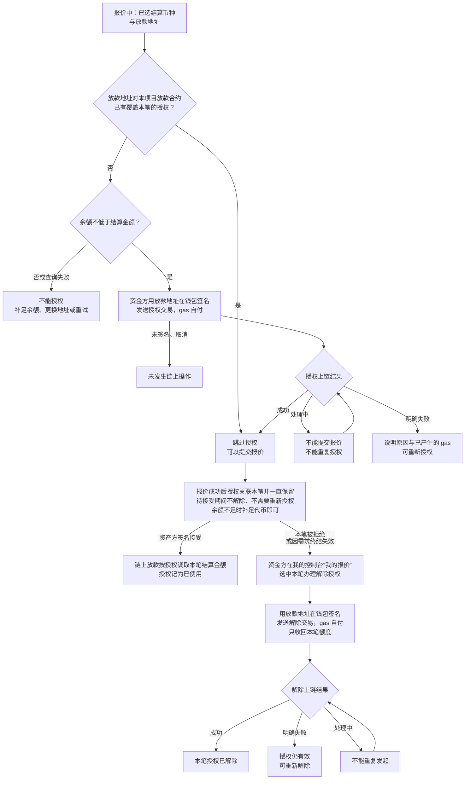
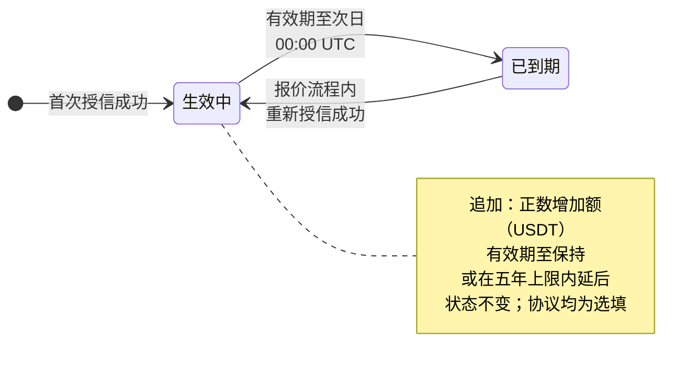
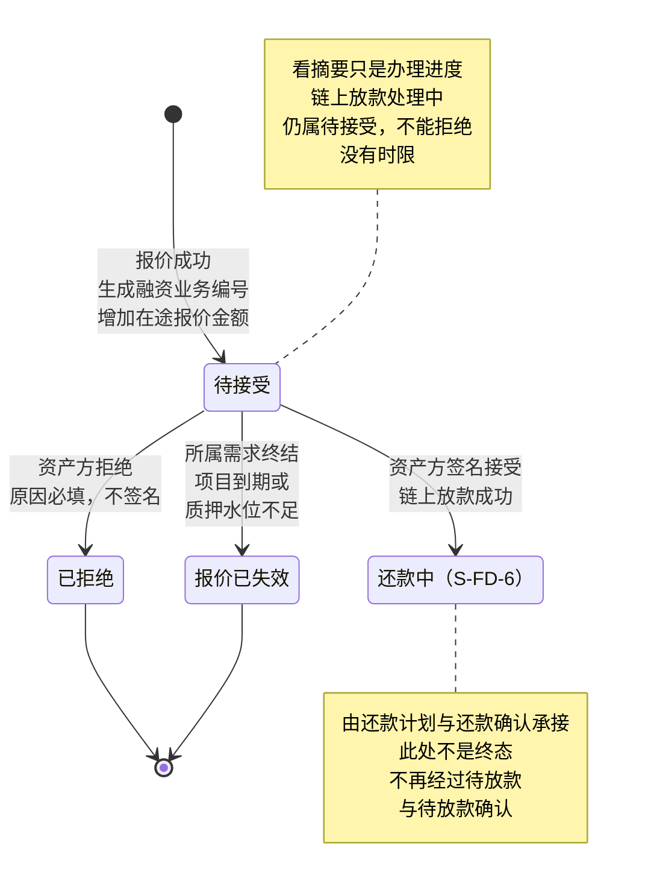
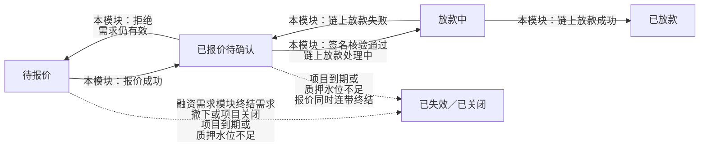
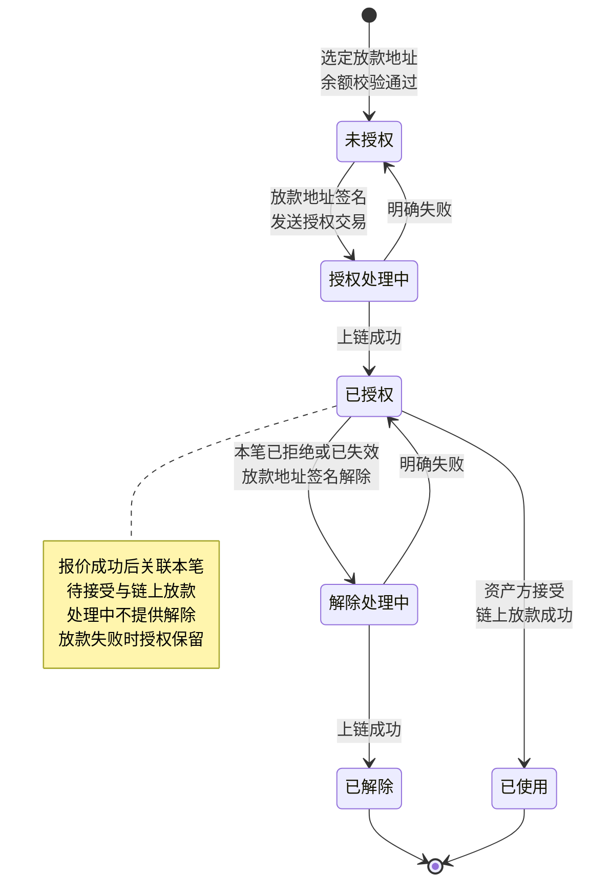

# 授信报价与接受拒绝 · 流程图与状态机

2026-10-22｜需求评审稿

本册把[功能与业务规则](./01-授信报价与接受拒绝-PRD.md)中的主要流程与状态画成图，规则以功能册为准。图中方框是业务环节，不代表页面或组件；实线表示办理或状态变化，虚线表示依据或相邻模块的结果。“终结”只针对本笔对象，不代表项目、授信或债务全部结束。

| 图 | 内容 | 对应功能 |
| --- | --- | --- |
| [授信与报价（FL-CR-01）](#fl-cr-01) | 从点击立即报价、授信核验与企业授信，到放款地址、余额校验、授权与报价提交 | [报价前的授信核验（F-LS-37）](./01-授信报价与接受拒绝-PRD.md#credit-entry)、[企业授信：首次、追加与重新授信（F-LS-38）](./01-授信报价与接受拒绝-PRD.md#credit-save)、[报价条款与提交（F-LS-24）](./01-授信报价与接受拒绝-PRD.md#quote-form)、[放款地址、余额校验与授权放款合约（F-LS-40）](./01-授信报价与接受拒绝-PRD.md#quote-authorize)、[提交时复核质押水位（F-LS-36）](./01-授信报价与接受拒绝-PRD.md#quote-coverage)、[生成融资业务并锁定需求（F-LS-25）](./01-授信报价与接受拒绝-PRD.md#quote-lock) |
| [接受与拒绝（FL-CR-02）](#fl-cr-02) | 资产方核对摘要与融资收款地址后签名接受、平台执行链上放款并进入还款，或填写原因直接拒绝 | [核对本笔融资收款地址（F-LS-28）](./01-授信报价与接受拒绝-PRD.md#respond-account)、[核对商务摘要、签名接受与链上放款（F-LS-29）](./01-授信报价与接受拒绝-PRD.md#respond-contract)、[拒绝及并发结果（F-LS-30）](./01-授信报价与接受拒绝-PRD.md#respond-reject) |
| [需求终结与连带失效（FL-CR-03）](#fl-cr-03) | 拒绝与需求终结两条退出路径，及各自的释放、授权与消息归属 | [报价的持续有效与退出路径（F-LS-34）](./01-授信报价与接受拒绝-PRD.md#f-ls-34)、[需求终结与报价连带失效（F-LS-35）](./01-授信报价与接受拒绝-PRD.md#demand-invalid) |
| [汇率锁定与逐笔沿用（FL-CR-04）](#fl-cr-04) | 运营端汇率管理配置的汇率如何锁进本笔快照并被链上放款、还款沿用 | [汇率与汇率快照（F-LS-26）](./01-授信报价与接受拒绝-PRD.md#quote-rate) |
| [查看记录与办理交接（FL-CR-05）](#fl-cr-05) | 从记录只读查看、从办理入口办理及结束后的去向 | [查看与办理](./01-授信报价与接受拒绝-PRD.md#view-and-act)、[当前报价、历史与跨入口定位（F-LS-32）](./01-授信报价与接受拒绝-PRD.md#records) |
| [授权与解除授权（FL-CR-06）](#fl-cr-06) | 放款地址的余额校验、授权上链、链上放款时的使用，以及报价被拒绝或失效后的解除授权 | [放款地址、余额校验与授权放款合约（F-LS-40）](./01-授信报价与接受拒绝-PRD.md#quote-authorize)、[解除授权（F-LS-41）](./01-授信报价与接受拒绝-PRD.md#revoke) |
| [授信生命周期（ST-CR-01）](#st-cr-01) | 一条授信关系的生效与到期 | [企业授信：首次、追加与重新授信（F-LS-38）](./01-授信报价与接受拒绝-PRD.md#credit-save)、[授信有效期（F-LS-39）](./01-授信报价与接受拒绝-PRD.md#credit-term) |
| [融资业务本模块状态（ST-CR-02）](#st-cr-02) | 一笔报价从待接受到已拒绝、已失效，或链上放款成功进入还款中 | [生成融资业务并锁定需求（F-LS-25）](./01-授信报价与接受拒绝-PRD.md#quote-lock)、[机构与项目两个维度（F-LS-27）](./01-授信报价与接受拒绝-PRD.md#allocation) |
| [对外状态协作（ST-CR-03）](#st-cr-03) | 本模块事实如何推动需求对外状态 | [当前报价、历史与跨入口定位（F-LS-32）](./01-授信报价与接受拒绝-PRD.md#records) |
| [本笔授权状态（ST-CR-04）](#st-cr-04) | 放款地址对本项目放款合约的本笔授权，从未授权到已授权，再到已使用或已解除 | [放款地址、余额校验与授权放款合约（F-LS-40）](./01-授信报价与接受拒绝-PRD.md#quote-authorize)、[解除授权（F-LS-41）](./01-授信报价与接受拒绝-PRD.md#revoke) |

## 授信与报价（FL-CR-01）

质押水位未知与已证实不安全走不同出口；授信保存独立生效，之后报价取消或失败都不回滚授信。报价失败不形成报价，也没有本笔授权需要处理；提交前已上链的授权，之后对同一放款合约再报价时足额即沿用。

## 接受与拒绝（FL-CR-02）

接受在同一页完成，看摘要只是待接受内的办理进度，停留多久都不改变结论；钱包内的签名就是最终确认，不另设勾选。接受即链上放款，之后没有独立的放款登记与放款确认。发起时被授权或余额拦下的，同一笔只在第一次提醒资金方。

## 需求终结与连带失效（FL-CR-03）

报价没有有效期，不存在自动到期分支。项目关闭不出现在本图：有待确认报价的项目不能关闭。失效记录需求的实际终结时刻与具体原因；同一笔只有一个正式结果。已失效报价的授权，资金方可以解除，见[授权与解除授权（FL-CR-06）](#fl-cr-06)。

## 汇率锁定与逐笔沿用（FL-CR-04）

授信与在途始终按融资金额（USDT）计量，汇率只决定 USDC 结算金额。数币精度仍待确认，见[Q-CR-09](./01-授信报价与接受拒绝-PRD.md#q-cr-09)。

## 查看记录与办理交接（FL-CR-05）

详情只读；查看历史、计划与文件不改变当前办理对象。

## 授权与解除授权（FL-CR-06）

同一放款地址可以同时为多笔待接受报价授权；任何一笔的授权或解除都不减少其他待接受报价所需的额度。授权与解除授权都用放款地址签名，放款地址可以不是登录地址；签名只为授权合约，与登录无关，签名前后登录状态不变。授权与解除授权都不发送站内信。

## 授信生命周期（ST-CR-01）

追加不重置五年上限的起点；授信到期只阻止新报价，不影响已有业务。

## 融资业务本模块状态（ST-CR-02）

待接受、已拒绝、报价已失效对应融资业务状态 S-FD-1、S-FD-2、S-FD-11；已拒绝与报价已失效不能恢复。链上放款成功后本笔直接进入还款中（S-FD-6），之后的状态由[还款计划与还款确认](../08-借贷广场-还款计划与还款确认/01-还款计划与还款确认-PRD.md)定义；待放款（S-FD-3）与待放款确认（S-FD-4）不再使用。本状态机没有按时间自动发生的转移。

## 对外状态协作（ST-CR-03）

需求对外状态的唯一来源是[融资需求与代币质押](../05-借贷广场-融资需求与代币质押/01-融资需求与代币质押-PRD.md#project-state)；本模块只提供报价、链上放款、拒绝与连带失效的事实，不据此图另建派生规则。融资需求模块现行派生仍以放款确认推动“已放款”，须由该模块同步。

## 本笔授权状态（ST-CR-04）

已足额授权的地址在报价时跳过授权，直接处于已授权。资金方在平台外自行撤销的，按链上事实显示。解除入口在我的控制台“我的报价”。
