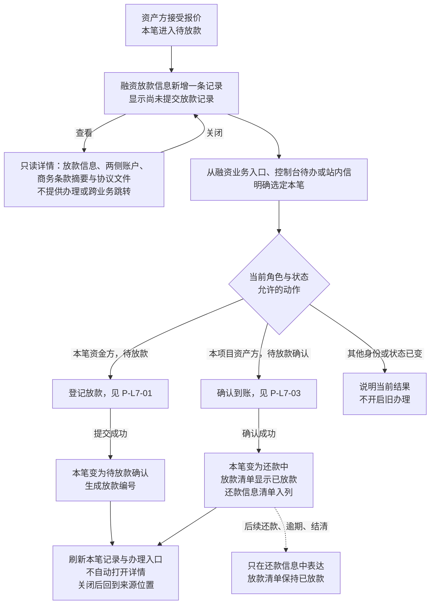
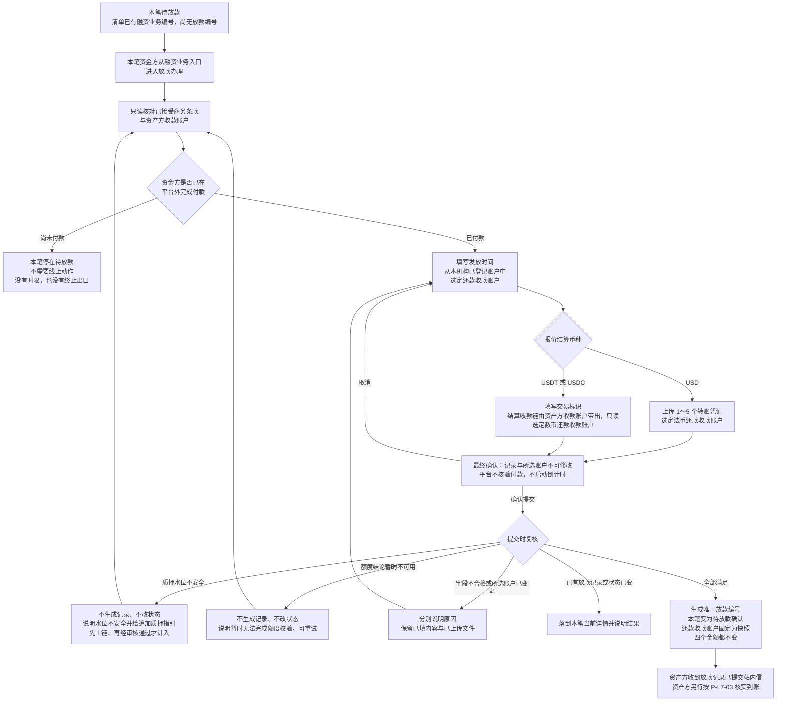
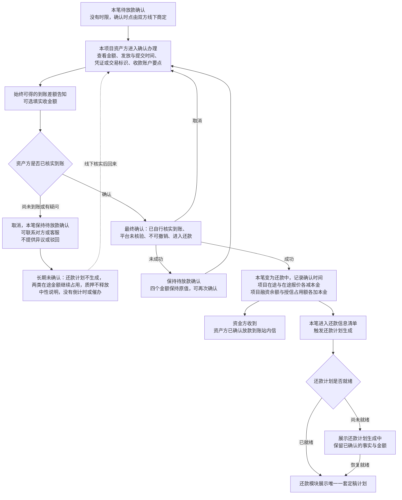
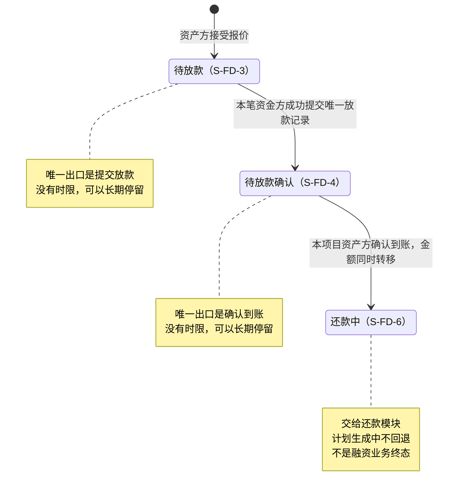

# 放款与放款确认 · 流程图与状态机

2026-10-19｜需求评审稿

本册把[功能与业务规则](./01-放款与放款确认-PRD.md)中的主要流程与状态画成图，规则以功能册为准。图中方框是业务环节，不代表页面或组件；实线表示办理或状态变化，虚线表示依据或相邻模块的结果。

编号说明：图号沿用原值，已删除的图不再占号，缺号不代表遗漏。

| 图 | 内容 | 对应功能 |
| --- | --- | --- |
| [放款清单、只读详情与办理（P-L7-00）](#p-l7-00) | 接受后入列、只读查看、进入办理与结果返回 | [融资放款信息：清单、详情与办理入口（F-LS-56）](./01-放款与放款确认-PRD.md#f-ls-56) |
| [资金方登记放款（P-L7-01）](#p-l7-01) | 核对条款与收款账户、选定还款收款账户、提交与质押水位复核 | [放款记录与还款收款账户（F-LS-49）](./01-放款与放款确认-PRD.md#f-ls-49)、[提交时复核质押水位（F-LS-50）](./01-放款与放款确认-PRD.md#f-ls-50)、[交易标识格式与自行查验（F-LS-51）](./01-放款与放款确认-PRD.md#f-ls-51) |
| [到账确认与还款交接（P-L7-03）](#p-l7-03) | 资产方核实与确认、长期未确认、金额转移与还款计划交接 | [确认到账与金额转移（F-LS-52）](./01-放款与放款确认-PRD.md#f-ls-52)、[到账差额告知与实收金额（F-LS-58）](./01-放款与放款确认-PRD.md#f-ls-58)、[未到账与线下出口（F-LS-54）](./01-放款与放款确认-PRD.md#f-ls-54)、[交接还款计划与我的控制台（F-LS-55）](./01-放款与放款确认-PRD.md#f-ls-55)、[本模块发送的站内信（F-LS-57）](./01-放款与放款确认-PRD.md#f-ls-57) |
| [融资业务本模块状态（S-L7-01）](#s-l7-01) | 一笔融资业务从待放款到还款中 | [放款记录与还款收款账户（F-LS-49）](./01-放款与放款确认-PRD.md#f-ls-49)、[确认到账与金额转移（F-LS-52）](./01-放款与放款确认-PRD.md#f-ls-52) |

## 放款清单、只读详情与办理（P-L7-00）

资金方在待放款时只有“提交放款”一个写动作，资产方在待放款确认时只有“确认到账”一个写动作；本模块没有终止、暂缓、重传或异议路径。

## 资金方登记放款（P-L7-01）

资金转账发生在平台外，平台不审核合同或付款的真伪。质押水位不安全只阻止提交，不影响查看本笔资料；资产方追加质押使水位恢复后，提交入口自动恢复。水位不安全时待放款没有其他出口，见[Q-L7-09](./01-放款与放款确认-PRD.md#q-l7-09)。

## 到账确认与还款交接（P-L7-03）

质押水位不安全或项目到期都不阻止资产方确认。实收金额填与不填都能确认，不改变本金。业务日期按 UTC，切换展示时区只影响显示。计划就绪后不自动打开还款办理，报价时的预计计划不能当作定稿计划。

## 融资业务本模块状态（S-L7-01）

- 初始箭头只表示本笔进入本模块，不是融资业务编号在此新建。
- 待放款与待放款确认都没有终止、撤回或驳回出边，也没有因时间到期产生的自环；本模块不产生任何业务标记。
- 放款异议处理中（S-FD-5）本期不可达，不画成可执行状态。

| 业务事件 | 融资业务状态 | 融资需求对外显示 |
| --- | --- | --- |
| 接受报价后，等待资金方付款 | 待放款（S-FD-3） | 放款中 |
| 放款记录提交后 | 待放款确认（S-FD-4） | 放款中 |
| 资产方确认到账 | 还款中（S-FD-6） | 已放款 |

需求对外状态由融资需求与代币质押模块派生，本模块只提供上表事实，不新增第六个需求状态。项目、需求与融资业务的状态分别表达。
