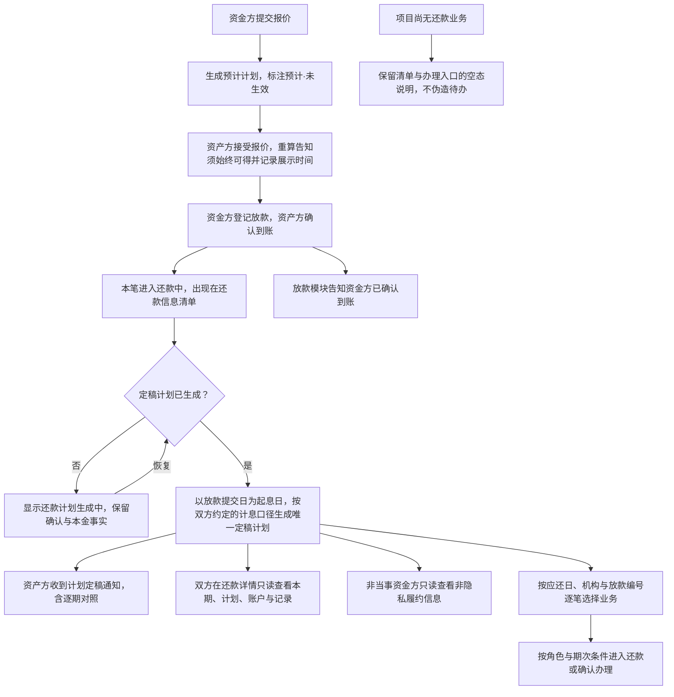
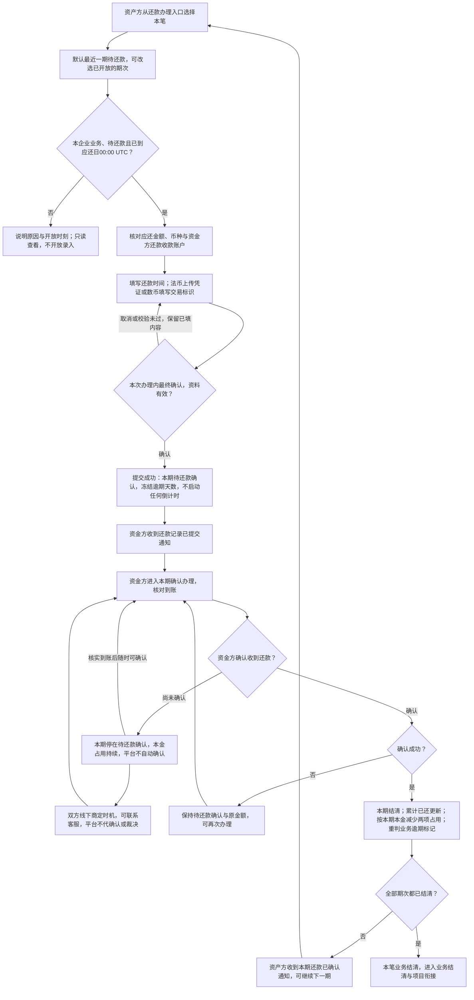
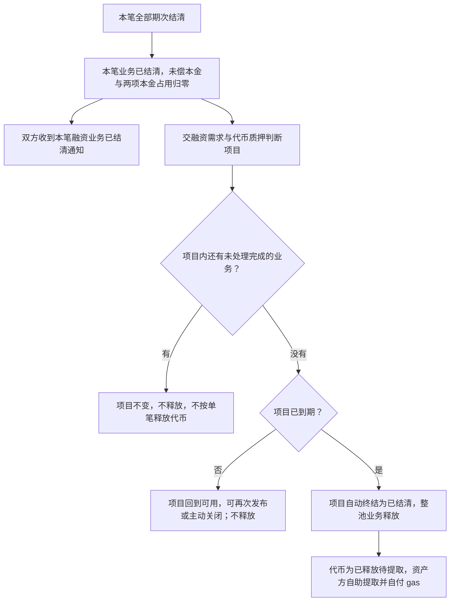
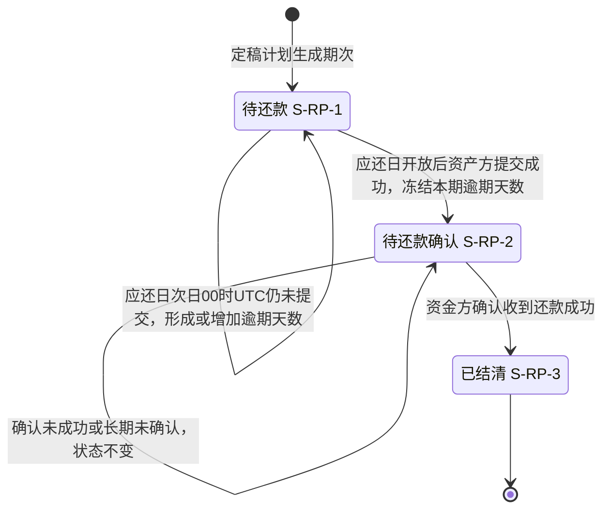
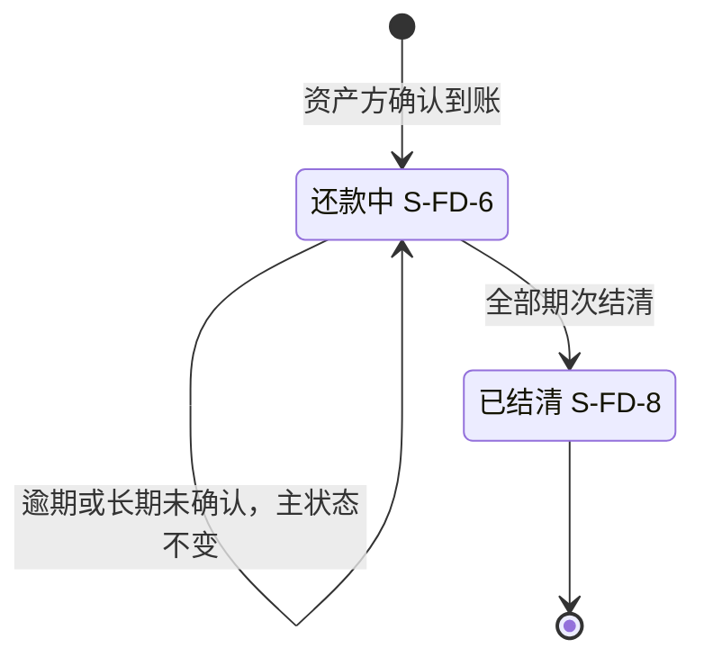

# 还款计划与还款确认 · 流程图与状态机

2026-10-19｜需求评审稿

本册把[功能与业务规则](./01-还款计划与还款确认-PRD.md)中的主要流程与状态画成图，规则以功能册为准。图中方框是业务环节与业务状态，不代表页面或组件，承载形式由设计决定（见[设计边界](./01-还款计划与还款确认-PRD.md#design-boundary)）。还款确认没有时限，图中没有截止判断、倒计时或超期分支。

项目状态、项目终态与质押释放属于融资需求与代币质押模块，状态机见[融资项目状态机（ST-LS-01）](../05-借贷广场-融资需求与代币质押/02-融资需求与代币质押-流程图与状态机.md#st-ls-01)；本册不再重画。图号沿用原值，已删除的图不再占号。

| 图 | 内容 | 对应功能 |
| --- | --- | --- |
| [计划形成与查看（L8-F01）](#l8-f01) | 从报价阶段的预计计划到定稿计划，以及按业务查看与进入办理 | [还款信息：清单、详情与办理入口](./01-还款计划与还款确认-PRD.md#f-entry)、[还款计划](./01-还款计划与还款确认-PRD.md#f-plan) |
| [还款提交与资金方确认（L8-F02）](#l8-f02) | 资产方登记一期还款，资金方核实到账后确认，长期未确认时的停留 | [资产方提交还款](./01-还款计划与还款确认-PRD.md#f-repay)、[资金方确认还款](./01-还款计划与还款确认-PRD.md#f-confirm) |
| [业务结清与项目衔接（L8-F03）](#l8-f03) | 全部期次结清后结束本笔业务，交项目判断终态与释放 | [全部期次结清后结束业务（F-LS-74）](./01-还款计划与还款确认-PRD.md#f-ls-74) |
| [还款期次状态机（L8-S01）](#l8-s01) | 一期的三种状态与逾期并行标记 | [填写并提交本期付款信息（F-LS-67）](./01-还款计划与还款确认-PRD.md#f-ls-67)、[形成逾期标记（F-LS-70）](./01-还款计划与还款确认-PRD.md#f-ls-70)、[核实到账并确认还款（F-LS-71）](./01-还款计划与还款确认-PRD.md#f-ls-71) |
| [融资业务状态机（L8-S02）](#l8-s02) | 本模块负责的还款中到已结清 | [全部期次结清后结束业务（F-LS-74）](./01-还款计划与还款确认-PRD.md#f-ls-74) |

## 计划形成与查看（L8-F01）

- 预计计划不进入还款信息，不产生期次编号。
- 计划未生成时不回退放款确认事实。
- 平台计划采用的计息口径就是双方约定的计息口径，双方按定稿计划还款与确认；预计计划采用同一口径但尚未生效。
- 游客、登录未绑定角色与其他企业的资产方看不到还款信息；非当事资金方可查看编号、机构、业务及期次状态、应还日、还款与结清时间、逾期信息，具体范围见[非隐私履约信息](./01-还款计划与还款确认-PRD.md#non-private-performance)。金额、条款与付款材料仍受限，不提供办理或本笔消息。

## 还款提交与资金方确认（L8-F02）

- 资产方提交不减少本金占用；利息期确认也不减少本金占用。
- 资金方迟未确认不是还款逾期，也不改变资产方已冻结的逾期天数。
- 失败、取消与重复提交都不会产生第二条有效还款记录。
- 平台只登记付款信息，不执行支付或签名；应还临近提醒只用于准备，不开放录入。

## 业务结清与项目衔接（L8-F03）

- 业务结清不依赖提取成功；提取失败不回退结清，也不恢复额度占用。
- 链上结果未知或冲突时只提示联系客服，不新增处置流程。

## 还款期次状态机（L8-S01）

每一期独立适用。

- 逾期是并行标记，不是第四种状态；结清后逾期天数作为历史保留，不清零。
- 没有撤回、撤销、自动确认或异议的状态转换。
- 本期是否已提交与业务整体是否仍有逾期分别判断，见[业务逾期标记（FD-44）](./01-还款计划与还款确认-PRD.md#f-ls-68)。

## 融资业务状态机（L8-S02）

只画本模块负责的状态段。

- 业务逾期标记（S-FD-9，即 FD-44）是并行标记：只要仍有已逾期且未结清的期次（待还款或待还款确认）就保留；相关逾期期次全部结清后清除，未来尚未逾期的期次不影响清除；之后另一期又逾期可以再次形成。
- 融资申请的对外状态在整个过程中保持“已放款”；业务结清不等于项目结清。
