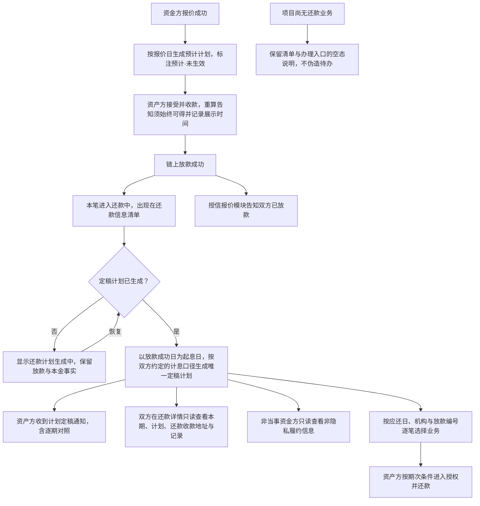
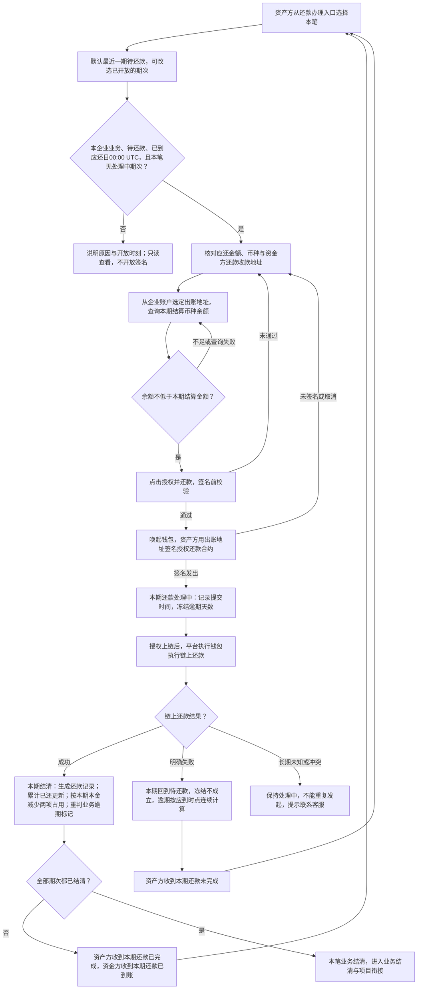
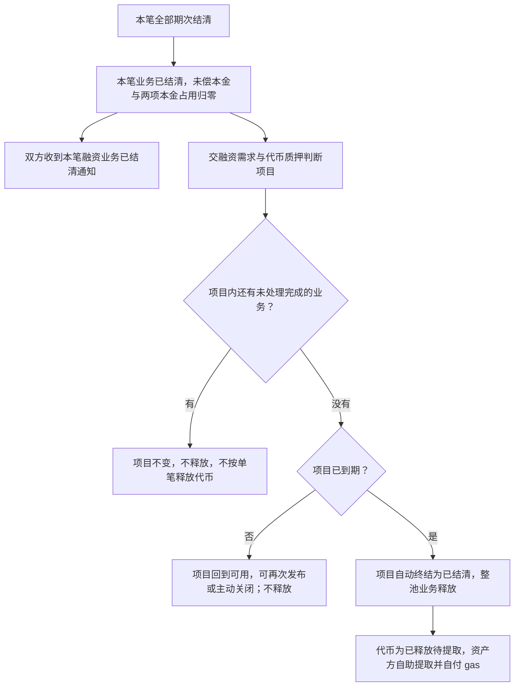
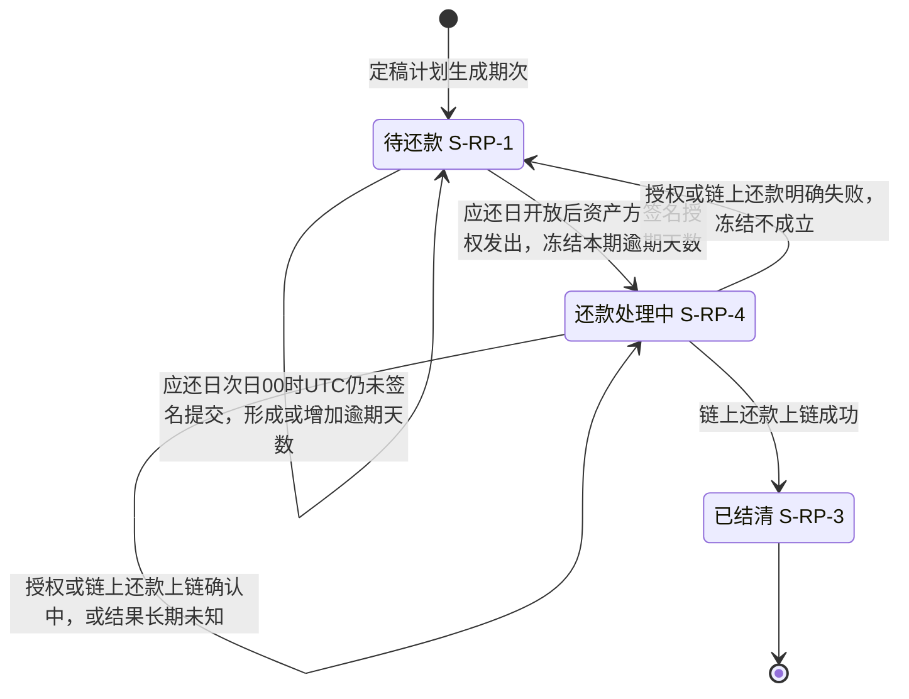
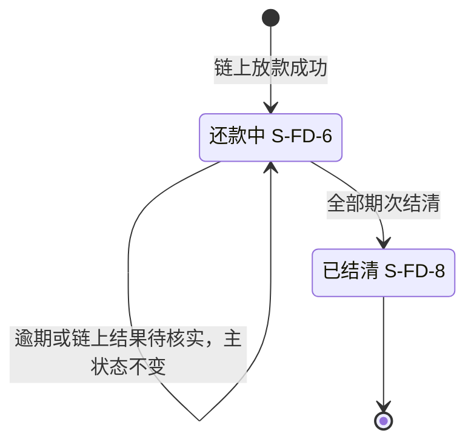

# 链上还款 · 流程图与状态机

2026-10-23｜需求评审稿

本册把[功能与业务规则](./01-链上还款-PRD.md)中的主要流程与状态画成图，规则以功能册为准。图中方框是业务环节与业务状态，不代表页面或组件，承载形式由设计决定（见[设计边界](./01-链上还款-PRD.md#design-boundary)）。还款参照放款的做法：资产方签名授权即提交，链上还款成功即结清，没有资金方确认环节。

项目状态、项目终态与质押释放属于融资需求与代币质押模块，状态机见[融资项目状态机（ST-LS-01）](../05-借贷广场-融资需求与代币质押/02-融资需求与代币质押-流程图与状态机.md#st-ls-01)；本册不再重画。图号沿用原值，已删除的图不再占号。

| 图 | 内容 | 对应功能 |
| --- | --- | --- |
| [计划形成与查看（L8-F01）](#l8-f01) | 从报价阶段的预计计划到定稿计划，以及按业务查看与进入办理 | [还款信息：清单、详情与办理入口](./01-链上还款-PRD.md#f-entry)、[还款计划](./01-链上还款-PRD.md#f-plan) |
| [授权并还款与链上结果（L8-F02）](#l8-f02) | 资产方选定出账地址、签名授权即提交，链上还款的成功、失败与长期未知 | [资产方授权并还款](./01-链上还款-PRD.md#f-repay)、[逾期](./01-链上还款-PRD.md#f-overdue) |
| [业务结清与项目衔接（L8-F03）](#l8-f03) | 全部期次结清后结束本笔业务，交项目判断终态与释放 | [全部期次结清后结束业务（F-LS-74）](./01-链上还款-PRD.md#f-ls-74) |
| [还款期次状态机（L8-S01）](#l8-s01) | 一期的三种状态与逾期并行标记 | [出账地址、余额校验与授权并还款（F-LS-67）](./01-链上还款-PRD.md#f-ls-67)、[形成逾期标记（F-LS-70）](./01-链上还款-PRD.md#f-ls-70)、[签名提交后冻结逾期天数与业务逾期标记（F-LS-68）](./01-链上还款-PRD.md#f-ls-68) |
| [融资业务状态机（L8-S02）](#l8-s02) | 本模块负责的还款中到已结清 | [全部期次结清后结束业务（F-LS-74）](./01-链上还款-PRD.md#f-ls-74) |

## 计划形成与查看（L8-F01）

- 预计计划不进入还款信息，不产生期次编号。
- 计划未生成时不回退已成立的链上放款。
- 还款收款地址取资金方报价时选定的还款收款地址；链上放款记录的明细在融资申请详情查看，还款信息只带编号识别同一笔。
- 平台计划采用的计息口径就是双方约定的计息口径，双方按定稿计划还款；预计计划采用同一口径但尚未生效。
- 游客、登录未绑定角色与其他企业的资产方看不到还款信息；非当事资金方可查看编号、机构、业务及期次状态、应还日、还款成功与结清时间、逾期信息，具体范围见[非隐私履约信息](./01-链上还款-PRD.md#non-private-performance)。金额、条款、地址与交易标识仍受限，不提供办理或本笔消息。

## 授权并还款与链上结果（L8-F02）

- 签名提交与还款处理中不减少本金占用；利息期链上还款成功也不减少本金占用。
- 每次提交都由资产方用出账地址签名授权一次，授权 gas 由资产方承担；链上还款由平台执行钱包执行并承担 gas。
- 重复点击、刷新或重复提交只产生一笔授权交易与一次链上还款。
- 没有资金方确认环节；平台不代签、不代付、不归集资金。应还临近提醒只用于准备，不开放还款。

## 业务结清与项目衔接（L8-F03）

- 业务结清不依赖提取成功；提取失败不回退结清，也不恢复额度占用。
- 链上结果未知或冲突时只提示联系客服，不新增处置流程。

## 还款期次状态机（L8-S01）

每一期独立适用。

- 逾期是并行标记，不是第四种状态；结清后逾期天数作为历史保留，不清零。
- 没有撤回、撤销、资金方确认或异议的状态转换；已结清不能回到其他状态。
- 本期是否已提交与业务整体是否仍有逾期分别判断，见[业务逾期标记（FD-44）](./01-链上还款-PRD.md#f-ls-68)。

## 融资业务状态机（L8-S02）

只画本模块负责的状态段。

- 业务逾期标记（S-FD-9，即 FD-44）是并行标记：只要仍有已逾期且未结清的期次（待还款或还款处理中）就保留；相关逾期期次全部结清后清除，未来尚未逾期的期次不影响清除；之后另一期又逾期可以再次形成。
- 融资申请的对外状态在整个过程中保持“已放款”；业务结清不等于项目结清。
