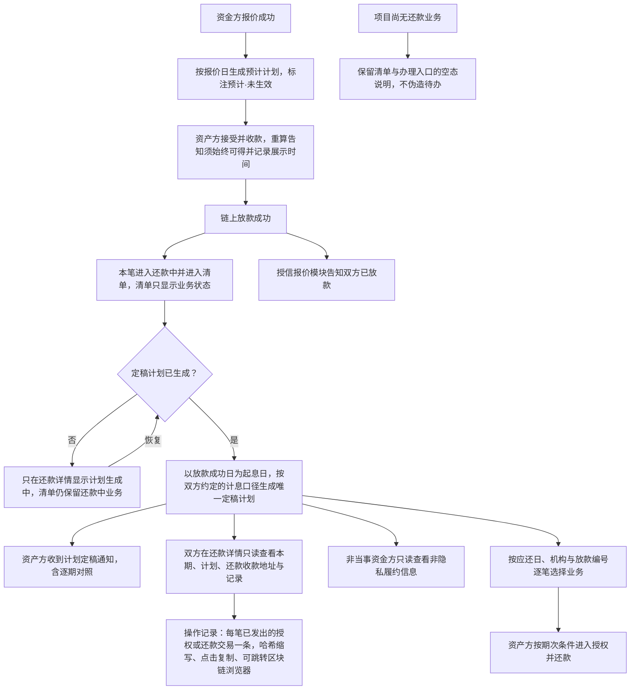
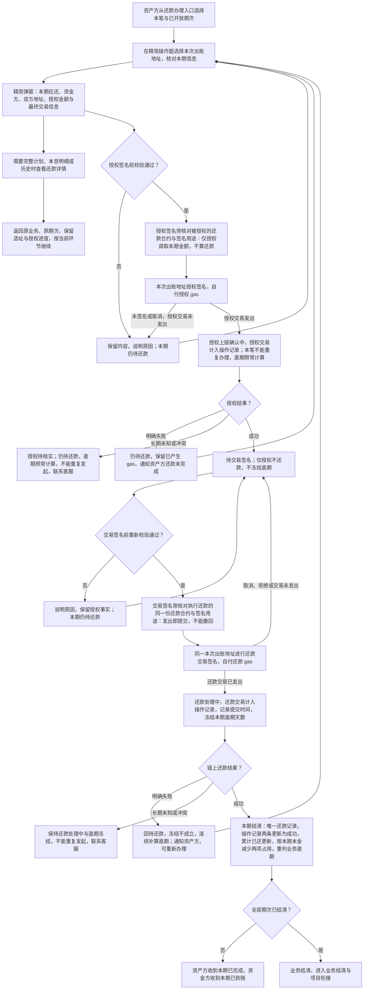
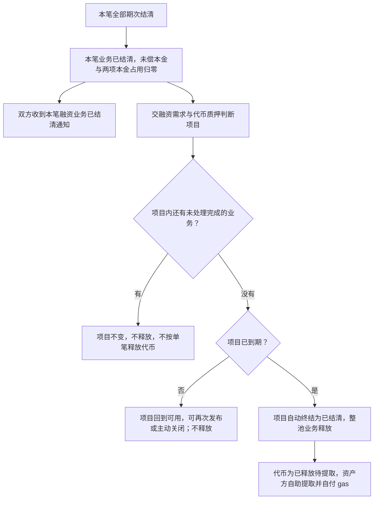
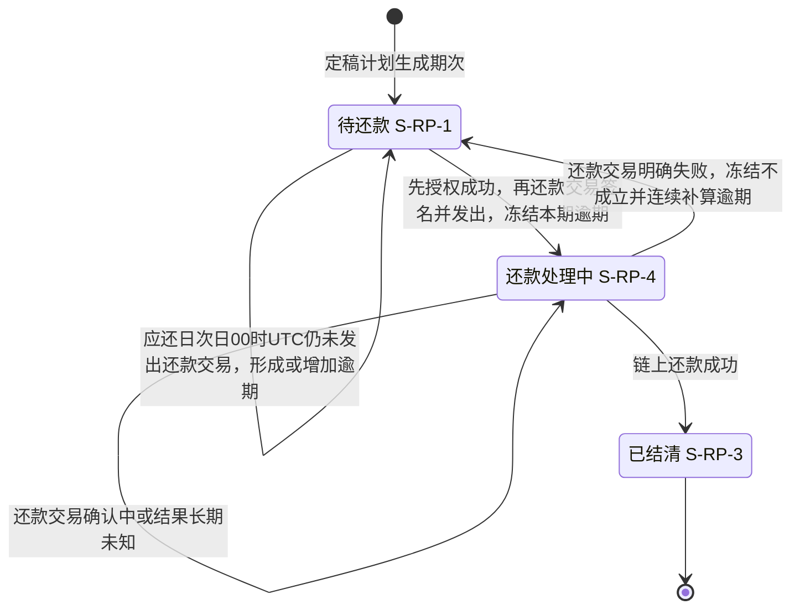
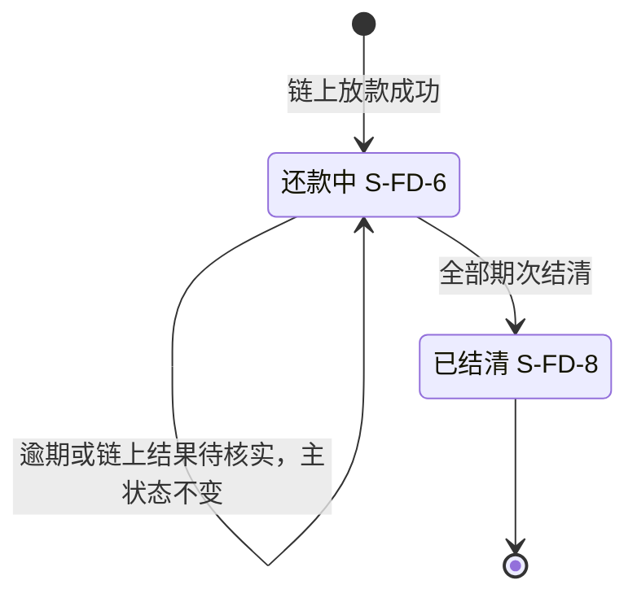

# 链上还款 · 流程图与状态机

2026-10-26｜需求评审稿

本册把[功能与业务规则](./01-链上还款-PRD.md)中的主要流程与状态画成图，规则以功能册为准。图中方框是业务环节与业务状态，不代表页面或组件，承载形式由设计决定（见[设计边界](./01-链上还款-PRD.md#design-boundary)）。资产方先完成授权签名，授权上链成功后再完成还款交易签名；还款交易发出才提交本期还款，链上还款成功即结清。两次签名时都展示所交互的还款合约与本次签名用途；两笔 gas 均由资产方承担，资金方只查看进展和结果。

项目状态、项目终态与质押释放属于融资需求与代币质押模块，状态机见[融资项目状态机（ST-LS-01）](../05-借贷广场-融资需求与代币质押/02-融资需求与代币质押-流程图与状态机.md#st-ls-01)；本册不再重画。图号沿用原值，已删除的图不再占号。

| 图 | 内容 | 对应功能 |
| --- | --- | --- |
| [计划形成与查看（L8-F01）](#l8-f01) | 从报价阶段的预计计划到定稿计划，按业务查看详情（交易哈希在操作记录）与进入办理 | [还款信息：清单、详情与办理入口](./01-链上还款-PRD.md#f-entry)、[还款计划](./01-链上还款-PRD.md#f-plan) |
| [授权并还款与链上结果（L8-F02）](#l8-f02) | 资产方选址、核对合约与签名用途后授权签名、交易签名，各阶段的交易哈希，以及取消、失败与长期未知 | [资产方授权并还款](./01-链上还款-PRD.md#f-repay)、[逾期](./01-链上还款-PRD.md#f-overdue) |
| [业务结清与项目衔接（L8-F03）](#l8-f03) | 全部期次结清后结束本笔业务，交项目判断终态与释放 | [全部期次结清后结束业务（F-LS-74）](./01-链上还款-PRD.md#f-ls-74) |
| [还款期次状态机（L8-S01）](#l8-s01) | 一期的三种状态、授权办理进度与逾期并行标记 | [出账地址、余额校验与授权并还款（F-LS-67）](./01-链上还款-PRD.md#f-ls-67)、[形成逾期标记（F-LS-70）](./01-链上还款-PRD.md#f-ls-70)、[签名提交后冻结逾期天数与业务逾期标记（F-LS-68）](./01-链上还款-PRD.md#f-ls-68) |
| [融资业务状态机（L8-S02）](#l8-s02) | 本模块负责的还款中到已结清 | [全部期次结清后结束业务（F-LS-74）](./01-链上还款-PRD.md#f-ls-74) |

## 计划形成与查看（L8-F01）

- 预计计划不进入还款信息，不产生期次编号。
- 计划尚未生成时不删除清单记录，清单业务状态仍为还款中；项目内与我的控制台还款清单都不展示生成进度，只有详情显示。
- 计划未生成时不伪造期次、日期、金额或可还款动作，也不回退已成立的链上放款。
- 还款详情中的交易哈希只在最下方的[操作记录](./01-链上还款-PRD.md#operation-records)展示，本期应还与还款记录不重复；只对本笔双方展示，跳转在新窗口打开，不改变本期状态，规则见[交易哈希的展示](./01-链上还款-PRD.md#tx-hash)。
- 还款收款地址取资金方报价时选定的还款收款地址；链上放款记录的明细在融资申请详情查看，还款信息只带编号识别同一笔。
- 平台计划采用的计息口径就是双方约定的计息口径，双方按定稿计划还款；预计计划采用同一口径但尚未生效。
- 游客、登录未绑定角色与其他企业的资产方看不到还款信息；非当事资金方可查看编号、机构、业务及期次状态、应还日、还款成功与结清时间、逾期信息，具体范围见[非隐私履约信息](./01-链上还款-PRD.md#non-private-performance)。金额、条款、地址与交易哈希仍受限，不提供办理或本笔消息。

## 授权并还款与链上结果（L8-F02）

- 操作页与操作弹窗只保留本次必要信息；完整计划、本息明细、整笔条款与历史记录在还款详情查看，正常办理不重复这些资料；页面选址后不展开出账账户详情；具体信息边界见[还款办理的信息范围](./01-链上还款-PRD.md#repay-content)。
- 两次签名的主动作旁都给出本项目还款合约（名称、Ethereum、完整地址）与一两句签名用途，不另设确认弹窗；合约读取失败或与本次授权的合约不一致时不唤起钱包，见[所交互的合约与签名用途](./01-链上还款-PRD.md#repay-contract)。
- 已发出的授权交易与还款交易在处理中、明确失败、待核实及成功结果中都给出已取得的交易哈希；未发出交易时不显示；这是当次反馈，离开办理后在还款详情的操作记录查看，见[交易哈希的展示](./01-链上还款-PRD.md#tx-hash)。
- 授权与交易签名是两个必要环节，均由资产方用本次出账地址完成、分别自付 gas；授权成功不自动发送还款交易，离开后返回仍须完成交易签名。
- 仅还款交易发出才冻结逾期；授权处理中、授权已成功但未发出还款交易时都仍待还款，逾期照常计算；这些阶段的办理占用不等于还款处理中。
- 授权成功后取消交易签名不产生还款交易 gas，但已产生的授权 gas 保留；授权仍在链上，平台无撤销入口，可在钱包自行撤销。签名取消不发失败通知，已发出交易明确失败才发。
- 签名提交与还款处理中不减少本金占用；利息期成功也不减少本金占用。重复点击、刷新或恢复同一次办理，不重复授权或还款。
- 资金方没有办理或确认环节；应还临近提醒只用于准备，不开放还款。

## 业务结清与项目衔接（L8-F03）

- 业务结清不依赖提取成功；提取失败不回退结清，也不恢复额度占用。
- 链上结果未知或冲突时只提示联系客服，不新增处置流程。

## 还款期次状态机（L8-S01）

每一期独立适用。授权阶段与待交易签名是办理进度，不新增期次状态。

- 授权上链未决时不能重复办理，本笔其他期次也不能发起；授权成功待交易签名时可以继续本次办理，主动结束后可重新选期办理，原授权保留。
- 授权阶段及待交易签名不冻结逾期；还款交易发出才记录提交时间并冻结，结清后逾期天数作为历史保留。
- 没有资金方确认或异议的状态转换；已结清不能回到其他状态，平台不提供撤销授权入口。
- 本期是否已提交与业务整体是否仍有逾期分别判断，见[业务逾期标记（FD-44）](./01-链上还款-PRD.md#f-ls-68)。

## 融资业务状态机（L8-S02）

只画本模块负责的状态段。

- 业务逾期标记（S-FD-9，即 FD-44）是并行标记：只要仍有已逾期且未结清的期次（待还款或还款处理中）就保留；相关逾期期次全部结清后清除，未来尚未逾期的期次不影响清除；之后另一期又逾期可以再次形成。
- 融资申请的对外状态在整个过程中保持“已放款”；业务结清不等于项目结清。
