# 借贷平台 · 我的控制台 · 流程图与状态机

2026-10-28｜需求评审稿。规则以[功能与业务规则](./01-我的控制台-PRD.md)为准，验收见[验收册](./04-我的控制台-验收.md)。图中节点是业务环节与状态，不表示页面或组件；布局及承载由 Hallmark 决定，见[设计边界](./01-我的控制台-PRD.md#design-boundary)。控制台不发消息，承接规则见[消息承接与业务事实](./01-我的控制台-PRD.md#message-reception)。详情取舍、原对象阅读定位、待处理归类与去向、授信修改范围按功能册末节建议执行、待确认。

清单与详情的分工见[清单展示边界](./01-我的控制台-PRD.md#list-detail-boundary)：本册状态机保留完整业务与链上状态，不表示每个状态都在列表展示；隐藏清单字段不删除记录、不改变占用或办理资格。

| 图号 | 内容 | 关联功能与正文 |
| --- | --- | --- |
| FL-MC-01 | 准入与聚合视图 | [企业统计（F-MC-01）](./01-我的控制台-PRD.md#f-mc-01)、[准入、空态与异常（F-MC-10）](./01-我的控制台-PRD.md#f-mc-10) |
| FL-MC-02 | 从列表经详情到对应广场项目并返回 | [融资项目（F-MC-03）](./01-我的控制台-PRD.md#f-mc-03)、[详情前往借贷广场与返回（F-MC-09）](./01-我的控制台-PRD.md#f-mc-09)、[分页、筛选、排序与刷新恢复（F-MC-11）](./01-我的控制台-PRD.md#f-mc-11) |
| FL-MC-03 | 待处理提示与行级提醒 | [待处理提示与行级提醒（F-MC-08）](./01-我的控制台-PRD.md#f-mc-08) |
| FL-MC-04 | 六类详情的访问与返回 | [六类详情与浏览闭环（F-MC-13）](./01-我的控制台-PRD.md#f-mc-13) |
| FL-MC-05 | 申请、报价、还款入列与期次定位 | [融资项目（F-MC-03）](./01-我的控制台-PRD.md#f-mc-03)、[还款信息（F-MC-06）](./01-我的控制台-PRD.md#f-mc-06)、[我的报价（F-MC-07）](./01-我的控制台-PRD.md#f-mc-07) |
| FL-MC-06 | 项目资格与执行结果阅读 | [融资项目（F-MC-03）](./01-我的控制台-PRD.md#f-mc-03)、[项目资格与执行异常（D-MC-200）](./01-我的控制台-PRD.md#d-mc-200) |
| FL-MC-07 | 修改授信 | [授信明细／授信汇总（F-MC-04）](./01-我的控制台-PRD.md#f-mc-04) |
| FL-MC-08 | 撤销授权 | [链上授权（F-MC-14）](./01-我的控制台-PRD.md#f-mc-14) |
| ST-MC-01 | 代币生命周期结果 | [代币列表（F-MC-02）](./01-我的控制台-PRD.md#f-mc-02) |
| ST-MC-02 | 质押对外展示状态 | [代币列表（F-MC-02）](./01-我的控制台-PRD.md#f-mc-02) |
| ST-MC-03 | 还款期次业务状态 | [还款信息（F-MC-06）](./01-我的控制台-PRD.md#f-mc-06) |
| ST-MC-04 | 控制台视图可用状态 | [准入、空态与异常（F-MC-10）](./01-我的控制台-PRD.md#f-mc-10)、[分页、筛选、排序与刷新恢复（F-MC-11）](./01-我的控制台-PRD.md#f-mc-11) |
| ST-MC-05 | 单个详情的可用状态 | [六类详情与浏览闭环（F-MC-13）](./01-我的控制台-PRD.md#f-mc-13) |
| ST-MC-06 | 我的报价记录状态 | [我的报价（F-MC-07）](./01-我的控制台-PRD.md#f-mc-07) |
| ST-MC-07 | 链上授权记录状态 | [链上授权（F-MC-14）](./01-我的控制台-PRD.md#f-mc-14) |

## 准入与聚合视图（FL-MC-01）

关联[企业统计（F-MC-01）](./01-我的控制台-PRD.md#f-mc-01)、[准入、空态与异常（F-MC-10）](./01-我的控制台-PRD.md#f-mc-10)；验收见[企业统计验收](./04-我的控制台-验收.md#ac-section-01)与[准入、空态与异常验收](./04-我的控制台-验收.md#ac-section-10)。

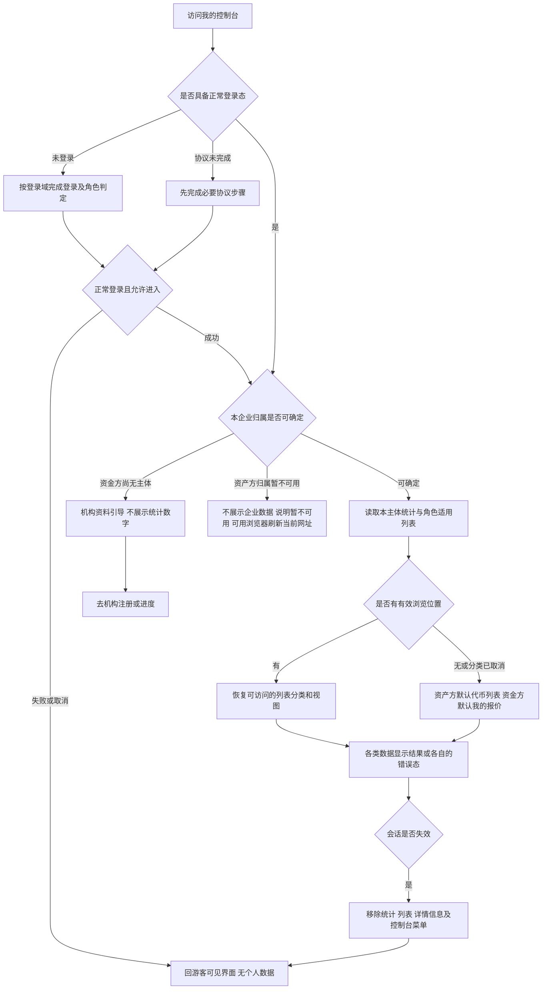

图例：未认证不等于未登录；只读菜单不因此消失。两角色会话规则引用各自登录域，不统一时长。业务签名（授权、撤销授权、接受、还款）与登录无关，不触发本图的会话变化。资料被驳回但仍有企业主体时，保留允许查看的业务，用对应引导承接。

## 从列表经详情到对应广场项目并返回（FL-MC-02）

关联[详情前往借贷广场与返回（F-MC-09）](./01-我的控制台-PRD.md#f-mc-09)、[六类详情与浏览闭环（F-MC-13）](./01-我的控制台-PRD.md#f-mc-13)；验收见[详情前往借贷广场与返回验收](./04-我的控制台-验收.md#ac-section-09)。

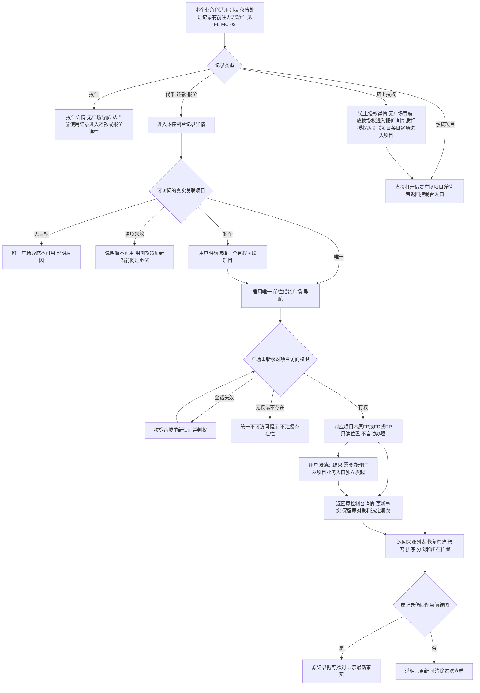

规则见[列表不设广场快捷入口（D-MC-196）](./01-我的控制台-PRD.md#d-mc-196)、[详情唯一广场导航（D-MC-197）](./01-我的控制台-PRD.md#d-mc-197)与[项目详情复用借贷广场（D-MC-210）](./01-我的控制台-PRD.md#d-mc-210)。可读项目的导航不受当前是否有可执行业务限制；需先选择项目再启用唯一广场导航的零／多关联情形只发生在代币详情；质押授权详情从各关联项目条目进入，无关联不能兜底普通广场或创建流程，多关联不得自动选择首项。列表、详情除修改授信与链上授权清单中的撤销授权外均无业务提交。报价上链确认中尚无 FD 时，报价详情的导航定位原 FP。

原对象阅读定位沿[唯一导航规则](./01-我的控制台-PRD.md#f-mc-09)及[原对象阅读定位建议](./01-我的控制台-PRD.md#q-mc-60)：来源不支持时显式降级到同项目，保留原编号与返回，定位分支待验；无权或不存在不替换新对象。控制台详情不转办，办理从项目既有入口独立选择。

## 待处理提示与行级提醒（FL-MC-03）

关联[待处理提示与行级提醒（F-MC-08）](./01-我的控制台-PRD.md#f-mc-08)；验收见[待处理提示与行级提醒验收](./04-我的控制台-验收.md#ac-section-08)。

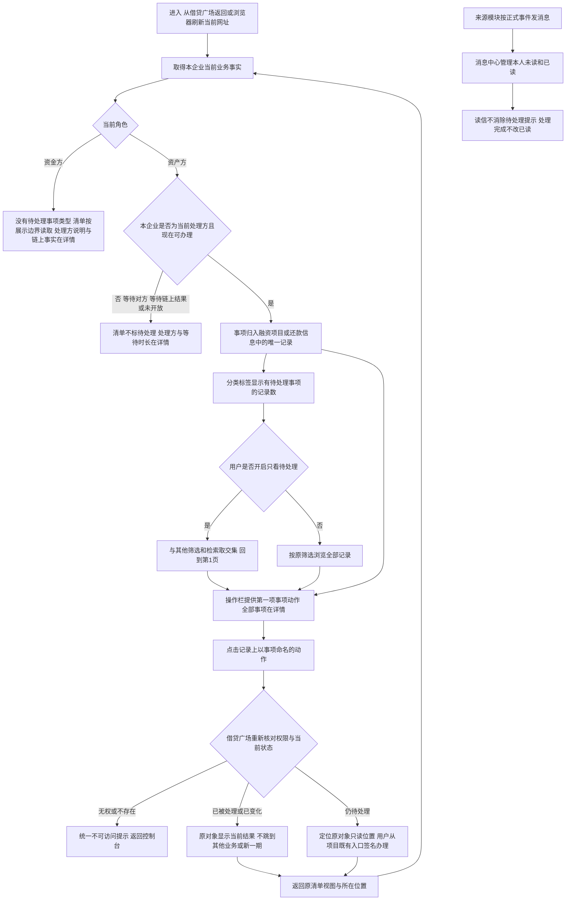

待处理事项没有手动完成、忽略或归档，条件不满足即在下一次取得事实时消失；控制台不为其出现或消失发消息。资产方签名后进入链上确认中（链上放款处理中、还款上链确认中）的事项随即不再标记；链上明确失败、本笔回到可办理时重新标记。分类标签数量按记录计，不按事项计；处理后记录不再匹配“只看待处理”时说明记录已更新。原对象定位暂不支持时显式降级到同项目，按[原对象阅读定位建议](./01-我的控制台-PRD.md#q-mc-60)；归类、计数与去向按[待处理归类、计数与去向建议](./01-我的控制台-PRD.md#q-mc-62)执行、待确认。

## 代币生命周期结果（ST-MC-01）

关联[代币列表（F-MC-02）](./01-我的控制台-PRD.md#f-mc-02)；验收见[代币列表验收](./04-我的控制台-验收.md#ac-section-02)。

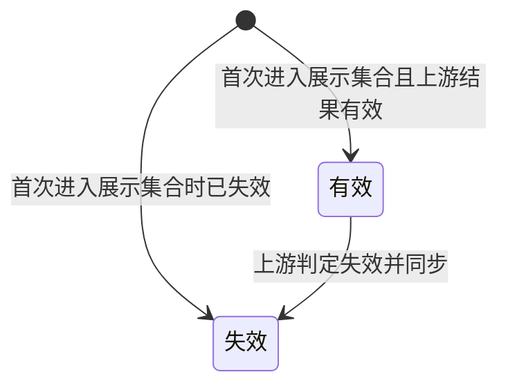

有效与失效均属于本企业全部可展示代币的覆盖范围；无项目、未质押不能成为隐藏条件，完整性和主体权限仍按[自己的全部代币（D-MC-195）](./01-我的控制台-PRD.md#d-mc-195)。

状态权威为代币发行平台；控制台读取本平台快照，不按本机日期迁移。失效后记录仍保留并纳入账面统计，不代表销毁或自动解除质押。本期没有已销毁展示状态，不画无依据的恢复有效边。

## 质押对外展示状态（ST-MC-02）

关联[代币列表（F-MC-02）](./01-我的控制台-PRD.md#f-mc-02)；验收见[代币列表验收](./04-我的控制台-验收.md#ac-section-02)。

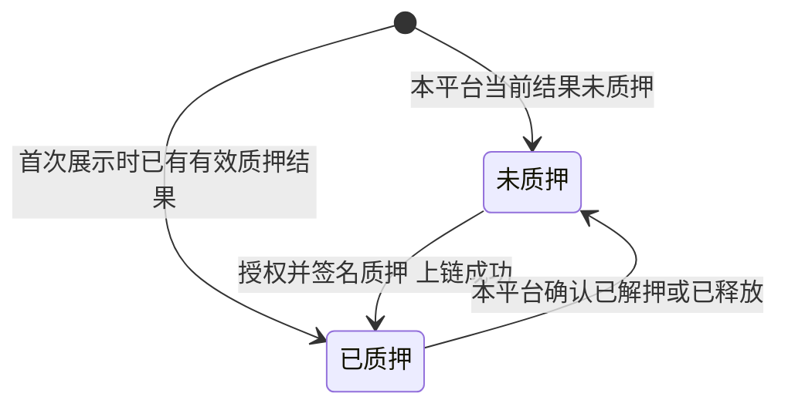

这是对外二元视图，不是内部执行状态机。授权处理中、质押上链处理中、失败或已释放未提取都不新增可见状态；仍显示未质押。与ST-MC-01正交，一枚代币可为“失效＋已质押”。一笔代币有多个持有方时，与资产广场持有方清单逐个对照：至少一个持有方为已质押即显示已质押，全部未质押才显示未质押。本页不因状态标签推断是否可再次质押，操作资格由对应业务判定。

## 还款期次业务状态（ST-MC-03）

关联[还款信息（F-MC-06）](./01-我的控制台-PRD.md#f-mc-06)与资产方待处理“还款”；验收见[还款信息验收](./04-我的控制台-验收.md#ac-section-06)。

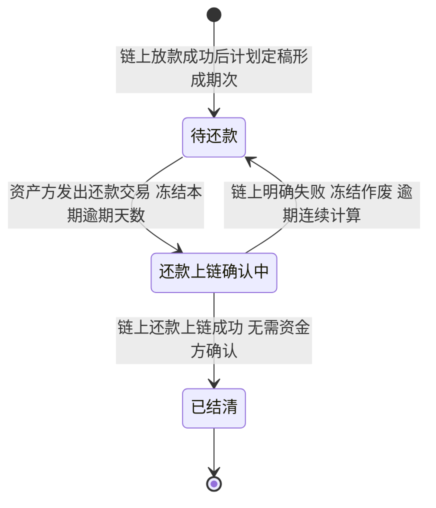

图中不画停留在原状态的情形，以文字说明：待还款期次在应还日 00:00 UTC 前只读，到期后由借贷广场开放还款；还款授权确认中或授权成功、尚未发出还款交易时仍为待还款；还款上链确认中结果长期未知时仍为还款上链确认中，不能重复提交，提示联系客服。普通利息期与末期均到应还日00:00 UTC才开放还款；前三日只是来源通知的准备提醒。未到期、已到期、逾期是业务条件或标记，不是额外期次状态。本期利息在定稿时已固定；还款交易发出冻结本期逾期天数，链上明确失败等于没有提交，冻结作废、处理中经过的天数照计。本笔有一期还款上链确认中时，结果回写前本笔其他期次不能提交，资产方待处理“还款”暂不标记。发出还款交易不清当前业务逾期：未结清的逾期期次含待还款与还款上链确认中，全部结清后才清当前业务标记；未来正常期可仍未结清，历史天数保留。清单还款状态只显示适用业务状态，链上阶段和天数仅在详情读取；不能因隐藏该阶段而开放重复还款。最早期和最长天数仅取未结清逾期集合。资金方在任何节点都没有确认动作。此图不定义项目或代币的状态变化。

## 控制台视图可用状态（ST-MC-04）

关联[准入、空态与异常（F-MC-10）](./01-我的控制台-PRD.md#f-mc-10)与[分页、筛选、排序与刷新恢复（F-MC-11）](./01-我的控制台-PRD.md#f-mc-11)；验收见[分页、筛选、排序与刷新恢复验收](./04-我的控制台-验收.md#ac-section-11)。

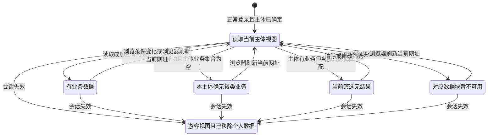

本图刷新均指浏览器刷新当前网址，不提供页内重新取数动作，按[刷新当前网址（D-MC-198）](./01-我的控制台-PRD.md#d-mc-198)恢复浏览视图。

本图按单项统计或单个列表分类表达加载与失败，不能推导为某一项失败就清空全部内容。无主体或主体不可确定先走FL-MC-01，不进入“真空集合”。会话失效清除全部已显示数据，覆盖所有分类；上游同步不可用但本平台快照可读时仍属于有数据状态。

## 六类详情的访问与返回（FL-MC-04）

关联[六类详情与浏览闭环（F-MC-13）](./01-我的控制台-PRD.md#f-mc-13)，页面 P-MC-02～P-MC-04、P-MC-06～P-MC-08；验收见[六类详情验收](./04-我的控制台-验收.md#ac-section-13)。实际业务操作闭环见[从列表经详情到对应广场项目并返回（FL-MC-02）](#fl-mc-02)。

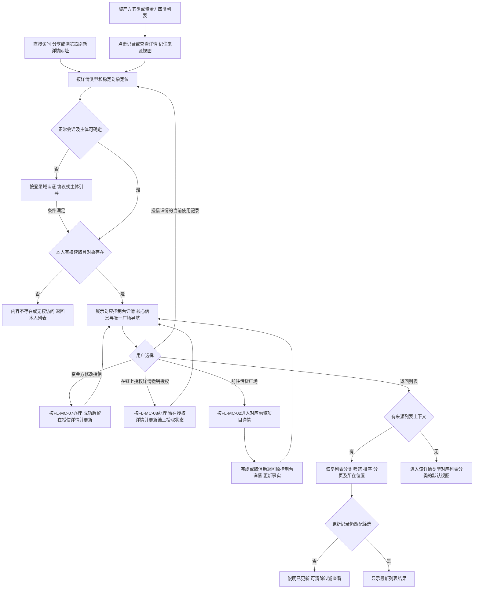

图中I包含代币、授信、还款业务及其选定期次、报价、链上授权五种控制台详情；融资项目详情由借贷广场承载，见FL-MC-02。没有把资金方无权使用的代币／项目列表补出来。复制等独立浏览操作不触发B。切换对象、读取错误及会话失效按ST-MC-05；失败不能假装成无业务。授信仍为机构×企业，不设广场导航，从当前使用记录进入具体业务；代币无关联项目不跳普通广场，多关联由用户选择有权目标后通过同一导航前往。

## 单个详情的可用状态（ST-MC-05）

关联[六类详情与浏览闭环（F-MC-13）](./01-我的控制台-PRD.md#f-mc-13)、[详情状态与权限（D-MC-187）](./01-我的控制台-PRD.md#d-mc-187)；验收见[六类详情验收](./04-我的控制台-验收.md#ac-section-13)。本图描述可读性，不改变项目、代币、融资或还款的业务状态。

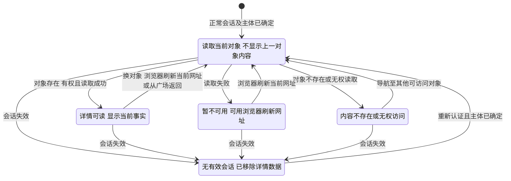

详情及其局部错误、计划生成中均不提供页内重新取数动作，浏览器刷新保持原对象及选定申请/期次、已有来源视图。

Ready可以包含“计划生成中”“尚无还款记录”等局部空内容；正常已终结记录仍属于Ready。可读但业务动作失效时留在Ready并说明当前结果；只有对象本身不可读才进入Unavailable。重新登录不直接恢复旧详情内容，必须重新确认当前主体可读。

## 申请、报价、还款入列与期次定位（FL-MC-05）

关联[融资项目（F-MC-03）](./01-我的控制台-PRD.md#f-mc-03)、[还款信息（F-MC-06）](./01-我的控制台-PRD.md#f-mc-06)、[我的报价（F-MC-07）](./01-我的控制台-PRD.md#f-mc-07)、[详情前往借贷广场与返回（F-MC-09）](./01-我的控制台-PRD.md#f-mc-09)；验收见[还款信息验收](./04-我的控制台-验收.md#ac-section-06)与[我的报价验收](./04-我的控制台-验收.md#ac-section-07)。各节点是用户能读取的业务事实，不表示控制台执行这些操作。

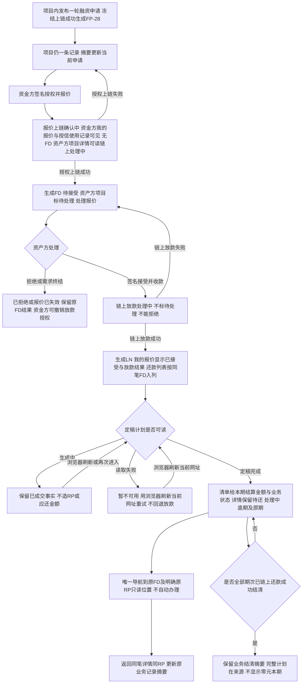

控制台不新增申请类或放款类列表分类，项目内申请独立编号可定位；我的报价与还款各自一条记录一笔FD（报价上链确认中尚无FD，以FP识别），不能把LN、RP、RM混作融资业务。旧期次链接始终查看原期最新结果。单笔业务结清不自动等于项目终态或代币提取到账，仍由融资需求与代币质押、还款模块给出各自结果。**报价待接受没有时限；链上放款成功后没有终止出口**：控制台在详情如实呈现当前处理方与已等待时长，不画自动失效、超期或终止边，见[既定业务限制](./01-我的控制台-PRD.md#limits)。

## 项目资格与执行结果阅读（FL-MC-06）

关联[融资项目（F-MC-03）](./01-我的控制台-PRD.md#f-mc-03)、[项目资格与执行异常（D-MC-200）](./01-我的控制台-PRD.md#d-mc-200)；验收见[融资项目验收](./04-我的控制台-验收.md#ac-section-03)。各节点为已授权用户可读事实，不由控制台执行业务判定或释放。

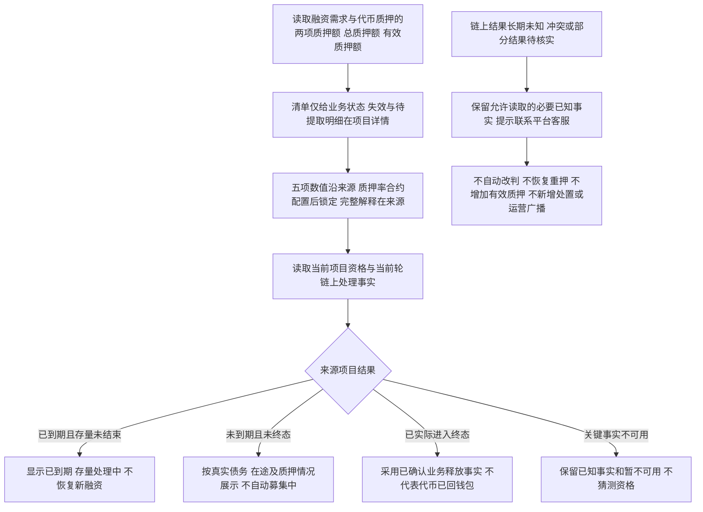

单笔还款结清同样不直接推导整个项目终态；链上放款成功后单笔业务没有终止出口，不存在可读的单笔终止结果。代币列表仍按本企业完整展示集合及两条既定状态轴呈现，已质押只说明代币在合约内；当前链上地址不替代企业归属。来源数据失败按既定浏览器刷新恢复，控制台不增加重新取数或异常处理动作。

## 修改授信（FL-MC-07）

关联[修改授信](./01-我的控制台-PRD.md#credit-modify)；规则沿授信报价模块[企业授信（F-LS-38）](../06-借贷广场-授信报价与接受拒绝/01-授信报价与接受拒绝-PRD.md#f-ls-38)。

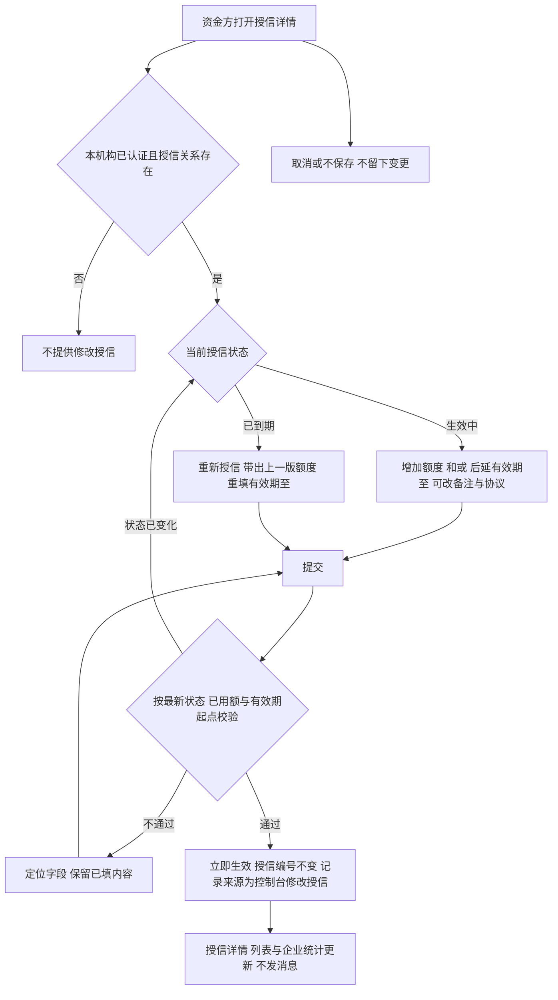

修改不生成报价、不锁定需求、不改变已有的在途与占用，不涉及链上操作；不支持调低、冻结、停用或删除。“只后延有效期至”按[授信修改范围](./01-我的控制台-PRD.md#q-mc-63)建议执行、待确认。

## 撤销授权（FL-MC-08）

关联[链上授权（F-MC-14）](./01-我的控制台-PRD.md#f-mc-14)与[撤销授权（D-MC-214）](./01-我的控制台-PRD.md#revoke)；撤销规则以本册为准，与授信报价模块、融资需求与代币质押模块的口径关系见[撤销授权的规则口径](./01-我的控制台-PRD.md#dep-revoke-sync)；验收见[链上授权验收](./04-我的控制台-验收.md#ac-section-14)。

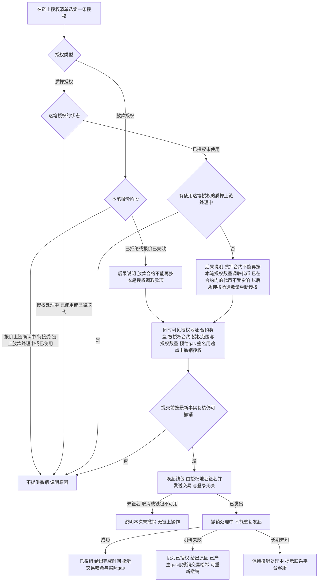

撤销不改变任何报价或项目的业务结论，不释放或增加任何占用，不发消息，也不是待处理事项。放款授权只收回本笔额度，同一放款地址对同一放款合约的其他待接受报价所需额度保留。平台外自行撤销的，按链上事实显示已撤销。每笔已发出的授权与撤销交易都记入该授权详情的[授权操作记录（D-MC-219）](./01-我的控制台-PRD.md#d-mc-219)，没有发出交易的不记。

## 我的报价记录状态（ST-MC-06）

关联[我的报价（F-MC-07）](./01-我的控制台-PRD.md#f-mc-07)；状态来源为授信报价模块[融资业务本模块状态（ST-CR-02）](../06-借贷广场-授信报价与接受拒绝/02-授信报价与接受拒绝-流程图与状态机.md#st-cr-02)与还款模块，控制台只读呈现。

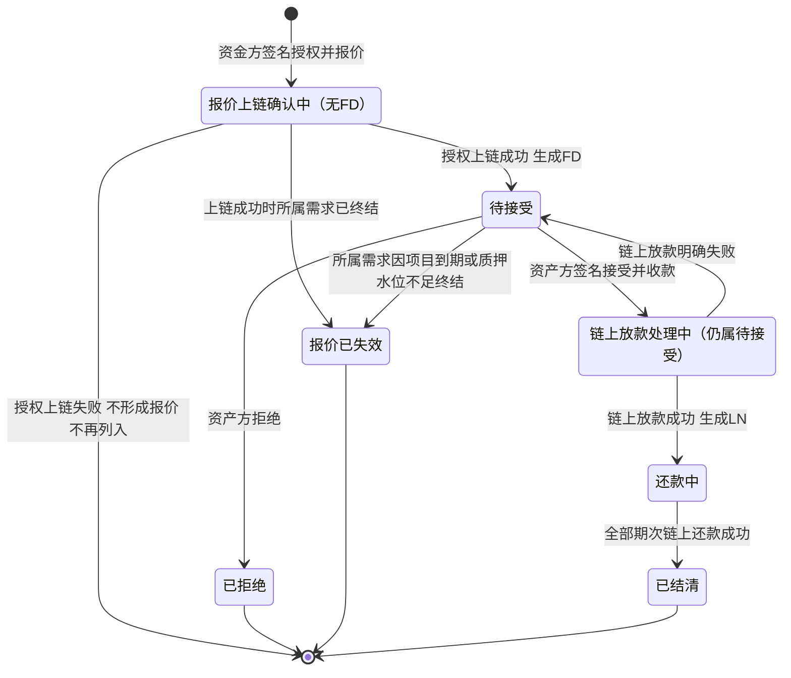

每条报价详情另带本笔链上授权状态，规则见[链上授权记录状态（ST-MC-07）](#st-mc-07)；已拒绝与报价已失效且仍为已授权时，可在链上授权清单撤销；待接受（含链上放款处理中）不能撤销（用户 2026-10-23 裁定）。撤销不改变本图的报价状态。清单不展示报价上链确认中、链上放款处理中、锁定或等待时长，报价时间独立显示；这些阶段仍保留记录，详情可读完整进展。报价第一步填写并签名确认报价信息（不上链）、不形成记录，不进入本图；报价上链确认中按用户 2026-10-23 裁定列入（[Q-MC-65](./01-我的控制台-PRD.md#q-mc-65)）。本状态机没有按时间自动发生的转移。

## 链上授权记录状态（ST-MC-07）

关联[链上授权（F-MC-14）](./01-我的控制台-PRD.md#f-mc-14)；验收见[链上授权验收](./04-我的控制台-验收.md#ac-section-14)。放款授权沿授信报价模块[本笔授权状态（ST-CR-04）](../06-借贷广场-授信报价与接受拒绝/02-授信报价与接受拒绝-流程图与状态机.md#st-cr-04)，质押授权的给出结果取融资需求与代币质押模块；撤销由控制台承载，规则以本册为准。

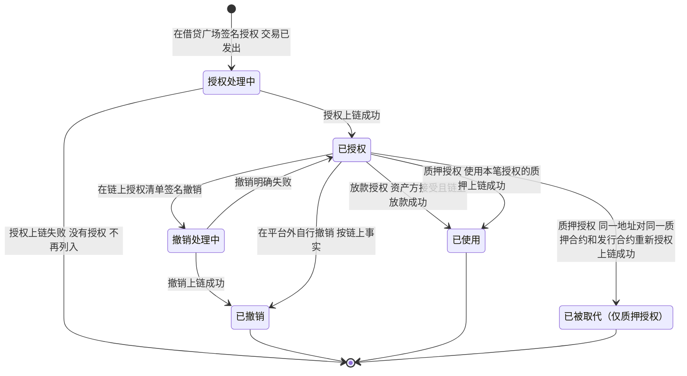

授权清单不展示本图的任何链上授权状态，也不展示授权时间；这些事实在详情完整读取，仍按授权时间排序且按最新状态限制撤销。

质押授权按[质押授权数量（D-MC-218）](./01-我的控制台-PRD.md#d-mc-218)给出：一笔授权只覆盖本次所选数量，质押上链成功即已使用；之后该地址新增的代币、追加质押，或撤销、已使用、已被取代之后再质押，都在借贷广场按当时所选数量重新授权，形成新的记录；已有已授权未使用且数量相同的授权时沿用，不形成新记录。已撤销、已使用、已被取代的记录保留供追溯，授权数量保持原值。放款授权在报价上链确认中、待接受（含链上放款处理中）时不可撤销，已使用的不可撤销；只有报价被拒绝或所属需求失效后才能撤销。
