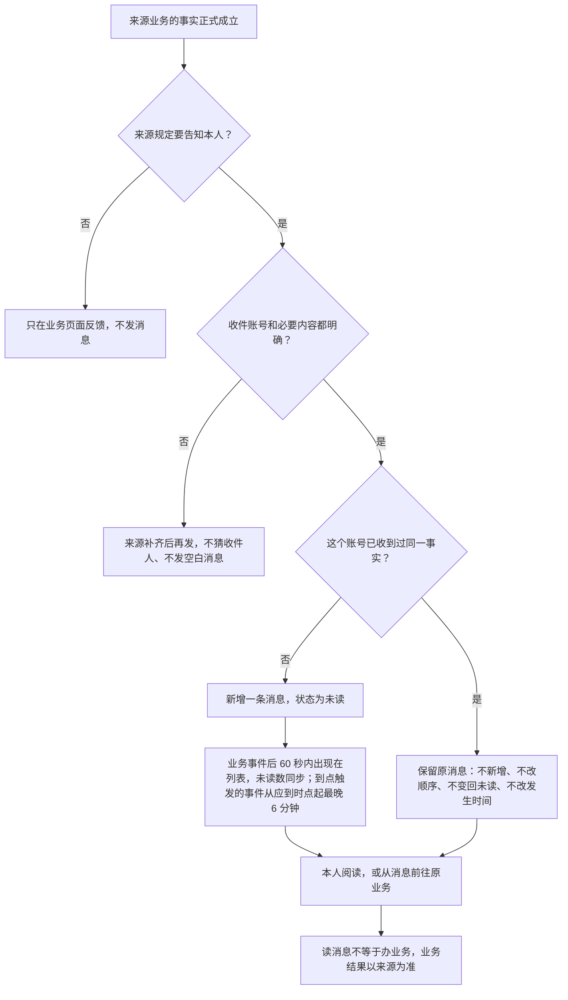
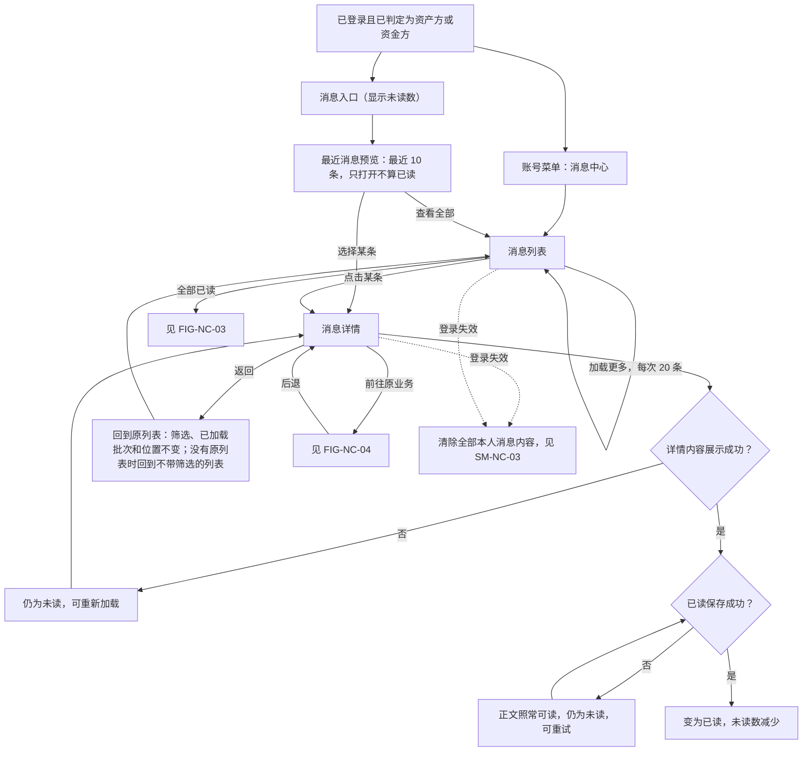
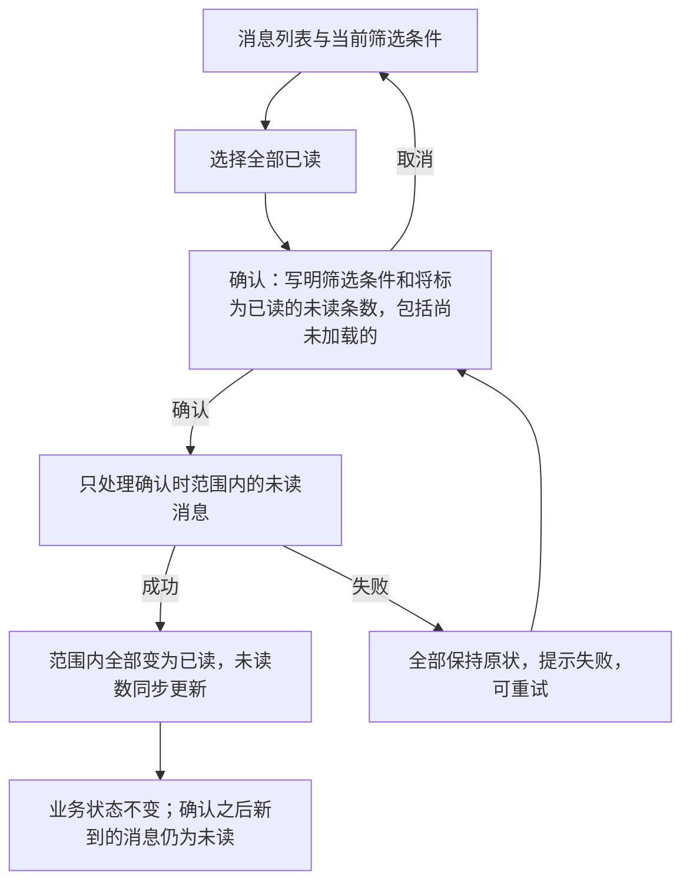
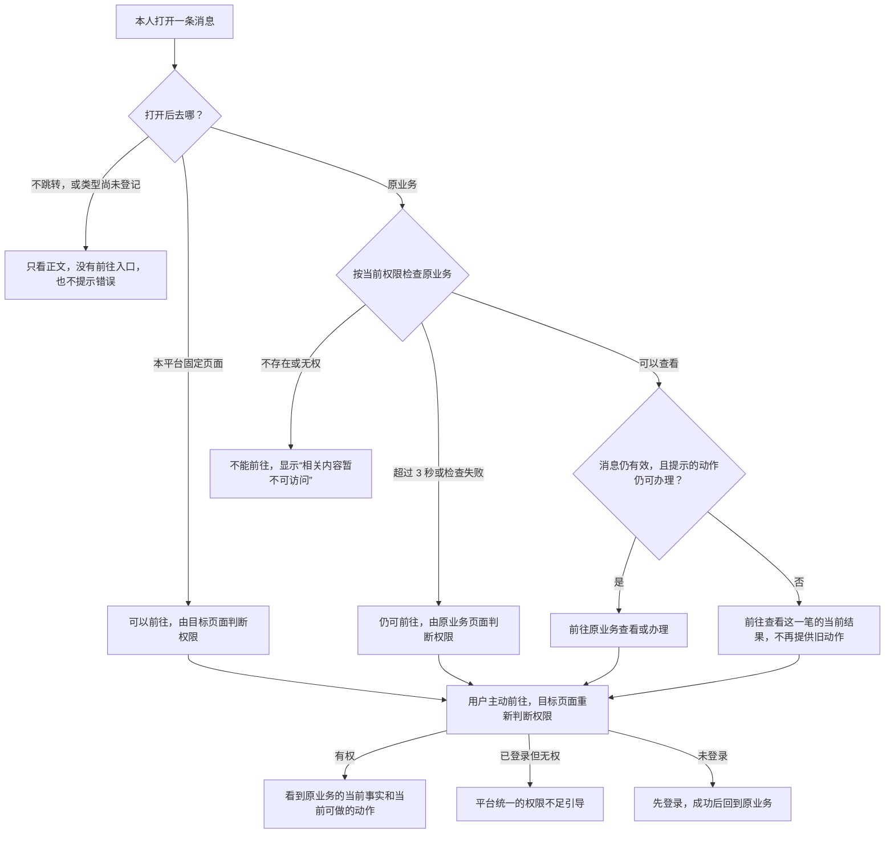
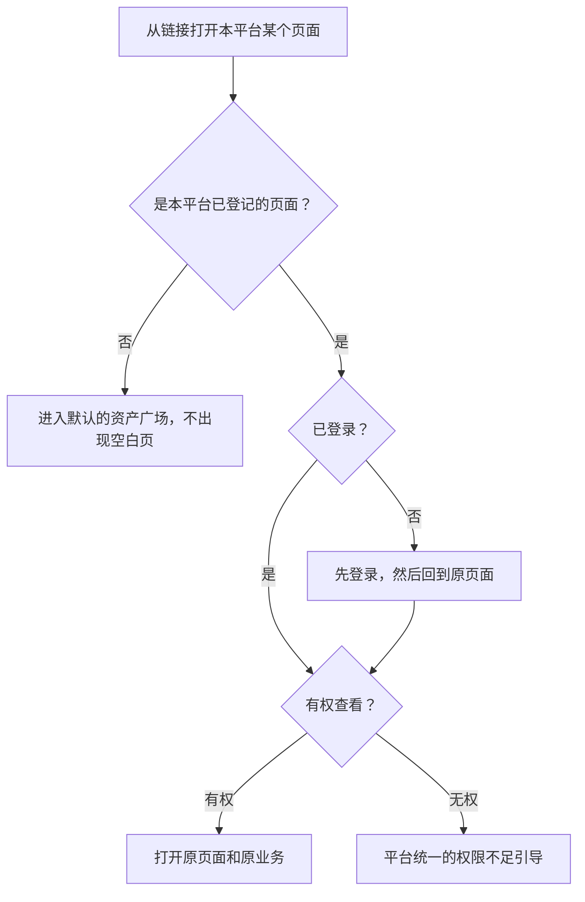
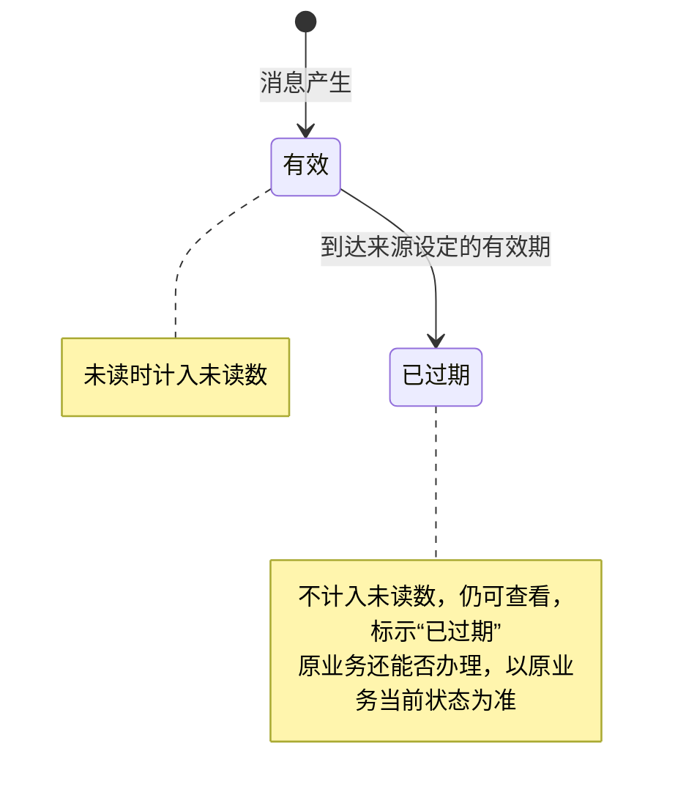
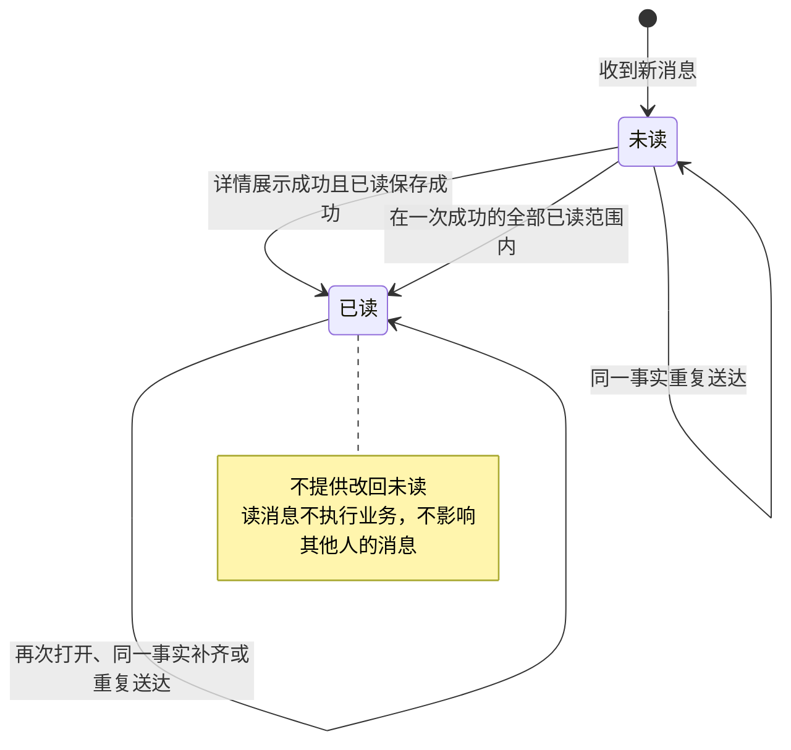
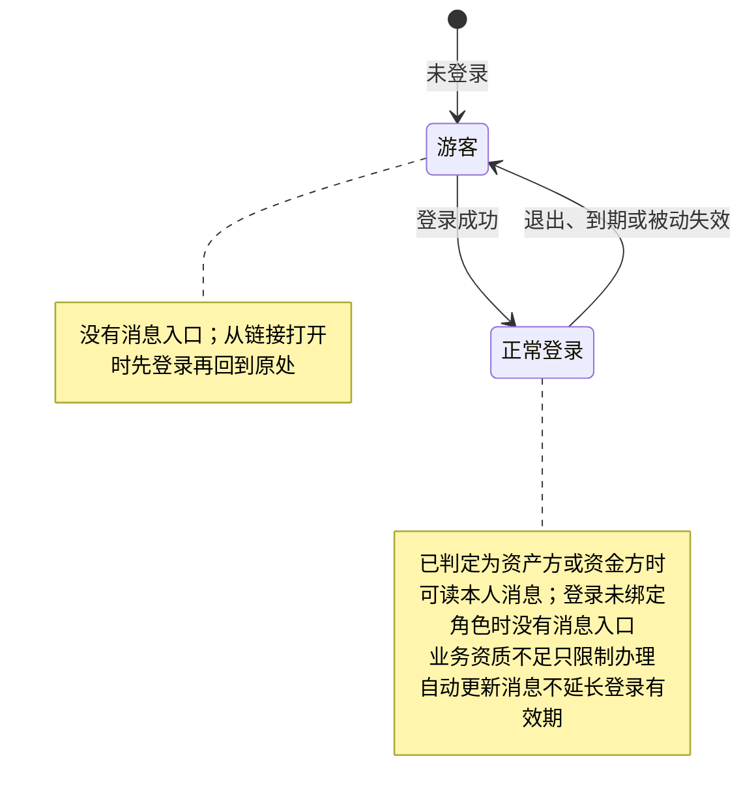

# 面客消息中心 · 流程图与状态机

2026-10-15｜需求评审稿

本册把[功能与业务规则](./01-面客消息中心-PRD.md)中的主要流程和状态画成图，规则以功能册为准。图中的方框是业务环节，不代表页面或组件，页面怎么承载由设计决定（见[统一条款](./01-面客消息中心-PRD.md#design-boundary)）。图中“原业务”指消息所说的那一笔业务，包括必要的原期次或原动作。

| 图 | 内容 | 对应功能 |
| --- | --- | --- |
| [FIG-NC-01](#fig-nc-01) | 一条消息从来源发出到本人阅读 | [第 3、4 节](./01-面客消息中心-PRD.md#f-nc-01) |
| [FIG-NC-02](#fig-nc-02) | 入口、列表、详情、已读与返回 | [第 5～7 节](./01-面客消息中心-PRD.md#f-nc-11) |
| [FIG-NC-03](#fig-nc-03) | 全部已读 | [第 7 节](./01-面客消息中心-PRD.md#f-nc-18) |
| [FIG-NC-04](#fig-nc-04) | 前往原业务 | [第 8 节](./01-面客消息中心-PRD.md#f-nc-23) |
| [FIG-NC-05](#fig-nc-05) | 从链接直接打开本平台页面 | [第 8 节](./01-面客消息中心-PRD.md#f-nc-23) |
| [SM-NC-01](#sm-nc-01) | 消息有效期 | [第 5 节](./01-面客消息中心-PRD.md#f-nc-11) |
| [SM-NC-02](#sm-nc-02) | 本人阅读状态 | [第 7 节](./01-面客消息中心-PRD.md#f-nc-18) |
| [SM-NC-03](#sm-nc-03) | 登录状态与能否看到消息 | [第 3、9 节](./01-面客消息中心-PRD.md#f-nc-27) |

## FIG-NC-01 一条消息从来源发出到本人阅读

同一笔业务上的新事实（新的一期、新的一轮、新的一次操作）各自是一条新消息。消息送达延迟不影响业务本身，也不顺延业务期限。

## FIG-NC-02 入口、列表、详情、已读与返回

## FIG-NC-03 全部已读

## FIG-NC-04 前往原业务

始终定位到消息所说的那一笔，不换成最新一笔、下一期或当前默认选中的业务。消息正文说的是当时的事实，原业务页面展示的是当前的事实。

## FIG-NC-05 从链接直接打开本平台页面

本期消息不跳转到其他平台；需要在其他平台办理的事项，按所属业务已确认的入口办理。

## SM-NC-01 消息有效期

一条消息是否仍在有效期内，与是否已读、原业务能否办理是三件互相独立的事。

没有设定有效期的消息一直有效。重复送达不会让过期的消息恢复有效。

## SM-NC-02 本人阅读状态

对象是一个收件账号的一条消息。

同一笔业务上的新事实是另一条新消息，不会把旧消息改回未读。消息过期只影响是否计入未读数，不改变是否读过。

## SM-NC-03 登录状态与能否看到消息

变为游客时，消息入口、未读数、预览、列表和详情同时清除，必须真正清除，之后迟到的数据也不再显示。
