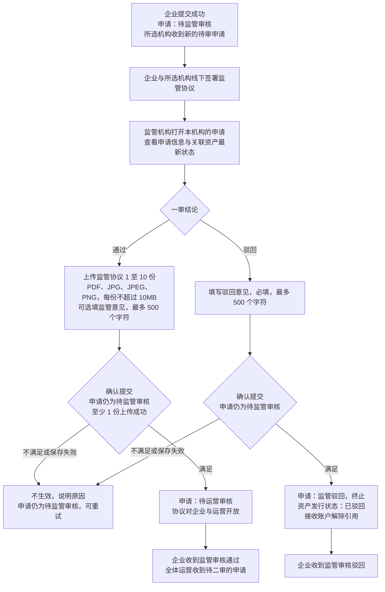
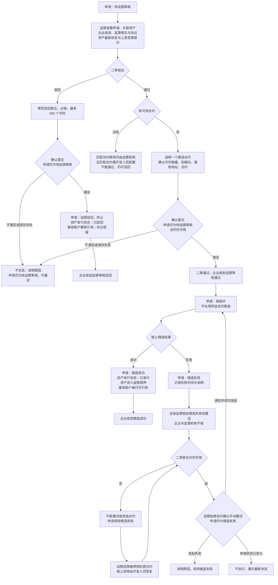
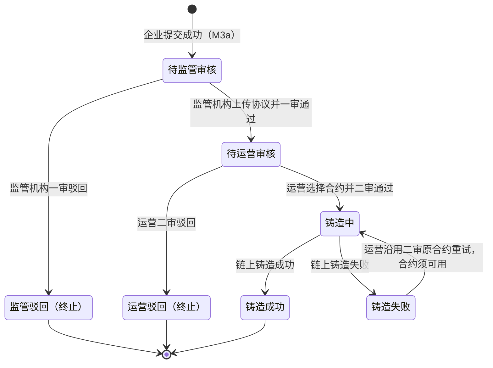
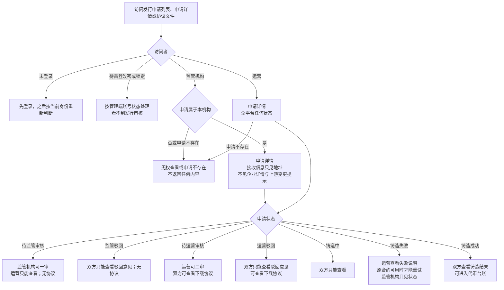

# 代币发行 · 审核与铸造 · 流程图与状态机

2026-10-30｜需求评审稿

本册把[功能与业务规则](./v1.0-代币发行-审核与铸造-PRD.md)中的主要流程与申请状态画成图，规则以功能册为准。图中方框是业务环节或业务状态，不代表页面或组件。

| 图 | 内容 | 对应功能 |
| --- | --- | --- |
| [监管一审（图 1）](#fig-1) | 监管机构上传协议后通过，或填写意见驳回 | [监管一审：上传协议并通过（R-ISSUE-04）](./v1.0-代币发行-审核与铸造-PRD.md#R-ISSUE-04)、[监管一审：驳回（R-ISSUE-05）](./v1.0-代币发行-审核与铸造-PRD.md#R-ISSUE-05) |
| [运营二审与铸造（图 2）](#fig-2) | 运营选择合约后通过并铸造，或驳回；铸造失败后手动重试 | [运营二审：选择铸造合约并通过（A-ISSUE-04）](./v1.0-代币发行-审核与铸造-PRD.md#A-ISSUE-04)、[运营二审：驳回（A-ISSUE-05）](./v1.0-代币发行-审核与铸造-PRD.md#A-ISSUE-05)、[铸造结果（A-ISSUE-06）](./v1.0-代币发行-审核与铸造-PRD.md#A-ISSUE-06)、[铸造失败手动重试（A-ISSUE-07）](./v1.0-代币发行-审核与铸造-PRD.md#A-ISSUE-07) |
| [发行申请状态（图 3）](#fig-3) | 简报第 5 节的申请状态、推动角色与资产发行状态的对应 | [申请状态与各角色看到的内容、能做的操作](./v1.0-代币发行-审核与铸造-PRD.md#status) |
| [查看申请与数据范围（图 4）](#fig-4) | 访问发行申请时的身份、范围与状态判断 | [谁能使用](./v1.0-代币发行-审核与铸造-PRD.md#access)、[申请详情（R-ISSUE-02、A-ISSUE-02）](./v1.0-代币发行-审核与铸造-PRD.md#R-ISSUE-02)、[查看与下载监管协议（R-ISSUE-03、A-ISSUE-03）](./v1.0-代币发行-审核与铸造-PRD.md#R-ISSUE-03) |

## 监管一审（图 1）

资产撤销确权、删除、结清或逾期均不自动拦截或终止申请；审核人按最新状态判断，规则见[审核期间资产状态变化](./v1.0-代币发行-审核与铸造-PRD.md#review-asset-change)。

## 运营二审与铸造（图 2）

可用合约须同时满足资产类型为应收账款、网络为 Ethereum、状态为启用（M6 现行同义名称为“可用”），见[可选合约范围](./v1.0-代币发行-审核与铸造-PRD.md#available-contracts)。

## 发行申请状态（图 3）

状态引用简报第 5 节，本模块不另行定义。初始状态为“待监管审核”；“监管驳回”“运营驳回”“铸造成功”是终态。

申请状态与资产发行状态的对应：待监管审核、待运营审核、铸造中、铸造失败对应“发行申请中”；监管驳回、运营驳回对应“已驳回”；铸造成功对应“已发行”，见[发行状态（图 2）](./v1.0-可信资产-流程图与状态机.md#fig-2)。

## 查看申请与数据范围（图 4）

