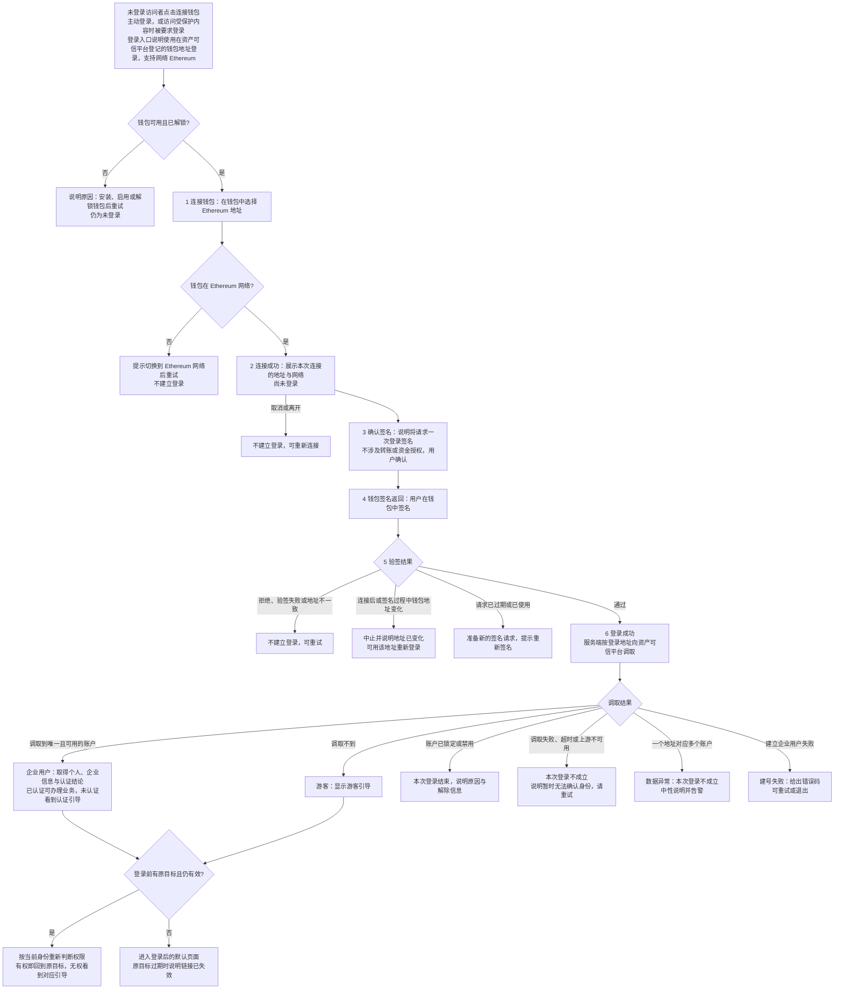
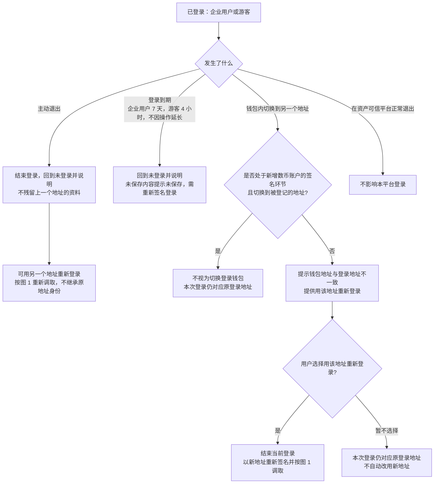
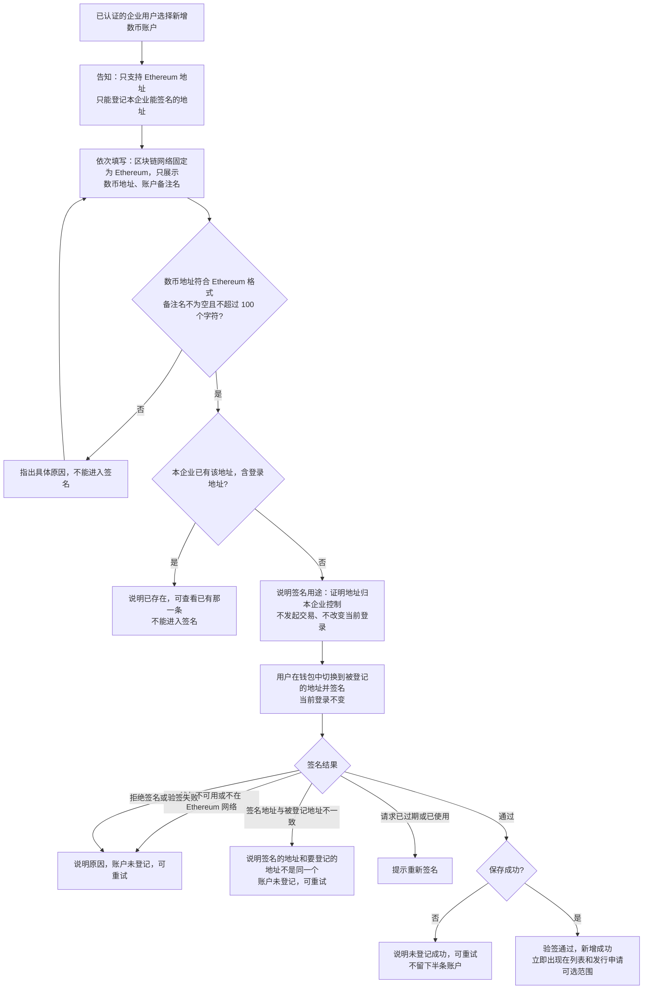
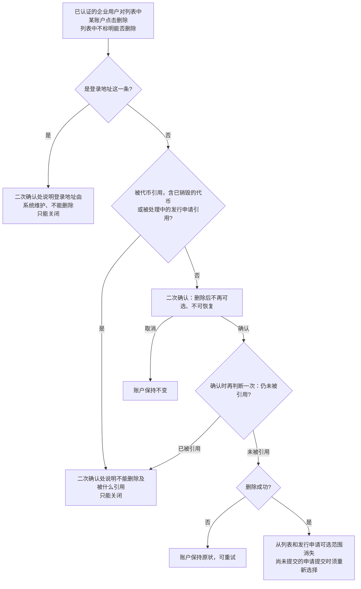
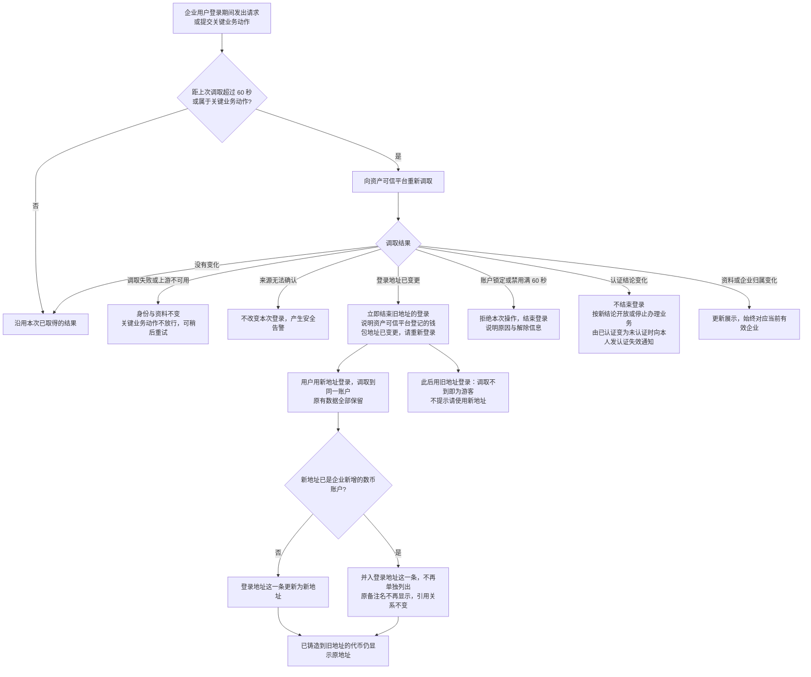
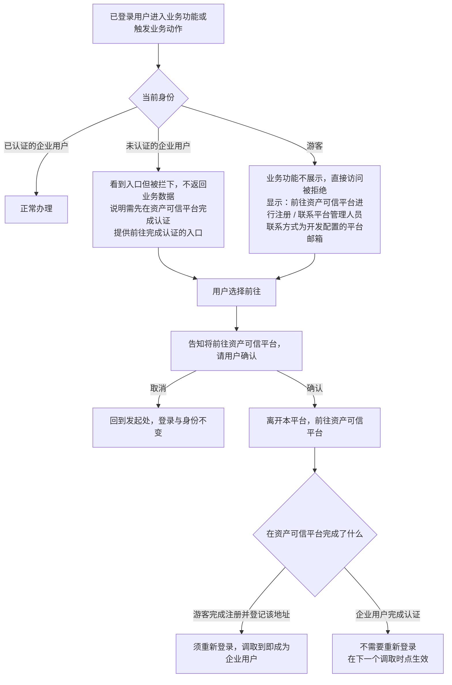
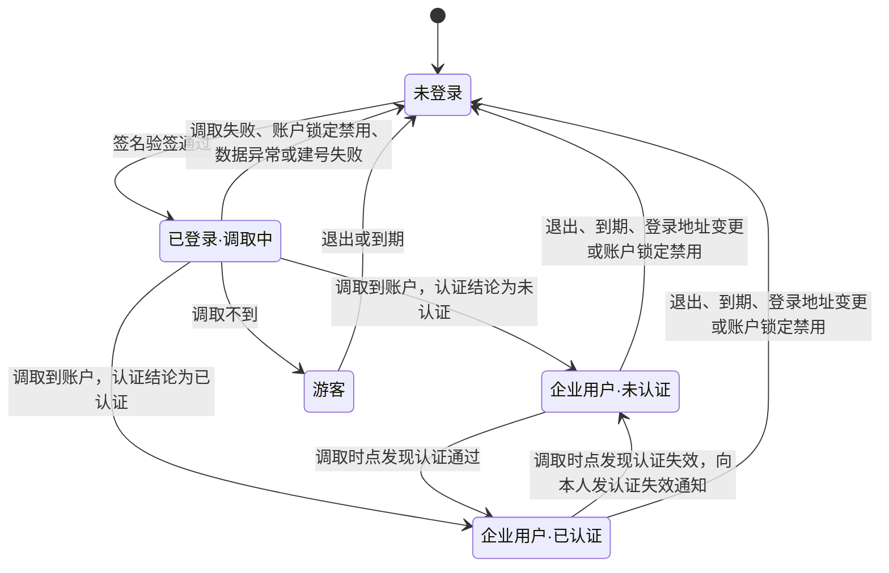
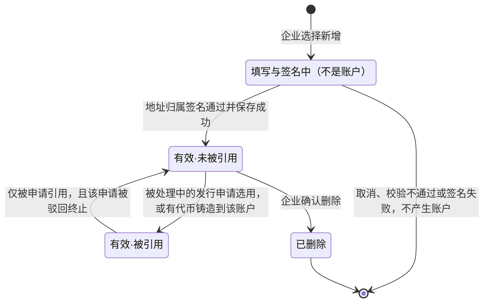

# 企业登录与企业账户 · 流程图与状态机

2026-10-29｜需求评审稿

本册把[功能与业务规则](./v1.0-企业登录与企业账户-PRD.md)中的主要流程与状态画成图，规则以功能册为准。图中方框是业务环节，不代表页面或组件。

| 图 | 内容 | 对应功能 |
| --- | --- | --- |
| [图 1](#fig-1) | 连接钱包、签名登录、按地址调取上游并成为企业用户或游客，再返回原目标 | [连接钱包与签名登录（C-AUTH-01）](./v1.0-企业登录与企业账户-PRD.md#C-AUTH-01)、[按地址匹配上游身份（C-AUTH-02）](./v1.0-企业登录与企业账户-PRD.md#C-AUTH-02)、[登录后返回原目标（C-AUTH-05）](./v1.0-企业登录与企业账户-PRD.md#C-AUTH-05) |
| [图 2](#fig-2) | 主动退出、换地址、登录期间钱包地址变化与登录到期 | [退出与切换钱包（C-AUTH-03）](./v1.0-企业登录与企业账户-PRD.md#C-AUTH-03) |
| [图 3](#fig-3) | 新增数币账户：填写、校验与地址归属签名 | [新增数币账户（C-ACCOUNT-02）](./v1.0-企业登录与企业账户-PRD.md#C-ACCOUNT-02) |
| [图 4](#fig-4) | 删除数币账户与引用判断 | [删除数币账户（C-ACCOUNT-04）](./v1.0-企业登录与企业账户-PRD.md#C-ACCOUNT-04) |
| [图 5](#fig-5) | 登录期间的调取时点，以及上游登录地址、账户可用性、认证结论变化后的处理 | [上游变化的同步（C-AUTH-06）](./v1.0-企业登录与企业账户-PRD.md#C-AUTH-06)、[数币账户列表与登录地址（C-ACCOUNT-01）](./v1.0-企业登录与企业账户-PRD.md#C-ACCOUNT-01) |
| [图 6](#fig-6) | 游客与未认证企业用户被拦下后的引导，以及前往资产可信平台的确认 | [认证资格与受限引导（C-AUTH-04）](./v1.0-企业登录与企业账户-PRD.md#C-AUTH-04)、[游客引导与功能限制（C-GUEST-01）](./v1.0-企业登录与企业账户-PRD.md#C-GUEST-01) |
| [面客端登录状态机](#state-1) | 访问者从未登录到企业用户或游客，再到退出 | [按地址匹配上游身份（C-AUTH-02）](./v1.0-企业登录与企业账户-PRD.md#C-AUTH-02)、[认证资格与受限引导（C-AUTH-04）](./v1.0-企业登录与企业账户-PRD.md#C-AUTH-04)、[退出与切换钱包（C-AUTH-03）](./v1.0-企业登录与企业账户-PRD.md#C-AUTH-03) |
| [数币账户状态机](#state-2) | 企业新增的数币账户从登记到删除 | [新增数币账户（C-ACCOUNT-02）](./v1.0-企业登录与企业账户-PRD.md#C-ACCOUNT-02)、[删除数币账户（C-ACCOUNT-04）](./v1.0-企业登录与企业账户-PRD.md#C-ACCOUNT-04) |

## 登录与身份判定（图 1）

## 退出、切换钱包与登录到期（图 2）

## 新增数币账户与地址归属签名（图 3）

未认证的企业用户进入数币账户时只看到认证引导，不能进入本流程，见[图 6](#fig-6)。

## 删除数币账户（图 4）

## 上游变化的同步（图 5）

## 受限引导与前往资产可信平台（图 6）

## 面客端登录状态机

- 初始状态是未登录；没有终态，退出后可再次登录。
- 企业用户的有效期为 7 天，游客为 4 小时，均自登录成功起计算，不因操作延长；认证状态在已认证与未认证之间变化时不重新计算有效期。
- 游客与企业用户之间不直接转换：游客在上游完成注册并登记该地址后，须退出并重新登录，经过一次签名与调取才成为企业用户。

## 数币账户状态机

- 只有“有效”的两个状态是账户，可在列表中查看、在发行申请中选用；两者都可以修改账户备注名。
- “有效·被引用”不能删除。有代币铸造到该账户后，不论代币之后是什么状态（包括已销毁），都不再回到“有效·未被引用”。
- 已删除是终态，不可恢复；需要时重新新增并签名，产生新的账户。
- 登录地址这一条不走本状态机：由系统列入，始终有效，不能编辑或删除，随上游登录地址变更而更新；新的登录地址与企业新增账户相同时，那条企业新增账户并入登录地址这一条。
