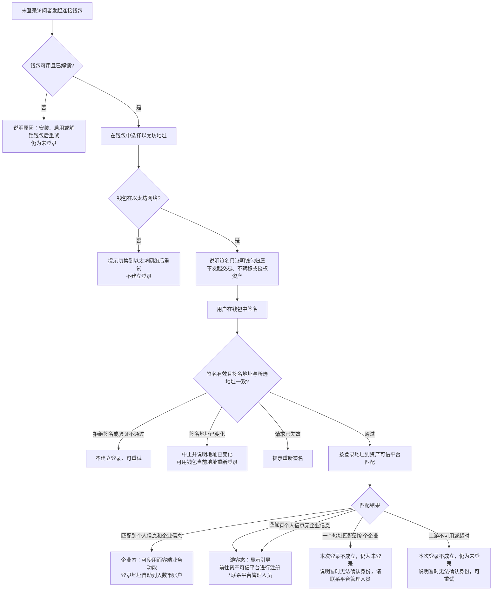
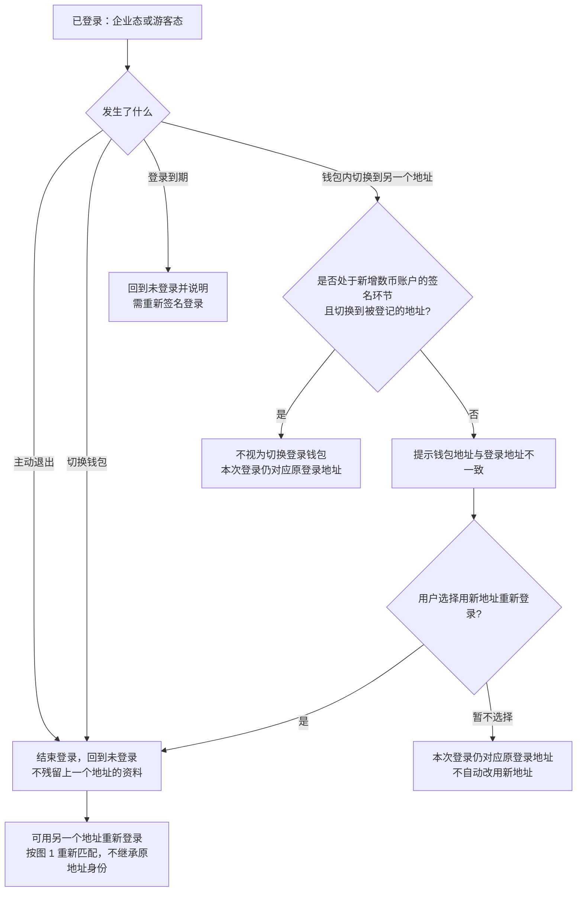
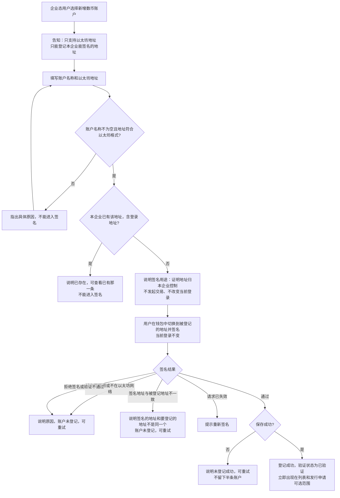
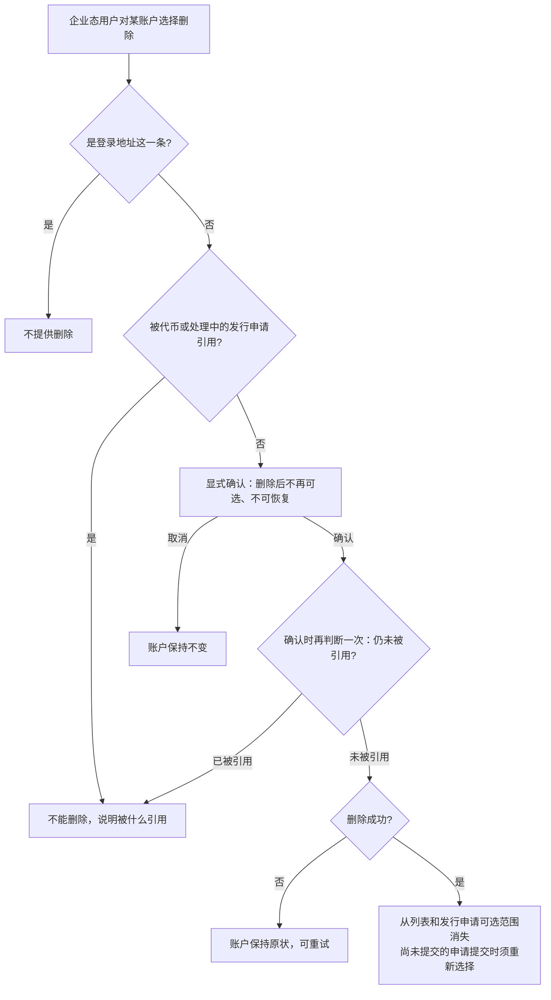
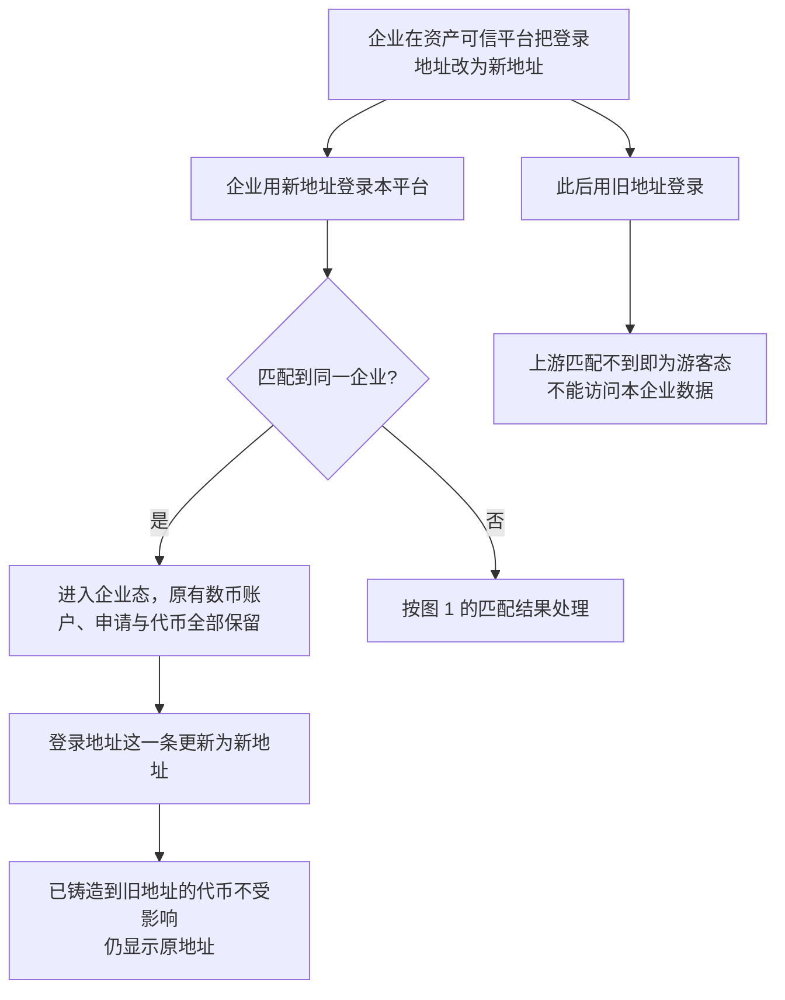
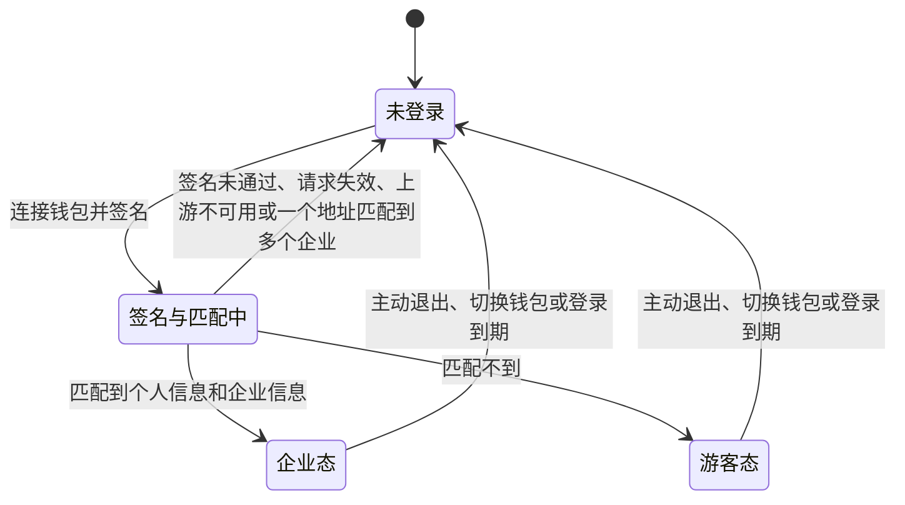
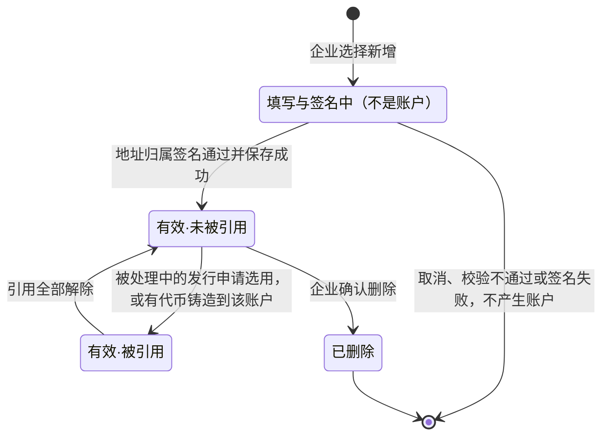

# 企业登录与企业账户 · 流程图与状态机

2026-10-29｜需求评审稿

本册把[功能与业务规则](./v1.0-企业登录与企业账户-PRD.md)中的主要流程与状态画成图，规则以功能册为准。图中方框是业务环节，不代表页面或组件。

| 图 | 内容 | 对应功能 |
| --- | --- | --- |
| [图 1](#fig-1) | 连接钱包、签名登录、按地址匹配上游并进入企业态或游客态 | [连接钱包与签名登录（C-AUTH-01）](./v1.0-企业登录与企业账户-PRD.md#C-AUTH-01)、[按地址匹配上游身份（C-AUTH-02）](./v1.0-企业登录与企业账户-PRD.md#C-AUTH-02)、[游客引导与功能限制（C-GUEST-01）](./v1.0-企业登录与企业账户-PRD.md#C-GUEST-01) |
| [图 2](#fig-2) | 主动退出、切换钱包、登录期间钱包地址变化与登录到期 | [退出与切换钱包（C-AUTH-03）](./v1.0-企业登录与企业账户-PRD.md#C-AUTH-03) |
| [图 3](#fig-3) | 新增数币账户：填写、校验与地址归属签名 | [新增数币账户（C-ACCOUNT-02）](./v1.0-企业登录与企业账户-PRD.md#C-ACCOUNT-02) |
| [图 4](#fig-4) | 删除数币账户与引用判断 | [删除数币账户（C-ACCOUNT-04）](./v1.0-企业登录与企业账户-PRD.md#C-ACCOUNT-04) |
| [图 5](#fig-5) | 上游登录地址变更后，登录地址这一条的同步 | [数币账户列表与登录地址（C-ACCOUNT-01）](./v1.0-企业登录与企业账户-PRD.md#C-ACCOUNT-01) |
| [面客端登录状态机](#state-1) | 访问者从未登录到企业态或游客态，再到退出 | [按地址匹配上游身份（C-AUTH-02）](./v1.0-企业登录与企业账户-PRD.md#C-AUTH-02)、[退出与切换钱包（C-AUTH-03）](./v1.0-企业登录与企业账户-PRD.md#C-AUTH-03) |
| [数币账户状态机](#state-2) | 企业新增的数币账户从登记到删除 | [新增数币账户（C-ACCOUNT-02）](./v1.0-企业登录与企业账户-PRD.md#C-ACCOUNT-02)、[删除数币账户（C-ACCOUNT-04）](./v1.0-企业登录与企业账户-PRD.md#C-ACCOUNT-04) |

## 登录与身份判定（图 1）

“有个人信息无企业信息”“一个地址匹配到多个企业”“上游不可用或超时”三条分支的口径待确认，见功能册[待确认事项](./v1.0-企业登录与企业账户-PRD.md#pending)。

## 退出、切换钱包与钱包地址变化（图 2）

登录有效期待确认，见功能册[登录有效期（Q-M1-01）](./v1.0-企业登录与企业账户-PRD.md#Q-M1-01)。

## 新增数币账户与地址归属签名（图 3）

## 删除数币账户（图 4）

“被代币引用”的范围待确认，确认前按任何状态的代币（含已销毁）处理，见功能册[被代币引用的范围（Q-M1-11）](./v1.0-企业登录与企业账户-PRD.md#Q-M1-11)。

## 登录地址变更后的同步（图 5）

登录期间何时发现变更、处理中申请的接收地址、新登录地址与已有账户重复三项待确认，见功能册[登录期间上游变化的生效时点（Q-M1-06）](./v1.0-企业登录与企业账户-PRD.md#Q-M1-06)、[登录地址变更对处理中申请的影响（Q-M1-08）](./v1.0-企业登录与企业账户-PRD.md#Q-M1-08)、[新登录地址与已有账户重复（Q-M1-09）](./v1.0-企业登录与企业账户-PRD.md#Q-M1-09)。

## 面客端登录状态机

- 初始状态是未登录；没有终态，退出后可再次登录。
- 企业态和游客态之间不直接转换：游客在上游完成注册后，须退出并重新登录，经过一次签名与匹配才进入企业态。
- 匹配到个人信息但没有企业信息时当前进入游客态，一个地址匹配到多个企业时回到未登录，两者口径见功能册[匹配结果异常的处理（Q-M1-03）](./v1.0-企业登录与企业账户-PRD.md#Q-M1-03)。

## 数币账户状态机

- 只有“有效”的两个状态是账户，可在列表中查看、在发行申请中选用；两者都可以修改账户名称。
- “有效·被引用”不能删除。申请被驳回终止即解除该申请的引用；按[被代币引用的范围（Q-M1-11）](./v1.0-企业登录与企业账户-PRD.md#Q-M1-11)当前口径，代币引用不会解除。
- 已删除是终态，不可恢复；需要时重新新增并签名，产生新的账户。
- 登录地址这一条不走本状态机：首次进入企业态时由系统列入，始终有效，不能编辑或删除，随上游登录地址变更而更新地址。
