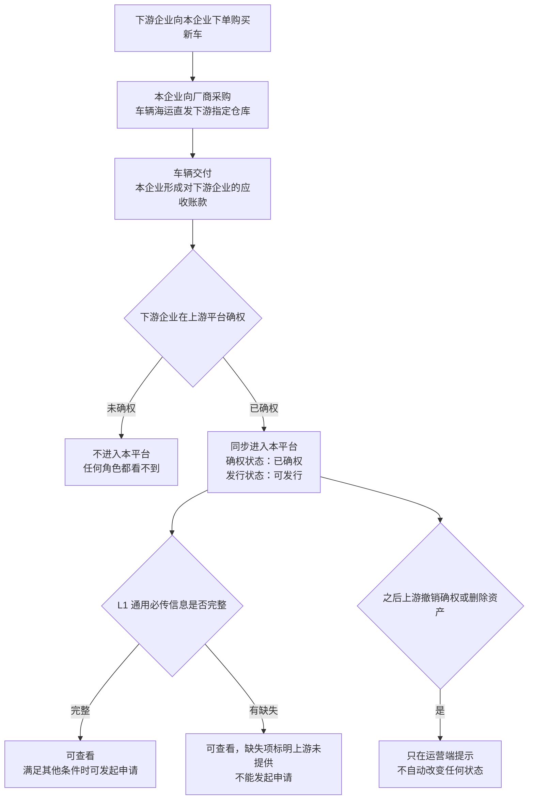
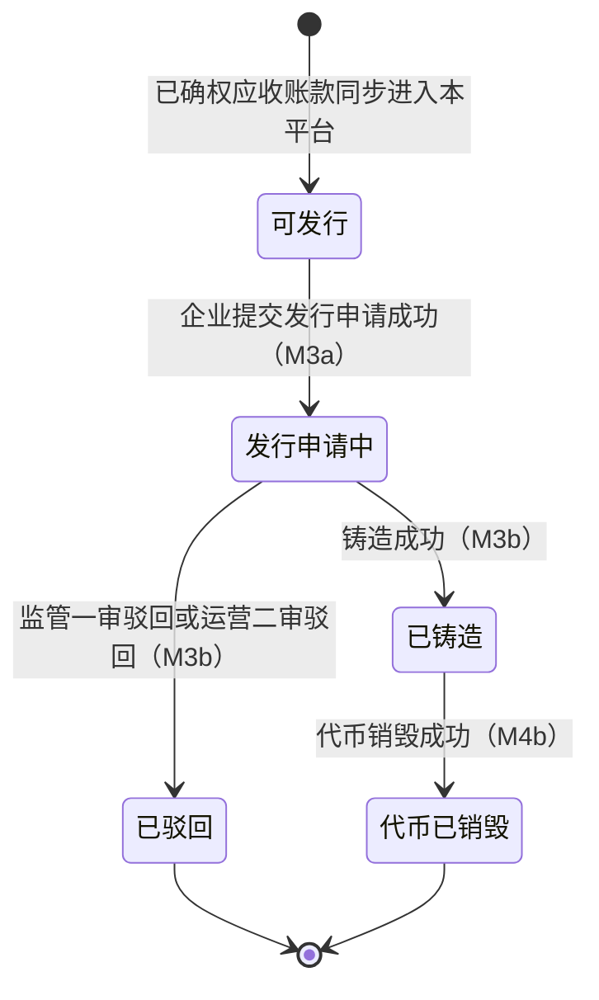
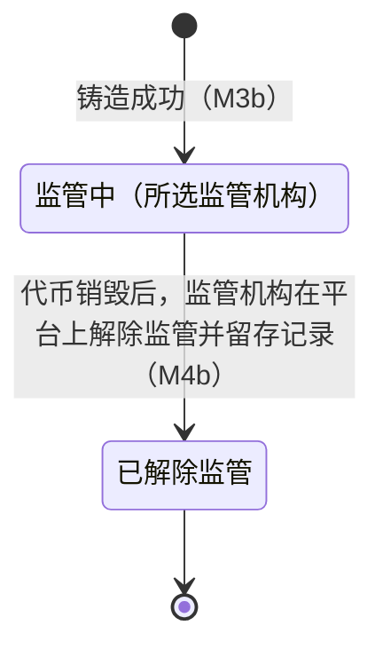
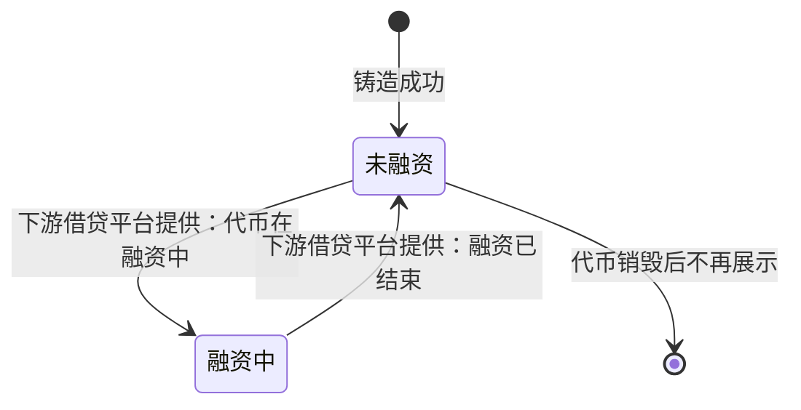
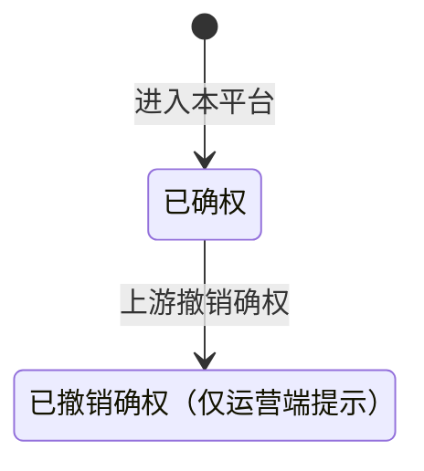
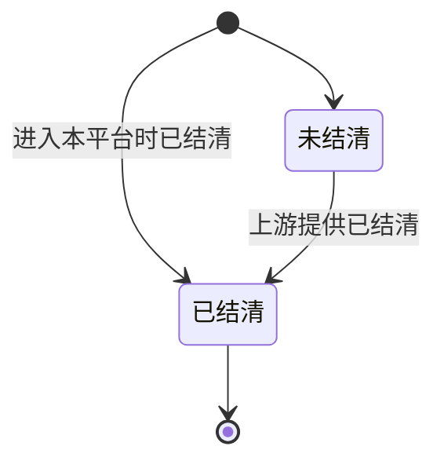
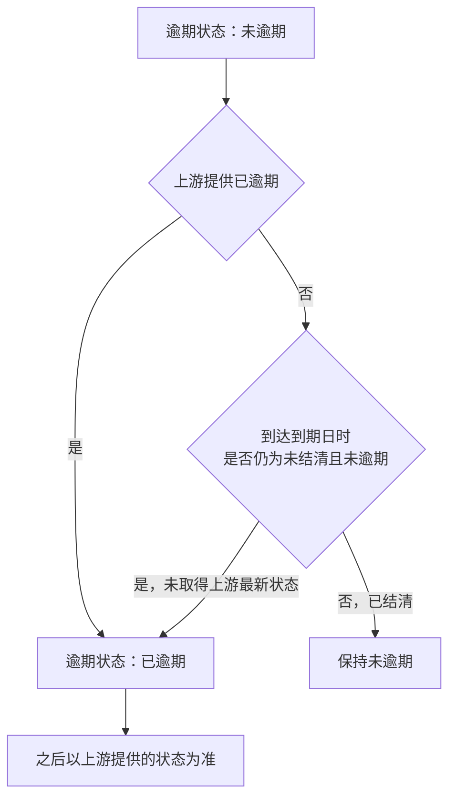
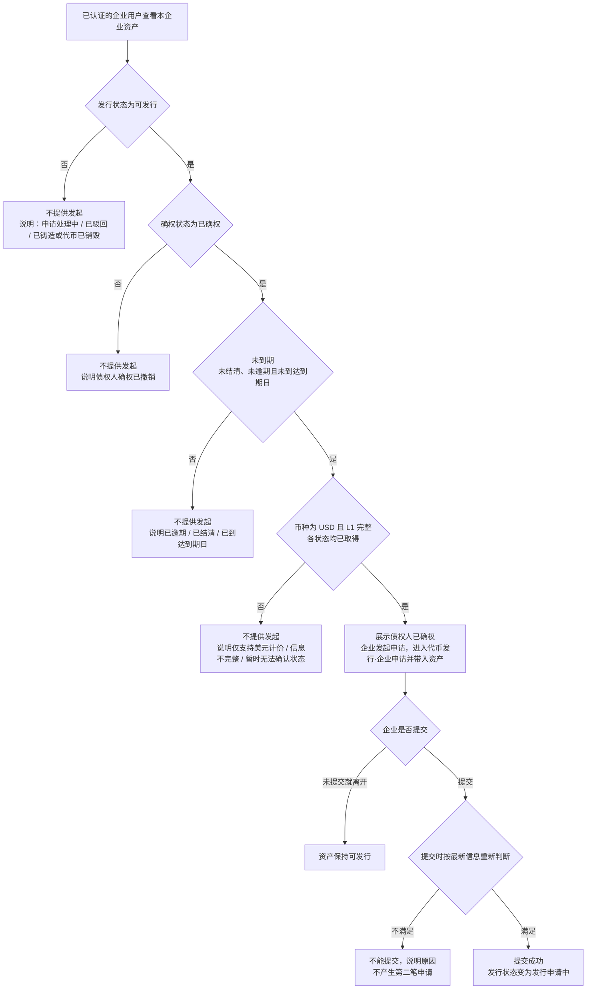
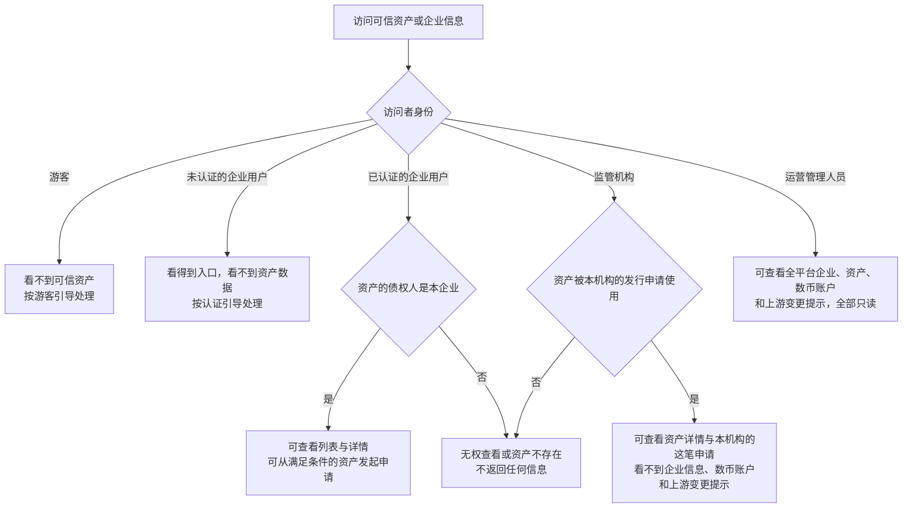

# 可信资产 · 流程图与状态机

2026-10-29｜需求评审稿

本册把[功能与业务规则](./v1.0-可信资产-PRD.md)中的主要流程与状态画成图，规则以功能册为准。图中方框是业务环节或业务状态，不代表页面或组件。资产的六个状态字段各自独立，分图表示。

| 图 | 内容 | 对应功能 |
| --- | --- | --- |
| [可信资产的来源与进入本平台（图 1）](#fig-1) | 应收账款从业务发生到同步进入本平台 | [资产进入本平台与信息结构（F-AS-01）](./v1.0-可信资产-PRD.md#F-AS-01) |
| [发行状态（图 2）](#fig-2) | 资产在发行、销毁流程中的发行状态与推动环节 | [发行状态](./v1.0-可信资产-PRD.md#issue-status) |
| [监管状态与融资状态（图 3）](#fig-3) | 铸造后的监管与融资状态 | [监管状态](./v1.0-可信资产-PRD.md#supervision)、[融资状态](./v1.0-可信资产-PRD.md#financing) |
| [确权、结清与逾期状态（图 4）](#fig-4) | 上游提供的三个状态及到期兜底 | [确权状态](./v1.0-可信资产-PRD.md#confirm-status)、[结清状态与逾期状态](./v1.0-可信资产-PRD.md#overdue) |
| [从可信资产发起发行申请（图 5）](#fig-5) | 企业发起申请时的条件判断与结果 | [从可信资产发起发行申请（F-AS-04）](./v1.0-可信资产-PRD.md#F-AS-04) |
| [各角色的查看范围（图 6）](#fig-6) | 企业、运营、监管机构能看到哪些资产与企业信息 | [企业查看本企业可信资产（F-AS-03）](./v1.0-可信资产-PRD.md#F-AS-03)、[运营查看企业与资产（F-AS-05）](./v1.0-可信资产-PRD.md#F-AS-05)、[监管机构查看关联资产（F-AS-06）](./v1.0-可信资产-PRD.md#F-AS-06) |

## 可信资产的来源与进入本平台（图 1）

## 发行状态（图 2）

初始状态为“可发行”；“已驳回”和“代币已销毁”是终态。铸造中、铸造失败待重试期间保持“发行申请中”；销毁申请审核中、被驳回、销毁中、销毁失败待重试期间保持“已铸造”。

## 监管状态与融资状态（图 3）

监管状态在铸造成功后才出现；融资状态只在发行状态为“已铸造”时展示，由下游借贷平台提供。监管状态的口径见[监管状态的口径（Q-AS-09）](./v1.0-可信资产-PRD.md#Q-AS-09)。

## 确权、结清与逾期状态（图 4）

三个状态都由上游平台提供，与发行、监管、融资状态互不推动。到期的时点见[到期的时点（Q-AS-08）](./v1.0-可信资产-PRD.md#Q-AS-08)。

## 从可信资产发起发行申请（图 5）

## 各角色的查看范围（图 6）

