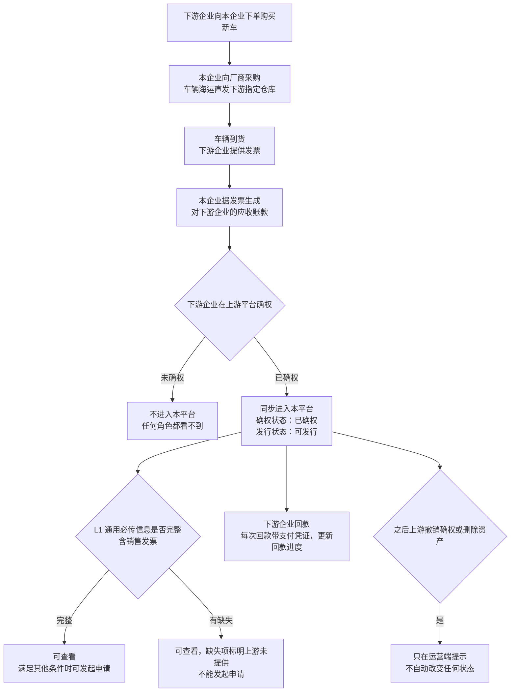
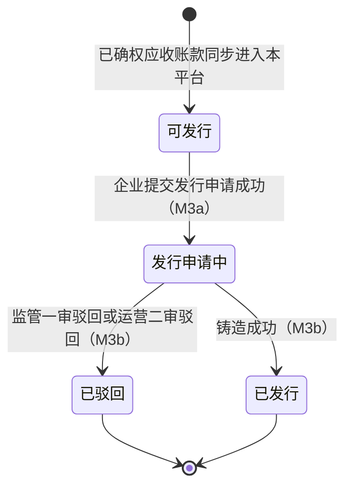
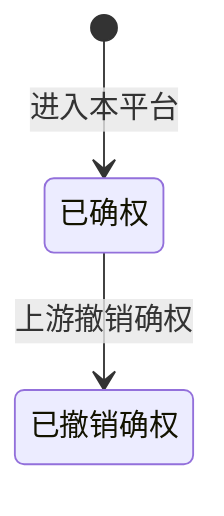
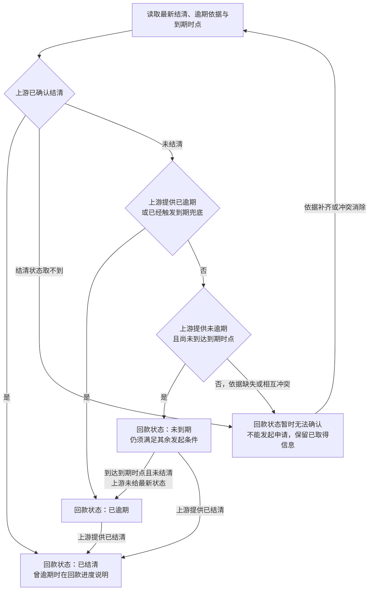
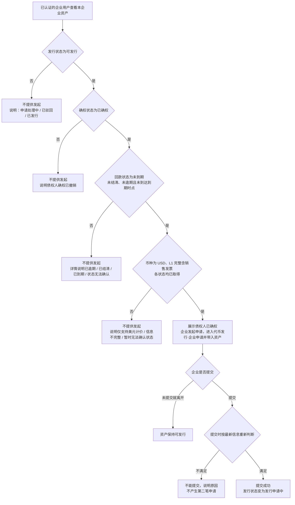
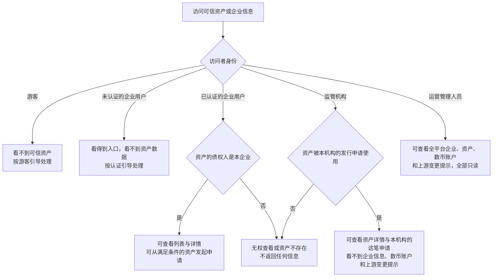

# 可信资产 · 流程图与状态机

2026-10-30｜需求评审稿

本册把[功能与业务规则](./v1.0-可信资产-PRD.md)中的主要流程与状态画成图，规则以功能册为准。图中方框是业务环节或业务状态，不代表页面或组件。资产统一展示确权、回款、发行三个状态，回款状态按上游结清、逾期依据归并。图号沿用原值，已删除的图不再占号，缺号不代表遗漏。

| 图 | 内容 | 对应功能 |
| --- | --- | --- |
| [可信资产的来源与进入本平台（图 1）](#fig-1) | 应收账款从业务发生到同步进入本平台，以及之后的回款 | [资产进入本平台与信息结构（F-AS-01）](./v1.0-可信资产-PRD.md#F-AS-01) |
| [发行状态（图 2）](#fig-2) | 资产的发行状态与推动环节 | [发行状态](./v1.0-可信资产-PRD.md#issue-status) |
| [确权与回款状态（图 4）](#fig-4) | 确权状态、回款状态归并及到期兜底 | [确权状态](./v1.0-可信资产-PRD.md#confirm-status)、[回款状态归并](./v1.0-可信资产-PRD.md#repayment-status) |
| [从可信资产发起发行申请（图 5）](#fig-5) | 企业发起申请时的条件判断与结果 | [从可信资产发起发行申请（F-AS-04）](./v1.0-可信资产-PRD.md#F-AS-04) |
| [各角色的查看范围（图 6）](#fig-6) | 企业、运营、监管机构能看到哪些资产与企业信息 | [企业查看本企业可信资产（F-AS-03）](./v1.0-可信资产-PRD.md#F-AS-03)、[运营查看企业与资产（F-AS-05）](./v1.0-可信资产-PRD.md#F-AS-05)、[监管机构查看关联资产（F-AS-06）](./v1.0-可信资产-PRD.md#F-AS-06) |

## 可信资产的来源与进入本平台（图 1）

## 发行状态（图 2）

初始状态为“可发行”；“已驳回”和“已发行”是终态。铸造中、铸造失败待重试期间保持“发行申请中”。代币铸造之后的监管、融资和销毁属于代币，不改变发行状态。

## 确权与回款状态（图 4）

确权、结清、逾期事实都由上游平台提供；回款状态归并表达当前结果，与发行状态互不推动。是否到期以上游提供的、带时区的到期时点为准，查看者所选时区只影响展示。

到期兜底与上游后续更新的关系以[结清与逾期依据](./v1.0-可信资产-PRD.md#overdue)为准；原始依据继续保留。已结清的资产不再因到期回到已逾期，先逾期后结清按当前已结清筛选。

## 从可信资产发起发行申请（图 5）

## 各角色的查看范围（图 6）

